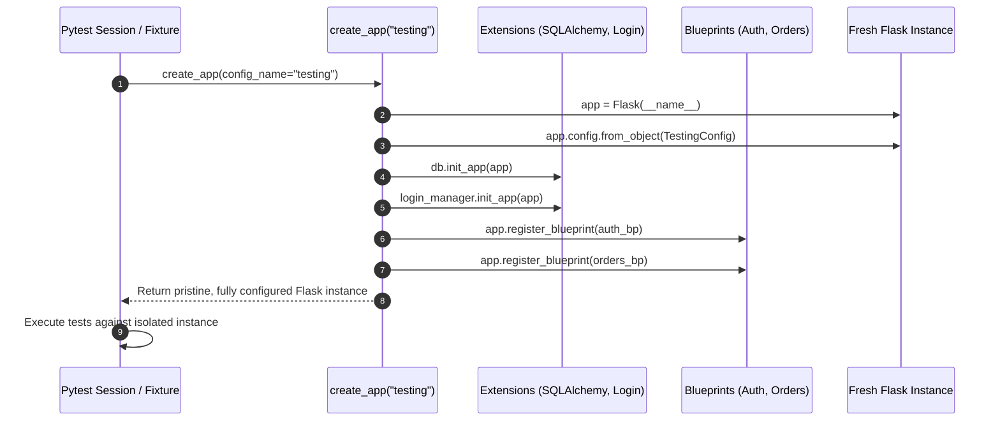

# Application Factory Testing (`create_app`) in Flask 🏭

> **Authoritative Sources & Literature:**
> - Pallets Projects: *Flask Application Factories Pattern* (flask.palletsprojects.com/en/latest/patterns/appfactories/)
> - Miguel Grinberg: *Flask Web Development: Developing Web Applications with Python* (Chapter 7: Large Application Structure)
> - David Lord: *Flask Configuration Handling & Factory Lifecycle* (palletsprojects.com)
> - Brian Okken: *Python Testing with pytest* (Chapter 3: Fixtures)

---

## 1. Conceptual Definition & Core Mental Model

In production Flask architectures, the **Application Factory Pattern** replaces a single, static global application instance (`app = Flask(__name__)`) with a factory function:
```python
def create_app(config_name_or_mapping=None) -> Flask:
    ...
```

### The Static Global App Anti-Pattern
When an application uses a static global `app` variable:
1. **Configuration Immutability**: All tests must share the exact same configuration loaded at import time. Switching to an ephemeral test database or disabling CSRF protection requires mutating global state.
2. **Circular Import Nightmares**: Blueprints, models, and extensions must import `app`, creating circular dependencies.
3. **Cross-Test Contamination**: State attached to extensions or the application object leaks from one test to the next.

### The Mental Model: Fresh, Isolated App Instances on Demand
With the Application Factory Pattern, your test runner can instantiate a brand-new, isolated `Flask` application object configured specifically for testing:
- `TESTING = True`: Enables exception propagation to pytest.
- `SQLALCHEMY_DATABASE_URI = "postgresql://test_db"`: Binds to the ephemeral test database.
- `WTF_CSRF_ENABLED = False`: Bypasses CSRF token validation during API testing.

```
                  ┌───────────────────────────────┐
                  │      create_app(config)       │
                  └───────────────┬───────────────┘
                                  │
         ┌────────────────────────┼────────────────────────┐
         │                        │                        │
         ▼                        ▼                        ▼
[ Dev Server Run ]       [ CI Integration Run ]    [ Unit Test Run ]
create_app("dev")        create_app("testing")     create_app({"TESTING": True})
- SQLite dev.db          - Postgres Container      - In-memory SQLite
- Debug toolbar          - Celery synchronous     - Mock email client
- CSRF active            - CSRF disabled           - Zero logging noise
```

---

## 2. Why This Is Critical in Modern Python Backend Engineering

1. **Absolute Test Isolation**: Every test or test module receives an isolated application instance with pristine extension states and zero configuration leakage.
2. **Dynamic Configuration Injection**: Tests can inject custom mock clients, override database URIs, or disable rate limits dynamically during `create_app()` invocation.
3. **Testing Multiple Configurations Simultaneously**: A single test suite can test how the application behaves under different feature flags or configurations (e.g. testing multi-region settings or tenant modes).

---

## 3. Internal Mechanics & Architectural Workflow



---

## 4. Standard Syntax, Signatures & Configuration

### Application Factory Implementation Structure

```python
# src/config.py
import os

class Config:
    SECRET_KEY = os.environ.get("SECRET_KEY", "prod-secret-key")
    SQLALCHEMY_TRACK_MODIFICATIONS = False
    WTF_CSRF_ENABLED = True
    TESTING = False

class DevelopmentConfig(Config):
    DEBUG = True
    SQLALCHEMY_DATABASE_URI = "sqlite:///dev.db"

class TestingConfig(Config):
    TESTING = True
    WTF_CSRF_ENABLED = False
    SQLALCHEMY_DATABASE_URI = os.environ.get("TEST_DATABASE_URL", "sqlite:///:memory:")
    SERVER_NAME = "localhost.localdomain"

CONFIG_MAP = {
    "development": DevelopmentConfig,
    "testing": TestingConfig,
    "default": DevelopmentConfig,
}
```

### The Factory Function

```python
# src/app.py
from typing import Optional, Union, Mapping, Any
from flask import Flask
from src.config import CONFIG_MAP, Config
from src.extensions import db, login_manager

def create_app(config: Union[str, Mapping[str, Any], None] = "default") -> Flask:
    app = Flask(__name__)

    # 1. Load Configuration
    if isinstance(config, str):
        app.config.from_object(CONFIG_MAP.get(config, CONFIG_MAP["default"]))
    elif isinstance(config, dict):
        app.config.from_object(CONFIG_MAP["default"])
        app.config.update(config)

    # 2. Lazy Extension Initialization
    db.init_app(app)
    login_manager.init_app(app)

    # 3. Register Blueprints
    from src.routes.users import users_bp
    from src.routes.orders import orders_bp
    app.register_blueprint(users_bp)
    app.register_blueprint(orders_bp)

    return app
```

---

## 5. Execution Lifecycle & Teardown Protocol

When testing an application factory:
1. **Creation**: Invoke `create_app("testing")` inside a pytest fixture.
2. **Context Setup**: Push an `app_context()` so extensions like SQLAlchemy can resolve `current_app`.
3. **Execution**: Yield the configured application to the test functions.
4. **Teardown**: Pop the context and let garbage collection reclaim the instance.

---

## 6. Scopes, Isolation & System Boundaries

| Configuration Parameter | Production Value | Testing Value | Impact on Tests |
| :--- | :--- | :--- | :--- |
| `TESTING` | `False` | `True` | Exceptions propagate to pytest rather than returning 500 HTML |
| `WTF_CSRF_ENABLED` | `True` | `False` | Disables CSRF token checks during API/Form POST testing |
| `SQLALCHEMY_DATABASE_URI` | Production Cluster | Ephemeral Test DB | Complete data isolation |
| `SERVER_NAME` | `api.company.com` | `localhost.localdomain` | Allows `url_for(..., _external=True)` without active request |

---

## 7. Pytest Fixture & conftest Integration

Here is the standardized application factory fixture suite for `tests/conftest.py`:

```python
# tests/conftest.py
import pytest
from typing import Generator
from flask import Flask
from flask.testing import FlaskClient
from src.app import create_app
from src.extensions import db

@pytest.fixture(scope="session")
def app() -> Generator[Flask, None, None]:
    """Session-scoped application factory fixture."""
    test_app = create_app(config="testing")

    with test_app.app_context():
        # Initialize schema once per session
        db.create_all()
        yield test_app
        db.drop_all()

@pytest.fixture
def client(app: Flask) -> FlaskClient:
    """Provides a fresh test client for each test function."""
    return app.test_client()
```

---

## 8. Step-by-Step Practical Python 3.10+ Walkthrough

Let's test an application factory to verify that it loads the correct configurations, initializes extensions, and respects runtime dictionary overrides.

### Step 1: Define Extensions and Blueprint
```python
# src/extensions.py
from flask_sqlalchemy import SQLAlchemy
from flask_login import LoginManager

db = SQLAlchemy()
login_manager = LoginManager()
```

### Step 2: Write Factory Architecture Tests
```python
# tests/test_app_factory.py
import pytest
from flask import Flask
from src.app import create_app
from src.config import TestingConfig, DevelopmentConfig

def test_create_app_with_testing_config():
    """Verifies that create_app('testing') sets the proper testing flags."""
    app = create_app("testing")

    assert app.config["TESTING"] is True
    assert app.config["WTF_CSRF_ENABLED"] is False
    assert "sqlite" in app.config["SQLALCHEMY_DATABASE_URI"]
    assert "users" in app.blueprints
    assert "orders" in app.blueprints

def test_create_app_with_custom_dictionary_overrides():
    """Verifies that passing a dictionary overrides specific config keys."""
    custom_overrides = {
        "TESTING": True,
        "CUSTOM_FEATURE_FLAG": True,
        "MAX_ITEMS_PER_PAGE": 50,
    }
    app = create_app(custom_overrides)

    assert app.config["TESTING"] is True
    assert app.config["CUSTOM_FEATURE_FLAG"] is True
    assert app.config["MAX_ITEMS_PER_PAGE"] == 50

def test_create_app_registers_extensions():
    """Verifies that extensions are initialized on the application object."""
    app = create_app("testing")

    # SQLAlchemy is registered under app.extensions
    assert "sqlalchemy" in app.extensions
    # LoginManager is registered
    assert "login_manager" in app.extensions
```

---

## 9. Framework & Ecosystem Integration: Testing Multiple App Instances Concurrently

A major strength of the factory pattern is the ability to test distinct application configurations within the same test module:

```python
# tests/test_multitenant_factories.py
import pytest
from src.app import create_app

def test_two_isolated_apps_do_not_interfere():
    # App 1: Tenant Alpha Configuration
    app_alpha = create_app({"TESTING": True, "TENANT_ID": "alpha", "TENANT_TIER": "FREE"})
    
    # App 2: Tenant Beta Configuration
    app_beta = create_app({"TESTING": True, "TENANT_ID": "beta", "TENANT_TIER": "ENTERPRISE"})

    assert app_alpha.config["TENANT_ID"] == "alpha"
    assert app_alpha.config["TENANT_TIER"] == "FREE"

    assert app_beta.config["TENANT_ID"] == "beta"
    assert app_beta.config["TENANT_TIER"] == "ENTERPRISE"

    # Verify clients are completely distinct
    client_alpha = app_alpha.test_client()
    client_beta = app_beta.test_client()
    assert client_alpha is not client_beta
```

---

## 10. Real-World Enterprise Scenario: Dynamic Database Overrides

When running tests against ephemeral Testcontainers or isolated test databases, the test harness passes the container's dynamic connection string directly to `create_app`:

```python
# tests/test_containerized_factory.py
import pytest
from testcontainers.postgres import PostgresContainer
from src.app import create_app

@pytest.fixture(scope="module")
def postgres_app():
    with PostgresContainer("postgres:16-alpine") as postgres:
        pg_url = postgres.get_connection_url()
        
        # Inject dynamic container URL into factory!
        app = create_app({
            "TESTING": True,
            "SQLALCHEMY_DATABASE_URI": pg_url
        })
        with app.app_context():
            from src.extensions import db
            db.create_all()
            yield app
            db.drop_all()
```

---

## 11. Anti-Patterns & Code Smells (Before vs After)

### Anti-Pattern 1: Top-Level Static `app = Flask(__name__)`
```python
# ❌ BEFORE: Global application instantiated at module level
# src/app.py
app = Flask(__name__)
app.config.from_envvar("SETTINGS")  # Fixed at import time! Hard to test!

# ✅ AFTER: Application factory function
# src/app.py
def create_app(config=None):
    app = Flask(__name__)
    ...
    return app
```

### Anti-Pattern 2: Eager Extension Initialization
```python
# ❌ BEFORE: Initializing extension with app immediately at module level
db = SQLAlchemy(app)  # Permanently binds db to that single static app!

# ✅ AFTER: Lazy initialization pattern
db = SQLAlchemy()  # Unbound

def create_app(config=None):
    app = Flask(__name__)
    db.init_app(app)  # Binds lazily to this specific app instance!
    return app
```

---

## 12. Best Practices & Production Guidelines

1. **Keep Extensions in a Dedicated `extensions.py`**: Initialize extension objects (`db = SQLAlchemy()`) without passing `app`. Use `init_app(app)` exclusively inside `create_app()`.
2. **Support String Names and Dict Mappings**: Allow `create_app("testing")` for standard configurations, and `create_app({"CUSTOM_KEY": "val"})` for ad-hoc test overrides.
3. **Always Disable CSRF in Testing**: Set `WTF_CSRF_ENABLED = False` in `TestingConfig` to streamline API and form submission testing.
4. **Use `SERVER_NAME` for External URL Generation**: Setting `SERVER_NAME = "localhost"` allows `url_for(..., _external=True)` to function outside of active HTTP requests.

---

## 13. Comprehensive Trade-Off Matrix

| Design Pattern | Setup Overhead | Test Isolation Fidelity | Supports Multiple Configs? |
| :--- | :--- | :--- | :--- |
| **Application Factory (`create_app`)** | Moderate (Small refactor) | **Absolute (Fresh instance per test)** | **✅ Yes (Dynamic overrides)** |
| **Global Static `app`** | Minimal (Initial script) | Low (Global state leaks) | ❌ No (Fixed at import) |
| **Monkeypatching Config** | High (Brittle teardown) | Moderate | ❌ Risky (Pollutes runner) |

---

## 14. Diagnostic & Troubleshooting Playbook

### Issue 1: `RuntimeError: The setup method 'register_blueprint' can no longer be called on the application`
- **Root Cause**: The application attempted to register a blueprint *after* the first HTTP request was handled.
- **Remediation**: Ensure all blueprints and extensions are registered inside `create_app()` before the function returns.

### Issue 2: `AssertionError: CSRF token missing` on POST tests
- **Root Cause**: `WTF_CSRF_ENABLED = False` was missing from `TestingConfig`.
- **Remediation**: Add `WTF_CSRF_ENABLED = False` to the test configuration.

---

## 15. Senior Staff Interview Questions & Answers

### Question 1: How does Flask's lazy extension initialization (`extension.init_app(app)`) resolve circular dependency issues in large applications?
**Answer**:
In monolithic Flask codebases, if an extension is bound at declaration time (`db = SQLAlchemy(app)`), `app` must be defined first. However, `app` must register blueprints (`app.register_blueprint(users_bp)`), and `users_bp` must import database models, which in turn must import `db`. This creates a classic circular dependency cycle (`app -> blueprint -> model -> db -> app`).
The lazy initialization pattern breaks this cycle:
1. `extensions.py` instantiates unbound objects: `db = SQLAlchemy()`.
2. Models import `db` safely because `db` does not depend on `app`.
3. Blueprints import models.
4. `create_app()` imports the blueprints and `db`, and binds everything together via `db.init_app(app)` and `app.register_blueprint(...)`.
In testing, this enables creating fresh application objects without tearing down or re-importing model modules.

### Question 2: Why should `url_for` with `_external=True` fail outside of an active HTTP request context unless `SERVER_NAME` is configured?
**Answer**:
Generating an external absolute URL (e.g., `https://api.company.com/reset-password`) requires knowing the scheme (`http`/`https`) and the host domain.
During a live HTTP request, Flask extracts the host from the WSGI `HTTP_HOST` header.
Outside of an active request (such as during test setup, CLI commands, or background tasks), there is no incoming HTTP request. Without `SERVER_NAME` defined in `app.config`, Flask has no domain to construct the URL and raises a `RuntimeError`. Configuring `SERVER_NAME = "localhost.localdomain"` in `TestingConfig` provides the fallback host required to generate absolute URLs deterministically.

---

## 16. Practical Hands-On Exercises & Challenges

### Exercise 1: Building a Feature-Flagged App Factory
1. Implement `create_app()` accepting a flag `enable_beta_routes=False`.
2. When `True`, register a `beta_bp` blueprint.
3. Write two tests proving the beta routes return 404 when disabled, and 200 when enabled.

### Exercise 2: Testing Configuration Fallbacks
1. Write a test asserting that if an unknown configuration name is passed (e.g. `create_app("unknown_env")`), the factory safely falls back to `default` with a logged warning.

---

## 17. Key Takeaways & Summary

- **The Application Factory Pattern is the foundation of robust Flask testing**, eliminating static global state.
- **Lazy extension initialization (`init_app`)** breaks circular import cycles and enables fresh test instances.
- **`TestingConfig` must set `TESTING = True` and `WTF_CSRF_ENABLED = False`** for reliable test execution.
- **Factory tests verify that blueprints, configurations, and extensions are wired correctly** before deployment.

---

## 18. Next Steps & Cross-References

- Next: [Route & Blueprint Testing](route-testing.md)
- [The Flask Test Client (`test_client`)](flask-test-client.md)
- [Flask Contexts: Application vs. Request Context](application-context.md)
- [Database Fixtures with Flask-SQLAlchemy](database-fixtures.md)
- [Authentication & Session Testing](authentication-testing.md)
