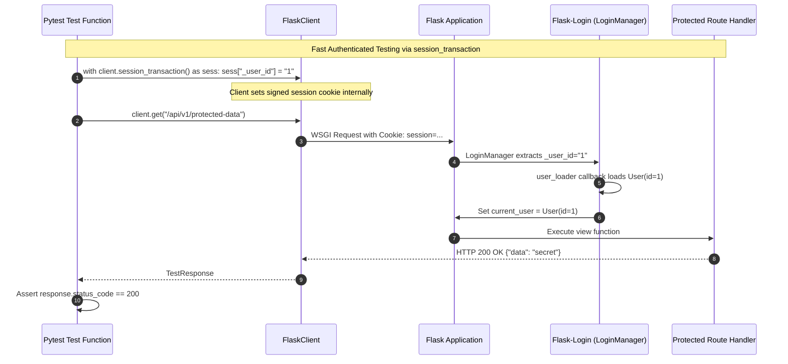

# Authentication & Session Testing in Flask 🛡️

> **Authoritative Sources & Literature:**
> - Pallets Projects: *Flask-Login Documentation & Security Principles* (flask-login.readthedocs.io)
> - Armin Ronacher: *itsdangerous: Cryptographic Signing of Untrusted Data* (itsdangerous.palletsprojects.com)
> - Flask-JWT-Extended Authors: *JWT Authentication in Flask* (flask-jwt-extended.readthedocs.io)
> - Brian Okken: *Python Testing with pytest* (Chapter 3: Fixtures & Scopes)

---

## 1. Conceptual Definition & Core Mental Model

In Flask backends, authentication is commonly implemented through two distinct paradigms:
1. **Stateful Session Cookies (Flask-Login)**: The client stores a cryptographically signed cookie (`session`). Flask verifies the signature using `app.secret_key` and restores `current_user`.
2. **Stateless Bearer Tokens (Flask-JWT-Extended)**: The client transmits an `Authorization: Bearer <jwt>` header on every request.

### The Testing Challenge
In automated test suites, testing security barriers without slowing down the suite requires:
- Avoiding slow form submissions for every test: using **`session_transaction()`** or a custom `login_user` test helper.
- Testing that unauthenticated requests to `@login_required` routes are rejected (HTTP 401 or HTTP 302 redirect to login).
- Testing CSRF validation boundaries without fighting token generators.

```
                  ┌──────────────────────────────────────────────┐
                  │             Incoming Test Request            │
                  └──────────────────────┬───────────────────────┘
                                         │
                   ┌─────────────────────┴─────────────────────┐
                   │                                           │
         Cookie Session Route?                       JWT Token Route?
                   │                                           │
                   ▼                                           ▼
   ┌───────────────────────────────┐           ┌───────────────────────────────┐
   │ Verify Signed Session Cookie  │           │ Verify Bearer Token Signature │
   │ (Signed via itsdangerous)     │           │ (Flask-JWT-Extended)          │
   └───────────────┬───────────────┘           └───────────────┬───────────────┘
                   │                                           │
         ┌─────────┴─────────┐                       ┌─────────┴─────────┐
         ▼                   ▼                       ▼                   ▼
     Valid?               Invalid?               Valid?               Invalid?
   Set current_user     Abort (401/302)        Set jwt_identity     Abort (401/422)
```

---

## 2. Why This Is Critical in Modern Python Backend Engineering

1. **Protecting Against Unauthorized Access**: Ensures that every protected route enforces `@login_required` or `@jwt_required()`, preventing unauthenticated access to sensitive resources.
2. **Detecting Cookie Tampering**: Verifies that Flask's `itsdangerous` cryptographic signing safely rejects altered session cookies.
3. **Validating Role-Based Barriers**: Ensures administrative endpoints reject authenticated regular users with `HTTP 403 Forbidden`.

---

## 3. Internal Mechanics & Architectural Workflow



---

## 4. Standard Syntax, Signatures & Configuration

### Prerequisites
```bash
pip install flask flask-login flask-jwt-extended pytest
```

### Core Security Patterns in Flask

```python
from flask import Flask, jsonify, request
from flask_login import LoginManager, UserMixin, login_required, current_user

login_manager = LoginManager()

class User(UserMixin):
    def __init__(self, user_id: str, is_admin: bool = False):
        self.id = user_id
        self.is_admin = is_admin

@login_manager.user_loader
def load_user(user_id: str):
    # In-memory lookup for example
    return User(user_id, is_admin=(user_id == "admin_1"))

@login_manager.unauthorized_handler
def unauthorized_callback():
    return jsonify(error="Authentication required"), 401
```

---

## 5. Execution Lifecycle & Teardown Protocol

Testing authentication flows should evaluate:
1. **Unauthenticated Access**: Verify missing credentials return `401 Unauthorized` (or `302 Found` redirect).
2. **Authenticated Access**: Verify valid session/token yields `200 OK`.
3. **Forbidden Access**: Authenticated user lacking privileges receives `403 Forbidden`.
4. **Logout Execution**: Verify calling logout invalidates session state.

---

## 6. Scopes, Isolation & System Boundaries

| Authentication Layer | Implementation | Test Invalidation Strategy |
| :--- | :--- | :--- |
| **Flask-Login Session** | Signed cookie storing `_user_id` | `with client.session_transaction() as sess: sess.clear()` |
| **Flask-JWT-Extended** | `Authorization: Bearer <jwt>` | Omit or transmit expired JWT |
| **CSRF Protection** | Flask-WTF token in form/header | Toggle `WTF_CSRF_ENABLED = False` in `TestingConfig` |

---

## 7. Pytest Fixture & conftest Integration

Here are the standardized fixtures for testing both Flask-Login and Flask-JWT-Extended:

```python
# tests/conftest.py
import pytest
from flask import Flask
from flask.testing import FlaskClient
from flask_jwt_extended import create_access_token
from src.app import create_app
from src.models import User

@pytest.fixture
def app():
    test_app = create_app(config="testing")
    with test_app.app_context():
        yield test_app

@pytest.fixture
def client(app: Flask) -> FlaskClient:
    return app.test_client()

@pytest.fixture
def auth_client(client: FlaskClient) -> FlaskClient:
    """Pre-authenticated test client using Flask-Login session injection."""
    with client.session_transaction() as sess:
        sess["_user_id"] = "user_standard_101"
        sess["_fresh"] = True
    return client

@pytest.fixture
def admin_client(client: FlaskClient) -> FlaskClient:
    """Pre-authenticated admin test client."""
    with client.session_transaction() as sess:
        sess["_user_id"] = "admin_user_001"
        sess["_fresh"] = True
    return client

@pytest.fixture
def jwt_headers(app: Flask):
    """Factory fixture for generating Flask-JWT-Extended Bearer headers."""
    def _create(identity: str = "test_user", claims: dict = None):
        with app.app_context():
            token = create_access_token(identity=identity, additional_claims=claims or {})
            return {"Authorization": f"Bearer {token}"}
    return _create
```

---

## 8. Step-by-Step Practical Python 3.10+ Walkthrough

Let's test an application with protected user profile and admin management endpoints.

### Step 1: Define Application Security and Routes
```python
# src/routes/secure_routes.py
from flask import Blueprint, jsonify, abort
from flask_login import login_required, current_user

secure_bp = Blueprint("secure", __name__, url_prefix="/api/v1")

@secure_bp.route("/profile", methods=["GET"])
@login_required
def get_profile():
    return jsonify(
        user_id=current_user.id,
        is_admin=current_user.is_admin
    ), 200

@secure_bp.route("/admin/settings", methods=["POST"])
@login_required
def update_admin_settings():
    if not current_user.is_admin:
        return jsonify(error="Administrative privileges required"), 403
    return jsonify(message="Settings updated successfully"), 200
```

### Step 2: Write Security Test Suite
```python
# tests/test_flask_security.py
import pytest
from flask import Flask
from flask.testing import FlaskClient
from src.routes.secure_routes import secure_bp
from src.extensions import login_manager
from src.models import User

@pytest.fixture
def app():
    test_app = Flask(__name__)
    test_app.config["TESTING"] = True
    test_app.config["SECRET_KEY"] = "super-secret-test-key"
    
    login_manager.init_app(test_app)
    
    @login_manager.user_loader
    def load_user(user_id):
        return User(user_id=user_id, is_admin=(user_id == "admin_user_001"))

    @login_manager.unauthorized_handler
    def unauthorized():
        return {"error": "Authentication required"}, 401

    test_app.register_blueprint(secure_bp)
    return test_app

def test_unauthenticated_request_rejected(client: FlaskClient):
    """Verifies that missing session cookie returns 401 Unauthorized."""
    response = client.get("/api/v1/profile")
    assert response.status_code == 401
    assert response.get_json()["error"] == "Authentication required"

def test_authenticated_standard_user_can_access_profile(client: FlaskClient):
    """Verifies that setting session cookie grants access to profile."""
    with client.session_transaction() as sess:
        sess["_user_id"] = "user_standard_101"

    response = client.get("/api/v1/profile")
    assert response.status_code == 200
    data = response.get_json()
    assert data["user_id"] == "user_standard_101"
    assert data["is_admin"] is False

def test_standard_user_forbidden_from_admin_route(client: FlaskClient):
    """Verifies that regular user receives 403 Forbidden on admin route."""
    with client.session_transaction() as sess:
        sess["_user_id"] = "user_standard_101"

    response = client.post("/api/v1/admin/settings")
    assert response.status_code == 403
    assert "Administrative privileges required" in response.get_json()["error"]

def test_admin_user_can_access_admin_route(client: FlaskClient):
    """Verifies that admin user receives 200 OK on admin route."""
    with client.session_transaction() as sess:
        sess["_user_id"] = "admin_user_001"

    response = client.post("/api/v1/admin/settings")
    assert response.status_code == 200
    assert response.get_json()["message"] == "Settings updated successfully"
```

---

## 9. Framework & Ecosystem Integration: Testing Flask-JWT-Extended

Testing JWT-protected APIs in Flask:

```python
# src/routes/jwt_routes.py
from flask import Blueprint, jsonify
from flask_jwt_extended import jwt_required, get_jwt_identity, get_jwt

jwt_bp = Blueprint("jwt_api", __name__, url_prefix="/api/jwt")

@jwt_bp.route("/protected", methods=["GET"])
@jwt_required()
def protected_jwt():
    current_identity = get_jwt_identity()
    claims = get_jwt()
    return jsonify(identity=current_identity, role=claims.get("role", "user")), 200
```

### Testing the JWT Endpoint
```python
# tests/test_jwt_routes.py
def test_jwt_route_without_token_returns_401(client: FlaskClient):
    response = client.get("/api/jwt/protected")
    assert response.status_code == 401

def test_jwt_route_with_valid_token(client: FlaskClient, jwt_headers):
    headers = jwt_headers(identity="ada_lovelace", claims={"role": "superadmin"})
    response = client.get("/api/jwt/protected", headers=headers)

    assert response.status_code == 200
    data = response.get_json()
    assert data["identity"] == "ada_lovelace"
    assert data["role"] == "superadmin"
```

---

## 10. Real-World Enterprise Scenario: Testing Cookie Tampering

Flask session cookies are cryptographically signed using `itsdangerous`. What happens if an attacker tampers with the cookie payload?

```python
# tests/test_cookie_tampering.py
def test_tampered_cookie_is_rejected(client: FlaskClient):
    # Set valid session
    with client.session_transaction() as sess:
        sess["_user_id"] = "user_1"

    # Capture raw cookie string from test client
    cookie_header = client.get_cookie("session")
    
    # Tamper with the raw cookie bytes!
    tampered_cookie = cookie_header.value[:-4] + "ABCD"
    client.set_cookie("session", tampered_cookie)

    # Dispatch request with forged cookie
    response = client.get("/api/v1/profile")
    
    # Assert signature mismatch causes cookie to be discarded and request rejected!
    assert response.status_code == 401
```

---

## 11. Anti-Patterns & Code Smells (Before vs After)

### Anti-Pattern 1: Performing Full Form Login in Every Test
```python
# ❌ BEFORE: Submitting POST /login on every single test (Extremely slow!)
def test_user_orders(client):
    client.post("/login", data={"username": "alice", "password": "pwd"})  # Wastes 50ms per test!
    resp = client.get("/orders")

# ✅ AFTER: Fast in-memory session injection
def test_user_orders(auth_client):
    # Session injected instantly in 0.1ms!
    resp = auth_client.get("/orders")
```

### Anti-Pattern 2: Hardcoding Secret Key in Production Config
```python
# ❌ BEFORE: Default hardcoded secret key
SECRET_KEY = "dev-secret"

# ✅ AFTER: Loaded from environment with test fallback
SECRET_KEY = os.environ.get("SECRET_KEY", "test-sentinel-key")
```

---

## 12. Best Practices & Production Guidelines

1. **Use `session_transaction()` for Test Speed**: Avoid executing full password hashing (`bcrypt`/`argon2`) during routine endpoint tests.
2. **Always Define `unauthorized_handler` for APIs**: Prevents HTML redirects (`302`) on API routes; returns structured `401 Unauthorized` JSON instead.
3. **Explicitly Set `_fresh = True`**: If using Flask-Login's `@fresh_login_required`, ensure `sess["_fresh"] = True` is populated in fixtures.
4. **Test Negative RBAC Boundaries**: Every protected resource must test both authorized and forbidden access paths.

---

## 13. Comprehensive Trade-Off Matrix

| Strategy | Speed per Test | Cryptographic Check | Use Case |
| :--- | :--- | :--- | :--- |
| **`session_transaction()`** | **$< 0.1\text{ms}$ (Instant)** | Bypasses login form | 95% of route & business logic tests |
| **Real `client.post("/login")`** | $\approx 30 - 80\text{ms}$ (Bcrypt) | Full Password Verification | Login endpoint tests only |
| **`flask-jwt-extended` Headers** | $< 0.5\text{ms}$ | Full JWT Signature Check | REST microservices & mobile APIs |

---

## 14. Diagnostic & Troubleshooting Playbook

### Issue 1: `AssertionError: response.status_code == 302 Found (Expected 401)`
- **Root Cause**: Flask-Login by default redirects unauthenticated users to `login_view`.
- **Remediation**: Register a custom `@login_manager.unauthorized_handler` that returns `jsonify(error="..."), 401`.

### Issue 2: `KeyError: '_user_id'` during session injection
- **Root Cause**: Using `sess["user_id"]` instead of Flask-Login's internal `sess["_user_id"]`.
- **Remediation**: Always use `sess["_user_id"]` with a leading underscore.

---

## 15. Senior Staff Interview Questions & Answers

### Question 1: How does Flask protect session cookies against tampering, and what are its security limitations?
**Answer**:
Flask's default session mechanism uses **client-side signed cookies** powered by the `itsdangerous` library:
1. Flask serializes the session dictionary (using JSON/pickle), compresses it, and computes a cryptographic HMAC-SHA1 signature using `app.secret_key`.
2. When the client transmits the cookie back, Flask recomputes the HMAC. If the signature matches, the session is trusted.
- **Security Limitations**:
  - **Data Exposure**: Client-side session cookies are *signed*, not *encrypted* by default. Any user can base64-decode the cookie payload and inspect the stored data.
  - **No Invalidation / Revocation**: If a cookie is stolen, the server cannot invalidate it until the timestamp expires, unless a server-side session store (e.g., Redis via Flask-Session) is introduced.
  - **Cookie Size**: Limited to 4KB by browser specifications.

### Question 2: Why should automated tests use `session_transaction()` rather than posting to the login route?
**Answer**:
Modern password hashing algorithms (Argon2id, Bcrypt, Scrypt) are deliberately designed to be computationally expensive (requiring 100,000 iterations or 64MB of RAM) to defeat brute-force attacks.
If a test suite with 200 integration tests submits a login form before every test, the runner wastes $10 - 20\text{ seconds}$ purely calculating CPU-bound password hashes.
`session_transaction()` operates at the WSGI client level: it bypasses the password hashing cost by directly setting the internal `_user_id` session key in memory, executing in $< 0.1\text{ms}$ while preserving 100% of the downstream authentication and authorization verification.

---

## 16. Practical Hands-On Exercises & Challenges

### Exercise 1: Testing Role-Based Route Decorators
1. Create a custom decorator `@role_required("MANAGER")`.
2. Write tests asserting that an unauthenticated caller receives 401, a user with role `MEMBER` receives 403, and role `MANAGER` receives 200.

### Exercise 2: Testing Fresh vs Non-Fresh Login
1. Use Flask-Login's `@fresh_login_required` on a password change route.
2. Write tests proving that a non-fresh session (`sess["_fresh"] = False`) is rejected, but setting `sess["_fresh"] = True` permits execution.

---

## 17. Key Takeaways & Summary

- **Flask-Login uses signed session cookies** (`itsdangerous`) to identify `current_user`.
- **Use `session_transaction()` for ultra-fast authenticated tests** without paying the CPU cost of password hashing.
- **Flask-JWT-Extended enables stateless token testing** via Bearer headers in `client.get(..., headers={...})`.
- **Always verify both 401 Unauthorized and 403 Forbidden** security boundaries.

---

## 18. Next Steps & Cross-References

- Next: [Database Fixtures with Flask-SQLAlchemy](database-fixtures.md)
- [The Flask Test Client (`test_client`)](flask-test-client.md)
- [Application Factory Testing (`create_app`)](application-factory-testing.md)
- [Flask Contexts: Application vs. Request Context](application-context.md)
- [Authentication & RBAC Testing](../integration-testing/authentication-testing.md)
