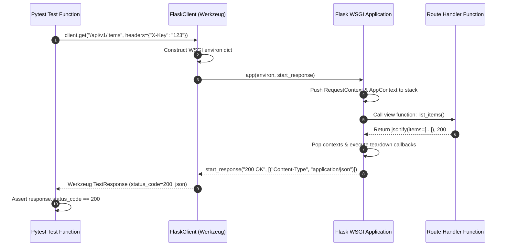

# The Flask Test Client (`test_client`) 🛠️

> **Authoritative Sources & Literature:**
> - Armin Ronacher: *Werkzeug Test Client Architecture & WSGI Environment Builder* (werkzeug.palletsprojects.com)
> - Pallets Projects: *Flask Testing Documentation* (flask.palletsprojects.com/en/latest/testing/)
> - Miguel Grinberg: *Flask Web Development: Developing Web Applications with Python* (Chapter 7: Large Application Structure)
> - Brian Okken: *Python Testing with pytest* (Chapter 4: Built-in Fixtures)

---

## 1. Conceptual Definition & Core Mental Model

In Flask, the **`test_client()`** method creates an in-memory HTTP test client backed by Werkzeug's WSGI Client.

### The In-Memory WSGI Dispatch Model
Unlike running a real Gunicorn or Waitress server listening on a TCP port, `test_client()` executes requests entirely in memory:
1. It translates test request arguments (URL, method, headers, JSON body, query parameters) into a standard **WSGI `environ` dictionary**.
2. It pushes the WSGI environment directly into the Flask application: `app(environ, start_response)`.
3. It packages the resulting status code, headers, and output stream into a `TestResponse` object.
Zero network overhead, zero port contention, and sub-millisecond execution speed.

```
       [ Pytest Test Function ]
                  │
                  │ client.post("/api/v1/users", json={"name": "Alice"})
                  ▼
   ┌─────────────────────────────────────────┐
   │ Werkzeug EnvironBuilder                 │
   │ Builds WSGI environ dictionary:         │
   │ {"REQUEST_METHOD": "POST", ...}         │
   └────────────────────┬────────────────────┘
                        │
                        ▼ (In-Memory WSGI Call)
   ┌─────────────────────────────────────────┐
   │ Flask Application WSGI Callable:        │
   │ app(environ, start_response)            │
   │ - Pushes Request Context                │
   │ - Executes Route Handler                │
   │ - Tears down Request Context            │
   └────────────────────┬────────────────────┘
                        │
                        ▼
   ┌─────────────────────────────────────────┐
   │ Werkzeug TestResponse                   │
   │ response.status_code == 201             │
   │ response.get_json() == {"id": 1}        │
   └─────────────────────────────────────────┘
```

---

## 2. Why This Is Critical in Modern Python Backend Engineering

1. **Sub-Millisecond Suite Velocity**: Tests execute within the same Python process in $1\text{ms}$ without socket creation or TCP handshakes.
2. **Session Cookie State Manipulation**: Werkzeug's `session_transaction()` allows tests to directly inspect and mutate encrypted signed session cookies without requiring automated browser logins.
3. **Context Preservation**: Running requests inside `with client:` keeps the Flask request context, `g` object, and template context alive *after* the request completes, permitting granular inspection.

---

## 3. Internal Mechanics & Architectural Workflow



---

## 4. Standard Syntax, Signatures & Configuration

### Prerequisites
```bash
pip install flask pytest pytest-flask
```

### Core `test_client` Methods & Arguments

```python
from flask import Flask, jsonify, request

app = Flask(__name__)

@app.route("/api/items", methods=["POST"])
def create_item():
    data = request.get_json()
    return jsonify(id=101, name=data["name"]), 201

# In tests:
client = app.test_client()

# 1. JSON Request
resp = client.post("/api/items", json={"name": "Toolkit"})
assert resp.status_code == 201
assert resp.get_json()["name"] == "Toolkit"

# 2. Form Data Request
resp = client.post("/login", data={"username": "alice", "password": "pwd"})

# 3. Query Parameters & Headers
resp = client.get("/search", query_string={"q": "flask", "page": 2}, headers={"X-Custom": "val"})

# 4. Accessing Raw Response Data
byte_data: bytes = resp.data
text_data: str = resp.text
json_data: dict = resp.get_json()
```

---

## 5. Execution Lifecycle & Teardown Protocol

### The Context Preserving Client (`with client:`)
By default, Flask destroys the request context (`request`, `g`, `session`) immediately after returning the response. If your test needs to inspect what variables were stored on `g` or which template was rendered:
- Wrap the request in `with client:`:

```python
with client:
    resp = client.get("/dashboard")
    from flask import g, session
    assert g.current_user.id == 1  # g is still accessible!
    assert session["logged_in"] is True
```

---

## 6. Scopes, Isolation & System Boundaries

| Attribute | `client.get()` (Default) | `with client:` (Context Preserving) |
| :--- | :--- | :--- |
| **Request Context Lifecycle** | Popped and destroyed upon return | Kept open until `with` block exits |
| **`g` Object Inspection** | ❌ Raises `RuntimeError` | ✅ Accessible |
| **Session Cookie Persistence** | Preserved across requests in same client | Preserved across requests |
| **Speed** | $\approx 1\text{ms}$ | $\approx 1\text{ms}$ |

---

## 7. Pytest Fixture & conftest Integration

```python
# tests/conftest.py
import pytest
from typing import Generator
from flask import Flask
from flask.testing import FlaskClient
from src.app import create_app

@pytest.fixture
def app() -> Generator[Flask, None, None]:
    """Provides a fresh, isolated Flask application instance configured for testing."""
    test_app = create_app(config_name="testing")
    with test_app.app_context():
        yield test_app

@pytest.fixture
def client(app: Flask) -> FlaskClient:
    """Provides a Werkzeug WSGI test client."""
    return app.test_client()
```

---

## 8. Step-by-Step Practical Python 3.10+ Walkthrough

Let's test an item inventory API with JSON serialization, query parameter filtering, and error handling.

### Step 1: Define Application Routes
```python
# src/routes/inventory.py
from flask import Blueprint, request, jsonify, abort

inventory_bp = Blueprint("inventory", __name__, url_prefix="/api/v1/inventory")

INVENTORY = {
    1: {"id": 1, "sku": "SKU-001", "name": "Laptop", "stock": 15},
    2: {"id": 2, "sku": "SKU-002", "name": "Mouse", "stock": 40},
}

@inventory_bp.route("", methods=["GET"])
def list_inventory():
    min_stock = request.args.get("min_stock", default=0, type=int)
    results = [item for item in INVENTORY.values() if item["stock"] >= min_stock]
    return jsonify(results), 200

@inventory_bp.route("", methods=["POST"])
def add_item():
    if not request.is_json:
        return jsonify(error="Content-Type must be application/json"), 415

    data = request.get_json()
    if "sku" not in data or "name" not in data or "stock" not in data:
        return jsonify(error="Missing required fields"), 400

    new_id = max(INVENTORY.keys(), default=0) + 1
    new_item = {"id": new_id, "sku": data["sku"], "name": data["name"], "stock": int(data["stock"])}
    INVENTORY[new_id] = new_item
    return jsonify(new_item), 201

@inventory_bp.route("/<int:item_id>", methods=["GET"])
def get_item(item_id: int):
    item = INVENTORY.get(item_id)
    if not item:
        return jsonify(error="Item not found"), 404
    return jsonify(item), 200
```

### Step 2: Write Comprehensive Test Cases
```python
# tests/test_inventory_client.py
import pytest
from flask import Flask
from flask.testing import FlaskClient
from src.routes.inventory import inventory_bp, INVENTORY

@pytest.fixture
def app():
    test_app = Flask(__name__)
    test_app.config["TESTING"] = True
    test_app.register_blueprint(inventory_bp)
    yield test_app

@pytest.fixture
def client(app):
    return app.test_client()

def test_list_inventory_with_query_params(client: FlaskClient):
    response = client.get("/api/v1/inventory", query_string={"min_stock": 20})
    assert response.status_code == 200
    items = response.get_json()
    assert len(items) == 1
    assert items[0]["name"] == "Mouse"

def test_add_item_success(client: FlaskClient):
    payload = {"sku": "SKU-003", "name": "Monitor", "stock": 25}
    response = client.post("/api/v1/inventory", json=payload)

    assert response.status_code == 201
    assert response.headers["Content-Type"] == "application/json"
    data = response.get_json()
    assert data["sku"] == "SKU-003"
    assert data["name"] == "Monitor"
    assert data["id"] in INVENTORY

def test_add_item_rejects_non_json(client: FlaskClient):
    # Sending plain text instead of JSON
    response = client.post(
        "/api/v1/inventory",
        data="sku=SKU-004",
        headers={"Content-Type": "text/plain"}
    )
    assert response.status_code == 415
    assert response.get_json()["error"] == "Content-Type must be application/json"

def test_add_item_validates_missing_fields(client: FlaskClient):
    response = client.post("/api/v1/inventory", json={"name": "Incomplete"})
    assert response.status_code == 400
    assert response.get_json()["error"] == "Missing required fields"

def test_get_item_not_found(client: FlaskClient):
    response = client.get("/api/v1/inventory/99999")
    assert response.status_code == 404
    assert response.get_json()["error"] == "Item not found"
```

---

## 9. Framework & Ecosystem Integration: Mutating Session with `session_transaction()`

In Flask applications that use secure cookie sessions, testing authenticated routes without performing a slow form login is achieved using `session_transaction()`:

```python
# src/routes/dashboard.py
from flask import Blueprint, session, jsonify

dashboard_bp = Blueprint("dashboard", __name__)

@dashboard_bp.route("/dashboard")
def dashboard():
    user_id = session.get("user_id")
    if not user_id:
        return jsonify(error="Unauthorized"), 401
    return jsonify(message=f"Welcome back user {user_id}"), 200

# Test directly mutating session cookie:
def test_authenticated_dashboard_via_session_transaction(client: FlaskClient):
    # Mutate session directly in test client!
    with client.session_transaction() as sess:
        sess["user_id"] = "user_vip_8849"

    # Now make request; test client automatically transmits signed session cookie!
    response = client.get("/dashboard")
    assert response.status_code == 200
    assert response.get_json()["message"] == "Welcome back user user_vip_8849"
```

---

## 10. Real-World Enterprise Scenario: Testing File Uploads in Flask

```python
# tests/test_flask_file_upload.py
import io
from flask.testing import FlaskClient

def test_csv_upload_endpoint(client: FlaskClient):
    # Construct in-memory byte buffer simulating a CSV file
    csv_bytes = b"id,name,role\n1,Ada,Engineer\n2,Charles,Architect"
    file_data = {
        "file": (io.BytesIO(csv_bytes), "employees.csv")
    }

    response = client.post(
        "/api/v1/upload-csv",
        data=file_data,
        content_type="multipart/form-data"
    )

    assert response.status_code == 200
    assert response.get_json()["rows_processed"] == 2
```

---

## 11. Anti-Patterns & Code Smells (Before vs After)

### Anti-Pattern 1: Using `json.loads(response.data)` Instead of `response.get_json()`
```python
# ❌ BEFORE: Manual decoding and parsing (Clunky, fails on empty bodies)
import json
data = json.loads(response.data.decode("utf-8"))

# ✅ AFTER: Built-in Werkzeug helper
data = response.get_json()
```

### Anti-Pattern 2: Forgetting to Set `TESTING = True`
```python
# ❌ BEFORE: Testing without TESTING flag (Exceptions get caught by 500 error handlers)
app = Flask(__name__)
# Errors in route code silently return HTML 500 pages rather than propagating to pytest!

# ✅ AFTER: Explicit TESTING configuration
app.config["TESTING"] = True
# Exceptions propagate directly to pytest, giving detailed Python tracebacks!
```

---

## 12. Best Practices & Production Guidelines

1. **Always Set `app.config["TESTING"] = True`**: Ensures unhandled exceptions propagate directly into pytest tracebacks rather than being caught by production HTTP 500 handlers.
2. **Use `query_string` Dictionary for GET Parameters**: Avoid manually concatenating URL strings like `f"/items?a={a}&b={b}"`. Pass `query_string={"a": a, "b": b}` to let Werkzeug handle URL encoding.
3. **Use `json=` Parameter for JSON Payloads**: Pass `json={"key": "val"}` to automatically set `Content-Type: application/json` and serialize data.
4. **Leverage `session_transaction()` for Speed**: Skip form login HTTP round-trips by directly populating session variables.

---

## 13. Comprehensive Trade-Off Matrix

| Strategy | Speed | Setup Complexity | Real Network Tested? |
| :--- | :--- | :--- | :--- |
| **`app.test_client()` (In-Memory)** | **$< 1\text{ms}$ (Ultra Fast)** | **Minimal (`app.test_client()`)** | ❌ Zero (In-memory WSGI) |
| **Live WSGI Server (Gunicorn)** | $\approx 30 - 80\text{ms}$ | High (Subprocess + Port) | ✅ Real TCP Socket |
| **Direct Route Function Call** | $< 0.1\text{ms}$ | High (Must fake `request`) | ❌ Bypasses WSGI stack |

---

## 14. Diagnostic & Troubleshooting Playbook

### Issue 1: `TypeError: 'NoneType' object is not callable` on `client.get()`
- **Root Cause**: The route handler did not return a valid response tuple or forgot a return statement.
- **Remediation**: Ensure every route returns `return jsonify(...), status_code`.

### Issue 2: `RuntimeError: Working outside of request context`
- **Root Cause**: The test attempted to inspect `request` or `g` after the request finished.
- **Remediation**: Enclose the request in a `with client:` block.

---

## 15. Senior Staff Interview Questions & Answers

### Question 1: How does Werkzeug's `test_client()` execute requests without opening a network socket?
**Answer**:
The WSGI standard (PEP 3333) specifies that a Python web application is simply a callable object accepting two arguments: `app(environ, start_response)`.
When `client.get("/users")` is called:
1. Werkzeug builds a Python dictionary called `environ` containing standard CGI keys (`REQUEST_METHOD: "GET"`, `PATH_INFO: "/users"`, `wsgi.input`, `HTTP_ACCEPT`).
2. It defines a callback function `start_response(status, response_headers)`.
3. It directly invokes `app(environ, start_response)` in-memory.
4. Flask processes the request, calls `start_response("200 OK", [...])`, and returns an iterable of response byte chunks.
5. Werkzeug collects these bytes into a `TestResponse` instance.
Because the entire exchange occurs via Python function calls and memory references, zero OS sockets are created, and execution completes in microseconds.

### Question 2: Why should `app.config["TESTING"] = True` always be enabled in automated test suites?
**Answer**:
Enabling `TESTING = True` activates several critical behaviors in Flask and Werkzeug:
1. **Exception Propagation**: In production, unhandled exceptions are caught by Flask's internal error handler, returning an opaque HTTP 500 HTML page. In testing mode, exceptions are **reraised directly into pytest**, giving the developer the exact Python traceback and line number of the failure.
2. **Error Logging**: Suppresses distracting console error logging for expected error status codes.
3. **Signal and Extension Activation**: Extensions like Flask-Mail or Flask-Login use `TESTING` to disable external network calls and enable test fixtures.

---

## 16. Practical Hands-On Exercises & Challenges

### Exercise 1: Testing Session Expiry & Mutation
1. Create a route `/profile` requiring `session["authenticated"] == True`.
2. Write a test setting this flag via `client.session_transaction()`.
3. Write a second test asserting that clear session returns `401 Unauthorized`.

### Exercise 2: Testing Multi-Cookie Response Parsing
1. Create a route that sets two separate cookies (`tracking_id` and `theme`).
2. Write a test asserting that `response.headers.getlist("Set-Cookie")` contains both cookie directives with proper attributes (`HttpOnly`, `SameSite=Lax`).

---

## 17. Key Takeaways & Summary

- **`app.test_client()` is the standard WSGI in-memory test runner** for Flask applications.
- **Always configure `TESTING = True`** so that unhandled exceptions propagate directly into pytest tracebacks.
- **Use `with client:` to preserve request context** for inspecting `g`, `session`, and template contexts.
- **`session_transaction()` provides instant authentication** without requiring automated login form submissions.

---

## 18. Next Steps & Cross-References

- Next: [Application Factory Testing (`create_app`)](application-factory-testing.md)
- [Flask Contexts: Application vs. Request Context](application-context.md)
- [Route & Blueprint Testing](route-testing.md)
- [Authentication & Session Testing](authentication-testing.md)
- [Database Fixtures with Flask-SQLAlchemy](database-fixtures.md)
