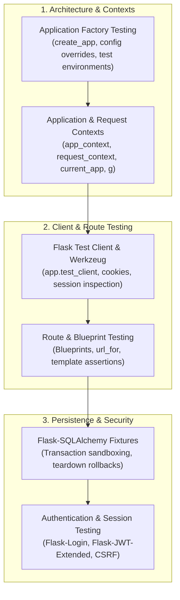

# Flask Backend Testing Architecture 🌶️

> **Authoritative Sources & Literature:**
> - Armin Ronacher & Pallets Projects: *Flask Testing Documentation* (flask.palletsprojects.com/en/latest/testing/)
> - Miguel Grinberg: *Flask Web Development: Developing Web Applications with Python* (O'Reilly)
> - David Lord: *Flask & Werkzeug Context Architecture & Test Client Design* (palletsprojects.com)
> - Brian Okken: *Python Testing with pytest* (Chapter 3: Fixtures & Chapter 5: Plugins)

---

## 📖 Module Overview

Flask remains one of the most widely deployed WSGI web frameworks in Python enterprise systems. While modern asynchronous frameworks like FastAPI dominate greenfield microservices, vast ecosystems of enterprise APIs, internal portals, and transactional services are powered by Flask.

Testing Flask applications requires mastering its distinct **synchronous WSGI architecture** and **thread-local context stack**:
- **The Application Factory Pattern (`create_app`)**: Dynamically configuring isolated application instances for testing.
- **The Dual Context Architecture**: Understanding the Application Context (`app_context()`, `current_app`, `g`) vs. the Request Context (`request_context()`, `request`, `session`).
- **The Werkzeug Test Client**: Executing in-process HTTP requests, managing session cookies, and inspecting headers.
- **Flask Extensions Testing**: Isolating Flask-SQLAlchemy, Flask-Login, and Flask-JWT-Extended inside automated test runs.

---

## 🗺️ Module Guides

### 1. [The Flask Test Client (`test_client`)](flask-test-client.md)
Master Werkzeug's WSGI `test_client`. Make GET, POST, PUT, DELETE requests, inspect response data, headers, cookies, and manage session cookies across multiple requests.

### 2. [Application Factory Testing (`create_app`)](application-factory-testing.md)
The bedrock of robust Flask testing. Structure applications to instantiate fresh, isolated application objects per test run with custom `TestingConfig` settings.

### 3. [Route & Blueprint Testing](route-testing.md)
Organize and test modular Blueprints. Verify dynamic routing, query parameter coercion, `url_for` route generation, and assert JSON/HTML response bodies.

### 4. [Flask Contexts: Application vs. Request Context](application-context.md)
Eliminate `RuntimeError: Working outside of application context` forever. Master `with app.app_context():` and `with app.test_request_context():`, understanding `g`, `current_app`, and `session`.

### 5. [Authentication & Session Testing](authentication-testing.md)
Test security barriers in Flask. Verify Flask-Login (`login_user`, `current_user`, `@login_required`), Flask-JWT-Extended, session cookie tampering, and CSRF token verification.

### 6. [Database Fixtures with Flask-SQLAlchemy](database-fixtures.md)
Integrate Flask-SQLAlchemy with pytest fixtures. Implement clean transactional rollback sandboxing in Flask's request teardown hooks to achieve millisecond database test isolation.

---

## 📊 Comparison: Flask WSGI vs. FastAPI ASGI Testing

| Dimension | Flask (WSGI) | FastAPI (ASGI) |
| :--- | :--- | :--- |
| **I/O Model** | Synchronous / Threaded | Asynchronous (`asyncio` / `anyio`) |
| **Test Client** | `app.test_client()` (Werkzeug) | `httpx.AsyncClient` (`ASGITransport`) |
| **Context Model** | Thread-local Context Stack (`g`, `request`) | Explicit Dependency Injection (`Depends`) |
| **Dependency Override** | `monkeypatch` / Factory config | Native `app.dependency_overrides` |
| **Startup / Teardown** | Factory function hooks | `@asynccontextmanager lifespan` |
| **Execution Speed** | $\approx 1 - 3\text{ms}$ per test | $< 0.5\text{ms}$ per test |

---

## ⏭️ Next Steps

Begin with **[The Flask Test Client](flask-test-client.md)** to establish core WSGI in-process testing workflows.
