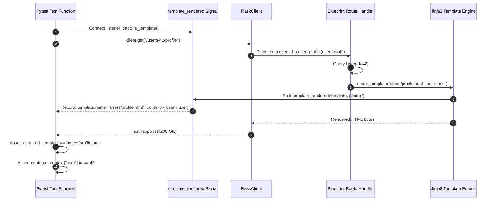

# Route & Blueprint Testing in Flask 🗺️

> **Authoritative Sources & Literature:**
> - Pallets Projects: *Flask Modular Applications with Blueprints* (flask.palletsprojects.com/en/latest/blueprints/)
> - Miguel Grinberg: *Flask Web Development: Developing Web Applications with Python* (Chapter 7: Large Application Structure)
> - Armin Ronacher: *Flask Signals & Context Locals Architecture* (palletsprojects.com)
> - Brian Okken: *Python Testing with pytest* (Chapter 5: Parametrization & Fixtures)

---

## 1. Conceptual Definition & Core Mental Model

In enterprise Flask systems, endpoints are organized into **Blueprints**—modular, reusable collections of routes, templates, error handlers, and middleware that are registered onto the application with an optional URL prefix.

### The Route Testing Challenge
Testing Flask routes involves two primary paradigms:
1. **JSON REST APIs**: Endpoints return `jsonify(...)` responses with explicit HTTP status codes (`200`, `201`, `404`, `422`).
2. **Server-Rendered HTML Views**: Endpoints invoke `render_template("profile.html", user=user)`.
   - **The Fragile HTML Scraping Trap**: Asserting that a webpage rendered correctly by scraping HTML strings (`assert "<h1>Welcome</h1>" in response.text`) breaks whenever styling or markup changes.
   - **The Signal-Based Solution**: Capturing Flask's built-in **`template_rendered` signal** to assert which template file was loaded and verify the exact Python context variables passed to Jinja2!

```
                  Incoming Test Request: client.get(...)
                                    │
                                    ▼
                     Flask Routing Engine (Werkzeug)
                                    │
                    ┌───────────────┴───────────────┐
                    │                               │
             API Blueprint?                  View Blueprint?
                    │                               │
                    ▼                               ▼
         Route Handler: jsonify()         Route Handler: render_template()
                    │                               │
                    ▼                               ▼
         Verify HTTP Status & JSON       Emit template_rendered Signal
         assert resp.get_json()["id"]    - Assert template name == "profile.html"
                                         - Assert context["user"].id == 1
```

---

## 2. Why This Is Critical in Modern Python Backend Engineering

1. **Decoupled URL Maintenance**: Using `url_for("blueprint_name.view_name", ...)` in tests ensures that refactoring URL path prefixes (e.g., from `/v1/` to `/v2/`) never breaks test assertions.
2. **Testing Custom URL Converters**: Proves that Flask correctly casts path parameters (integers, strings, UUIDs) and returns `404 Not Found` for malformed converter patterns.
3. **Robust Template Verification**: Testing template contexts via signals verifies business logic presentation without coupling tests to ephemeral CSS or HTML changes.

---

## 3. Internal Mechanics & Architectural Workflow



---

## 4. Standard Syntax, Signatures & Configuration

### Prerequisites
```bash
pip install flask blinker pytest pytest-flask
```
*(Note: `blinker` is the official dependency required for Flask signals).*

### Capturing Template Signals in Tests

```python
from contextlib import contextmanager
from flask import template_rendered

@contextmanager
def captured_templates(app):
    recorded = []
    def record(sender, template, context, **extra):
        recorded.append((template, context))

    template_rendered.connect(record, app)
    try:
        yield recorded
    finally:
        template_rendered.disconnect(record, app)
```

---

## 5. Execution Lifecycle & Teardown Protocol

When testing routes across blueprints:
1. **Dynamic URL Resolution**: Always resolve endpoints via `url_for("blueprint.endpoint")` inside an active request or application context.
2. **Execute Request**: Send request via `client.get()` or `client.post()`.
3. **Verify Payload**: For JSON endpoints, use `response.get_json()`. For HTML endpoints, inspect captured template context.

---

## 6. Scopes, Isolation & System Boundaries

| Blueprint Type | Expected Content-Type | Preferred Verification Strategy |
| :--- | :--- | :--- |
| **REST API Blueprint** | `application/json` | Assert `response.status_code` & `response.get_json()` |
| **Server-Rendered View** | `text/html; charset=utf-8` | Assert `template_rendered` signal & context variables |
| **Redirect Route** | `text/html` | Assert `response.status_code == 302` & `response.location` |
| **Custom Error Handler** | `application/json` or `text/html` | Assert blueprint `@bp.errorhandler` catch |

---

## 7. Pytest Fixture & conftest Integration

```python
# tests/conftest.py
import pytest
from flask import Flask, template_rendered
from typing import Generator
from src.app import create_app

@pytest.fixture
def app() -> Generator[Flask, None, None]:
    test_app = create_app(config="testing")
    with test_app.app_context():
        yield test_app

@pytest.fixture
def client(app: Flask):
    return app.test_client()

@pytest.fixture
def captured_templates_fixture(app: Flask):
    """Fixture providing a context manager to capture rendered templates and context."""
    from contextlib import contextmanager

    @contextmanager
    def _capture():
        recorded = []
        def _record(sender, template, context, **extra):
            recorded.append((template, context))
        template_rendered.connect(_record, app)
        try:
            yield recorded
        finally:
            template_rendered.disconnect(_record, app)

    return _capture
```

---

## 8. Step-by-Step Practical Python 3.10+ Walkthrough

Let's test a modular Blueprint containing both a JSON API endpoint and an HTML view endpoint.

### Step 1: Define the Blueprint and Views
```python
# src/routes/users.py
from uuid import UUID
from flask import Blueprint, jsonify, render_template, abort, request, url_for

users_bp = Blueprint("users", __name__, url_prefix="/users", template_folder="../templates")

# Mock database
USERS = {
    1: {"id": 1, "username": "ada_lovelace", "role": "admin"},
    2: {"id": 2, "username": "charles_babbage", "role": "member"},
}

@users_bp.route("/<int:user_id>", methods=["GET"])
def get_user_json(user_id: int):
    user = USERS.get(user_id)
    if not user:
        return jsonify(error="User not found"), 404
    return jsonify(user), 200

@users_bp.route("/<int:user_id>/profile", methods=["GET"])
def user_profile_html(user_id: int):
    user = USERS.get(user_id)
    if not user:
        abort(404)
    # Render template passing context dictionary
    return render_template("users/profile.html", user=user, title="User Profile")

@users_bp.errorhandler(404)
def handle_user_not_found(error):
    return jsonify(error="User resource could not be located"), 404
```

### Step 2: Write Tests Using `url_for` and Template Signals
```python
# tests/test_users_routes.py
import pytest
from flask import url_for
from flask.testing import FlaskClient

def test_get_user_json_using_url_for(app, client: FlaskClient):
    with app.test_request_context():
        # Avoid hardcoding "/users/1" path! Resolve via url_for:
        target_url = url_for("users.get_user_json", user_id=1)

    response = client.get(target_url)
    assert response.status_code == 200
    assert response.is_json is True
    data = response.get_json()
    assert data["id"] == 1
    assert data["username"] == "ada_lovelace"

def test_get_user_not_found_returns_blueprint_error(app, client: FlaskClient):
    with app.test_request_context():
        target_url = url_for("users.get_user_json", user_id=999)

    response = client.get(target_url)
    assert response.status_code == 404
    assert response.get_json()["error"] == "User not found"

def test_user_profile_template_rendered_signal(app, client: FlaskClient, captured_templates_fixture):
    with app.test_request_context():
        target_url = url_for("users.user_profile_html", user_id=2)

    with captured_templates_fixture() as templates:
        response = client.get(target_url)
        assert response.status_code == 200

        # Assert exactly one template was rendered
        assert len(templates) == 1
        template, context = templates[0]

        # Verify template name
        assert template.name == "users/profile.html"

        # Verify exact context variables passed to Jinja2
        assert context["title"] == "User Profile"
        assert context["user"]["id"] == 2
        assert context["user"]["username"] == "charles_babbage"
```

---

## 9. Framework & Ecosystem Integration: Testing URL Converters

Flask includes built-in URL converters (`int`, `float`, `path`, `string`, `uuid`). Testing converter constraints ensures that requests with invalid path formats are rejected at the routing layer:

```python
# src/routes/documents.py
from uuid import UUID
from flask import Blueprint, jsonify

docs_bp = Blueprint("docs", __name__, url_prefix="/docs")

@docs_bp.route("/<uuid:doc_id>")
def get_doc(doc_id: UUID):
    return jsonify(doc_id=str(doc_id)), 200

# Test asserting that invalid UUID strings are rejected automatically by Werkzeug:
def test_uuid_converter_rejects_non_uuid(client: FlaskClient):
    # Pass arbitrary string instead of valid UUID
    response = client.get("/docs/not-a-valid-uuid-string")
    assert response.status_code == 404  # Werkzeug route converter fails to match!
```

---

## 10. Real-World Enterprise Scenario: Testing HTTP Redirects

When testing routes that issue HTTP redirects (`redirect(url_for(...))`), tests must verify both the `302 Found` status code and the `Location` header, as well as testing following the redirect:

```python
# tests/test_redirects.py
def test_redirect_without_following(client: FlaskClient):
    # Default: client does NOT follow redirect
    response = client.post("/logout")
    assert response.status_code == 302
    assert response.headers["Location"].endswith("/login")

def test_redirect_with_following(client: FlaskClient):
    # Pass follow_redirects=True to test the destination page
    response = client.post("/logout", follow_redirects=True)
    assert response.status_code == 200
    assert response.request.path == "/login"
```

---

## 11. Anti-Patterns & Code Smells (Before vs After)

### Anti-Pattern 1: Scraping HTML Strings in View Tests
```python
# ❌ BEFORE: Scraping HTML strings (Brittle! Fails when designer changes <b> to <strong>)
response = client.get("/profile")
assert "<b>Welcome, Alice</b>" in response.text

# ✅ AFTER: Inspecting template context via template_rendered signal
with captured_templates_fixture() as templates:
    client.get("/profile")
    template, context = templates[0]
    assert context["user"].name == "Alice"  # Robust and immune to HTML refactoring!
```

### Anti-Pattern 2: Hardcoding URL Strings in Test Code
```python
# ❌ BEFORE: Hardcoding URLs (Breaks when blueprint url_prefix changes)
response = client.get("/api/v1/users/list")

# ✅ AFTER: Dynamic URL generation via url_for
with app.test_request_context():
    url = url_for("users.list_users")
response = client.get(url)
```

---

## 12. Best Practices & Production Guidelines

1. **Always Use `url_for` for Target Endpoints**: Generates endpoints dynamically, preventing broken tests during path refactoring.
2. **Use Signals for Server-Rendered Views**: Inspect template names and context dictionaries via `template_rendered` rather than scraping HTML markup.
3. **Verify `response.is_json` on API Routes**: Assert that API responses set the correct `application/json` Content-Type header.
4. **Test Blueprint Error Handlers**: Ensure custom error handlers declared on blueprints return structured JSON error payloads.

---

## 13. Comprehensive Trade-Off Matrix

| Testing Approach | Speed | Refactoring Resilience | HTML Rendering Checked? |
| :--- | :--- | :--- | :--- |
| **`template_rendered` Signal** | **$< 1\text{ms}$ (Fastest)** | **High (Inspects Python context)** | ❌ No (Inspects data) |
| **HTML String Scraping** | $< 1\text{ms}$ | Very Low (Fragile to markup) | ⚠️ Shallow string search |
| **Playwright / Selenium E2E** | $> 1500\text{ms}$ | High | **Full DOM & CSS evaluation** |

---

## 14. Diagnostic & Troubleshooting Playbook

### Issue 1: `RuntimeError: Attempted to generate a URL without the application context being pushed`
- **Root Cause**: `url_for()` was called outside of an active application or request context.
- **Remediation**: Wrap the `url_for` invocation inside `with app.test_request_context():`.

### Issue 2: `AssertionError: len(templates) == 0`
- **Root Cause**: The `blinker` library was not installed, so Flask signals were silently disabled.
- **Remediation**: Run `pip install blinker`.

---

## 15. Senior Staff Interview Questions & Answers

### Question 1: How does Flask's Blueprint naming convention affect `url_for()` resolution, and why is this critical for testing?
**Answer**:
When a view function is registered inside a Blueprint, Flask prefixes the endpoint name with the Blueprint's name: `f"{blueprint.name}.{view_func.__name__}"`.
For example, a function `def profile()` inside a blueprint `users_bp = Blueprint("users_admin", ...)` is registered as `"users_admin.profile"`.
In tests, using `url_for("users_admin.profile", user_id=10)` ensures that:
1. If the Blueprint's `url_prefix` is relocated from `/admin/users` to `/v2/internal/users`, the tests automatically resolve the new URL without modifying test assertions.
2. If route parameters change, `url_for` raises a `BuildError` immediately in test setup, alerting the developer to the breaking change before any HTTP request is dispatched.

### Question 2: Why is testing template context via signals preferred over asserting text presence in `response.data`?
**Answer**:
Asserting text in `response.data` (e.g. `assert "Alice" in response.text`) is an anti-pattern because:
1. **False Positives**: The word "Alice" might appear in the navigation bar, footer copyright, or analytics scripts rather than the intended profile section.
2. **Brittle to UI Refactoring**: If the frontend team changes HTML tags, alters whitespace, or converts text to lowercase via CSS, the test breaks despite the backend business logic functioning perfectly.
3. **Loss of Type Inspection**: Scraping strings cannot verify that a database object or custom Enum was passed to the template. Capturing the `template_rendered` signal inspects the raw, typed Python context dictionary (`context["user"].role == UserRole.ADMIN`), verifying that the controller prepared the exact data required by the presentation layer.

---

## 16. Practical Hands-On Exercises & Challenges

### Exercise 1: Testing Nested Blueprint Routing
1. Create a parent Blueprint `api_bp` and a child Blueprint `orders_bp`.
2. Register `orders_bp` inside `api_bp` using Flask 2.0+ nested blueprints.
3. Write a test resolving the nested route via `url_for("api.orders.list_orders")`.

### Exercise 2: Custom Blueprint Error Handler Verification
1. Create a Blueprint with a custom `@bp.errorhandler(ZeroDivisionError)` returning HTTP 400.
2. Write a test asserting that triggering a division by zero inside that Blueprint returns structured JSON `{ "error": "Math error" }`.

---

## 17. Key Takeaways & Summary

- **Blueprints organize Flask applications into modular routing units**.
- **Always use `url_for("blueprint.endpoint")` in tests** rather than hardcoding static URL path strings.
- **Capture `template_rendered` signals** to verify server-rendered views without fragile HTML scraping.
- **Install `blinker`** to ensure Flask signal dispatching is active during test sessions.

---

## 18. Next Steps & Cross-References

- Next: [Flask Contexts: Application vs. Request Context](application-context.md)
- [The Flask Test Client (`test_client`)](flask-test-client.md)
- [Application Factory Testing (`create_app`)](application-factory-testing.md)
- [Database Fixtures with Flask-SQLAlchemy](database-fixtures.md)
- [Authentication & Session Testing](authentication-testing.md)
