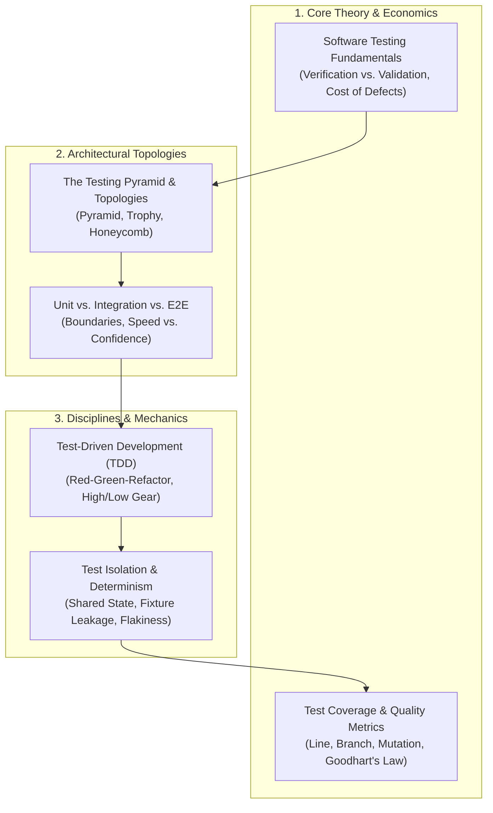

# Foundations of Python Backend Testing 🏛️

> The theoretical, architectural, and mathematical bedrock of automated software testing for backend systems.
>
> Grounded in the works of:
> - **Brian Okken**: *Python Testing with pytest*
> - **Harry Percival & Bob Gregory**: *Architecture Patterns with Python*
> - **Gerard Meszaros**: *xUnit Test Patterns*
> - **Glenford J. Myers**: *The Art of Software Testing*

---

## 📖 Module Overview

Testing is not an afterthought; it is an essential engineering discipline that dictates how software is architected, evolved, and deployed. A team with poor testing fundamentals often falls into the trap of writing slow, brittle, overlapping tests that create maintenance friction rather than safety.

This module establishes the foundational mental models required before writing a single line of test code in Python. It covers the physics of test execution, the economics of defect prevention, architectural testing topologies, and the mechanics of behavioral isolation.

---

## 🗺️ Module Guides

### 1. [Software Testing Fundamentals](software-testing-fundamentals.md)
Explore the foundational principles of QA: Verification ("Are we building the product right?") versus Validation ("Are we building the right product?"), the exponential cost of defects over the SDLC, Black-box vs. White-box vs. Grey-box testing, and formal test case derivation techniques (Equivalence Partitioning, Boundary Value Analysis, State Transition).

### 2. [The Testing Pyramid & Modern Topologies](testing-pyramid.md)
Deconstruct Mike Cohn's classic Testing Pyramid and evaluate alternative modern topologies: Martin Fowler's service-oriented pyramid, Kent C. Dodds' Testing Trophy (integration-heavy), and the Microservices Honeycomb (Spotify model). Learn the economics of test execution speed, debugging cost, and behavioral confidence.

### 3. [Unit vs. Integration vs. E2E Testing](unit-vs-integration-vs-e2e.md)
Establish mathematically rigorous boundaries between testing tiers. Understand how test scope changes execution speed, infrastructure dependency, and failure localization. Master the 5 flavors of Gerard Meszaros' test doubles (Dummy, Stub, Spy, Mock, Fake) and where they belong in Hexagonal / Clean Architecture.

### 4. [Test-Driven Development (TDD)](test-driven-development.md)
Master the disciplined Red-Green-Refactor rhythm. Learn the crucial distinction between London School (Mockist / Outside-In) and Chicago School (Classicist / Inside-Out) TDD. Deep dive into Harry Percival & Bob Gregory's concept of **TDD in High Gear vs. Low Gear**, learning when to write unit tests vs. when to drive domain changes from service-layer tests.

### 5. [Test Coverage & Metrics](test-coverage.md)
Move beyond vanity metrics. Contrast Line Coverage, Branch Coverage, Condition Coverage, and Path Coverage. Discover why 100% line coverage can still miss critical production bugs. Learn the mechanics of Mutation Testing (`mutmut`) to objectively score test suite quality, and understand Goodhart's Law in software engineering.

### 6. [Test Isolation & Determinism](test-isolation.md)
Eliminate flaky tests at the architectural level. Study the physics of test pollution: shared in-memory state, global singletons, uncommitted database rows, filesystem side-effects, and order dependency. Master transaction rollback sandboxes, ephemeral Docker environments, and deterministic fixture lifecycles.

---

## 📊 Foundational Concepts Comparison

| Topic | Primary Focus | Key Metric / Trade-off | Standard Backend Pattern |
| :--- | :--- | :--- | :--- |
| **[Fundamentals](software-testing-fundamentals.md)** | Defect prevention & test design | Cost of defect vs. Stage detected | Equivalence Partitioning & Oracles |
| **[Testing Pyramid](testing-pyramid.md)** | Portfolio distribution & ROI | Execution speed vs. End-to-end confidence | 70% Unit / 20% Integration / 10% E2E |
| **[Unit vs Int vs E2E](unit-vs-integration-vs-e2e.md)** | System boundary definition | Isolation vs. Realism | Fakes for domain, Docker for DB integration |
| **[TDD](test-driven-development.md)** | Design guidance & fast feedback | Cycle time vs. Over-specification | High Gear (Service tests) / Low Gear (Domain tests) |
| **[Test Coverage](test-coverage.md)** | Code execution & mutation killing | Line coverage vs. Mutant survival score | Minimum 85% Branch Coverage + Mutation gates |
| **[Test Isolation](test-isolation.md)** | Determinism & zero side-effects | Execution speed vs. State cleanliness | Nested DB savepoints (`SAVEPOINT`) & clean fixtures |

---

## ⏭️ Next Steps

Once you master the theoretical foundations, proceed directly to **[Pytest Fundamentals](../pytest-fundamentals/index.md)** to implement these principles using Python's premier testing framework.
