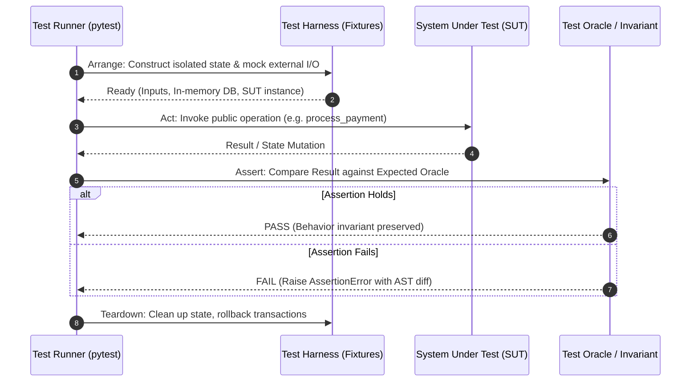
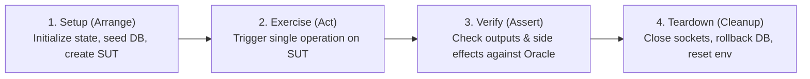

# Software Testing Fundamentals in Python Backend Systems 🧪

> **Authoritative Sources & Literature:**
> - Glenford J. Myers, Corey Sandler, Tom Badgett: *The Art of Software Testing* (3rd Edition, Wiley)
> - Brian Okken: *Python Testing with pytest* (2nd Edition, Pragmatic Bookshelf)
> - Gerard Meszaros: *xUnit Test Patterns: Refactoring Test Code* (Addison-Wesley)
> - Barry Boehm: *Software Engineering Economics* (Prentice-Hall)

---

## 1. Conceptual Definition & Core Mental Model

At its fundamental level, **software testing** is the disciplined investigation of a software system to discover discrepancies between specified, expected behavior and observed runtime behavior.

### Verification vs. Validation (Boehm's Duality)
Software quality engineering rests on two distinct questions formulated by Barry Boehm:
- **Verification**: *"Are we building the product right?"* Ensures the software conforms strictly to its architectural specifications, technical requirements, type contracts, and static invariants.
- **Validation**: *"Are we building the right product?"* Ensures the software satisfies user requirements, operational business workflows, and intended real-world value.

```
       Specification (Blueprint)
             ▲             │
Verification │             │ Implementation
             │             ▼
       Observed System Output
             ▲
             │ Validation
             ▼
       Real-World User Need
```

### The Defect Taxonomy
A failure in production is the terminus of an internal causation chain:
1. **Error (Human Mistake)**: A developer misinterprets a business rule (e.g., using `<=` instead of `<` when checking account balance thresholds).
2. **Defect / Fault (Bug in Code)**: The physical code flaw sitting latent within the codebase.
3. **Failure (Observed Deviation)**: At runtime, an event triggers the fault, causing the system to produce an incorrect state, throw an unhandled exception, or corrupt persistent storage.

### Testing Methodologies: The Visibility Spectrum
- **Black-Box Testing (Specification-Based)**: Treating the System Under Test (SUT) as an opaque box. Tests only interact with public interfaces (HTTP routes, CLI commands, public API methods) and evaluate outputs against inputs without awareness of internal control flows.
- **White-Box Testing (Structural Testing)**: Testing with full visibility into the code structure, executing specific branches, loops, exception handlers, and internal state mutations.
- **Grey-Box Testing**: The industry standard for backend APIs. The tester understands the underlying database schemas, caching layers, and external message queues, but drives tests through public API boundaries while verifying state changes directly in the database.

---

## 2. Why This Is Critical in Modern Python Backend Engineering

Python is dynamically typed, interpreted, and late-binding. While modern Python features strong type hinting (`typing`, `mypy`), the runtime does not enforce these types. 

1. **Latent Runtime Failures**: A missing attribute or mismatched argument type in a rarely triggered `except` block can sit undetected in production until midnight traffic hits it, causing an unhandled `AttributeError` or `TypeError`.
2. **Asynchronous Race Conditions**: Modern ASGI frameworks (FastAPI, Starlette) run concurrent task loops. Without formal testing of state boundaries and event loop lifecycles, backend services suffer from silent race conditions and context leakage.
3. **Schema Drifts in Distributed Systems**: Backend services communicate with PostgreSQL, Redis, external Stripe APIs, and Kafka topics. Automated testing provides the regression safety net necessary to refactor database schemas and upgrade libraries safely.
4. **The Exponential Cost of Defects**: A bug identified during requirement gathering costs 1x to fix; during unit testing, 10x; in CI/CD integration, 100x; in production, 1,000x to 10,000x (data corruption, security breaches, customer churn).

---

## 3. Internal Mechanics: The Test Oracle & The SUT

Every automated test requires three primary components:
1. **System Under Test (SUT)**: The unit, function, service, or HTTP endpoint being evaluated.
2. **Test Fixtures (Harness)**: The controlled environment, input data, and state preconditions.
3. **Test Oracle**: The authoritative mechanism that determines whether the actual output matches the required specification.



---

## 4. Formal Test Design Techniques

Writing tests at random leads to bloated suites with low defect detection. Professional engineers use formal test design techniques:

### A. Equivalence Partitioning (EP)
Divides the input domain of a component into partitions of equivalent data from which test cases can be derived. If one condition in a partition catches a bug, all other conditions in that partition are assumed to catch it.
- **Valid Partitions**: Values accepted by the system.
- **Invalid Partitions**: Values rejected with specific validation errors.

### B. Boundary Value Analysis (BVA)
Defects cluster at the boundaries of equivalence partitions rather than in the center. BVA tests the exact edge values:
- **Two-Point Boundary**: The boundary value itself and its immediate adjacent value across the threshold ($B$ and $B+1$ or $B-1$).
- **Three-Point Boundary**: The boundary, the value immediately below, and the value immediately above ($B-1$, $B$, $B+1$).

### C. Decision Table Testing
Used when business logic involves combinations of multiple boolean conditions that determine distinct actions (e.g., loan approvals based on credit score, income, and existing debt).

---

## 5. Standard Syntax, Signatures & Key Options

In standard Python, tests rely on the built-in `assert` statement. Pytest enhances this via **Abstract Syntax Tree (AST) rewriting**, intercepting assertions at compile time to provide deep introspection without boilerplate helper methods.

```python
# Standard Python assert syntax
assert <expression>, "<optional failure message>"

# Pytest assertion examples
assert actual_value == expected_value
assert actual_list == [1, 2, 3]
assert actual_dict == {"status": "active", "tier": "gold"}

# Floating-point comparisons using pytest.approx
import pytest
assert 0.1 + 0.2 == pytest.approx(0.3, rel=1e-6)
```

---

## 6. Lifecycle, Execution Flow & Teardown Mechanics

Every robust test follows the **Four-Phase Test Pattern** (also known as Arrange-Act-Assert or Given-When-Then):



1. **Setup (Arrange)**: Establish the pre-conditions. Create users, configure test doubles, set environment variables.
2. **Exercise (Act)**: Perform the single logical action being evaluated.
3. **Verify (Assert)**: Inspect return values, state changes in the database, and emitted events.
4. **Teardown (Cleanup)**: Restore the environment to a pristine state to prevent test pollution. In Pytest, teardown is handled automatically via generator fixtures (`yield`).

---

## 7. Scopes, Hierarchy, or Test Boundaries

```
┌──────────────────────────────────────────────────────────┐
│ End-to-End Tests (E2E)                                   │
│ Scope: Entire Application (HTTP -> Routing -> DB -> Bus) │
│ Speed: Slow (Seconds) | Confidence: Very High            │
├──────────────────────────────────────────────────────────┤
│ Integration Tests                                        │
│ Scope: Component Boundaries (Service Layer + Postgres)   │
│ Speed: Moderate (100ms - 500ms) | Confidence: High       │
├──────────────────────────────────────────────────────────┤
│ Unit Tests                                               │
│ Scope: Pure Logic / Single Class / Domain Invariant      │
│ Speed: Ultra-Fast (Sub-millisecond) | Confidence: Local  │
└──────────────────────────────────────────────────────────┘
```

---

## 8. Pytest Fixture & `conftest.py` Integration Patterns

Fixtures provide a declarative, modular dependency-injection mechanism for setting up SUT instances and test oracles:

```python
# tests/conftest.py
import pytest
from typing import Generator
from dataclasses import dataclass

@dataclass
class TestUser:
    id: str
    email: str
    is_verified: bool

@pytest.fixture
def unverified_user() -> TestUser:
    """Provides an arranged unverified user fixture."""
    return TestUser(id="usr_100", email="dev@example.com", is_verified=False)

@pytest.fixture
def verified_user() -> TestUser:
    """Provides an arranged verified user fixture."""
    return TestUser(id="usr_200", email="vip@example.com", is_verified=True)
```

---

## 9. Practical Python Implementation: Step-by-Step Walkthrough

Let us implement a domain component: a **Financial Loan Eligibility & Tier Engine**, and build an exhaustive test suite using Equivalence Partitioning and Boundary Value Analysis.

### Step 1: Define Domain Models & Invariants

```python
# domain/lending.py
from dataclasses import dataclass
from enum import Enum

class LoanTier(str, Enum):
    REJECTED = "REJECTED"
    STANDARD = "STANDARD"
    PRIME = "PRIME"
    SUPER_PRIME = "SUPER_PRIME"

class ValidationError(ValueError):
    pass

@dataclass(frozen=True)
class Applicant:
    age: int
    credit_score: int
    annual_income: float

class LendingEngine:
    MIN_AGE = 18
    MAX_AGE = 75
    MIN_CREDIT = 300
    MAX_CREDIT = 850

    @classmethod
    def evaluate_tier(cls, applicant: Applicant) -> LoanTier:
        """
        Determines loan eligibility based on strict boundaries:
        - Age: [18, 75]
        - Credit Score:
            - < 600: REJECTED
            - [600, 699]: STANDARD (requires income >= 30,000)
            - [700, 799]: PRIME (requires income >= 50,000)
            - [800, 850]: SUPER_PRIME (requires income >= 75,000)
        """
        if not (cls.MIN_AGE <= applicant.age <= cls.MAX_AGE):
            raise ValidationError(f"Age must be between {cls.MIN_AGE} and {cls.MAX_AGE}")

        if not (cls.MIN_CREDIT <= applicant.credit_score <= cls.MAX_CREDIT):
            raise ValidationError(f"Credit score must be between {cls.MIN_CREDIT} and {cls.MAX_CREDIT}")

        if applicant.annual_income < 0:
            raise ValidationError("Annual income cannot be negative")

        score = applicant.credit_score
        income = applicant.annual_income

        if score < 600:
            return LoanTier.REJECTED
        elif 600 <= score <= 699:
            return LoanTier.STANDARD if income >= 30_000.0 else LoanTier.REJECTED
        elif 700 <= score <= 799:
            return LoanTier.PRIME if income >= 50_000.0 else LoanTier.STANDARD
        else: # 800 - 850
            if income >= 75_000.0:
                return LoanTier.SUPER_PRIME
            elif income >= 50_000.0:
                return LoanTier.PRIME
            else:
                return LoanTier.STANDARD
```

### Step 2: Implement Exhaustive BVA and EP Unit Tests

```python
# tests/unit/test_lending_engine.py
import pytest
from domain.lending import LendingEngine, Applicant, LoanTier, ValidationError

class TestLendingEngineValidation:
    """Equivalence Partitioning & Boundary Value Analysis for Input Validation."""

    @pytest.mark.parametrize("invalid_age", [17, 76, -1, 100])
    def test_age_out_of_bounds_raises_validation_error(self, invalid_age: int) -> None:
        # Arrange
        applicant = Applicant(age=invalid_age, credit_score=720, annual_income=60_000.0)
        
        # Act & Assert
        with pytest.raises(ValidationError, match="Age must be between 18 and 75"):
            LendingEngine.evaluate_tier(applicant)

    @pytest.mark.parametrize("valid_age", [18, 19, 45, 74, 75])
    def test_age_at_boundaries_accepted(self, valid_age: int) -> None:
        applicant = Applicant(age=valid_age, credit_score=750, annual_income=60_000.0)
        result = LendingEngine.evaluate_tier(applicant)
        assert result == LoanTier.PRIME

    @pytest.mark.parametrize("invalid_score", [299, 851, 0, -50])
    def test_credit_score_out_of_bounds_raises_error(self, invalid_score: int) -> None:
        applicant = Applicant(age=30, credit_score=invalid_score, annual_income=50_000.0)
        with pytest.raises(ValidationError, match="Credit score must be between 300 and 850"):
            LendingEngine.evaluate_tier(applicant)


class TestLendingTierEvaluation:
    """Testing Business Logic Partitions and Edge Decisions."""

    @pytest.mark.parametrize(
        "score,income,expected_tier",
        [
            # Partition: Score < 600 -> Always Rejected
            (300, 100_000.0, LoanTier.REJECTED),
            (599, 200_000.0, LoanTier.REJECTED),
            
            # Boundary: Score 600 (Standard)
            (600, 30_000.0, LoanTier.STANDARD),
            (600, 29_999.99, LoanTier.REJECTED),
            (699, 30_000.0, LoanTier.STANDARD),
            
            # Boundary: Score 700 (Prime)
            (700, 50_000.0, LoanTier.PRIME),
            (700, 49_999.99, LoanTier.STANDARD),
            (799, 50_000.0, LoanTier.PRIME),
            
            # Boundary: Score 800 (Super Prime)
            (800, 75_000.0, LoanTier.SUPER_PRIME),
            (800, 74_999.99, LoanTier.PRIME),
            (850, 75_000.0, LoanTier.SUPER_PRIME),
        ],
        ids=[
            "lower_bound_credit_reject",
            "just_below_standard_credit_reject",
            "exact_standard_entry",
            "standard_credit_insufficient_income",
            "upper_standard_boundary",
            "exact_prime_entry",
            "prime_credit_standard_income_fallback",
            "upper_prime_boundary",
            "exact_super_prime_entry",
            "super_prime_credit_fallback_to_prime",
            "max_credit_score_super_prime",
        ]
    )
    def test_tier_evaluation_boundary_conditions(
        self, score: int, income: float, expected_tier: LoanTier
    ) -> None:
        applicant = Applicant(age=35, credit_score=score, annual_income=income)
        tier = LendingEngine.evaluate_tier(applicant)
        assert tier == expected_tier
```

---

## 10. Framework-Specific Integration: FastAPI

In modern FastAPI applications, input validation is partially handled by Pydantic v2 schemas at the HTTP boundary, while core domain validation belongs to domain entities. Tests must verify both boundaries.

```python
# api/schemas.py
from pydantic import BaseModel, Field, field_validator

class LoanApplicationRequest(BaseModel):
    age: int = Field(..., ge=18, le=75, description="Applicant age between 18 and 75")
    credit_score: int = Field(..., ge=300, le=850)
    annual_income: float = Field(..., ge=0.0)

# api/routes.py
from fastapi import APIRouter, HTTPException, status
from domain.lending import LendingEngine, Applicant, ValidationError

router = APIRouter(prefix="/loans", tags=["Loans"])

@router.post("/evaluate")
async def evaluate_loan(payload: LoanApplicationRequest):
    applicant = Applicant(
        age=payload.age,
        credit_score=payload.credit_score,
        annual_income=payload.annual_income,
    )
    try:
        tier = LendingEngine.evaluate_tier(applicant)
        return {"applicant_id": "auto", "tier": tier.value}
    except ValidationError as e:
        raise HTTPException(status_code=status.HTTP_400_BAD_REQUEST, detail=str(e))
```

### Testing the FastAPI Boundary

```python
# tests/integration/test_loan_api.py
import pytest
from httpx import AsyncClient, ASGITransport
from fastapi import FastAPI
from api.routes import router

@pytest.fixture
def app() -> FastAPI:
    application = FastAPI()
    application.include_router(router)
    return application

@pytest.mark.asyncio
async def test_evaluate_loan_schema_validation_error(app: FastAPI) -> None:
    """Verifies that Pydantic intercepts invalid inputs with HTTP 422."""
    async with AsyncClient(transport=ASGITransport(app=app), base_url="http://test") as client:
        # Age 16 violates schema boundary (ge=18)
        response = await client.post(
            "/loans/evaluate",
            json={"age": 16, "credit_score": 750, "annual_income": 50000.0}
        )
        assert response.status_code == 422
        errors = response.json()["detail"]
        assert any(e["loc"] == ["body", "age"] for e in errors)

@pytest.mark.asyncio
async def test_evaluate_loan_successful_evaluation(app: FastAPI) -> None:
    """Verifies successful end-to-end evaluation with HTTP 200."""
    async with AsyncClient(transport=ASGITransport(app=app), base_url="http://test") as client:
        response = await client.post(
            "/loans/evaluate",
            json={"age": 30, "credit_score": 820, "annual_income": 80000.0}
        )
        assert response.status_code == 200
        assert response.json() == {"applicant_id": "auto", "tier": "SUPER_PRIME"}
```

---

## 11. Real-World Enterprise Backend Scenario: Proration & Billing Engine

Consider an enterprise SaaS subscription billing engine calculating prorated refunds when a customer downgrades mid-cycle.


```python
# billing/proration.py
from dataclasses import dataclass
from datetime import date
from decimal import Decimal, ROUND_HALF_UP

@dataclass(frozen=True)
class SubscriptionPeriod:
    start_date: date
    end_date: date
    monthly_fee: Decimal

    @property
    def total_days(self) -> int:
        return (self.end_date - self.start_date).days

class ProrationCalculator:
    @staticmethod
    def calculate_credit(period: SubscriptionPeriod, cancel_date: date) -> Decimal:
        """
        Calculates refund for unused portion of subscription:
        Refund = Monthly Fee * (Unused Days / Total Days)
        """
        if cancel_date < period.start_date or cancel_date > period.end_date:
            raise ValueError("Cancellation date falls outside the billing cycle")

        used_days = (cancel_date - period.start_date).days
        unused_days = period.total_days - used_days

        if period.total_days == 0:
            return Decimal("0.00")

        daily_rate = period.monthly_fee / Decimal(period.total_days)
        credit = daily_rate * Decimal(unused_days)
        return credit.quantize(Decimal("0.01"), rounding=ROUND_HALF_UP)
```

### Enterprise Test Suite Verifying Financial Invariants

```python
# tests/unit/test_proration.py
import pytest
from datetime import date
from decimal import Decimal
from billing.proration import SubscriptionPeriod, ProrationCalculator

def test_proration_exact_mid_month_cancellation() -> None:
    # 30-day period: June 1 to July 1
    period = SubscriptionPeriod(
        start_date=date(2026, 6, 1),
        end_date=date(2026, 7, 1),
        monthly_fee=Decimal("300.00"),
    )
    # Cancelled on June 16 (15 days used, 15 days unused)
    cancel_date = date(2026, 6, 16)
    credit = ProrationCalculator.calculate_credit(period, cancel_date)
    
    assert credit == Decimal("150.00")

def test_proration_day_one_cancellation_full_refund() -> None:
    period = SubscriptionPeriod(
        start_date=date(2026, 6, 1),
        end_date=date(2026, 7, 1),
        monthly_fee=Decimal("300.00"),
    )
    # Cancelled on day 1 (0 days used, 30 days unused)
    credit = ProrationCalculator.calculate_credit(period, date(2026, 6, 1))
    assert credit == Decimal("300.00")

def test_proration_last_day_cancellation_zero_refund() -> None:
    period = SubscriptionPeriod(
        start_date=date(2026, 6, 1),
        end_date=date(2026, 7, 1),
        monthly_fee=Decimal("300.00"),
    )
    # Cancelled on expiration date
    credit = ProrationCalculator.calculate_credit(period, date(2026, 7, 1))
    assert credit == Decimal("0.00")

def test_proration_invalid_date_raises_domain_error() -> None:
    period = SubscriptionPeriod(
        start_date=date(2026, 6, 1),
        end_date=date(2026, 7, 1),
        monthly_fee=Decimal("300.00"),
    )
    with pytest.raises(ValueError, match="outside the billing cycle"):
        ProrationCalculator.calculate_credit(period, date(2026, 5, 31))
```

---

## 12. Anti-Patterns & Common Pitfalls

### Anti-Pattern 1: The Tautological Test (Testing the Mock)
Writing a test that mocks an internal method and asserts that the mock returned what was configured.

```python
# ❌ BAD: Tautological test asserting mocked return value
def test_get_user_bad(mocker):
    mock_repo = mocker.patch("services.user_repo.find_by_id")
    mock_repo.return_value = {"id": "123", "name": "Alice"}
    
    # This only tests that python-mock works, not that our code is correct
    result = mock_repo.find_by_id("123")
    assert result == {"id": "123", "name": "Alice"}

# ✅ GOOD: Test real behavior through the service layer
def test_get_user_good(in_memory_user_service):
    in_memory_user_service.register_user(user_id="123", name="Alice")
    user = in_memory_user_service.get_user_profile("123")
    assert user.name == "Alice"
```

### Anti-Pattern 2: The Giant "All-In-One" Test (Assertion Roulette)
Packing twenty different assertions into one 100-line test. When line 14 fails, lines 15-100 never run, obscuring the root cause.

```python
# ❌ BAD: Giant procedural test
def test_everything_about_orders(client):
    r1 = client.post("/orders", json={"item": "book"})
    assert r1.status_code == 201
    r2 = client.get("/orders/1")
    assert r2.status_code == 200
    r3 = client.post("/orders/1/pay")
    assert r3.status_code == 200
    r4 = client.delete("/orders/1")
    assert r4.status_code == 400

# ✅ GOOD: Atomic, focused tests with distinct behavioral contracts
def test_create_order_returns_201(client):
    response = client.post("/orders", json={"item": "book"})
    assert response.status_code == 201

def test_cannot_delete_paid_order(client, paid_order_id):
    response = client.delete(f"/orders/{paid_order_id}")
    assert response.status_code == 400
```

---

## 13. Best Practices & Production Guidelines

1. **Test Observable Behavior, Not Implementation Details**: Avoid asserting private methods (`sut._internal_calc()`). Test through public interfaces. If refactoring the internal algorithm breaks your tests without changing output, your tests are tightly coupled to implementation.
2. **Deterministic Test Execution**: Eliminate non-deterministic factors: freeze time using `freezegun` or `time-machine`, seed random number generators, and avoid dependencies on live internet connections.
3. **The Single Concept Rule**: A test should verify one logical concept. It may contain multiple physical `assert` statements if they all inspect facets of that single logical outcome (e.g., verifying `status == "COMPLETED"`, `balance == 0`, and `items_shipped == 2`).
4. **Descriptive Test Naming**: Use the pattern `test_<action>_<condition>_<expected_outcome>()`:
   - `test_withdraw_funds_when_balance_insufficient_raises_overdraft_error()`
   - `test_evaluate_tier_when_credit_score_below_600_returns_rejected()`

---

## 14. Trade-Off Analysis: Testing Approaches

| Dimension | Black-Box Testing | Grey-Box Testing | White-Box Testing |
| :--- | :--- | :--- | :--- |
| **System Visibility** | Zero (External I/O only) | Partial (APIs + DB State) | Full (Source AST, branches) |
| **Refactoring Resilience** | Highest (Immune to internal rewrites) | High | Low (Breaks on structural edits) |
| **Defect Localization** | Coarse (Knows failure occurred) | Medium | Pinpoint (Exact line/branch) |
| **Execution Cost** | Slow (Full stack overhead) | Balanced | Ultra-Fast |
| **Primary Level** | E2E & Acceptance Testing | API & Service Integration | Unit & Mutation Testing |
| **Maintenance Burden** | High if UI-based, Low if API-based | Moderate | High if over-mocked |

---

## 15. Diagnostic & Debugging Playbook

When tests fail, use pytest's diagnostic flags:

```bash
# 1. Run tests with maximum verbosity and full diffs
pytest -vv

# 2. Stop immediately on first failure
pytest -x

# 3. Drop into the Python debugger (PDB) at the point of assertion failure
pytest --pdb

# 4. Show stdout and print statements for debugging
pytest -s

# 5. Show only short traceback summaries
pytest --tb=short

# 6. Re-run only the tests that failed in the previous run
pytest --lf
```

---

## 16. Senior Staff Interview Questions & Deep Dives

### Question 1: What is the fundamental difference between State Verification and Behavioral Verification, and when should each be used?
**Answer**:
- **State Verification** inspects the state of the SUT and its collaborators *after* an operation has executed (e.g., querying the database to ensure `status == "ACTIVE"` or verifying a return value). It treats the SUT as a black box and preserves refactoring flexibility.
- **Behavioral Verification** (interaction testing) asserts that specific methods were invoked on collaborators with specific parameters during execution (e.g., `mock_email_service.send_welcome_email.assert_called_once_with("user@test.com")`).
- **Guideline**: Prefer State Verification for pure business logic and domain entities. Reserve Behavioral Verification exclusively for true side-effect boundaries (sending emails, publishing Kafka messages, charging credit cards via third-party gateways) where external I/O must be verified without hitting production networks.

### Question 2: Why can high line coverage be dangerously misleading in backend systems?
**Answer**:
Line coverage simply checks whether a line of code was executed during a test run; it does not verify whether the line executed correctly, whether boundary conditions were tested, or whether assertions were even made. A test suite can achieve 100% line coverage with zero `assert` statements. Furthermore, line coverage ignores combinatorial paths, exception handling branches, and database race conditions. Mutation testing (e.g., using `mutmut`) provides a far more rigorous metric by introducing artificial defects into the AST and checking whether the test suite detects ("kills") the mutant.

---

## 17. Hands-on Engineering Exercises & Challenges

### Exercise 1: Boundary Value Test Suite for a Rate Limiter
Given a rate limiter allowing a maximum of 10 requests per minute per IP:
1. Identify the Equivalence Partitions (Valid, Exceeded, Malformed IP).
2. Identify the 2-point and 3-point Boundary Values.
3. Implement the tests in pytest using `@pytest.mark.parametrize`.

*Solution Hint*:
- Partitions: Requests [1, 10] (allowed), Requests >= 11 (rejected HTTP 429).
- Boundaries: 9 requests (allowed), 10 requests (allowed, edge), 11 requests (rejected, edge).
- Test rapid sequential calls and time window resets.

### Exercise 2: Refactoring Fragile White-Box Tests
Take a test that asserts `mock_user_service._hash_password.assert_called_once()`. Refactor it into a state-verified test that tests the public `user_service.register()` method and asserts that the persisted password hash in the database is verified by Argon2/Bcrypt without exposing internal helper functions.

---

## 18. Summary, Cross-References & Further Reading

Software testing is an architectural foundation, not a post-development chore. By understanding verification versus validation, mastering Equivalence Partitioning and Boundary Value Analysis, and relying on state verification, backend engineers build resilient systems that support aggressive refactoring.

### Cross-References:
- Next: [The Testing Pyramid & Modern Topologies](testing-pyramid.md)
- [Unit vs. Integration vs. E2E Testing](unit-vs-integration-vs-e2e.md)
- [Pytest Smart Assertions](../pytest-fundamentals/assertions.md)
- [Safe Refactoring & Testing Preconditions](../../refactoring/foundations/safe-refactoring-and-testing.md)
