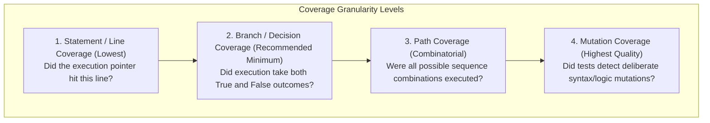
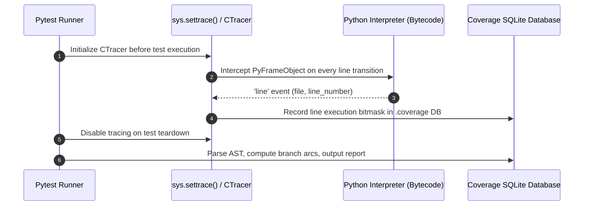

# Test Coverage, Quality Metrics & Mutation Testing 📊

> **Authoritative Sources & Literature:**
> - Brian Okken: *Python Testing with pytest* (Chapter 7: Strategy - Coverage, Pragmatic Bookshelf)
> - Ned Batchelder: *Coverage.py Architecture & Internals* (coverage.readthedocs.io)
> - Martin Fowler: *Test Coverage* (martinfowler.com)
> - Paul Ammann & Jeff Offutt: *Introduction to Software Testing* (Cambridge University Press)
> - Goodhart's Law: *"When a measure becomes a target, it ceases to be a good measure."*

---

## 1. Conceptual Definition & Core Mental Model

**Test Coverage** is a quantitative code metric that measures the percentage of source code executed by an automated test suite. 

However, coverage is a **negative indicator, not a positive guarantee**:
- **What low coverage proves**: Untested code definitely contains unverified behavior and latent defects.
- **What 100% coverage does NOT prove**: It does not prove that code is correct, that edge cases are handled, or that assertions even exist. A test suite can achieve 100% line coverage with zero `assert` statements.

```
       [ Source Code Under Test ]
                   │
         Does test execute line?
          ├── YES ──> Line Coverage Satisfied (Weak)
          │             │
          │     Were all branch paths evaluated? (if/else/try)
          │      ├── YES ──> Branch Coverage Satisfied (Moderate)
          │      │             │
          │      │     Does modifying code break the test?
          │      │      ├── YES ──> Mutant Killed (High Confidence)
          │      │      └── NO  ──> Mutant Survived (Defect in Test Suite)
```

---

## 2. Why This Is Critical in Modern Python Backend Engineering

1. **Python Dynamic Late-Binding Traps**: In compiled languages, syntax errors and missing variables are caught at compile time. In Python, an unexecuted branch inside an `except ValueError:` block might reference an undefined variable or invalid attribute. Without test coverage, this explodes at runtime in production.
2. **Defeating Dead & Rotting Code**: Coverage reports highlight obsolete functions, abandoned endpoints, and dead branches that can be safely deleted.
3. **Goodhart's Law in Engineering Teams**: When management mandates "all PRs must have 95% coverage", developers game the metric by writing superficial tests that call functions without checking outputs, giving a false sense of security while increasing maintenance cost.

---

## 3. The Coverage Hierarchy



### A. Statement / Line Coverage
$$\text{Line Coverage} = \frac{\text{Executed Lines}}{\text{Total Executable Lines}} \times 100$$
Evaluates whether a physical line was triggered. It fails to distinguish between compound conditions.

### B. Branch Coverage (Decision Coverage)
$$\text{Branch Coverage} = \frac{\text{Executed Branches}}{\text{Total Decision Branches}} \times 100$$
Ensures that for every conditional branch (`if`, `elif`, `else`, `while`, `try/except`), both the `True` and `False` paths are tested.

### C. Mutation Testing (`mutmut`)
Instead of measuring what lines were touched, **Mutation Testing tests the tests themselves**. A mutation engine parses your Python AST, generates dozens of slightly modified mutants (e.g., changing `>` to `>=`, `+` to `-`, or `return True` to `return False`), and runs pytest against each:
- **Killed Mutant**: A test fails when the mutant runs. (The test caught the defect).
- **Survived Mutant**: All tests pass despite the corrupted logic. (The test suite has a blind spot).

---

## 4. Internal Mechanics: How `coverage.py` Operates

Under the hood, Python's official `coverage` engine hooks directly into the Python interpreter's execution tracing mechanism:



In modern Python 3.12+, `coverage.py` leverages PEP 669 (`sys.monitoring`), drastically reducing performance overhead compared to legacy `sys.settrace()`.

---

## 5. Standard Syntax, Signatures & Key Options

### Essential CLI Flags for Pytest
```bash
# Run pytest with term-missing report and branch coverage
pytest --cov=src --cov-report=term-missing --cov-branch

# Enforce a strict minimum threshold (fails CI if coverage < 85%)
pytest --cov=src --cov-branch --cov-fail-under=85

# Generate an interactive HTML report
pytest --cov=src --cov-report=html
```

### Production Configuration (`pyproject.toml`)
```toml
[tool.coverage.run]
source = ["src"]
branch = true
omit = [
    "src/alembic/*",
    "src/**/dto.py",
    "src/**/protocols.py",
    "tests/*",
]

[tool.coverage.report]
exclude_lines = [
    "pragma: no cover",
    "def __repr__",
    "raise NotImplementedError",
    "if __name__ == .__main__.:",
    "if TYPE_CHECKING:",
    "@abstractmethod",
    "class .*\\bProtocol\\):",
]
fail_under = 85
show_missing = true
skip_covered = false
```

---

## 6. Lifecycle, Execution Flow & Teardown Mechanics

Measuring coverage incurs execution overhead:
- **Line Coverage tracing**: Adds $\approx 10\% - 25\%$ execution time.
- **Branch Coverage tracing**: Adds $\approx 20\% - 40\%$ execution time.
- **Mutation Testing (`mutmut`)**: Can take 10x to 100x the normal test suite duration because it re-runs pytest for every mutant.

**Operational Rule**: Do not run `--cov` during rapid local TDD cycles (`ptw`). Run coverage during pre-commit checks and CI/CD pull request builds.

---

## 7. Scopes, Hierarchy, or Test Boundaries

```
[ Whole Repository Coverage ]
        │
        ├── [ Domain & Core Logic: Target 95%+ Branch Coverage ]
        ├── [ Service & API Layer: Target 85%+ Branch Coverage ]
        ├── [ Database Adapters: Target 80%+ Branch Coverage ]
        └── [ Schemas / Protocols / Migrations: Excluded (Omitted) ]
```

---

## 8. Pytest Fixture & `conftest.py` Integration Patterns

Fixtures and test helpers should not distort application coverage statistics. Always ensure `tests/` is excluded from the coverage `source` setting in `pyproject.toml`.

```python
# tests/conftest.py
import pytest
from decimal import Decimal

# Custom assertion helper that will not be tracked as app coverage
def assert_monetary_equal(actual: Decimal, expected: Decimal) -> None:
    assert actual.quantize(Decimal("0.01")) == expected.quantize(Decimal("0.01"))
```

---

## 9. Practical Python Implementation: Step-by-Step Walkthrough

We will demonstrate how **100% Line Coverage can fail completely**, and how Branch Coverage and Mutation Testing catch the flaw.

### The Application Code

```python
# src/billing/tax_engine.py
from decimal import Decimal

class TaxCalculator:
    @staticmethod
    def calculate_vat(amount: Decimal, country_code: str, is_business: bool) -> Decimal:
        """
        Calculates VAT:
        - Domestic personal: 20%
        - Domestic business: 0% (reverse charge)
        - International: 0%
        """
        rate = Decimal("0.00")
        if country_code == "GB":
            if not is_business:
                rate = Decimal("0.20")
            # Potential bug: what if amount is negative?
        
        return (amount * rate).quantize(Decimal("0.01"))
```

### The Flawed "100% Line Coverage" Test Suite

```python
# tests/unit/test_flawed_tax.py
from decimal import Decimal
from src.billing.tax_engine import TaxCalculator

def test_vat_execution():
    # This single test executes EVERY line in calculate_vat!
    # Line coverage is 100%!
    res1 = TaxCalculator.calculate_vat(Decimal("100.00"), "GB", False)
    assert res1 == Decimal("20.00")
    
    res2 = TaxCalculator.calculate_vat(Decimal("100.00"), "US", False)
    assert res2 == Decimal("0.00")
```
Running `pytest --cov=src.billing.tax_engine` reports:
`TOTAL: 100% COVERAGE`.

Yet, we missed:
1. What happens if `country_code == "GB"` and `is_business == True`? (Branch omitted!)
2. What happens if `amount` is negative? (Domain invariant missing!)

### Adding Branch Coverage & Mutation Testing

```python
# tests/unit/test_robust_tax.py
import pytest
from decimal import Decimal
from src.billing.tax_engine import TaxCalculator

@pytest.mark.parametrize(
    "amount,country,is_biz,expected",
    [
        (Decimal("100.00"), "GB", False, Decimal("20.00")),
        (Decimal("100.00"), "GB", True, Decimal("0.00")),    # Evaluates False branch
        (Decimal("100.00"), "DE", False, Decimal("0.00")),    # Non-GB branch
        (Decimal("0.00"), "GB", False, Decimal("0.00")),      # Boundary: zero amount
    ]
)
def test_vat_all_branches(amount, country, is_biz, expected):
    result = TaxCalculator.calculate_vat(amount, country, is_biz)
    assert result == expected

def test_negative_amount_raises_error():
    with pytest.raises(ValueError, match="Amount cannot be negative"):
        # We discovered we need domain validation!
        TaxCalculator.calculate_vat(Decimal("-50.00"), "GB", False)
```

---

## 10. Framework-Specific Integration: FastAPI

In FastAPI applications, Pydantic models automatically execute validation code during import or schema instantiation. If you test only the HTTP endpoints, your coverage may report 95%+, but individual error handling branches inside custom Pydantic validators might remain completely untested.

```python
# src/schemas/payment.py
from pydantic import BaseModel, field_validator
from decimal import Decimal

class PaymentRequest(BaseModel):
    amount: Decimal
    currency: str

    @field_validator("currency")
    @classmethod
    def validate_currency(cls, v: str) -> str:
        # Branch 1
        if v.upper() not in {"USD", "EUR", "GBP"}:
            # Branch 2: Untested unless an invalid currency test exists!
            raise ValueError(f"Unsupported currency: {v}")
        return v.upper()
```

To maintain high branch coverage, explicitly test both successful validation and failed validation scenarios.

---

## 11. Real-World Enterprise Backend Scenario: Fintech Loan Amortization

In a financial lending platform calculating compound interest and debt service coverage ratios:
- A single missing branch test in an interest rounding function caused a 1-cent discrepancy per transaction.
- Over 500,000 daily transactions, this created a \$5,000/day accounting imbalance.
- **Remediation**: The engineering team instituted a strict policy: the `domain/finance/` package requires **100% Branch Coverage** and a **Mutation Score > 90%** via `mutmut` before PR approval.

---

## 12. Anti-Patterns & Common Pitfalls

### Anti-Pattern 1: The "Assert-Free" Coverage Hack
Calling expensive functions purely to satisfy CI coverage gates without making assertions.

```python
# ❌ BAD: Toxic test written purely to increase coverage numbers
def test_create_invoice_coverage_booster(client):
    # Hits 40 lines in invoice_service.py, but asserts NOTHING
    client.post("/invoices", json={"customer": "Alice", "amount": 100})
```

### Anti-Pattern 2: Overusing `# pragma: no cover`
Hiding difficult-to-test edge cases by adding pragmas.

```python
# ❌ BAD: Hiding untested critical fallback
try:
    process_payment()
except StripeNetworkTimeout: # pragma: no cover
    refund_customer()        # This critical safety code is never tested!
```

### Anti-Pattern 3: Chasing 100% Repository-Wide Coverage
Forcing 100% coverage on configuration files, logging scripts, and boilerplate DTOs.
- **Consequence**: Wasted engineering time writing trivial tests that provide zero risk reduction.

---

## 13. Best Practices & Production Guidelines

1. **Target 80% – 85% Branch Coverage as the Quality Floor**: Require `--cov-branch --cov-fail-under=85` in CI. Require 95%+ only on mission-critical domain logic.
2. **Use Mutation Testing on Core Logic**: Run `mutmut run --paths-to-mutate=src/domain/` to verify that your unit tests actually fail when domain logic is intentionally corrupted.
3. **Always Review Missing Lines**: Use `--cov-report=term-missing` and review the exact line numbers displayed in the terminal.
4. **Pragma Discipline**: Restrict `# pragma: no cover` to truly unreachable code (e.g., `if TYPE_CHECKING:`, abstract methods, or OS-specific platform checks).

---

## 14. Trade-Off Analysis: Coverage Metrics

| Metric | Ease of Measurement | CI Execution Overhead | Defect Catching Power | Risk of Manipulation |
| :--- | :--- | :--- | :--- | :--- |
| **Line Coverage** | Trivial | Very Low ($\approx 10\%$) | Low (misses branches & logic) | High (easy to game) |
| **Branch Coverage** | Easy (`--cov-branch`) | Low ($\approx 25\%$) | High (forces both if/else paths) | Moderate |
| **Path Coverage** | Extremely Difficult | Impractical (exponential) | Maximum | Very Low |
| **Mutation Score** | Moderate (`mutmut`) | Very High (10x - 100x run) | Exceptional (tests the assertions) | Near Zero |

---

## 15. Diagnostic & Debugging Playbook

```bash
# 1. Output terminal report showing exactly which lines were missed
pytest --cov=src --cov-report=term-missing

# 2. Generate and open interactive HTML coverage report
pytest --cov=src --cov-report=html
python -m http.server --directory htmlcov 8000

# 3. Run mutation testing against domain package
mutmut run --paths-to-mutate=src/domain/

# 4. Inspect surviving mutants
mutmut results
mutmut show <mutant_id>
```

---

## 16. Senior Staff Interview Questions & Deep Dives

### Question 1: How does Mutation Testing work under the hood, and what does a "surviving mutant" tell you about your test suite?
**Answer**:
A mutation testing tool (like `mutmut` in Python) parses the source code into an Abstract Syntax Tree (AST). It then applies predefined mutation operators:
- Arithmetic: replaces `+` with `-`
- Relational: replaces `<` with `<=` or `==`
- Logical: replaces `and` with `or`
- Return value: replaces `return True` with `return False` or `return None`

After applying a single mutation, it runs the test suite. If the test suite **fails**, the mutant is **killed** (the tests successfully verified that the code must behave in that exact way). If the test suite **passes**, the mutant **survived**. A surviving mutant indicates a gap in the test suite: either an assertion is missing, a boundary value was not checked, or the code under test is dead/redundant.

### Question 2: Why is Branch Coverage superior to Statement Coverage when testing boolean logic?
**Answer**:
Statement coverage only verifies that a line was executed. Consider:
```python
if user.is_admin or user.has_override:
    allow_access()
```
If a test passes `user.is_admin=True` and `user.has_override=False`, the line `allow_access()` executes, achieving 100% statement coverage. However, the condition where `user.is_admin=False` and `user.has_override=True` was never tested, nor was the condition where both are `False`. Branch coverage evaluates both paths of the decision diamond, ensuring that the alternative branch (where access is denied) is also exercised.

---

## 17. Hands-on Engineering Exercises & Challenges

### Exercise 1: Finding the Undetected Bug in 100% Covered Code
Given this function:
```python
def calculate_discount(price: float, is_member: bool) -> float:
    discount = 0.0
    if is_member:
        discount = price * 0.1
    return price - discount
```
1. Write a test suite that achieves 100% statement coverage with only one test.
2. Identify the missing branch.
3. Add a test to achieve 100% branch coverage.

### Exercise 2: Running Mutmut on an Allocation Service
Install `mutmut` in your development environment. Run it against your domain model from the TDD module. If any mutants survive, inspect the mutant diff using `mutmut show <id>` and write the exact assertion needed to kill it.

---

## 18. Summary, Cross-References & Further Reading

Test coverage is a valuable diagnostic tool for discovering untested code, but it must never be mistaken for proof of correctness. By combining branch coverage thresholds in CI with periodic mutation testing on core business logic, engineering teams build high-confidence test suites that actively prevent regressions.

### Cross-References:
- Previous: [Test-Driven Development (TDD)](test-driven-development.md)
- Next: [Test Isolation & Determinism](test-isolation.md)
- [Pytest Configuration & Options](../pytest-fundamentals/installation-and-configuration.md)
- [Mutation Testing Guide](../ai-assisted-testing/mutation-testing.md)
