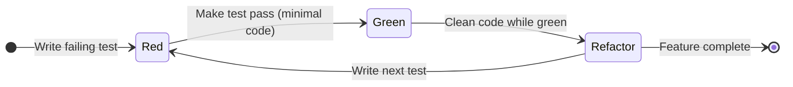
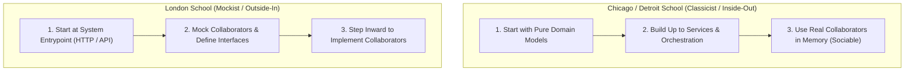
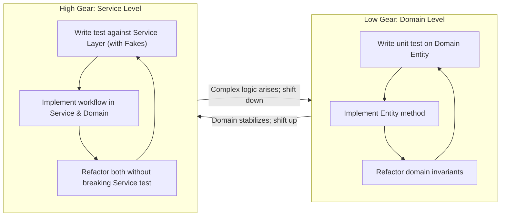

# Test-Driven Development (TDD) in Python Backend Systems 🔁

> **Authoritative Sources & Literature:**
> - Kent Beck: *Test-Driven Development: By Example* (Addison-Wesley)
> - Harry Percival & Bob Gregory: *Architecture Patterns with Python* (O'Reilly, "Cosmic Python" - Chapter 5: TDD in High Gear and Low Gear)
> - Steve Freeman & Nat Pryce: *Growing Object-Oriented Software, Guided by Tests* (Addison-Wesley, "GOOS")
> - Robert C. Martin: *The Three Laws of TDD* (Clean Code)

---

## 1. Conceptual Definition & Core Mental Model

**Test-Driven Development (TDD)** is an iterative software design and development practice where automated tests are written *before* the production code they verify. 

TDD is fundamentally an **architectural design tool**, not merely a validation technique. It forces the developer to become the first consumer of the API, driving modularity, loose coupling, and clear boundaries.

### The Red-Green-Refactor Cycle
The foundational rhythm of TDD operates in three distinct phases:



1. **🔴 RED**: Write a small, focused test for behavior that does not yet exist. Run the test runner and verify that it fails with the *expected* failure message (not an import or syntax error).
2. **🟢 GREEN**: Write the simplest, most minimal production code possible to make the test pass. Quick and "dirty" code (even hardcoding the return value) is acceptable here to reach a green state rapidly.
3. **🔵 REFACTOR**: With the test suite passing as a behavioral safety net, clean up the implementation. Remove code duplication, improve variable naming, extract classes, and enforce SOLID principles while keeping tests green.

---

## 2. Why This Is Critical in Modern Python Backend Engineering

1. **Combats Over-Engineering (YAGNI)**: Developers often invent speculative abstractions ("just in case"). TDD strictly forbids writing production code without a failing test, preventing bloat.
2. **Guarantees Testability**: Code written before tests often accumulates hidden dependencies (hardcoded global database connections, hidden network calls, tight coupling). Code designed through TDD is inherently modular and testable.
3. **Executable Living Documentation**: Tests written via TDD document the exact intended behavior of the system under both normal and exceptional conditions.
4. **Fearless Refactoring**: Backend code with comprehensive TDD suites can undergo major architectural overhauls (such as upgrading SQLAlchemy or swapping sync code for async) with complete confidence.

---

## 3. The Two Schools of TDD



| Dimension | Chicago School (Classicist) | London School (Mockist) |
| :--- | :--- | :--- |
| **Direction** | Inside-Out (Domain $\rightarrow$ Service $\rightarrow$ API) | Outside-In (API $\rightarrow$ Service $\rightarrow$ Domain) |
| **Test Doubles** | Avoids mocks; uses real objects or Fakes | Extensive use of Mocks and Spies |
| **Verification** | **State Verification** (check final outputs) | **Behavior Verification** (check interactions) |
| **Refactoring Risk** | Highly resilient to structural refactoring | Fragile; refactoring method calls breaks tests |
| **Best Used For** | Rich Domain Models, Algorithmic Logic | API Routers, Orchestration Workflows |

---

## 4. TDD in High Gear vs. Low Gear (Percival & Gregory)

In *Architecture Patterns with Python*, Harry Percival and Bob Gregory introduce an invaluable mental model for balancing velocity and test granularity:



- **Low Gear (Domain Model)**: When you are designing a brand-new, complex domain model with intricate rules, drop into low gear. Write tight, microsecond unit tests directly against domain entities.
- **High Gear (Service Layer)**: Once the domain model has stabilized, rewrite or elevate your tests to run against the **Service Layer** using **Fake Repositories**. This allows you to freely refactor the internal domain classes without breaking your tests. If you stay in low gear forever, your test suite becomes brittle.

---

## 5. The Three Laws of TDD (Robert C. Martin)

1. You may not write any production code until you have written a failing unit test.
2. You may not write more of a unit test than is sufficient to fail, and not compiling is failing.
3. You may not write more production code than is sufficient to pass the currently failing unit test.

---

## 6. Standard Syntax, Signatures & Key Options

Use Pytest flags that accelerate the TDD cycle:

```bash
# Exit immediately on the first failing test (stay focused on one task)
pytest -x

# Re-run tests automatically on every file change using pytest-watch
ptw -- -x --tb=short

# Run only the test you are currently driving
pytest tests/unit/test_allocation.py -k "test_allocates_batch"
```

---

## 7. Scopes, Hierarchy, or Test Boundaries

```
[ Outside: End-to-End Acceptance Test (London School Starts Here) ]
                     │
[ Middle: Service Layer / Use Cases (High Gear Testing) ]
                     │
[ Core: Domain Aggregates & Invariants (Chicago / Low Gear Testing) ]
```

---

## 8. Pytest Fixture & `conftest.py` Integration Patterns

During TDD, avoid pre-building complex fixtures before you actually need them. Start with inline data and extract fixtures only during the **Refactor** phase.

```python
# tests/conftest.py
import pytest
from datetime import date
from typing import NamedTuple

class OrderBatch(NamedTuple):
    reference: str
    sku: str
    qty: int
    eta: date | None = None

@pytest.fixture
def sample_batch() -> OrderBatch:
    """Extracted only after multiple tests required this shape."""
    return OrderBatch(reference="batch-001", sku="SMALL-TABLE", qty=20)
```

---

## 9. Practical Python Implementation: Step-by-Step TDD Walkthrough

We will build an **Inventory Allocation Engine** (inspired by *Cosmic Python*) completely driven by TDD.

### Cycle 1: Basic Allocation

#### Step 1: 🔴 RED (Write failing test)
```python
# tests/unit/test_batches.py
from datetime import date
from src.allocation.model import Batch, OrderLine

def test_allocating_to_a_batch_reduces_the_available_quantity():
    # Arrange
    batch = Batch("batch-001", "SMALL-TABLE", qty=20, eta=date.today())
    line = OrderLine("order-ref", "SMALL-TABLE", 2)

    # Act
    batch.allocate(line)

    # Assert
    assert batch.available_quantity == 18
```
*Run test*: Fails with `ModuleNotFoundError: No module named 'src.allocation.model'`. (Good failure).

#### Step 2: 🟢 GREEN (Minimal code to pass)
```python
# src/allocation/model.py
from dataclasses import dataclass
from datetime import date

@dataclass(frozen=True)
class OrderLine:
    orderid: str
    sku: str
    qty: int

class Batch:
    def __init__(self, ref: str, sku: str, qty: int, eta: date | None):
        self.reference = ref
        self.sku = sku
        self.eta = eta
        self._purchased_quantity = qty
        self._allocations: set[OrderLine] = set()

    def allocate(self, line: OrderLine) -> None:
        self._allocations.add(line)

    @property
    def allocated_quantity(self) -> int:
        return sum(line.qty for line in self._allocations)

    @property
    def available_quantity(self) -> int:
        return self._purchased_quantity - self.allocated_quantity
```
*Run test*: `1 passed in 0.01s`.

#### Step 3: 🔵 REFACTOR
Code is clean; no duplication yet. Proceed to next test.

---

### Cycle 2: Allocation Invariance (Idempotency)

#### Step 1: 🔴 RED (Write test for duplicate allocation)
```python
def test_cannot_allocate_if_available_smaller_than_required():
    small_batch = Batch("batch-001", "SMALL-TABLE", qty=2, eta=date.today())
    line = OrderLine("order-ref", "SMALL-TABLE", 10)
    
    assert small_batch.can_allocate(line) is False

def test_can_allocate_if_available_greater_than_required():
    large_batch = Batch("batch-001", "SMALL-TABLE", qty=20, eta=date.today())
    line = OrderLine("order-ref", "SMALL-TABLE", 2)
    
    assert large_batch.can_allocate(line) is True

def test_allocation_is_idempotent():
    batch = Batch("batch-001", "SMALL-TABLE", qty=20, eta=date.today())
    line = OrderLine("order-ref", "SMALL-TABLE", 2)
    
    batch.allocate(line)
    batch.allocate(line) # Duplicate allocation
    
    assert batch.available_quantity == 18
```

#### Step 2: 🟢 GREEN
```python
# Added to Batch class in src/allocation/model.py
    def can_allocate(self, line: OrderLine) -> bool:
        return self.sku == line.sku and self.available_quantity >= line.qty
```
*Run test*: All tests pass.

#### Step 3: 🔵 REFACTOR: Shift to High Gear
Now that our `Batch` and `OrderLine` models work, we shift into **High Gear**. We test through the **Service Layer** using an in-memory `FakeRepository` so we can refactor our internal domain logic without breaking these higher-level tests.

```python
# tests/unit/test_services.py
import pytest
from src.allocation.service_layer import allocate, InvalidSkuError
from src.allocation.adapters import FakeRepository

def test_returns_allocation():
    repo = FakeRepository()
    repo.add_batch("b1", "COMPACT-DESK", 100, eta=None)
    
    result = allocate("o1", "COMPACT-DESK", 10, repo=repo)
    
    assert result == "b1"

def test_errors_for_invalid_sku():
    repo = FakeRepository()
    repo.add_batch("b1", "AREALSKU", 100, eta=None)
    
    with pytest.raises(InvalidSkuError, match="Invalid sku NONEXISTENTSKU"):
        allocate("o1", "NONEXISTENTSKU", 10, repo=repo)
```

---

## 10. Framework-Specific Integration: FastAPI

When practicing TDD in FastAPI, never start with the FastAPI route. Start with the core service or use case, and only build the route as a thin presentation adapter at the end of the feature cycle.

```python
# tests/e2e/test_api.py (Written after Service Layer TDD is complete)
import pytest
from httpx import AsyncClient, ASGITransport
from src.entrypoints.fastapi_app import app

@pytest.mark.asyncio
async def test_happy_path_returns_201_and_allocated_batch():
    async with AsyncClient(transport=ASGITransport(app=app), base_url="http://test") as client:
        response = await client.post(
            "/allocate",
            json={"orderid": "o1", "sku": "MINIMALIST-SPOON", "qty": 3}
        )
        assert response.status_code == 201
        assert response.json()["batchref"] is not None
```

---

## 11. Real-World Enterprise Backend Scenario: B2B Multi-Tenant Feature Flags

Developing an enterprise feature flagging service using TDD:
1. **Red**: Write a test verifying that tenant tier `ENTERPRISE` receives access to `advanced_analytics`, while tier `BASIC` is denied.
2. **Green**: Implement a simple dictionary mapping tiers to flag sets.
3. **Refactor**: Introduce a strategy pattern for rule evaluation (user percentage rollouts, beta lists, organization ID overrides).
4. **Shift to High Gear**: Write service tests that evaluate user tokens against the flag engine.

---

## 12. Anti-Patterns & Common Pitfalls

### Anti-Pattern 1: Skipping the Refactor Phase (Red-Green-Red-Green Rot)
Writing a test, writing the code to pass, and immediately rushing to the next test without cleaning up.
- **Consequence**: Code accumulates duplicate logic, bad variable names, and architectural rot under the false impression that tests protect them.

### Anti-Pattern 2: The "Over-Specified" Mockist Test
Mocking every private collaborator method during TDD.
```python
# ❌ BAD: Coupled to implementation details
def test_transfer_calls_private_validate(mocker):
    service = TransferService()
    mock_validate = mocker.patch.object(service, "_validate_limits")
    service.transfer("ACC1", "ACC2", 100)
    mock_validate.assert_called_once() # Brittle!
```

### Anti-Pattern 3: Getting Trapped in Low Gear
Writing hundreds of micro-tests for every single helper method on every domain class.
- **Consequence**: Refactoring becomes agonizingly painful because every internal structural change breaks 50 unit tests, even though the business behavior is unchanged.

---

## 13. Best Practices & Production Guidelines

1. **Fake It Till You Make It**: When going from Red to Green, it is perfectly fine to return a hardcoded constant (e.g., `return 42`). Write a second test with different inputs to force the generalized algorithmic solution (the **Triangulation** technique).
2. **Listen to the Tests**: If writing a test for a component feels difficult or requires massive setup fixtures, that is architectural feedback: your class has too many responsibilities or is tightly coupled.
3. **One Invariant per Test**: Ensure each test verifies a single logical rule.
4. **Keep Tests Blazing Fast**: A TDD suite must run in under 5 seconds, or developers will stop running it on every cycle.

---

## 14. Trade-Off Analysis: TDD vs. Test-After vs. No Automated Tests

| Dimension | Test-Driven Development (TDD) | Test-After (Writing Tests Later) | No Automated Tests |
| :--- | :--- | :--- | :--- |
| **Design Quality** | Highest (Decoupled, modular by necessity) | Variable (Often tightly coupled to frameworks) | Lowest |
| **Initial Feature Speed** | Slower (20% – 30% initial overhead) | Faster initially | Fast initially, crashes later |
| **Long-Term Velocity** | High & Linear | Degrades as complexity grows | Exponential decay (Refactoring fear) |
| **Test Coverage** | Naturally Near 100% | Often 50% – 70% (Edge cases skipped) | 0% |
| **Developer Confidence** | Total freedom to refactor | Cautious | Paralyzed by fear of regressions |

---

## 15. Diagnostic & Debugging Playbook

```bash
# If a test refuses to turn green, run with max verbosity and local variables
pytest -vv -l tests/unit/test_batches.py

# Revert immediately if you cannot get back to green within 5 minutes
git stash

# Run only tests that failed in the last TDD cycle
pytest --lf
```

---

## 16. Senior Staff Interview Questions & Deep Dives

### Question 1: What is the Triangulation technique in TDD, and how does it prevent overfitting?
**Answer**:
Triangulation is the practice of only generalizing an algorithm when you have two or more failing test cases with different inputs. If you have only one test (`test_adds_two_numbers: add(2, 2) == 4`), the minimal implementation is `return 4`. Triangulation introduces a second test (`add(2, 3) == 5`). Now, hardcoding `4` fails the second test, forcing the developer to generalize the implementation to `return a + b`. It prevents the developer from prematurely writing speculative logic.

### Question 2: In Harry Percival's "High Gear / Low Gear" framework, what are the indicators that a team is spending too much time in Low Gear?
**Answer**:
The clearest indicator is **Refactoring Resistance**: when developers complain that making a simple, non-breaking architectural improvement (e.g., splitting a class, renaming internal fields, or changing an internal data structure from a list to a dictionary) causes dozens of unit tests to fail. If tests fail when behavior has not changed, the tests are bound to implementation details rather than business capabilities. Shifting to High Gear (testing through the service layer with fake repositories) decouples tests from internal domain representations.

---

## 17. Hands-on Engineering Exercises & Challenges

### Exercise 1: TDD a Password Strength Validator
Follow strict Red-Green-Refactor:
1. Test 1: Rejects passwords shorter than 8 characters.
2. Test 2: Requires at least one uppercase letter.
3. Test 3: Requires at least one numerical digit.
4. Test 4: Requires at least one special character (`!@#$%^&*`).
*Rule*: Do not write code for step 2 until step 1 has passed and was refactored.

### Exercise 2: Triangulating a Currency Converter
Build a `Money` value object with addition capabilities:
1. Test adding `USD(10)` and `USD(20)` $\rightarrow$ `USD(30)`.
2. Test adding `USD(10)` and `EUR(10)` raises `CurrencyMismatchError`.
3. Triangulate to ensure immutable instances (adding does not mutate the original instance).

---

## 18. Summary, Cross-References & Further Reading

TDD is a design methodology that yields modular, maintainable, and regression-proof Python backend code. By balancing London School outside-in workflows with Chicago School inside-out domain modeling, and knowing when to shift between High Gear and Low Gear, backend engineers maximize both architectural health and delivery speed.

### Cross-References:
- Previous: [Unit vs. Integration vs. E2E Testing](unit-vs-integration-vs-e2e.md)
- Next: [Test Coverage & Metrics](test-coverage.md)
- [Domain Model & Pure Entity Invariants](../architecture-and-testing/domain-model-testing.md)
- [Service Layer & Fake Repositories](../architecture-and-testing/service-layer.md)
