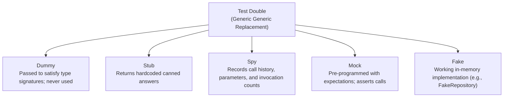

# Unit vs. Integration vs. End-to-End (E2E) Testing 🔬

> **Authoritative Sources & Literature:**
> - Gerard Meszaros: *xUnit Test Patterns: Refactoring Test Code* (Addison-Wesley)
> - Harry Percival & Bob Gregory: *Architecture Patterns with Python* (O'Reilly, "Cosmic Python")
> - Martin Fowler: *Mocks Aren't Stubs* & *Onion/Hexagonal Architecture Testing*
> - Brian Okken: *Python Testing with pytest* (Pragmatic Bookshelf)

---

## 1. Conceptual Definition & Core Mental Model

The distinction between **Unit**, **Integration**, and **End-to-End (E2E)** tests is defined by the **architectural boundaries** the test crosses and the degree of **test double substitution** employed.

```
┌────────────────────────────────────────────────────────────────────────┐
│                              END-TO-END                                │
│       [ HTTP Client ] ──> [ FastAPI Router ] ──> [ Middleware ]        │
│                                  │                                     │
│ ┌────────────────────────────────▼───────────────────────────────────┐ │
│ │                           INTEGRATION                              │ │
│ │          [ Service Layer ] ──> [ SQLAlchemy Repository ]           │ │
│ │                                         │                          │ │
│ │ ┌───────────────────────────────────────▼────────────────────────┐ │ │
│ │ │                            UNIT                                │ │ │
│ │ │        [ Domain Entities ] ──> [ Business Invariants ]         │ │ │
│ │ └────────────────────────────────────────────────────────────────┘ │ │
│ │                                         │                          │ │
│ │                                  [ PostgreSQL ]                    │ │
│ └────────────────────────────────────────────────────────────────────┘ │
│                                  │                                     │
│                     [ External Stripe / Redis ]                        │
└────────────────────────────────────────────────────────────────────────┘
```

### The Three Boundaries Defined

1. **Unit Tests**:
   - **Boundary**: Pure computational logic, algorithmic rules, domain entities, and value objects.
   - **Dependencies**: In-memory only. Zero network calls, zero database connections, zero filesystem writes, and zero system clock dependencies.
   - **Execution Time**: Sub-millisecond ($< 1\text{ms}$).
   - **Failure Diagnostic**: Pinpoints the exact function, branch, or line of code that violated an invariant.

2. **Integration Tests**:
   - **Boundary**: Crosses at least one out-of-process boundary (e.g., Python code communicating with PostgreSQL via SQLAlchemy, writing to Redis, publishing to RabbitMQ, or writing to disk).
   - **Dependencies**: Real infrastructure components (typically managed via Docker/Testcontainers or local sandbox databases).
   - **Execution Time**: Tens to hundreds of milliseconds ($20\text{ms} - 500\text{ms}$).
   - **Failure Diagnostic**: Identifies schema mismatches, SQL syntax errors, foreign key violations, serialization bugs, or connection pooling failures.

3. **End-to-End (E2E) Tests**:
   - **Boundary**: The complete system from the perspective of an external consumer (HTTP/REST API, GraphQL, or Celery consumer worker).
   - **Dependencies**: The full application stack running with all middleware, routers, dependency injection containers, and persistent storage.
   - **Execution Time**: Seconds ($1\text{s} - 30\text{s}$).
   - **Failure Diagnostic**: Coarse. Demonstrates that a business workflow is broken, but requires log analysis to locate the faulty component.

---

## 2. Why This Is Critical in Modern Python Backend Engineering

Without clear boundaries between test types, Python backend projects suffer from two major pathologies:

1. **The "False Unit Test" Trap**: Developers write "unit tests" that secretly invoke SQLite in-memory databases or query disk caches. When running 1,000 such tests, the suite slows to minutes, preventing fast feedback.
2. **The "Over-Mocked Integration" Trap**: Developers write "integration tests" that mock out the database engine using `unittest.mock`. This creates tests that pass even when the SQL dialect is invalid, defeating the purpose of integration testing.

A disciplined separation ensures that pure business logic remains decoupled from framework and database details (Clean Architecture / Hexagonal Architecture).

---

## 3. The Test Double Taxonomy (Gerard Meszaros)

The term "mock" is frequently misused as a generic catch-all. In modern backend engineering, we follow Gerard Meszaros' rigorous classification:



| Type | Definition | Typical Python Usage |
| :--- | :--- | :--- |
| **Dummy** | Passed to satisfy signatures, never actually executed | Supplying an unused `logger` or `auth_token` parameter |
| **Stub** | Provides canned, hardcoded responses to method calls | A stubbed currency converter returning `Decimal("1.25")` |
| **Spy** | Wraps a real object or stub to record invocation history | `mocker.spy(service, "dispatch_event")` |
| **Mock** | Pre-programmed with behavioral expectations and assertions | `unittest.mock.MagicMock()` asserting `.assert_called_once()` |
| **Fake** | Working implementation with in-memory shortcuts | In-memory `dict`-backed repository (`FakeOrderRepository`) |

---

## 4. Solitary vs. Sociable Unit Tests (Martin Fowler)

When designing unit tests, two philosophies exist:

```
Solitary Unit Test                     Sociable Unit Test
┌──────────────┐                       ┌──────────────┐
│  OrderClass  │                       │  OrderClass  │
└──────┬───────┘                       └──────┬───────┘
       │                                      │
       ▼                                      ▼
┌──────────────┐                       ┌──────────────┐
│ [Mock Tax]   │ (London School)       │  TaxClass    │ (Chicago School)
└──────────────┘                       └──────┬───────┘
                                              │
                                              ▼
                                       ┌──────────────┐
                                       │ MoneyClass   │
                                       └──────────────┘
```

- **Solitary Unit Tests (London School / Mockist)**: Isolate the SUT from all collaborators, replacing every dependent class with a Mock or Stub.
- **Sociable Unit Tests (Chicago / Detroit / Classicist)**: Allow the SUT to interact with real domain collaborators (like Value Objects and utility classes) as long as they operate entirely in memory.
- **Backend Standard**: Prefer **Sociable Unit Tests** for domain logic. Only use test doubles when crossing out-of-process boundaries (network, disk, clock).

---

## 5. Standard Syntax, Signatures & Key Options

### Structuring Tests in the Filesystem
```text
tests/
├── unit/
│   ├── domain/
│   │   ├── test_money.py
│   │   └── test_order_entity.py
│   └── services/
│       └── test_allocation_service.py   # Uses FakeRepository
├── integration/
│   ├── repositories/
│   │   └── test_postgres_order_repo.py  # Uses Real PostgreSQL
│   └── clients/
│       └── test_stripe_client.py        # Uses Respx / WireMock
└── e2e/
    └── api/
        └── test_order_lifecycle.py      # Uses httpx.AsyncClient + Full App
```

### Pytest Marker Configuration (`pyproject.toml`)
```toml
[tool.pytest.ini_options]
markers = [
    "unit: Fast, pure memory tests with zero I/O",
    "integration: Infrastructure tests touching PostgreSQL/Redis",
    "e2e: Complete HTTP and asynchronous system workflows",
]
```

---

## 6. Lifecycle, Execution Flow & Teardown Mechanics

| Dimension | Unit Testing | Integration Testing | E2E Testing |
| :--- | :--- | :--- | :--- |
| **Setup Phase** | Instantiate Python dataclasses | Create DB connection, begin transaction | Spin up FastAPI app, seed base tables |
| **Execution Phase** | Direct method call on SUT | Call repository method or service | Send HTTP request via `AsyncClient` |
| **Verification Phase** | Assert return value or entity state | Inspect DB rows or verify side effects | Assert HTTP status, JSON schema, and DB |
| **Teardown Phase** | Automatic garbage collection | `ROLLBACK` transaction via `SAVEPOINT` | Truncate test tables, close HTTP clients |
| **Teardown Cost** | $0\text{ms}$ | $2\text{ms} - 10\text{ms}$ | $50\text{ms} - 200\text{ms}$ |

---

## 7. Scopes, Hierarchy, or Test Boundaries

```
[ Application Ingress: HTTP / JSON ]  <--- E2E Boundary
         │
[ FastAPI Dependency Injection ]
         │
[ Service Layer / Application Core ]  <--- Integration Boundary Starts
         │
[ Port / Interface (typing.Protocol) ]
         │
   ┌─────┴──────────────────┐
   ▼                        ▼
[ In-Memory Fake ]   [ SQLAlchemy Adapter ]
(Used by Unit)       (Used by Integration)
   │                        │
[ Pure Python ]      [ PostgreSQL Container ]
```

---

## 8. Pytest Fixture & `conftest.py` Integration Patterns

Using Python's `typing.Protocol` allows dependency inversion, enabling unit tests to inject fast in-memory fakes while integration tests inject real database repositories.

```python
# src/domain/ports.py
from typing import Protocol, Optional
from src.domain.models import Account

class AccountRepository(Protocol):
    def get_by_id(self, account_id: str) -> Optional[Account]: ...
    def save(self, account: Account) -> None: ...

# tests/unit/conftest.py
import pytest
from typing import Dict, Optional
from src.domain.models import Account
from src.domain.ports import AccountRepository

class FakeAccountRepository(AccountRepository):
    """In-memory fake repository for lightning-fast unit tests."""
    def __init__(self, initial_data: Optional[Dict[str, Account]] = None):
        self._accounts: Dict[str, Account] = initial_data or {}

    def get_by_id(self, account_id: str) -> Optional[Account]:
        return self._accounts.get(account_id)

    def save(self, account: Account) -> None:
        self._accounts[account.id] = account

@pytest.fixture
def fake_account_repo() -> FakeAccountRepository:
    return FakeAccountRepository()
```

---

## 9. Practical Python Implementation: Step-by-Step Walkthrough

Let us build a **Bank Account Transfer Service** and test it across all three tiers.

### Step 1: Pure Domain Model (Unit Boundary)

```python
# src/domain/models.py
from dataclasses import dataclass
from decimal import Decimal

class InsufficientFundsError(Exception):
    pass

@dataclass
class Account:
    id: str
    owner_name: str
    balance: Decimal

    def debit(self, amount: Decimal) -> None:
        if amount <= Decimal("0.00"):
            raise ValueError("Debit amount must be positive")
        if self.balance < amount:
            raise InsufficientFundsError(f"Account {self.id} has insufficient funds")
        self.balance -= amount

    def credit(self, amount: Decimal) -> None:
        if amount <= Decimal("0.00"):
            raise ValueError("Credit amount must be positive")
        self.balance += amount
```

### Step 2: Service Layer Orchestration

```python
# src/services/transfer_service.py
from decimal import Decimal
from src.domain.ports import AccountRepository
from src.domain.models import InsufficientFundsError

class TransferService:
    def __init__(self, repo: AccountRepository) -> None:
        self.repo = repo

    def transfer(self, source_id: str, target_id: str, amount: Decimal) -> None:
        source = self.repo.get_by_id(source_id)
        target = self.repo.get_by_id(target_id)

        if not source or not target:
            raise ValueError("Source or target account does not exist")

        source.debit(amount)
        target.credit(amount)

        self.repo.save(source)
        self.repo.save(target)
```

### Tier 1: Unit Test (Execution Time: 0.001s)

```python
# tests/unit/test_transfer_service.py
import pytest
from decimal import Decimal
from src.domain.models import Account, InsufficientFundsError
from src.services.transfer_service import TransferService

@pytest.mark.unit
def test_successful_transfer_updates_balances(fake_account_repo) -> None:
    # Arrange: Seed fake repository in-memory
    acc_a = Account(id="ACC_1", owner_name="Alice", balance=Decimal("100.00"))
    acc_b = Account(id="ACC_2", owner_name="Bob", balance=Decimal("50.00"))
    fake_account_repo.save(acc_a)
    fake_account_repo.save(acc_b)

    service = TransferService(repo=fake_account_repo)

    # Act
    service.transfer(source_id="ACC_1", target_id="ACC_2", amount=Decimal("40.00"))

    # Assert: Pure state verification
    assert fake_account_repo.get_by_id("ACC_1").balance == Decimal("60.00")
    assert fake_account_repo.get_by_id("ACC_2").balance == Decimal("90.00")

@pytest.mark.unit
def test_transfer_with_insufficient_funds_raises_error(fake_account_repo) -> None:
    acc_a = Account(id="ACC_1", owner_name="Alice", balance=Decimal("20.00"))
    acc_b = Account(id="ACC_2", owner_name="Bob", balance=Decimal("50.00"))
    fake_account_repo.save(acc_a)
    fake_account_repo.save(acc_b)

    service = TransferService(repo=fake_account_repo)

    with pytest.raises(InsufficientFundsError):
        service.transfer(source_id="ACC_1", target_id="ACC_2", amount=Decimal("50.00"))

    # Assert balance remains invariant
    assert fake_account_repo.get_by_id("ACC_1").balance == Decimal("20.00")
    assert fake_account_repo.get_by_id("ACC_2").balance == Decimal("50.00")
```

### Tier 2: Integration Test (PostgreSQL / SQLAlchemy Repository)

```python
# tests/integration/test_postgres_repository.py
import pytest
from decimal import Decimal
from sqlalchemy.orm import Session
from src.adapters.orm import AccountORM
from src.adapters.postgres_repo import PostgresAccountRepository
from src.domain.models import Account

@pytest.mark.integration
def test_postgres_repository_persists_and_retrieves_account(db_session: Session) -> None:
    repo = PostgresAccountRepository(session=db_session)
    account = Account(id="ACC_DB_1", owner_name="Charlie", balance=Decimal("500.00"))

    # Act
    repo.save(account)
    db_session.flush()

    # Assert: Verify actual database row
    loaded = repo.get_by_id("ACC_DB_1")
    assert loaded is not None
    assert loaded.owner_name == "Charlie"
    assert loaded.balance == Decimal("500.00")
```

### Tier 3: End-to-End Test (FastAPI HTTP Endpoint)

```python
# tests/e2e/test_transfer_api.py
import pytest
from decimal import Decimal
from httpx import AsyncClient, ASGITransport
from fastapi import FastAPI

@pytest.mark.e2e
@pytest.mark.asyncio
async def test_transfer_endpoint_e2e(app: FastAPI, seeded_accounts) -> None:
    async with AsyncClient(transport=ASGITransport(app=app), base_url="http://testserver") as client:
        payload = {
            "source_id": "ACC_ALICE",
            "target_id": "ACC_BOB",
            "amount": "25.00"
        }
        response = await client.post("/api/v1/transfers", json=payload)

        assert response.status_code == 200
        data = response.json()
        assert data["status"] == "COMPLETED"
        assert data["transferred_amount"] == "25.00"
```

---

## 10. Framework-Specific Integration: FastAPI

FastAPI makes it straightforward to substitute implementations at test boundaries via its dependency injection system:

```python
# In tests/unit/test_api_routes.py
from fastapi import FastAPI
from src.api.dependencies import get_account_repo

def test_api_route_with_fake_repo(test_app: FastAPI, fake_account_repo) -> None:
    # Override the real database repository with our in-memory fake
    test_app.dependency_overrides[get_account_repo] = lambda: fake_account_repo
    
    # Run route tests with sub-millisecond execution
    # ...
    
    # Clean up overrides after test
    test_app.dependency_overrides.clear()
```

---

## 11. Real-World Enterprise Backend Scenario: Fintech Ledger Settlement

In financial ledger systems, testing boundaries are non-negotiable:
- **Unit Layer**: Verifies double-entry balancing rules (the sum of all debits must equal the sum of all credits for every journal entry, down to the exact Satoshi or cent).
- **Integration Layer**: Verifies database-level isolation levels (`SERIALIZABLE`), row-level locking (`SELECT ... FOR UPDATE`), and foreign key constraints preventing orphaned ledger entries.
- **E2E Layer**: Verifies asynchronous payment settlement, from ACH webhook receipt through ledger recording and Kafka event emission.

---

## 12. Anti-Patterns & Common Pitfalls

### Anti-Pattern 1: Mocking the Database in an Integration Test
Replacing SQLAlchemy or Psycopg with a mock in a test that resides in `tests/integration/`.

```python
# ❌ BAD: This tests nothing real and gives false confidence
def test_integration_repository_bad(mocker):
    mock_session = mocker.patch("sqlalchemy.orm.Session")
    repo = PostgresAccountRepository(session=mock_session)
    repo.save(Account("1", "Alice", 100))
    # Passing this assertion does NOT prove your SQL query is valid!
    mock_session.add.assert_called_once()
```

### Anti-Pattern 2: The "Sociable" Unit Test with Hidden I/O
A unit test that accidentally writes temporary files to the local hard drive or queries a real Redis instance running on `localhost:6379`.
- **Consequence**: Test breaks on CI runner where Redis is not running; tests interfere with each other during parallel runs (`pytest-xdist`).

### Anti-Pattern 3: Testing Business Invariants Only in E2E Tests
Exercising 25 different discount and tax edge cases exclusively through the `/checkout` HTTP API.
- **Consequence**: Test suite runtime balloons to 40 minutes, and failure messages are obscure JSON responses rather than pinpoint invariant traces.

---

## 13. Best Practices & Production Guidelines

1. **Use In-Memory Fakes Over Mocks for Domain Testing**: As advocated by Percival & Gregory (*Cosmic Python*), build a `FakeRepository` backed by a Python dictionary. It is simpler, cleaner, and faster than complex mock setups.
2. **Strict Directory & Marker Partitioning**: Maintain explicit directory separation (`tests/unit/`, `tests/integration/`, `tests/e2e/`) and ensure pre-commit hooks only run `tests/unit/`.
3. **Use Testcontainers for Real Database Testing**: For integration tests, run against the exact version of PostgreSQL used in production using `testcontainers-python` rather than relying on SQLite.
4. **Enforce Zero-I/O in Unit Tests**: Use `pytest-socket` to disallow network calls during unit test runs.

---

## 14. Trade-Off Analysis: Testing Boundaries

| Dimension | Unit Tests | Integration Tests | End-to-End Tests |
| :--- | :--- | :--- | :--- |
| **Primary Goal** | Logic correctness & fast feedback | Boundary & schema contract verification | System-wide confidence & critical paths |
| **Typical Count** | 70% – 80% | 15% – 25% | 5% – 10% |
| **Execution Speed** | $\le 1\text{ms}$ | $20\text{ms} - 300\text{ms}$ | $1\text{s} - 15\text{s}$ |
| **State Cleanliness** | Automatic (In-memory) | Requires DB Rollback / Truncation | Complex environment reset |
| **Brittle to Refactoring** | Low (if testing behavior) | Low | High (changes to UI/routing) |
| **Cost to Write** | Lowest | Moderate | Highest |

---

## 15. Diagnostic & Debugging Playbook

```bash
# Run only unit tests with immediate failure on error
pytest tests/unit/ -x

# Profile the 10 slowest tests in the integration suite
pytest tests/integration/ --durations=10

# Verify no unit tests open network sockets (fails if socket is accessed)
pytest tests/unit/ --disable-socket

# Run E2E tests with live log capture enabled
pytest tests/e2e/ -o log_cli=true --log-cli-level=DEBUG
```

---

## 16. Senior Staff Interview Questions & Deep Dives

### Question 1: Why does Harry Percival advocate for "Fake Repositories" over `unittest.mock` when unit testing service layers?
**Answer**:
`unittest.mock` operates via dynamic attribute substitution at runtime. Mocks can easily diverge from the real interface without warning (e.g., if a method signature changes, the mock still accepts the old signature unless `autospec=True` is rigorously applied). Furthermore, tests heavy with `mock.patch` become coupled to implementation details (how things are called) rather than state (what was produced). A **Fake Repository** implements the real `typing.Protocol` interface using an in-memory dictionary. It exercises the real service layer logic with genuine state storage, runs just as fast as a mock, and provides cleaner, refactoring-resilient assertions.

### Question 2: When is testing against an in-memory SQLite database an anti-pattern for integration tests?
**Answer**:
When production runs PostgreSQL or MySQL. SQLite lacks many production database capabilities:
1. Concurrency and locking models (SQLite locks the whole file on write, hiding deadlocks).
2. Advanced data types (native `JSONB`, PostgreSQL UUIDs, array columns, custom ENUMs).
3. Constraint enforcement (foreign key checks are off by default in SQLite; case-sensitivity in text matching differs).
Using SQLite for integration tests results in passing tests locally that fail in production. Modern best practice is to run real PostgreSQL in Docker via Testcontainers or ephemeral sandboxes.

---

## 17. Hands-on Engineering Exercises & Challenges

### Exercise 1: Isolating an Out-of-Process Dependency
You have a `NotificationService` that sends SMS messages via Twilio.
1. Define a `SmsSender` `Protocol` with a `.send(phone: str, body: str) -> bool` method.
2. Implement a `FakeSmsSender` that records sent messages in a list.
3. Write a unit test for `NotificationService` using the fake, with zero network calls.
4. Write an integration test using `respx` or `WireMock` that verifies the real `TwilioSmsSender` constructs the expected HTTP POST payload.

### Exercise 2: Converting an Over-Mocked Unit Test to a Sociable Unit Test
Take an existing test that uses 5 `mocker.patch` calls to mock sub-functions in a billing domain module. Refactor it to use real in-memory value objects and domain entities, removing all mocks while keeping execution time under $2\text{ms}$.

---

## 18. Summary, Cross-References & Further Reading

Mastering the boundaries between Unit, Integration, and E2E tests is the key to building fast, reliable, and scalable test suites. Unit tests protect business logic invariants in microseconds; integration tests verify database and infrastructure contracts; and E2E tests guarantee user journeys.

### Cross-References:
- Previous: [The Testing Pyramid & Modern Topologies](testing-pyramid.md)
- Next: [Test-Driven Development (TDD)](test-driven-development.md)
- [Repository Pattern & Testing Fakes](../architecture-and-testing/repository-pattern.md)
- [Mocking & The Test Double Spectrum](../advanced-pytest/mocking.md)
