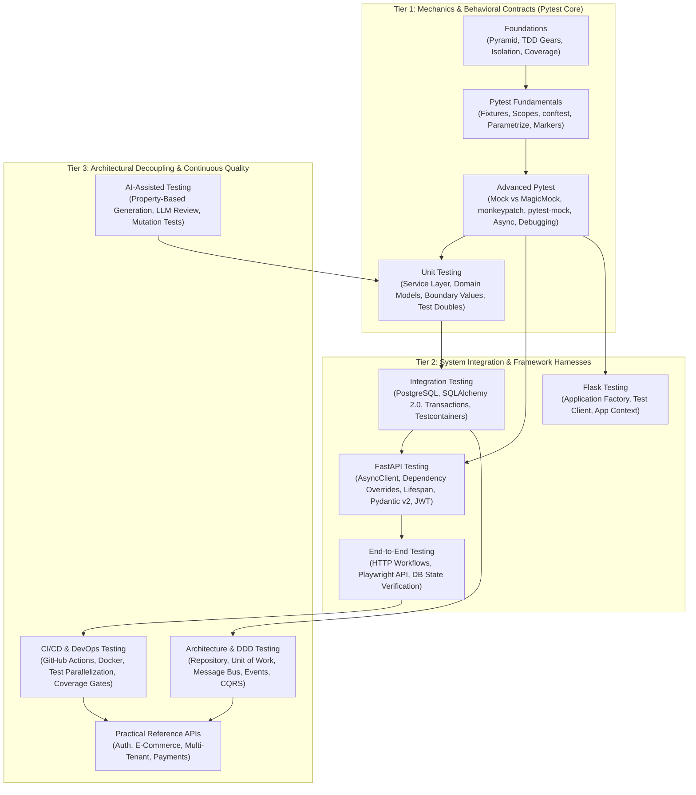

# Python Backend Testing & Quality Architecture Knowledge System 🧪🐍

> A comprehensive, production-grade engineering manual, test architecture encyclopedia, and practical pytest reference for modern Python backend applications.
>
> Built on authoritative industry standards and foundational literature:
> - **Brian Okken**: *Python Testing with pytest: Simple, Rapid, Effective, and Scalable* (2nd Edition, Pragmatic Bookshelf)
> - **Harry Percival & Bob Gregory**: *Architecture Patterns with Python: Enabling Test-Driven Development, Domain-Driven Design, and Event-Driven Microservices* (O'Reilly, "Cosmic Python")
> - **Gerard Meszaros**: *xUnit Test Patterns: Refactoring Test Code* (Addison-Wesley)
> - **Martin Fowler & Kent Beck**: *Refactoring & Test-Driven Development by Example*

---

## 🏛️ The Three-Tier Python Backend Testing Model

Modern Python backend testing is not simply writing isolated function tests. It is an engineering discipline that couples runtime safety, loose architectural coupling, deterministic isolation, and high deployment confidence.

---

## 🧭 Master Knowledge Base Map

### [1. Foundations (8 Guides)](foundations/)
The theoretical, mathematical, and architectural underpinnings of software testing.
- [Foundations Overview](foundations/index.md)
- [Software Testing Fundamentals](foundations/software-testing-fundamentals.md) — Verification vs. Validation, Cost of Defects, Black/White/Grey Box.
- [The Testing Pyramid & Modern Topologies](foundations/testing-pyramid.md) — Fowler/Okken Pyramid vs. Testing Trophy vs. Microservices Honeycomb.
- [Unit vs. Integration vs. E2E Testing](foundations/unit-vs-integration-vs-e2e.md) — Precise boundaries, confidence vs. velocity curves, test double spectrum.
- [Test-Driven Development (TDD)](foundations/test-driven-development.md) — Red-Green-Refactor, TDD in High Gear vs. Low Gear, London vs. Chicago schools.
- [Test Coverage & Metrics](foundations/test-coverage.md) — Statement vs. Branch vs. Mutation coverage, coverage traps, Goodhart's Law in QA.
- [Test Isolation & Determinism](foundations/test-isolation.md) — Preventing test pollution, shared state hazards, deterministic database sandboxes.

---

### [2. Pytest Fundamentals (11 Guides)](pytest-fundamentals/)
Mastery of the standard Python testing framework from Brian Okken's foundational work.
- [Pytest Fundamentals Overview](pytest-fundamentals/index.md)
- [Installation & Configuration](pytest-fundamentals/installation-and-configuration.md) — `pyproject.toml`, `pytest.ini`, flags, and environments.
- [Test Discovery & Execution](pytest-fundamentals/test-discovery.md) — Python test discovery rules, custom collectors, filtering.
- [Smart Assertions & Failure Introspection](pytest-fundamentals/assertions.md) — AST rewriting, custom assertion helpers, failure diff formatting.
- [Fixtures Mechanics & Dependency Injection](pytest-fundamentals/fixtures.md) — The fixture mental model, yield fixtures, teardown execution.
- [Centralized Configuration with `conftest.py`](pytest-fundamentals/conftest.md) — Root vs. directory-level cascading `conftest.py` rules.
- [Fixture Scopes & Lifecycle Management](pytest-fundamentals/fixture-scopes.md) — `function`, `class`, `module`, `package`, and `session` scopes.
- [Data-Driven Parametrization](pytest-fundamentals/parametrization.md) — `@pytest.mark.parametrize`, dynamic fixture parametrization, cartesian products.
- [Markers & Test Selection](pytest-fundamentals/markers.md) — Built-in markers (`skip`, `xfail`), custom markers, `-m` filtering.
- [Pytest Plugin Ecosystem](pytest-fundamentals/plugins.md) — `pytest-xdist`, `pytest-cov`, `pytest-sugar`, authoring custom hooks.

---

### [3. Advanced Pytest (10 Guides)](advanced-pytest/)
Deep dive into runtime interception, isolation, async execution, and test doubles.
- [Advanced Pytest Overview](advanced-pytest/index.md)
- [Mocking Fundamentals & The Test Double Spectrum](advanced-pytest/mocking.md) — Dummies, Stubs, Spies, Mocks, and Fakes.
- [Patching Mechanics & Target Location Rules](advanced-pytest/patching.md) — Where to patch ("patch where an object is looked up, not where it is defined").
- [Safe Runtime Substitution with `monkeypatch`](advanced-pytest/monkeypatch.md) — Modifying environment variables, sys.path, attributes, and dictionaries.
- [`Mock` vs. `MagicMock`](advanced-pytest/mock-vs-magicmock.md) — Magic method dispatch, spec validation, autospec pitfalls.
- [Idiomatic Mocking with `pytest-mock`](advanced-pytest/pytest-mock.md) — The `mocker` fixture, spy objects, stubbing without teardown leaks.
- [Async Testing with `pytest-asyncio`](advanced-pytest/async-testing.md) — Event loops, async fixtures, concurrency testing, race condition detection.
- [Exception Testing & Negative Test Paths](advanced-pytest/exception-testing.md) — `pytest.raises`, exception info matching, custom exception hierarchies.
- [Debugging Test Failures](advanced-pytest/debugging-tests.md) — `--pdb`, `--trace`, `-vv`, `--tb=short`, capturing stdout/stderr (`-s`).

---

### [4. Unit Testing in Backend Python (8 Guides)](unit-testing/)
Isolating pure logic, domain invariants, and service interactions.
- [Unit Testing Overview](unit-testing/index.md)
- [Function & Algorithmic Testing](unit-testing/function-testing.md) — Deterministic inputs, pure functions, side-effect elimination.
- [Service Layer Unit Testing](unit-testing/service-layer-testing.md) — Orchestrating domain workflows with fake repositories.
- [Business Logic & Invariant Testing](unit-testing/business-logic-testing.md) — Testing rich entity invariants and domain aggregates.
- [Edge Case & Defensive Testing](unit-testing/edge-case-testing.md) — Null values, boundary overflows, malformed inputs, Unicode edge cases.
- [Boundary Value Analysis (BVA)](unit-testing/boundary-value-testing.md) — 2-point vs. 3-point boundary testing, robust test suite derivation.
- [Dependency Isolation Strategies](unit-testing/dependency-isolation.md) — Decoupling time, random seeds, file systems, and network sockets.

---

### [5. Integration Testing (9 Guides)](integration-testing/)
Verifying real infrastructure, queries, schema migrations, and external boundaries.
- [Integration Testing Overview](integration-testing/index.md)
- [API Integration Testing](integration-testing/api-integration-testing.md) — Testing full HTTP lifecycles against real databases.
- [Database Integration Testing Strategies](integration-testing/database-testing.md) — Schema setup, migrations, seeded datasets, and sanitation.
- [SQLAlchemy 2.0 Testing Harnesses](integration-testing/sqlalchemy-testing.md) — Session management, async engines, query verification, mapper testing.
- [Production-Parity PostgreSQL Testing](integration-testing/postgresql-testing.md) — Avoiding SQLite traps, JSONB, native enums, concurrency locks.
- [Transaction Rollback Sandboxing](integration-testing/transaction-and-rollback.md) — Nested transactions (`SAVEPOINT`), lightning-fast test isolation.
- [Containerized Dependencies with Testcontainers](integration-testing/testcontainers-testing.md) — Spinning up ephemeral Postgres, Redis, and Kafka in tests.
- [External HTTP & Webhook Integration](integration-testing/external-api-testing.md) — `respx`, WireMock, VCR.py cassette recording.
- [Authentication & Role-Based Access Control](integration-testing/authentication-testing.md) — Testing OAuth2, JWT signatures, claim validation, multi-tenant RBAC.

---

### [6. Modern Framework Testing: FastAPI (9 Guides)](fastapi-testing/)
Deep patterns for modern async ASGI backends, Pydantic v2, and dependency injection.
- [FastAPI Testing Overview](fastapi-testing/index.md)
- [Testing Clients: `TestClient` vs. `httpx.AsyncClient`](fastapi-testing/testclient-and-httpx.md) — ASGI transports, lifecycle handling, async execution.
- [Endpoint Integration Testing](fastapi-testing/endpoint-testing.md) — Status codes, headers, cookies, query parameters, path parsing.
- [Dependency Injection Overrides](fastapi-testing/dependency-overrides.md) — `app.dependency_overrides`, swappable database sessions, fake auth providers.
- [Request & Schema Validation Testing](fastapi-testing/request-validation.md) — Testing 422 Unprocessable Entity, custom Pydantic v2 field validators.
- [Response Serialization & Security Auditing](fastapi-testing/response-validation.md) — Preventing credential leakage, `response_model` filtering.
- [JWT & OAuth2 Security Testing](fastapi-testing/jwt-testing.md) — Expired tokens, bad signatures, tampered scopes, RBAC middleware.
- [Background Tasks & Streaming Endpoints](fastapi-testing/async-endpoint-testing.md) — Server-Sent Events, async streams, BackgroundTasks execution verification.

---

### [7. Modern Framework Testing: Flask (7 Guides)](flask-testing/)
Enterprise patterns for WSGI, blueprints, and request context mechanics.
- [Flask Testing Overview](flask-testing/index.md)
- [Flask Test Client & Request Context](flask-testing/flask-test-client.md) — Client initialization, cookies, sessions, request context stack.
- [Application Factory Testing Pattern](flask-testing/application-factory-testing.md) — Dynamic test configuration injection, extensions isolation.
- [Blueprint & Route Verification](flask-testing/route-testing.md) — Blueprint registration, URL generation (`url_for`), error handlers.
- [Application Context & Database Fixtures](flask-testing/application-context.md) — `app.app_context()`, `g` object, teardown requests.
- [Flask Session & Cookie Security Testing](flask-testing/authentication-testing.md) — Secure cookies, CSRF protection, session impersonation tests.

---

### [8. End-to-End (E2E) Testing (6 Guides)](e2e-testing/)
Validating entire operational pipelines from boundary to boundary.
- [E2E Testing Overview](e2e-testing/index.md)
- [API-Level vs. Browser-Level E2E Testing](e2e-testing/api-vs-browser-e2e.md) — Speed, maintenance, flake rate, appropriate application levels.
- [Playwright for API & Backend Verification](e2e-testing/playwright-api-testing.md) — Real browser flows, authenticated storage state, API tracing.
- [Complex Multi-Step User Workflows](e2e-testing/user-workflows.md) — Registration, email verification, checkout, asynchronous background worker polling.
- [Cross-Service Database State Verification](e2e-testing/database-verification.md) — Asserting event side-effects, outbox tables, queue state.
- [Test Environment & Seed Data Management](e2e-testing/test-environment-management.md) — Docker Compose test networks, teardown cleanliness, database migrations.

---

### [9. Architecture & Testing: Cosmic Python / DDD (10 Guides)](architecture-and-testing/)
Building decoupled systems where business logic is 100% testable without database or network I/O.
- [Architecture & Testing Overview](architecture-and-testing/index.md)
- [Repository Pattern & Fake Repositories](architecture-and-testing/repository-pattern.md) — Replacing SQLAlchemy with an in-memory dictionary repository.
- [Unit of Work (UoW) Pattern Testing](architecture-and-testing/unit-of-work.md) — Atomic transactions, atomic commits, rollback verification.
- [Service Layer / Use Case Testing](architecture-and-testing/service-layer.md) — Driving services via clean primitive commands and fake adapters.
- [Domain Model & Pure Entity Invariants](architecture-and-testing/domain-model-testing.md) — Zero-dependency aggregate tests, money values, order allocation.
- [Ports & Adapters (Hexagonal Architecture)](architecture-and-testing/ports-and-adapters.md) — Primary (driving) vs. secondary (driven) ports, protocol-based testing.
- [Domain Events & Message Bus Testing](architecture-and-testing/domain-events-and-message-bus-testing.md) — Decoupled event emission, tracking side-effects, fake message brokers.
- [CQRS Testing (Command Query Responsibility Segregation)](architecture-and-testing/cqrs-testing.md) — Testing read models (fast raw SQL) vs. write models (domain aggregates).
- [Dependency Inversion via Python Protocols](architecture-and-testing/dependency-injection.md) — `typing.Protocol` structural subtyping for ultra-fast unit testing.

---

### [10. AI-Assisted & Modern Quality Engineering (6 Guides)](ai-assisted-testing/)
Leveraging generative models and property testing safely.
- [AI-Assisted Testing Overview](ai-assisted-testing/index.md)
- [AI-Generated Test Cases](ai-assisted-testing/ai-generated-test-cases.md) — Prompt engineering for exhaustive test scenarios, edge case extraction.
- [Testing AI-Generated & LLM Code](ai-assisted-testing/testing-ai-generated-code.md) — Rigorous test cages, automated hallucination detection, contract tests.
- [Automated Code & Test Review](ai-assisted-testing/test-case-review.md) — Static analysis, detecting tautological tests, smell detection in tests.
- [Mutation Testing with `mutmut`](ai-assisted-testing/mutation-testing.md) — Testing your tests: killing mutant bugs, evaluating test suite strength.
- [Property-Based Testing with `hypothesis`](ai-assisted-testing/property-based-testing.md) — Fuzzing, invariant discovery, shrinking failure cases.

---

### [11. CI/CD & DevOps Testing (6 Guides)](ci-cd-and-devops/)
Automating quality gates in modern engineering pipelines.
- [CI/CD Testing Overview](ci-cd-and-devops/index.md)
- [Dockerized Testing Pipelines](ci-cd-and-devops/docker-testing.md) — Multi-stage Dockerfiles for test execution, caching wheels, isolation.
- [GitHub Actions Test Matrix Workflows](ci-cd-and-devops/github-actions.md) — Parallel runners, service containers (Postgres/Redis), caching pytest cache.
- [Distributed Parallel Testing with `pytest-xdist`](ci-cd-and-devops/parallel-testing.md) — Core allocation, CPU auto-detection, avoiding test collisions.
- [Coverage Reporting & Quality Gates](ci-cd-and-devops/coverage-reporting.md) — XML coverage output, PR annotations, minimum threshold enforcement.
- [Continuous Testing & Flaky Test Remediation](ci-cd-and-devops/continuous-testing.md) — Flake detection, quarantine markers, `pytest-rerunfailures`.

---

### [12. Practical Reference Projects (6 Guides)](practical-projects/)
Production-grade, end-to-end test suites for common backend domains.
- [Reference Projects Overview](practical-projects/index.md)
- [User Management & RBAC API Suite](practical-projects/user-management-api.md) — Registration, Argon2 hashing, password reset tokens, permissions.
- [Fintech Authentication & 2FA API Suite](practical-projects/authentication-api.md) — TOTP verification, rate-limiting, session revocation, refresh tokens.
- [E-Commerce Order & Inventory Suite](practical-projects/ecommerce-api.md) — Optimistic concurrency, order state machine, stock allocation invariants.
- [Stripe / Webhook Payment Integration Suite](practical-projects/payment-api.md) — Webhook signature verification, idempotency keys, refund retries.
- [Multi-Tenant SaaS API Testing Architecture](practical-projects/complete-testing-project.md) — Schema-per-tenant, row-level security (RLS), isolated data fixtures.

---

### [13. Comparative Architecture Guides (8 Guides)](comparisons/)
Side-by-side technical trade-off matrices.
- [Comparisons Overview](comparisons/index.md)
- [Unit vs. Integration vs. End-to-End](comparisons/unit-vs-integration-vs-e2e.md)
- [Pytest vs. Unittest](comparisons/pytest-vs-unittest.md)
- [Test Doubles: Mocks vs. Fakes vs. Stubs vs. Spies](comparisons/mock-vs-fake-vs-stub.md)
- [TestClient vs. HTTPX AsyncClient vs. Live Server](comparisons/testclient-vs-httpx-vs-live.md)
- [SQLite vs. PostgreSQL in Database Integration Testing](comparisons/sqlite-vs-postgresql-testing.md)
- [Synchronous vs. Asynchronous Testing Paradigms](comparisons/sync-vs-async-testing.md)
- [pytest-mock vs. unittest.mock](comparisons/pytest-mock-vs-unittest-mock.md)

---

### [14. Resources, Checklists & Senior Playbooks (6 Guides)](resources/)
Essential toolkits, interview preparation, and debugging cheat sheets.
- [Resources Overview](resources/index.md)
- [Senior & Staff Backend Testing Interview Q&A](resources/interview-questions.md) — 30 deep architectural questions for Staff/Lead engineers.
- [The Comprehensive Pytest CLI & Configuration Cheat Sheet](resources/pytest-cheat-sheet.md) — Options, env vars, ini flags, formatting.
- [Backend Quality Strategy & Test Plan Template](resources/testing-strategy-template.md) — Engineering RFC template for backend teams.
- [Flaky Test Root-Cause Playbook](resources/flaky-test-playbook.md) — Systematic guide to identifying, isolating, and killing test flakes.
- [Complete Python Testing Glossary](resources/glossary.md) — From AST rewriting to Zephyr test runs.

---

## 🔗 Synergies with Design Patterns and Refactoring

The three pillars of this repository form an unbreakable engineering triangle:

| Engineering Need | Design Patterns (`design-patterns/`) | Refactoring (`refactoring/`) | Backend Testing (`python-backend-testing/`) |
| :--- | :--- | :--- | :--- |
| **Loose Coupling** | Strategy, Factory Method, Dependency Inversion | Replace Inheritance with Delegation | Test Doubles, Fake Repositories, Ports & Adapters |
| **Behavior Safety** | Template Method, State Pattern | Characterization Tests, Seams | Pytest Fixtures, Invariant Testing, Regressions |
| **Clean APIs** | Facade, Builder, Adapter | Introduce Parameter Object | Fast Contract Tests, Schema Validation, AsyncClient |
| **State Isolation** | Prototype, Immutable Value Objects | Encapsulate Field, Encapsulate Collection | Transaction Rollback, Ephemeral Docker DBs |

---

## 📐 The 18-Section Golden Anatomy Standard

Every individual topic guide in this system adheres to a comprehensive 18-section format designed for production engineering teams:

1. **Title & Reference Attribution** (Brian Okken, Harry Percival, Gerard Meszaros, Martin Fowler)
2. **Conceptual Definition & Core Mental Model**
3. **Why This Is Critical in Modern Python Backend Engineering**
4. **Internal Mechanics & How It Works** (with interactive Mermaid.js diagram)
5. **Standard Syntax, Signatures & Key Options**
6. **Lifecycle, Execution Flow & Teardown Mechanics**
7. **Scopes, Hierarchy, or Test Boundaries**
8. **Pytest Fixture & `conftest.py` Integration Patterns**
9. **Practical Python Implementation: Step-by-Step Walkthrough** (Python 3.10+, type hints)
10. **Framework-Specific Integration** (FastAPI / SQLAlchemy 2.0 / Pydantic v2 / Flask)
11. **Real-World Enterprise Backend Scenario** (Fintech, E-commerce, SaaS)
12. **Anti-Patterns & Common Pitfalls** (Side-by-side Before / After code)
13. **Best Practices & Production Guidelines**
14. **Trade-Off Analysis & Alternative Comparisons** (Markdown matrix)
15. **Diagnostic & Debugging Playbook** (CLI flags, pytest failure interpretation)
16. **Senior Staff Interview Questions & Deep Dives** (with thorough answers)
17. **Hands-on Engineering Exercises & Challenges** (with solution hints)
18. **Summary, Cross-References & Further Reading**
