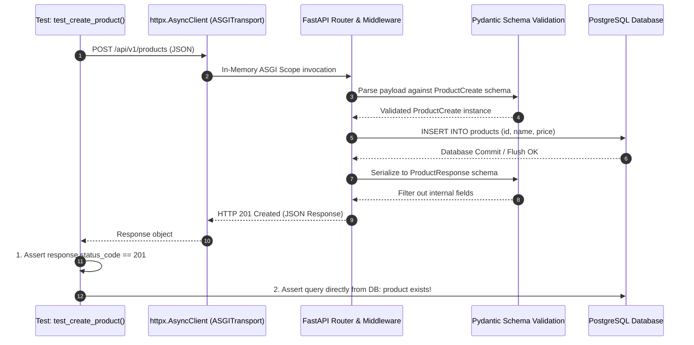
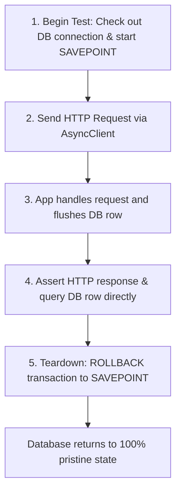

# API Integration Testing: HTTP Lifecycles & Real Persistence 🌐

> **Authoritative Sources & Literature:**
> - Martin Fowler: *Component Testing & Integration Testing* (martinfowler.com)
> - encode/httpx: *HTTPX AsyncClient & ASGI In-Process Transport Documentation*
> - Brian Okken: *Python Testing with pytest* (Pragmatic Bookshelf)
> - FastAPI Development Team: *FastAPI Advanced Testing Guide* (fastapi.tiangolo.com)

---

## 1. Conceptual Definition & Core Mental Model

**API Integration Testing** evaluates the complete request-response lifecycle of a backend application from the HTTP boundary down to persistent storage, running entirely in-process against a real or containerized database.

Unlike unit tests (which substitute databases with in-memory fakes), API integration tests verify that **all architectural layers integrate seamlessly**:
- HTTP routing and path parameter parsing.
- Middleware execution (CORS, Request Tracing, Authentication).
- Pydantic v2 request body deserialization and schema validation.
- FastAPI dependency injection (`Depends`) wiring.
- SQLAlchemy ORM mapping, query generation, and foreign key constraints.
- Real database persistence in PostgreSQL.
- Pydantic v2 response serialization and sensitive field filtering.

```
       [ HTTP Test Client (httpx.AsyncClient) ]
                          │ (In-Process Memory Transport)
                          ▼
             [ FastAPI Routing & Middleware ]
                          │
             [ Pydantic Request Validation (422 Check) ]
                          │
             [ Dependency Injection (Auth / Session) ]
                          │
             [ SQLAlchemy 2.0 ORM Mappings ]
                          │
             [ Real PostgreSQL Database / Container ] <─── VERIFIES PERSISTENCE!
```

---

## 2. Why This Is Critical in Modern Python Backend Engineering

1. **Catching Seam Failures**: Code often passes unit tests, yet fails in production because a database column name is misspelled in an ORM query, a foreign key constraint is violated, or Pydantic fails to serialize a `UUID` or `Decimal` field into JSON.
2. **In-Process ASGI Execution Velocity**: By using `httpx.AsyncClient` with `ASGITransport(app=app)`, tests bypass operating system network sockets and TCP handshakes entirely. Requests communicate with FastAPI via in-memory ASGI callable protocols, executing in **5 to 15 milliseconds** per request!
3. **Verifying True State Mutation**: A test must not simply assert `response.status_code == 201`; it must query the database to verify that the row was actually inserted with correct values.

---

## 3. The Complete ASGI Request Flow



---

## 4. Standard Syntax, Signatures & Key Options

### Modern Async Testing Client Setup (`HTTPX`)
```python
import pytest
from httpx import AsyncClient, ASGITransport
from fastapi import FastAPI
from src.main import app

@pytest.fixture
async def async_client() -> AsyncClient:
    """
    Creates an in-process ASGI async client.
    Does NOT open network sockets! Communicates via memory.
    """
    transport = ASGITransport(app=app)
    async with AsyncClient(transport=transport, base_url="http://testserver") as client:
        yield client
```

### Standard HTTP Interaction Syntax
```python
# GET with Query Parameters
response = await client.get("/api/v1/orders", params={"page": 1, "page_size": 20})

# POST with JSON Body & Custom Headers
response = await client.post(
    "/api/v1/orders",
    json={"sku": "DESK-01", "quantity": 2},
    headers={"Authorization": f"Bearer {token}", "X-Correlation-ID": "test-uuid-123"}
)

# PUT / PATCH
response = await client.patch("/api/v1/orders/ord_1", json={"status": "CANCELLED"})

# DELETE
response = await client.delete("/api/v1/orders/ord_1")
```

---

## 5. Lifecycle, Execution Flow & Teardown Mechanics

In API integration testing, every mutating test must execute within an isolated database sandbox:



---

## 6. Scopes, Hierarchy, or Test Boundaries

```
[ Outside: Public Ingress HTTP / REST API ] <─── TEST STARTS HERE
                 │
[ In-Process ASGI Request Dispatch ]
                 │
[ Real FastAPI Dependencies & Services ]
                 │
[ Real SQLAlchemy 2.0 ORM Mappings ]
                 │
[ Real PostgreSQL Database ]                <─── TEST VERIFIES HERE
                 │
[ External 3rd Party APIs (Stripe, Twilio) ] <─── MOCKED WITH RESPOX / WIREMOCK
```

---

## 7. Pytest Fixture & `conftest.py` Integration Patterns

Wiring the real database session into FastAPI's dependency injection system:

```python
# tests/integration/conftest.py
import pytest
from httpx import AsyncClient, ASGITransport
from sqlalchemy.orm import Session
from src.main import app
from src.database import get_db

@pytest.fixture
def test_app(db_session: Session):
    """
    Overrides the FastAPI get_db dependency to yield our
    transactional sandbox database session!
    """
    app.dependency_overrides[get_db] = lambda: db_session
    yield app
    app.dependency_overrides.clear()

@pytest.fixture
async def api_client(test_app) -> AsyncClient:
    transport = ASGITransport(app=test_app)
    async with AsyncClient(transport=transport, base_url="http://test") as client:
        yield client
```

---

## 8. Practical Python Implementation: Step-by-Step Walkthrough

We will build an **E-Commerce Product Catalog CRUD API** and write a comprehensive integration test suite verifying HTTP responses and PostgreSQL database state.

### Step 1: Define Application Domain & Database Models

```python
# src/models.py
from sqlalchemy.orm import DeclarativeBase, Mapped, mapped_column
from decimal import Decimal

class Base(DeclarativeBase):
    pass

class ProductORM(Base):
    __tablename__ = "products"

    id: Mapped[str] = mapped_column(primary_key=True)
    name: Mapped[str] = mapped_column(nullable=False)
    price: Mapped[Decimal] = mapped_column(nullable=False)
    is_active: Mapped[bool] = mapped_column(default=True)
```

### Step 2: Implement FastAPI Router & Pydantic Schemas

```python
# src/api/products.py
from fastapi import APIRouter, Depends, HTTPException, status
from pydantic import BaseModel, Field
from sqlalchemy.orm import Session
from decimal import Decimal
from uuid import uuid4
from src.models import ProductORM
from src.database import get_db

router = APIRouter(prefix="/products", tags=["Products"])

class ProductCreate(BaseModel):
    name: str = Field(..., min_length=2, max_length=100)
    price: Decimal = Field(..., gt=0)

class ProductResponse(BaseModel):
    id: str
    name: str
    price: Decimal
    is_active: bool

    class Config:
        from_attributes = True

@router.post("", response_model=ProductResponse, status_code=status.HTTP_201_CREATED)
def create_product(payload: ProductCreate, db: Session = Depends(get_db)):
    product = ProductORM(
        id=f"prod_{uuid4().hex[:8]}",
        name=payload.name,
        price=payload.price,
    )
    db.add(product)
    db.commit()
    db.refresh(product)
    return product

@router.get("/{product_id}", response_model=ProductResponse)
def get_product(product_id: str, db: Session = Depends(get_db)):
    product = db.query(ProductORM).filter_by(id=product_id).first()
    if not product:
        raise HTTPException(status_code=404, detail="Product not found")
    return product

@router.delete("/{product_id}", status_code=status.HTTP_204_NO_CONTENT)
def delete_product(product_id: str, db: Session = Depends(get_db)):
    product = db.query(ProductORM).filter_by(id=product_id).first()
    if not product:
        raise HTTPException(status_code=404, detail="Product not found")
    db.delete(product)
    db.commit()
```

### Step 3: Implement Rigorous Integration Test Suite

```python
# tests/integration/test_product_api.py
import pytest
from decimal import Decimal
from httpx import AsyncClient
from sqlalchemy.orm import Session
from src.models import ProductORM

@pytest.mark.integration
@pytest.mark.asyncio
async def test_create_product_lifecycle(api_client: AsyncClient, db_session: Session):
    # 1. ACT: Send POST request
    payload = {"name": "Ergonomic Standing Desk", "price": "499.99"}
    response = await api_client.post("/products", json=payload)

    # 2. ASSERT HTTP CONTRACT
    assert response.status_code == 201
    data = response.json()
    product_id = data["id"]
    assert product_id.startswith("prod_")
    assert data["name"] == "Ergonomic Standing Desk"
    assert data["price"] == "499.99"
    assert data["is_active"] is True

    # 3. CRITICAL: DIRECT DATABASE VERIFICATION!
    db_product = db_session.query(ProductORM).filter_by(id=product_id).one_or_none()
    assert db_product is not None
    assert db_product.name == "Ergonomic Standing Desk"
    assert db_product.price == Decimal("499.99")


@pytest.mark.integration
@pytest.mark.asyncio
async def test_get_product_not_found(api_client: AsyncClient):
    response = await api_client.get("/products/prod_nonexistent")
    assert response.status_code == 404
    assert response.json() == {"detail": "Product not found"}


@pytest.mark.integration
@pytest.mark.asyncio
async def test_delete_product_persists_deletion(api_client: AsyncClient, db_session: Session):
    # Arrange: Seed a product directly into PostgreSQL
    seeded = ProductORM(id="prod_seed_1", name="Wireless Mouse", price=Decimal("29.99"))
    db_session.add(seeded)
    db_session.commit()

    # Act: Call DELETE endpoint
    response = await api_client.delete("/products/prod_seed_1")
    assert response.status_code == 204

    # Assert: Query database directly to prove row is gone!
    persisted = db_session.query(ProductORM).filter_by(id="prod_seed_1").first()
    assert persisted is None
```

---

## 9. Framework-Specific Integration: Pydantic Validation Error Auditing

Integration tests must verify that malformed JSON payloads return `HTTP 422 Unprocessable Entity` with structured field pointers:

```python
@pytest.mark.integration
@pytest.mark.asyncio
async def test_create_product_validation_error(api_client: AsyncClient):
    # Invalid: price is negative, name is too short
    payload = {"name": "A", "price": "-10.00"}
    response = await api_client.post("/products", json=payload)

    assert response.status_code == 422
    errors = response.json()["detail"]
    
    # Assert exact field validation errors
    assert any(e["loc"] == ["body", "name"] for e in errors)
    assert any(e["loc"] == ["body", "price"] for e in errors)
```

---

## 10. Real-World Enterprise Backend Scenario: B2B Multi-Tenant Customer Onboarding

In an enterprise SaaS platform:
- `POST /api/v1/organizations` is invoked with `{ "org_name": "Acme Corp", "admin_email": "admin@acme.com" }`.
- The integration test verifies that:
  1. An `organizations` row is created.
  2. A default `users` row is created with hashed password and role `OWNER`.
  3. A default `billing_account` row is initialized with status `TRIAL`.
  4. The HTTP response returns `201 Created` with a clean public DTO that hides internal database password hashes.

---

## 11. Anti-Patterns & Common Pitfalls

### Anti-Pattern 1: The "Status-Code Only" Test (Shallow Testing)
```python
# ❌ WEAK: Checks status code, but never verifies database persistence!
def test_create(client):
    res = client.post("/users", json={"name": "Alice"})
    assert res.status_code == 201
    # What if the app forgot db.commit()? The test passes, but production fails!
```

### Anti-Pattern 2: Using Synchronous `TestClient` for Async FastAPI Endpoints
Using Starlette's synchronous `TestClient` creates subtle event-loop discrepancies when running asynchronous database operations.
- **Fix**: Standardize on `httpx.AsyncClient` with `ASGITransport`.

### Anti-Pattern 3: Mocking the Database in an Integration Test
Replacing SQLAlchemy with a mock in `tests/integration/` defeats the entire purpose of integration testing.

---

## 12. Best Practices & Production Guidelines

1. **Always Verify Database State**: Query PostgreSQL directly in your test assertions to confirm persistent state changes.
2. **Use `httpx.AsyncClient` with `ASGITransport`**: Eliminates network socket overhead and executes requests in microseconds.
3. **Use Transactional Rollback Sandboxes**: Ensure every integration test runs inside a `SAVEPOINT` rollback to guarantee pristine isolation.
4. **Test Schema Error Responses (422)**: Ensure Pydantic error details conform to API specification contracts.

---

## 13. Trade-Off Analysis: API Testing Approaches

| Dimension | In-Process API Integration (AsyncClient) | Out-of-Process E2E (Live Server) | Unit Test with Fakes |
| :--- | :--- | :--- | :--- |
| **Execution Speed** | **Fast ($5\text{ms} - 15\text{ms}$)** | Slow ($1\text{s} - 5\text{s}$) | Ultra-Fast ($< 1\text{ms}$) |
| **Database Fidelity** | **100% Real PostgreSQL** | 100% Real PostgreSQL | In-Memory Fake |
| **Network Overhead** | **Zero (In-Memory ASGI)** | Real TCP Network Sockets | Zero |
| **Debuggability** | High (Direct breakpoint access) | Low (Inspect server logs) | High |

---

## 14. Diagnostic & Debugging Playbook

```python
# Print full response body on unexpected status code
if response.status_code != 200:
    print("Response Status:", response.status_code)
    print("Response Headers:", response.headers)
    print("Response JSON:", response.json())
```

---

## 15. Senior Staff Interview Questions & Deep Dives

### Question 1: How does `httpx.AsyncClient` with `ASGITransport` execute requests against a FastAPI application without opening network sockets?
**Answer**:
FastAPI is an **ASGI (Asynchronous Server Gateway Interface)** compliant application. An ASGI application is fundamentally an asynchronous callable with the signature `async def app(scope, receive, send)`.
When using `httpx.AsyncClient(transport=ASGITransport(app=app))`:
1. HTTPX bypasses the operating system's networking stack entirely (no socket creation, no port binding, no loopback interface).
2. It constructs an in-memory ASGI `scope` dictionary containing the HTTP method, headers, and path.
3. It directly invokes the `app(scope, receive, send)` coroutine in memory.
4. The response streams back into HTTPX through memory queues.
This eliminates all TCP handshake, network latency, and port contention issues, allowing API integration tests to execute in milliseconds.

### Question 2: Why should an API integration test query the database directly instead of relying solely on a subsequent GET request?
**Answer**:
Relying solely on `GET /resources/{id}` to verify a preceding `POST` creates **Coupled Testing**:
1. If the `GET` endpoint has a bug (e.g. incorrect serializer or caching layer error), the `POST` test will fail even if product creation works perfectly.
2. Conversely, if both `POST` and `GET` share a flawed in-memory cache or flawed mapping, the test may pass while the actual database row is missing or corrupted.
Querying PostgreSQL directly with the database session provides **absolute ground-truth verification**: it proves that the ORM mapping was correct, database constraints were satisfied, and the data was physically persisted to disk.

---

## 16. Hands-on Engineering Exercises & Challenges

### Exercise 1: Building an Idempotency Header Test
Write an integration test for a `POST /transfers` endpoint that accepts an `Idempotency-Key` header.
1. Submit a payment request with `Idempotency-Key: key-123`. Assert `HTTP 201`.
2. Submit the exact same request again with `Idempotency-Key: key-123`.
3. Assert that the second request returns `HTTP 200` with the original payment ID, and verify in the database that only **one** transaction row was created.

### Exercise 2: Testing Pagination Headers and Offsets
Implement an integration test for `GET /items?page=2&page_size=10`.
Seed 25 items in the database. Assert that page 2 returns exactly items 11 through 20, and assert that pagination metadata (`total=25`, `page=2`) is returned in response headers or body.

---

## 17. Summary, Cross-References & Further Reading

API integration testing bridges the gap between pure unit logic and complete production deployment. By driving requests in-process via `httpx.AsyncClient` and verifying persistence in real PostgreSQL databases, backend teams gain absolute confidence in their HTTP interfaces.

### Cross-References:
- Previous: [Integration Testing Overview](index.md)
- Next: [Database Integration Testing Strategies](database-testing.md)
- [SQLAlchemy 2.0 Testing Harnesses](sqlalchemy-testing.md)
- [Transaction Rollback Sandboxing](transaction-and-rollback.md)
