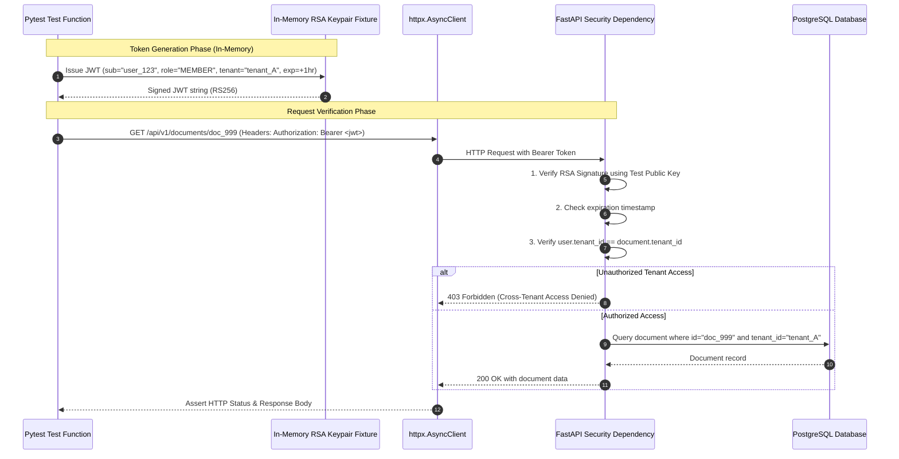

# Authentication & Role-Based Access Control (RBAC) Testing 🔐

> **Authoritative Sources & Literature:**
> - OWASP: *API Security Top 10 & Authentication Testing Guide* (owasp.org)
> - RFC 7519: *JSON Web Token (JWT) Standard* (datatracker.ietf.org/doc/html/rfc7519)
> - Martin Fowler: *Role-Based Authorization Patterns* (martinfowler.com)
> - Gerard Meszaros: *xUnit Test Patterns: Refactoring Test Code* (Security Test Double Pattern)
> - Brian Okken: *Python Testing with pytest* (Chapter 3: Fixtures & Scopes)

---

## 1. Conceptual Definition & Core Mental Model

In modern backend APIs, **Authentication (AuthN)** verifies *who the client is*, while **Authorization (AuthZ)** verifies *what that client is permitted to do*.

### The Security Testing Imperative
Security boundaries represent the most critical attack surface of any backend application. A single defect in authorization logic can result in catastrophic data breaches (such as OWASP API 1: *Broken Object Level Authorization - BOLA* or OWASP API 5: *Broken Function Level Authorization*).

### The Mental Model: The Two-Stage Security Filter
In a modern Python API (e.g., FastAPI, Starlette), every incoming request passes through two distinct logical gates before executing domain business logic:

1. **Authentication Gate (401 Unauthorized)**:
   - Is the `Authorization: Bearer <token>` header present?
   - Is the cryptographic signature valid (signed with trusted private key or HMAC secret)?
   - Has the token expired (`exp < current_timestamp`)?
   - Are standard claims valid (`iss` issuer, `aud` audience, `nbf` not before)?

2. **Authorization & RBAC Gate (403 Forbidden)**:
   - Does the authenticated identity possess the required role (`ADMIN`, `OPERATOR`, `MEMBER`)?
   - Does the identity possess the specific permission scope (`read:reports`, `write:orders`)?
   - **Multi-Tenant Boundary**: Does the requested entity belong to the user's `tenant_id`?

```
                        Incoming HTTP Request
                                 │
                                 ▼
         ┌───────────────────────────────────────────────┐
         │          Authentication Gate (AuthN)          │
         │  - Bearer Token Present?                      │
         │  - Cryptographic Signature Valid?             │
         │  - Token Expired (exp check)?                 │
         └───────┬───────────────────────────────┬───────┘
                 │ Failed                        │ Passed
                 ▼                               ▼
       [ HTTP 401 Unauthorized ]   ┌───────────────────────────────┐
                                   │   Authorization Gate (AuthZ)  │
                                   │  - Role / Permission Match?   │
                                   │  - Tenant Isolation Valid?    │
                                   └───────┬───────────────┬───────┘
                                           │ Failed        │ Passed
                                           ▼               ▼
                                 [ HTTP 403 Forbidden ]  [ 200 OK: Domain Logic ]
```

---

## 2. Why This Is Critical in Modern Python Backend Engineering

1. **Preventing BOLA / IDOR Exploits**: The #1 vulnerability in modern APIs is Insecure Direct Object References (e.g., User A accessing `/api/v1/invoices/999` which belongs to User B). Automated integration tests must rigorously verify cross-tenant data barriers.
2. **Defending Against Cryptographic Attacks**:
   - **Algorithm "None" Vulnerability**: Attackers alter the JWT header to `{"alg": "none"}` and strip the signature.
   - **Key Confusion Attacks**: Attackers sign RS256 tokens using the public key as an HMAC secret key in HS256.
   - **Clock Skew & Expiration Tampering**: Attackers replay expired tokens.
3. **Decoupling Tests from External Identity Providers**: Automated tests should never contact Auth0, Okta, or Keycloak over the public network; instead, tests generate genuine, cryptographically valid tokens in-memory using an asymmetric test keypair.

---

## 3. Internal Mechanics & Architectural Workflow



---

## 4. Standard Syntax, Signatures & Configuration

### Prerequisites
```bash
pip install pyjwt[crypto] cryptography httpx fastapi pytest-asyncio
```

### Cryptographic Key Generation & JWT Signatures

```python
import jwt
from cryptography.hazmat.primitives.asymmetric import rsa
from cryptography.hazmat.primitives import serialization
from datetime import datetime, timezone, timedelta

# 1. Generate an In-Memory 2048-bit RSA Keypair for Automated Testing
private_key = rsa.generate_private_key(public_exponent=65537, key_size=2048)
public_key = private_key.public_key()

# 2. Serialize Public Key for Application Dependency Injection
pem_public = public_key.public_bytes(
    encoding=serialization.Encoding.PEM,
    format=serialization.PublicFormat.SubjectPublicKeyInfo
).decode("utf-8")

# 3. Create Cryptographically Signed JWT
payload = {
    "sub": "user_alpha_001",
    "tenant_id": "tenant_enterprise_01",
    "roles": ["ADMIN"],
    "permissions": ["read:documents", "write:documents"],
    "iss": "https://auth.company.com",
    "aud": "https://api.company.com",
    "iat": datetime.now(timezone.utc),
    "exp": datetime.now(timezone.utc) + timedelta(hours=1),
}
token: str = jwt.encode(payload, private_key, algorithm="RS256")

# 4. Verification
decoded = jwt.decode(
    token,
    key=public_key,
    algorithms=["RS256"],
    audience="https://api.company.com",
    issuer="https://auth.company.com"
)
```

---

## 5. Execution Lifecycle & Teardown Protocol

To ensure rapid test execution, cryptographic key generation should be **session-scoped**:
- Generating a 2048-bit RSA key takes $\approx 50 - 100\text{ms}$.
- If done on every test function, a 200-test suite wastes 15 seconds purely computing prime numbers.
- **Protocol**: Generate the RSA keypair **once per pytest session**, and derive ephemeral tokens per test function in $< 0.1\text{ms}$.

---

## 6. Scopes, Isolation & System Boundaries

| Security Layer | Boundary Enforced | Expected Failure Code | Tested Scenario |
| :--- | :--- | :--- | :--- |
| **Token Transport** | Missing / Malformed `Authorization` header | `401 Unauthorized` | Missing header, `Basic` instead of `Bearer` |
| **Cryptographic Signature** | Tampered payload or wrong private key | `401 Unauthorized` | Payload mutation, Alg: None attack, wrong issuer |
| **Token Lifespan** | Expired timestamp (`exp`) | `401 Unauthorized` | Clock skew, stale session tokens |
| **Role & Scope (RBAC)** | Insufficient permissions for route | `403 Forbidden` | Regular user attempting admin delete |
| **Tenant Isolation** | Cross-tenant data boundary | `403 Forbidden` or `404 Not Found` | Tenant A attempting to access Tenant B's data |

---

## 7. Pytest Fixture & conftest Integration

Here is the production-grade security fixture suite for testing FastAPI applications:

```python
# tests/fixtures/auth_fixtures.py
import pytest
from datetime import datetime, timezone, timedelta
from typing import Dict, Any, Callable
import jwt
from cryptography.hazmat.primitives.asymmetric import rsa

@pytest.fixture(scope="session")
def rsa_keypair():
    """Generates an in-memory 2048-bit RSA keypair once for the test session."""
    private_key = rsa.generate_private_key(public_exponent=65537, key_size=2048)
    return {
        "private": private_key,
        "public": private_key.public_key()
    }

@pytest.fixture
def token_factory(rsa_keypair) -> Callable[..., str]:
    """Factory fixture for minting custom JWTs with configurable claims."""
    def _create_token(
        user_id: str = "usr_default_01",
        tenant_id: str = "tenant_alpha",
        roles: list[str] = None,
        permissions: list[str] = None,
        expires_delta: timedelta = timedelta(minutes=30),
        algorithm: str = "RS256",
        key_override: Any = None,
        custom_claims: Dict[str, Any] = None
    ) -> str:
        roles = roles or ["MEMBER"]
        permissions = permissions or ["read:data"]
        
        now = datetime.now(timezone.utc)
        payload = {
            "sub": user_id,
            "tenant_id": tenant_id,
            "roles": roles,
            "permissions": permissions,
            "iss": "https://auth.enterprise.com",
            "aud": "https://api.enterprise.com",
            "iat": now,
            "exp": now + expires_delta,
        }
        if custom_claims:
            payload.update(custom_claims)

        signing_key = key_override or rsa_keypair["private"]
        return jwt.encode(payload, signing_key, algorithm=algorithm)

    return _create_token

@pytest.fixture
def auth_headers(token_factory) -> Callable[..., Dict[str, str]]:
    """Helper fixture returning pre-formatted Authorization headers."""
    def _headers(**kwargs) -> Dict[str, str]:
        token = token_factory(**kwargs)
        return {"Authorization": f"Bearer {token}"}
    return _headers
```

---

## 8. Step-by-Step Practical Python 3.10+ Walkthrough

Let's build a complete FastAPI application with JWT authentication, role verification, and multi-tenant document isolation, and test it against all security boundaries.

### Step 1: Define the Application Security Layer
```python
# src/security.py
from dataclasses import dataclass
from typing import List, Optional
import jwt
from fastapi import Depends, HTTPException, Security, status
from fastapi.security import HTTPBearer, HTTPAuthorizationCredentials

security_scheme = HTTPBearer()

@dataclass(frozen=True)
class CurrentUser:
    user_id: str
    tenant_id: str
    roles: List[str]
    permissions: List[str]

class TokenVerifier:
    def __init__(self, public_key: Any) -> None:
        self.public_key = public_key

    def verify_token(
        self,
        credentials: HTTPAuthorizationCredentials = Security(security_scheme)
    ) -> CurrentUser:
        token = credentials.credentials
        try:
            payload = jwt.decode(
                token,
                key=self.public_key,
                algorithms=["RS256"],  # Strictly enforce RS256!
                audience="https://api.enterprise.com",
                issuer="https://auth.enterprise.com"
            )
        except jwt.ExpiredSignatureError:
            raise HTTPException(
                status_code=status.HTTP_401_UNAUTHORIZED,
                detail="Token has expired"
            )
        except jwt.PyJWTError as exc:
            raise HTTPException(
                status_code=status.HTTP_401_UNAUTHORIZED,
                detail=f"Invalid authentication token: {str(exc)}"
            )

        return CurrentUser(
            user_id=payload["sub"],
            tenant_id=payload["tenant_id"],
            roles=payload.get("roles", []),
            permissions=payload.get("permissions", [])
        )

def require_role(required_role: str):
    """RBAC dependency checking required role."""
    def _role_checker(user: CurrentUser = Depends()) -> CurrentUser:
        if required_role not in user.roles:
            raise HTTPException(
                status_code=status.HTTP_403_FORBIDDEN,
                detail=f"Role '{required_role}' required for this resource"
            )
        return user
    return _role_checker
```

### Step 2: Define the Protected Document API
```python
# src/api.py
from fastapi import FastAPI, Depends, HTTPException, status
from src.security import CurrentUser

app = FastAPI()

# In-memory document database for walkthrough
MOCK_DOCUMENTS = {
    "doc_101": {"id": "doc_101", "tenant_id": "tenant_alpha", "title": "Alpha Q3 Financials"},
    "doc_102": {"id": "doc_102", "tenant_id": "tenant_beta", "title": "Beta Secret Roadmap"},
}

@app.get("/api/v1/documents/{doc_id}")
async def get_document(doc_id: str, current_user: CurrentUser = Depends()):
    doc = MOCK_DOCUMENTS.get(doc_id)
    if not doc:
        raise HTTPException(status_code=status.HTTP_404_NOT_FOUND, detail="Document not found")

    # Multi-tenant isolation verification!
    if doc["tenant_id"] != current_user.tenant_id:
        raise HTTPException(
            status_code=status.HTTP_403_FORBIDDEN,
            detail="Access to other tenant data is forbidden"
        )

    return doc

@app.delete("/api/v1/documents/{doc_id}")
async def delete_document(
    doc_id: str,
    current_user: CurrentUser = Depends()
):
    if "ADMIN" not in current_user.roles:
        raise HTTPException(
            status_code=status.HTTP_403_FORBIDDEN,
            detail="Admin role required to delete documents"
        )
    return {"message": f"Document {doc_id} permanently deleted"}
```

---

## 9. Framework & Ecosystem Integration: Writing the Test Suite

```python
# tests/test_security_boundaries.py
import pytest
from datetime import timedelta
from httpx import AsyncClient, ASGITransport
import jwt
from cryptography.hazmat.primitives.asymmetric import rsa
from src.api import app
from src.security import CurrentUser, TokenVerifier

@pytest.fixture(autouse=True)
def override_token_verifier(rsa_keypair):
    """Overrides the application's token verification dependency with the test public key."""
    verifier = TokenVerifier(public_key=rsa_keypair["public"])
    app.dependency_overrides[CurrentUser] = verifier.verify_token
    yield
    app.dependency_overrides.clear()

@pytest.mark.asyncio
async def test_access_granted_with_valid_token(auth_headers):
    """Happy path: User in tenant_alpha successfully reads doc_101."""
    transport = ASGITransport(app=app)
    async with AsyncClient(transport=transport, base_url="http://test") as client:
        headers = auth_headers(user_id="user_1", tenant_id="tenant_alpha")
        response = await client.get("/api/v1/documents/doc_101", headers=headers)

        assert response.status_code == 200
        assert response.json()["title"] == "Alpha Q3 Financials"

@pytest.mark.asyncio
async def test_unauthenticated_request_rejected():
    """Verifies that missing Authorization header returns 403/401."""
    transport = ASGITransport(app=app)
    async with AsyncClient(transport=transport, base_url="http://test") as client:
        response = await client.get("/api/v1/documents/doc_101")
        assert response.status_code == 403 or response.status_code == 401

@pytest.mark.asyncio
async def test_expired_token_rejected(auth_headers):
    """Verifies that expired tokens are immediately rejected with 401."""
    transport = ASGITransport(app=app)
    async with AsyncClient(transport=transport, base_url="http://test") as client:
        headers = auth_headers(expires_delta=timedelta(seconds=-10))
        response = await client.get("/api/v1/documents/doc_101", headers=headers)

        assert response.status_code == 401
        assert "Token has expired" in response.json()["detail"]

@pytest.mark.asyncio
async def test_cross_tenant_access_blocked(auth_headers):
    """
    CRITICAL SECURITY TEST: BOLA / Multi-Tenant Isolation.
    User in tenant_beta attempts to read doc_101 belonging to tenant_alpha.
    """
    transport = ASGITransport(app=app)
    async with AsyncClient(transport=transport, base_url="http://test") as client:
        headers = auth_headers(user_id="hacker_user", tenant_id="tenant_beta")
        response = await client.get("/api/v1/documents/doc_101", headers=headers)

        assert response.status_code == 403
        assert "Access to other tenant data is forbidden" in response.json()["detail"]

@pytest.mark.asyncio
async def test_rbac_delete_forbidden_for_regular_member(auth_headers):
    """Verifies that a MEMBER cannot perform an ADMIN-only delete."""
    transport = ASGITransport(app=app)
    async with AsyncClient(transport=transport, base_url="http://test") as client:
        headers = auth_headers(roles=["MEMBER"])
        response = await client.delete("/api/v1/documents/doc_101", headers=headers)

        assert response.status_code == 403
        assert "Admin role required" in response.json()["detail"]

@pytest.mark.asyncio
async def test_rbac_delete_succeeds_for_admin(auth_headers):
    """Verifies that an ADMIN successfully executes the deletion."""
    transport = ASGITransport(app=app)
    async with AsyncClient(transport=transport, base_url="http://test") as client:
        headers = auth_headers(roles=["ADMIN"])
        response = await client.delete("/api/v1/documents/doc_101", headers=headers)

        assert response.status_code == 200
        assert "permanently deleted" in response.json()["message"]
```

---

## 10. Real-World Enterprise Scenario: Defeating the "Alg: None" Attack

In the infamous "Algorithm: None" exploit, attackers strip the cryptographic signature from a token and change the header to `{"alg": "none"}`:

```python
# tests/test_jwt_vulnerabilities.py
import pytest
import jwt
from httpx import AsyncClient, ASGITransport
from src.api import app

@pytest.mark.asyncio
async def test_rejects_algorithm_none_attack():
    """
    Penetration Test: Asserts that an unsigned token with alg='none'
    is rejected and cannot bypass authentication.
    """
    malicious_payload = {
        "sub": "admin_impersonator",
        "tenant_id": "tenant_alpha",
        "roles": ["ADMIN"],
        "iss": "https://auth.enterprise.com",
        "aud": "https://api.enterprise.com",
        "exp": 9999999999,
    }
    # Create unsigned token with algorithm 'none'
    unsigned_token = jwt.encode(malicious_payload, key="", algorithm="none")

    transport = ASGITransport(app=app)
    async with AsyncClient(transport=transport, base_url="http://test") as client:
        response = await client.get(
            "/api/v1/documents/doc_101",
            headers={"Authorization": f"Bearer {unsigned_token}"}
        )
        assert response.status_code == 401
        assert "Invalid authentication token" in response.json()["detail"]
```

---

## 11. Anti-Patterns & Code Smells (Before vs After)

### Anti-Pattern 1: Bypassing Auth by Mocking the User Globally
```python
# ❌ BEFORE: Bypassing the authentication layer entirely in integration tests
@pytest.fixture(autouse=True)
def bypass_auth():
    # Completely disables token decoding, signature checking, and RBAC!
    app.dependency_overrides[get_current_user] = lambda: CurrentUser(user_id="1", roles=["ADMIN"])

# ✅ AFTER: Real in-memory JWT minting with valid cryptographic signatures
# Tests pass through real token parsing, signature validation, and RBAC logic!
@pytest.fixture
def test_client(auth_headers):
    # Generates a real signed JWT for each test scenario
    headers = auth_headers(roles=["MEMBER"])
    ...
```

### Anti-Pattern 2: Symmetric Shared Secret in Distributed Microservices
```python
# ❌ BEFORE: Using HS256 with shared secret string (If leaked, any service can forge admin tokens)
jwt.encode(payload, "shared_hardcoded_secret", algorithm="HS256")

# ✅ AFTER: Asymmetric RS256 / EdDSA (Private key stays with Auth Server; APIs only hold Public Key)
jwt.encode(payload, private_key_pem, algorithm="RS256")
```

---

## 12. Best Practices & Production Guidelines

1. **Always Restrict Allowed Algorithms in Decoder**: Always pass `algorithms=["RS256"]` explicitly to `jwt.decode()`. Never leave algorithms undefined or allow multiple conflicting families (`HS256` and `RS256` simultaneously).
2. **Explicitly Verify Audience (`aud`) and Issuer (`iss`)**: Ensures tokens issued for other applications or environments (e.g. staging vs production) are rejected.
3. **Session-Scope Cryptographic Key Generation**: Generate RSA keypairs in session-scoped fixtures to avoid slowing down the test runner.
4. **Always Test Both Positive and Negative Authorization Paths**: Every protected route must have at least one test proving access is granted with proper credentials, and at least two tests proving access is rejected (unauthenticated and unauthorized).

---

## 13. Comprehensive Trade-Off Matrix

| Strategy | Security Fidelity | Test Suite Speed | Multi-Tenant Verification | External Network Dependency |
| :--- | :--- | :--- | :--- | :--- |
| **In-Memory RSA Keypair + Real JWTs** | **Highest (100% cryptographic parity)** | **$< 1\text{ms}$ per test** | **Full (Custom tenant claims)** | **Zero (Hermetic & offline)** |
| **Global Dependency Mock (`CurrentUser`)** | Low (Bypasses decoding & claims) | $< 0.1\text{ms}$ | ⚠️ Fragile (Hardcoded mock) | Zero |
| **Live External OAuth Server (Auth0)** | High | Extremely Slow ($> 500\text{ms}$) | Limited (Pre-seeded users) | ❌ High (Requires internet & credentials) |
| **Local Keycloak Docker Container** | High | Slow ($30\text{s}$ boot time) | High | Zero (Local Docker) |

---

## 14. Diagnostic & Troubleshooting Playbook

### Issue 1: `jwt.exceptions.InvalidAlgorithmError: The specified alg value is not allowed`
- **Root Cause**: The client minted a token using `HS256`, but the application decoder specifies `algorithms=["RS256"]`.
- **Diagnostic Step**: Check the token header using `jwt.get_unverified_header(token)`.
- **Remediation**: Ensure the test fixture signs tokens with the RSA private key corresponding to the public key injected into the app.

### Issue 2: `jwt.exceptions.ExpiredSignatureError`
- **Root Cause**: The test generated a token with `exp` in the past, or there is an unhandled timezone mismatch between UTC and local system time.
- **Remediation**: Always construct timestamps using `datetime.now(timezone.utc)`.

---

## 15. Senior Staff Interview Questions & Answers

### Question 1: What is the "Key Confusion Attack" (RS256 vs HS256) in JWT implementations, and how does your test suite verify protection against it?
**Answer**:
In a Key Confusion Attack, an attacker exploits an API that allows both asymmetric (`RS256`) and symmetric (`HS256`) algorithms.
1. The attacker obtains the server's public key (which is public knowledge).
2. The attacker crafts a forged JWT payload (granting themselves `ADMIN` privileges).
3. The attacker signs the token using `HS256`, passing the **public RSA key string as the HMAC secret key**.
4. If the server naively verifies the token using its public key and accepts the algorithm specified in the token header, the HMAC verification succeeds!
- **How our test suite verifies protection**:
  We write a penetration test that explicitly signs a token with `HS256` using the test RSA public key bytes as the secret. We pass this token to the API and assert that it returns `HTTP 401 Unauthorized` with an algorithm rejection error, proving that `algorithms=["RS256"]` is strictly enforced.

### Question 2: In a multi-tenant SaaS application, where should tenant authorization be enforced, and how do you test for BOLA vulnerabilities?
**Answer**:
Tenant authorization must be enforced **at the database query level** (Defense in Depth), not merely at the API routing layer:
1. **API Layer**: The security dependency extracts `tenant_id` from the verified JWT claims.
2. **Persistence Layer**: Every SQL query must include `WHERE tenant_id = :tenant_id` (or utilize PostgreSQL Row-Level Security / RLS policies).
- **How we test for BOLA**:
  We seed two distinct tenants in the test database (`Tenant_A` with `Document_A`, and `Tenant_B` with `Document_B`). We then execute two integration tests:
  - We authenticate as `User_A` and attempt to `GET /documents/{Document_B_id}`.
  - We assert that the API returns `HTTP 403 Forbidden` (or `404 Not Found` to prevent entity existence enumeration).
  - We also verify mutative operations (`PUT`, `DELETE`) across tenant boundaries to ensure no state mutation can occur.

---

## 16. Practical Hands-On Exercises & Challenges

### Exercise 1: Testing Role Hierarchies with FastAPI Security
Implement a role hierarchy where `SUPER_ADMIN > ADMIN > MANAGER > MEMBER`:
1. Create a permission dependency that permits actions if the user's role meets or exceeds the required level.
2. Write a parameterized pytest test verifying that an endpoint requiring `MANAGER` accepts `SUPER_ADMIN`, `ADMIN`, and `MANAGER`, but returns `HTTP 403` for `MEMBER`.

### Exercise 2: Simulating and Preventing Clock Skew Issues
1. Write a test where a token's `iat` (issued at) is set 5 seconds in the future due to slight server clock drift.
2. Configure `jwt.decode(..., leeway=10)` and verify that the token is accepted within the leeway window, but rejected beyond it.

---

## 17. Key Takeaways & Summary

- **Never bypass authentication in integration tests**: Generate genuine, cryptographically valid tokens in-memory using session-scoped RSA keypairs.
- **Strictly specify allowed algorithms**: Never allow arbitrary algorithms; enforce `algorithms=["RS256"]` to defeat Alg: None and key confusion attacks.
- **Automate BOLA / IDOR tests**: Every multi-tenant entity must have integration tests proving cross-tenant access is blocked.
- **Differentiate AuthN (401) and AuthZ (403)**: Return 401 when the identity cannot be verified, and 403 when the verified identity lacks necessary permissions or tenant ownership.

---

## 18. Next Steps & Cross-References

- Next: [FastAPI Testing Overview](../fastapi-testing/index.md)
- [API Integration Testing](api-integration-testing.md)
- [External HTTP & Webhook Integration](external-api-testing.md)
- [Containerized Dependencies with Testcontainers](testcontainers-testing.md)
- [FastAPI Dependency Overrides](../fastapi-testing/dependency-overrides.md)
