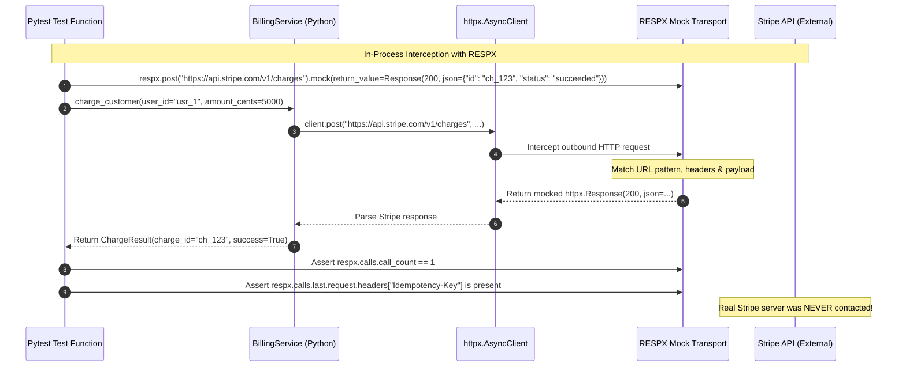

# External HTTP, Third-Party APIs & Webhook Testing 🌐

> **Authoritative Sources & Literature:**
> - Martin Fowler: *Integration Contract Testing & Service Virtualization* (martinfowler.com)
> - Gerard Meszaros: *xUnit Test Patterns: Refactoring Test Code* (Test Spy, Mock Object & Service Stub Patterns)
> - Brian Okken: *Python Testing with pytest* (Chapter 5: Mocking and Plugins)
> - Florimond Manca: *RESPX: Mocking HTTPX made easy* (lundberg.github.io/respx)
> - Stripe Engineering: *Testing Webhooks & Signature Verification Best Practices* (docs.stripe.com)

---

## 1. Conceptual Definition & Core Mental Model

In modern backend architectures, applications rarely exist in isolation. They communicate constantly with external third-party HTTP APIs:
- Payment Processors (Stripe, PayPal, Adyen).
- Identity & OAuth2 Providers (Auth0, Okta, Google Identity).
- Communication Gateways (Twilio SMS, SendGrid Email).
- AI Foundation Models (OpenAI, Anthropic, Gemini API).

### The External Boundary Testing Dilemma
Directly calling live third-party APIs during automated test runs is an anti-pattern:
1. **Flakiness & Network Latency**: External networks introduce non-deterministic latency ($200\text{ms} - 2\text{s}$ per call) and transient failures.
2. **Financial & Rate Limit Costs**: Hitting real APIs incurs per-call billing costs and exhausts rate limits.
3. **Data Pollution & Irreversible Side Effects**: Sending real emails, charging test credit cards, or generating live webhooks pollutes third-party staging accounts.

### The Mental Model: The Three Tiers of External Service Virtualization
To test external dependencies thoroughly and safely, backend engineers employ three complementary tiers:
1. **In-Process Virtualization (`respx`)**: Intercepts HTTPX ASGI/HTTP client transport directly inside Python memory. Zero network overhead, deterministic, and supports microsecond call inspection.
2. **Network Record & Replay (`vcrpy` / `pytest-recording`)**: Records real live HTTP requests and responses to serialized YAML "cassettes" once, then replays them offline deterministically in subsequent test runs.
3. **Out-of-Process Mock Servers (WireMock / Mockoon)**: Containerized HTTP mock servers that run over real local TCP sockets, testing raw HTTP client socket behavior, connection timeouts, and TLS negotiation.

```
                     ┌─────────────────────────────────────────────────────────┐
                     │                 Python Backend Service                  │
                     │                                                         │
                     │   [PaymentService] ──► httpx.AsyncClient()             │
                     └────────────────────────────┬────────────────────────────┘
                                                  │
                 ┌────────────────────────────────┼────────────────────────────────┐
                 ▼                                ▼                                ▼
    ┌─────────────────────────┐      ┌─────────────────────────┐      ┌─────────────────────────┐
    │  Tier 1: In-Process     │      │  Tier 2: Record/Replay  │      │  Tier 3: Out-of-Process │
    │         RESPX           │      │         VCR.py          │      │        WireMock         │
    │ (Memory Interception)   │      │ (Cassette Playback)     │      │ (Containerized Server)  │
    │ - Microsecond speed     │      │ - Real payload fidelity │      │ - Real TCP socket       │
    │ - Strict call assertions│      │ - Offline execution     │      │ - Simulates timeouts    │
    └─────────────────────────┘      └─────────────────────────┘      └─────────────────────────┘
```

---

## 2. Why This Is Critical in Modern Python Backend Engineering

1. **Testing Resiliency & Error Recovery**: In production, third-party APIs fail constantly (502 Bad Gateway, 504 Gateway Timeout, 429 Too Many Requests). Without virtualized testing, you cannot safely verify that your retry logic, exponential backoffs, circuit breakers, and fallbacks work.
2. **Verifying Webhook Signatures & Cryptographic Security**: Webhook endpoints must reject forged payloads, mismatched HMAC-SHA256 signatures, and replayed requests. Integration tests must verify this security barrier.
3. **Hermetic CI Execution**: Tests must pass with zero internet access (`pytest-socket --disable-socket`). All outbound HTTP traffic must be explicitly accounted for and intercepted.

---

## 3. Internal Mechanics & Architectural Workflow



---

## 4. Standard Syntax, Signatures & Configuration

### Prerequisites
```bash
pip install respx httpx vcrpy pytest-recording tenacity
```

### Core RESPX Signatures

```python
import respx
from httpx import Response, Request

# 1. Declarative Route Mocking
@respx.mock
def test_declarative():
    route = respx.get("https://api.example.com/v1/users/123")
    route.return_value = Response(200, json={"id": "123", "name": "Ada Lovelace"})
    ...

# 2. Pattern Matching with Regex and Headers
route = respx.post(url__regex=r"^https://api\.stripe\.com/v1/charges$")
route.side_effect = Response(
    status_code=201,
    headers={"Content-Type": "application/json"},
    json={"status": "succeeded"}
)

# 3. Simulating Network Errors
route.side_effect = httpx.ConnectTimeout("Connection timed out to external gateway")

# 4. Inspecting Call History
assert route.called
assert route.call_count == 1
last_request: Request = route.calls.last.request
assert last_request.headers["Authorization"] == "Bearer sk_test_123"
```

---

## 5. Execution Lifecycle & Teardown Protocol

Managing external HTTP mocks requires strict assertions that **no unexpected outbound requests escape**:

```python
# tests/conftest.py
import pytest
import respx

@pytest.fixture
def mock_external_api():
    """
    Strict RESPX fixture:
    assert_all_called=True ensures that if a mock route is registered, it MUST be executed.
    assert_all_mocked=True ensures that any unmocked HTTP request raises an immediate test failure.
    """
    with respx.mock(
        assert_all_called=True,
        assert_all_mocked=True,
        base_url="https://api.stripe.com"
    ) as respx_mock:
        yield respx_mock
```

---

## 6. Scopes, Isolation & System Boundaries

| Boundary | Interception Level | Tool | Use Case |
| :--- | :--- | :--- | :--- |
| **In-Memory Transport** | ASGI / HTTPX Client Layer | `respx` | Unit & API integration tests; fast, deterministic |
| **Serialization / File** | Network Recording Cassette | `vcrpy` / `pytest-recording` | Complex third-party payload capture; documentation |
| **TCP / Local Network** | Local Loopback (`127.0.0.1:<port>`) | WireMock (Testcontainers) | Protocol compliance, TLS, socket drops, slow bandwidth |
| **Public Internet** | Live External Cloud | Direct HTTP (Stripe CLI) | Staging smoke tests only; **never run in automated CI** |

---

## 7. Pytest Fixture & conftest Integration

Here is the standardized HTTP test harness combining `respx` and `httpx.AsyncClient`:

```python
# tests/fixtures/external_mocks.py
import pytest
from typing import AsyncGenerator
import httpx
import respx

@pytest.fixture
def stripe_mock():
    """Provides a managed RESPX router for Stripe endpoints."""
    with respx.mock(base_url="https://api.stripe.com/v1") as mock:
        yield mock

@pytest.fixture
async def external_http_client() -> AsyncGenerator[httpx.AsyncClient, None]:
    """Shared HTTPX client configured with strict timeouts for external services."""
    async with httpx.AsyncClient(
        timeout=httpx.Timeout(connect=2.0, read=5.0, write=5.0, pool=1.0)
    ) as client:
        yield client
```

---

## 8. Step-by-Step Practical Python 3.10+ Walkthrough

Let's implement and test a resilient payment gateway client with **automatic retry on rate limiting (HTTP 429)** and **timeout fallbacks**.

### Step 1: Implement the Payment Service with Retries
```python
# src/payment_client.py
from dataclasses import dataclass
import httpx
from tenacity import retry, stop_after_attempt, wait_exponential, retry_if_exception_type

class PaymentGatewayError(Exception):
    """Base exception for payment gateway failures."""

class RateLimitExceededError(PaymentGatewayError):
    """Raised when external gateway responds with HTTP 429."""

@dataclass(frozen=True)
class PaymentResult:
    transaction_id: str
    amount_cents: int
    status: str

class StripePaymentGateway:
    def __init__(self, api_key: str, client: httpx.AsyncClient) -> None:
        self._api_key = api_key
        self._client = client
        self._base_url = "https://api.stripe.com/v1"

    @retry(
        stop=stop_after_attempt(3),
        wait=wait_exponential(multiplier=0.1, min=0.1, max=0.5),
        retry=retry_if_exception_type(RateLimitExceededError),
        reraise=True
    )
    async def create_charge(self, customer_id: str, amount_cents: int, idempotency_key: str) -> PaymentResult:
        headers = {
            "Authorization": f"Bearer {self._api_key}",
            "Idempotency-Key": idempotency_key,
        }
        try:
            response = await self._client.post(
                f"{self._base_url}/charges",
                data={"customer": customer_id, "amount": str(amount_cents), "currency": "usd"},
                headers=headers
            )
        except httpx.TimeoutException as exc:
            raise PaymentGatewayError(f"Payment gateway timed out: {exc}") from exc
        except httpx.NetworkError as exc:
            raise PaymentGatewayError(f"Network error contacting payment gateway: {exc}") from exc

        if response.status_code == 429:
            raise RateLimitExceededError("Rate limit exceeded on payment gateway")

        if response.status_code != 200:
            raise PaymentGatewayError(f"Payment failed with status {response.status_code}: {response.text}")

        data = response.json()
        return PaymentResult(
            transaction_id=data["id"],
            amount_cents=int(data["amount"]),
            status=data["status"]
        )
```

### Step 2: Write Comprehensive Integration Tests for Success, Retries, and Timeouts
```python
# tests/test_payment_gateway.py
import pytest
import httpx
import respx
from src.payment_client import (
    StripePaymentGateway,
    PaymentResult,
    PaymentGatewayError,
    RateLimitExceededError
)

@pytest.mark.asyncio
async def test_successful_charge(external_http_client: httpx.AsyncClient) -> None:
    gateway = StripePaymentGateway(api_key="sk_test_secret123", client=external_http_client)

    with respx.mock(base_url="https://api.stripe.com/v1") as stripe_mock:
        stripe_mock.post("/charges").respond(
            status_code=200,
            json={"id": "ch_3OhzKl2eZvKYlo2C01234567", "amount": 5000, "status": "succeeded"}
        )

        result = await gateway.create_charge(
            customer_id="cus_98765",
            amount_cents=5000,
            idempotency_key="idemp_unique_key_1"
        )

        assert isinstance(result, PaymentResult)
        assert result.transaction_id == "ch_3OhzKl2eZvKYlo2C01234567"
        assert result.amount_cents == 5000
        assert result.status == "succeeded"

        # Verify idempotency header was properly dispatched
        last_req = stripe_mock.calls.last.request
        assert last_req.headers["Idempotency-Key"] == "idemp_unique_key_1"
        assert last_req.headers["Authorization"] == "Bearer sk_test_secret123"

@pytest.mark.asyncio
async def test_automatic_retry_on_429_rate_limit(external_http_client: httpx.AsyncClient) -> None:
    gateway = StripePaymentGateway(api_key="sk_test_secret123", client=external_http_client)

    with respx.mock(base_url="https://api.stripe.com/v1") as stripe_mock:
        # First call returns 429, second call succeeds with 200
        route = stripe_mock.post("/charges")
        route.side_effect = [
            httpx.Response(429, json={"error": "Too many requests"}),
            httpx.Response(200, json={"id": "ch_success_after_retry", "amount": 2500, "status": "succeeded"}),
        ]

        result = await gateway.create_charge(
            customer_id="cus_retry_user",
            amount_cents=2500,
            idempotency_key="idemp_key_retry"
        )

        assert result.transaction_id == "ch_success_after_retry"
        assert route.call_count == 2  # Proves the retry mechanism worked!

@pytest.mark.asyncio
async def test_gateway_timeout_handling(external_http_client: httpx.AsyncClient) -> None:
    gateway = StripePaymentGateway(api_key="sk_test_secret123", client=external_http_client)

    with respx.mock(base_url="https://api.stripe.com/v1") as stripe_mock:
        stripe_mock.post("/charges").mock(
            side_effect=httpx.ConnectTimeout("Connection to Stripe timed out")
        )

        with pytest.raises(PaymentGatewayError, match="Payment gateway timed out"):
            await gateway.create_charge(
                customer_id="cus_timeout",
                amount_cents=1000,
                idempotency_key="idemp_timeout"
            )
```

---

## 9. Framework & Ecosystem Integration: Webhook Signature Verification

Webhooks are reverse APIs: external providers push HTTP POST requests into your FastAPI service. You **must** verify the cryptographic HMAC signature before processing the event.

```python
# src/webhook_endpoint.py
import hmac
import hashlib
import time
from fastapi import FastAPI, Request, HTTPException, status, Header

app = FastAPI()
WEBHOOK_SECRET = "whsec_test_secret_key_8849"
TOLERANCE_SECONDS = 300  # 5 minutes replay attack tolerance

@app.post("/webhooks/stripe")
async def handle_stripe_webhook(
    request: Request,
    stripe_signature: str = Header(..., alias="Stripe-Signature")
):
    raw_payload = await request.body()
    
    # Parse Stripe header format: t=1614555845,v1=5257a869e7eee...
    sig_elements = dict(item.split("=") for item in stripe_signature.split(","))
    timestamp = sig_elements.get("t")
    received_sig = sig_elements.get("v1")

    if not timestamp or not received_sig:
        raise HTTPException(status_code=status.HTTP_400_BAD_REQUEST, detail="Invalid signature format")

    # Prevent replay attacks
    if abs(time.time() - int(timestamp)) > TOLERANCE_SECONDS:
        raise HTTPException(status_code=status.HTTP_400_BAD_REQUEST, detail="Webhook timestamp expired")

    # Compute expected HMAC-SHA256
    signed_payload = f"{timestamp}.".encode("utf-8") + raw_payload
    expected_sig = hmac.new(
        WEBHOOK_SECRET.encode("utf-8"),
        signed_payload,
        hashlib.sha256
    ).hexdigest()

    if not hmac.compare_digest(expected_sig, received_sig):
        raise HTTPException(status_code=status.HTTP_400_BAD_REQUEST, detail="Signature verification failed")

    return {"status": "event_accepted"}
```

### Testing the Webhook Handler with Valid, Tampered, and Expired Signatures
```python
# tests/test_webhooks.py
import pytest
import hmac
import hashlib
import time
from httpx import AsyncClient, ASGITransport
from src.webhook_endpoint import app, WEBHOOK_SECRET

def generate_stripe_signature(payload: bytes, secret: str, timestamp: int) -> str:
    signed_payload = f"{timestamp}.".encode("utf-8") + payload
    digest = hmac.new(secret.encode("utf-8"), signed_payload, hashlib.sha256).hexdigest()
    return f"t={timestamp},v1={digest}"

@pytest.mark.asyncio
async def test_valid_webhook_signature():
    transport = ASGITransport(app=app)
    async with AsyncClient(transport=transport, base_url="http://testserver") as client:
        payload = b'{"id": "evt_test", "type": "payment_intent.succeeded"}'
        current_time = int(time.time())
        signature = generate_stripe_signature(payload, WEBHOOK_SECRET, current_time)

        response = await client.post(
            "/webhooks/stripe",
            content=payload,
            headers={"Stripe-Signature": signature}
        )
        assert response.status_code == 200
        assert response.json() == {"status": "event_accepted"}

@pytest.mark.asyncio
async def test_tampered_payload_rejected():
    transport = ASGITransport(app=app)
    async with AsyncClient(transport=transport, base_url="http://testserver") as client:
        original_payload = b'{"amount": 1000}'
        tampered_payload = b'{"amount": 999999}'  # Attacker modified the payload!
        current_time = int(time.time())
        signature = generate_stripe_signature(original_payload, WEBHOOK_SECRET, current_time)

        response = await client.post(
            "/webhooks/stripe",
            content=tampered_payload,
            headers={"Stripe-Signature": signature}
        )
        assert response.status_code == 400
        assert "Signature verification failed" in response.json()["detail"]

@pytest.mark.asyncio
async def test_expired_replay_attack_rejected():
    transport = ASGITransport(app=app)
    async with AsyncClient(transport=transport, base_url="http://testserver") as client:
        payload = b'{"id": "evt_test"}'
        expired_time = int(time.time()) - 400  # Older than 300s tolerance
        signature = generate_stripe_signature(payload, WEBHOOK_SECRET, expired_time)

        response = await client.post(
            "/webhooks/stripe",
            content=payload,
            headers={"Stripe-Signature": signature}
        )
        assert response.status_code == 400
        assert "Webhook timestamp expired" in response.json()["detail"]
```

---

## 10. Real-World Enterprise Scenario: Recording Cassettes with VCR.py

When integrating with large, complex third-party APIs (e.g. Salesforce or Workday) where handwriting hundreds of JSON mock responses is error-prone, **VCR.py** records live HTTP interactions once and replays them deterministically:

```python
# tests/test_vcr_cassettes.py
import pytest
import vcr

vcr_recorder = vcr.VCR(
    cassette_library_dir="tests/cassettes",
    record_mode="once",
    match_on=["uri", "method", "body"],
    filter_headers=["authorization", "x-api-key"],  # Redact credentials!
    decode_compressed_response=True
)

@vcr_recorder.use_cassette("github_repo_info.yaml")
def test_fetch_github_repository():
    import urllib.request
    req = urllib.request.Request(
        "https://api.github.com/repos/pytest-dev/pytest",
        headers={"User-Agent": "EnterpriseTestRunner"}
    )
    with urllib.request.urlopen(req) as resp:
        assert resp.status == 200
        # Recorded once to disk in YAML; subsequent runs execute offline in 1ms!
```

---

## 11. Anti-Patterns & Code Smells (Before vs After)

### Anti-Pattern 1: Leaking Raw Unmocked Requests to the Internet
```python
# ❌ BEFORE: Defaulting to allowing network calls. If the developer forgets to mock an endpoint,
# the test makes a live call to production, silently billing the company or failing on offline CI!
def test_user_creation():
    client.post("https://api.sendgrid.com/v3/mail/send", json={...})  # Sends real email!

# ✅ AFTER: Strict zero-network enforcement with assert_all_mocked=True or pytest-socket
@pytest.fixture(autouse=True)
def block_unmocked_http():
    with respx.mock(assert_all_mocked=True) as respx_mock:
        yield respx_mock
# Any unmocked external call will raise respx.ResolutionError immediately!
```

### Anti-Pattern 2: Mocking Internal Library Implementation Instead of HTTP
```python
# ❌ BEFORE: Monkeypatching internal private methods (Brittle)
@patch.object(httpx.AsyncClient, "post")
async def test_brittle(mock_post):
    ...  # Breaks when httpx upgrades internal dispatch logic

# ✅ AFTER: Mocking the HTTP layer via RESPX or custom Transport
@respx.mock
async def test_resilient():
    respx.post("https://api.stripe.com/v1/charges").respond(200, json={...})
```

---

## 12. Best Practices & Production Guidelines

1. **Always Enforce Idempotency Keys**: For all mutative external calls (POST/PUT), ensure your client transmits an `Idempotency-Key` header, and verify its presence in tests.
2. **Redact Sensitive Secrets in Cassettes**: If using VCR.py, configure `filter_headers` and `filter_query_parameters` to strip API keys, Bearer tokens, and client secrets from recorded YAML files.
3. **Set Explicit Timeouts on HTTP Clients**: Never instantiate `httpx.AsyncClient()` without a defined `httpx.Timeout`. Test that timeout exceptions are caught and wrapped in domain exceptions.
4. **Use Constant-Time Comparison for Signatures**: Always use `hmac.compare_digest()` to compare webhook signatures to prevent timing side-channel attacks.

---

## 13. Comprehensive Trade-Off Matrix

| Strategy | Speed per Call | Fidelity to Production | Offline Safe? | Resiliency Simulation (Timeouts) |
| :--- | :--- | :--- | :--- | :--- |
| **RESPX (In-Process)** | **$< 0.1\text{ms}$ (Fastest)** | High (HTTPX client) | ✅ 100% Offline | ✅ Excellent (`side_effect=Timeout`) |
| **VCR.py (Cassette)** | $\approx 1 - 2\text{ms}$ | **Highest (Real captured data)** | ✅ 100% Offline | ⚠️ Limited (Static replay) |
| **WireMock (Docker)** | $\approx 5 - 15\text{ms}$ | High (Real TCP socket) | ✅ 100% Offline | ✅ Full (Simulates dropped TCP sockets) |
| **Live Sandbox API** | $\approx 500 - 2000\text{ms}$ | Real Environment | ❌ Requires Internet | ❌ Impossible to force 500/429 reliably |

---

## 14. Diagnostic & Troubleshooting Playbook

### Issue 1: `respx.ResolutionError: Unmocked request`
- **Root Cause**: The application code initiated an outbound HTTP request that did not match any defined RESPX route pattern, and `assert_all_mocked=True` was active.
- **Diagnostic Step**: Inspect the failed request URL and HTTP method reported in the exception stack trace.
- **Remediation**: Check query parameters and trailing slashes. `https://api.foo.com/items` will NOT match `https://api.foo.com/items/`. Use regex or `url__startswith` to permit flexible query strings:
  ```python
  respx.get(url__startswith="https://api.foo.com/items").respond(200)
  ```

### Issue 2: `hmac.compare_digest` fails on Webhook Tests
- **Root Cause**: The raw body was parsed into JSON and then re-serialized before signature verification, altering whitespace or key ordering.
- **Remediation**: Always verify HMAC against the exact raw byte payload (`await request.body()`), not re-encoded dictionary representations.

---

## 15. Senior Staff Interview Questions & Answers

### Question 1: How do you design an automated test suite to prevent accidental live network calls from leaking to production third-party APIs during CI runs?
**Answer**:
A defense-in-depth approach is required across three layers:
1. **Network Firewall / Test Runner Socket Disabling**: Use the `pytest-socket` plugin with `--disable-socket` and allowlist only local Unix sockets and `127.0.0.1` (for Testcontainers). Any code attempting to open a TCP connection to an external IP is aborted at the Python `socket.connect()` level.
2. **Mocking Transport Assertion**: Configure RESPX with `assert_all_mocked=True`. This ensures that any HTTPX request without a registered route immediately raises a `ResolutionError`.
3. **Environment Variable Guardrails**: In test configuration (`conftest.py` / `pytest.ini`), override external API keys with dummy sentinels (e.g., `STRIPE_API_KEY="sk_test_fake_sentinel"`). Even if an HTTP call miraculously escaped the runner, the third-party API would reject it with an authentication error.

### Question 2: What is the architectural difference between In-Process HTTP Mocking (RESPX) and WireMock running in a container, and when must you use WireMock?
**Answer**:
- **In-Process Mocking (RESPX)** operates inside the Python runtime by patching HTTPX's underlying `BaseTransport`. It handles requests entirely in memory with zero network sockets. It is ideal for 95% of unit and integration tests because it runs in microseconds.
- **WireMock** is an out-of-process HTTP mock server running in a standalone process or Docker container, listening on a real TCP loopback port (`http://127.0.0.1:<port>`).
- **When WireMock is mandatory**:
  1. **Low-Level Socket & TLS Verification**: Testing HTTP keep-alive connection pooling, TLS handshake negotiation, SSL certificate validation, and TCP connection resets (`RST` packets).
  2. **Polyglot / Subprocess Testing**: When the code under test spawns an external CLI tool (e.g., `curl`, `git`, or a Go binary) that makes HTTP calls that cannot be intercepted by Python-level hooks.
  3. **Simulating Extreme Latency & Chunked Streaming**: Testing how your client handles chunked transfer-encoding drops midway through reading an 8MB payload.

---

## 16. Practical Hands-On Exercises & Challenges

### Exercise 1: Simulating an Exponential Backoff Circuit Breaker
1. Implement a client that connects to an external stock ticker API.
2. Configure RESPX to return HTTP 503 Service Unavailable for 3 consecutive calls, and HTTP 200 on the 4th call.
3. Assert that the client executes 4 attempts with exponential backoff delays and returns the final stock price.

### Exercise 2: Implementing a GitHub Webhook Event Filter
1. Write a FastAPI endpoint that handles GitHub `push` and `pull_request` webhook events with SHA-256 HMAC verification.
2. Write integration tests for:
   - Valid signature and payload.
   - Forged signature.
   - Non-JSON payload.
   - Unhandled event types (should return HTTP 200 with `ignored` status to satisfy GitHub delivery requirements).

---

## 17. Key Takeaways & Summary

- **Never make live external HTTP calls in automated tests**: External APIs introduce non-determinism, latency, billing costs, and data pollution.
- **RESPX provides the ultimate in-process HTTP mocking**: Sub-millisecond execution, complete pattern matching, and comprehensive call inspection.
- **Always test failures and rate limits**: Your backend must be tested against HTTP 429, 502, 504, connection drops, and timeouts.
- **Cryptographic Webhook verification is non-negotiable**: Test that HMAC signatures, timestamp tolerances, and payload integrity barriers reject malicious callers.

---

## 18. Next Steps & Cross-References

- Next: [Authentication & Role-Based Access Control (RBAC)](authentication-testing.md)
- [Containerized Dependencies with Testcontainers](testcontainers-testing.md)
- [API Integration Testing](api-integration-testing.md)
- [Dependency Isolation Strategies](../unit-testing/dependency-isolation.md)
- [FastAPI Dependency Overrides](../fastapi-testing/dependency-overrides.md)
