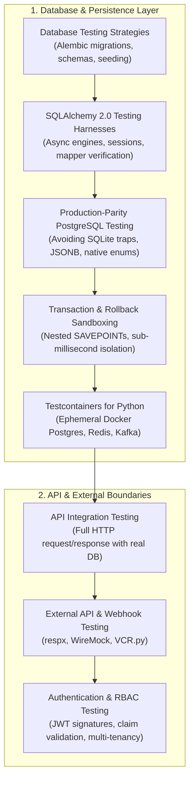

# Integration Testing in Python Backend Systems 🗄️

> **Authoritative Sources & Literature:**
> - Martin Fowler: *Integration Test* & *Testing of Microservices* (martinfowler.com)
> - Harry Percival & Bob Gregory: *Architecture Patterns with Python* (Chapter 2: Repository Pattern, Chapter 3: Coupling and Abstractions, O'Reilly)
> - Mike Bayer: *SQLAlchemy 2.0 Architecture & Transactional Management* (docs.sqlalchemy.org)
> - Testcontainers Community: *Testcontainers for Python* (testcontainers-python.readthedocs.io)

---

## 📖 Module Overview

While unit tests prove that pure business logic works in memory, **Integration Testing** verifies that software components function correctly when connected to **real infrastructure**:
- Relational Databases (PostgreSQL, MySQL, SQLite).
- Object-Relational Mappers (SQLAlchemy 2.0, Tortoise ORM).
- Ephemeral Docker Containers via Testcontainers.
- Cache & Messaging Layers (Redis, RabbitMQ, Kafka).
- External Third-Party APIs & Webhooks (Stripe, Twilio, OAuth2 providers).

This module provides backend engineers with an enterprise-grade blueprint for orchestrating database migrations, transactional sandboxing via `SAVEPOINT` rollbacks, production-parity PostgreSQL testing, and resilient HTTP mock servers.

---

## 🗺️ Module Guides

### 1. [API Integration Testing](api-integration-testing.md)
Verify end-to-end HTTP request/response cycles against real database persistence. Test JSON schema serialization, query parameters, status codes, and database state mutations.

### 2. [Database Integration Testing Strategies](database-testing.md)
Manage database lifecycles in automated test runs. Run Alembic schema migrations, seed baseline reference datasets, and sanitize tables between test executions.

### 3. [SQLAlchemy 2.0 Testing Harnesses](sqlalchemy-testing.md)
Master modern SQLAlchemy 2.0 testing. Configure async engines (`asyncpg`), manage `AsyncSession` lifecycles, verify ORM relationship cascades, and test raw SQL queries.

### 4. [Production-Parity PostgreSQL Testing](postgresql-testing.md)
Understand why in-memory SQLite hides production bugs. Test native PostgreSQL features: `JSONB` operators, custom `ENUM` types, UUID columns, and row-level locking (`SELECT FOR UPDATE`).

### 5. [Transaction Rollback Sandboxing (`SAVEPOINT`)](transaction-and-rollback.md)
The holy grail of database testing performance. Learn how nested transactions and `SAVEPOINT` rollbacks provide 100% clean test isolation in **1 to 2 milliseconds** per test.

### 6. [Containerized Dependencies with Testcontainers](testcontainers-testing.md)
Eliminate mocked databases. Spin up real, ephemeral Docker containers (PostgreSQL, Redis, Kafka, LocalStack) directly from Python pytest fixtures with automated port mapping and cleanup.

### 7. [External HTTP & Webhook Integration](external-api-testing.md)
Isolate third-party HTTP services safely. Master `respx` for asynchronous HTTPX mocking, WireMock for containerized mock servers, and `vcrpy` for recording and replaying HTTP cassettes.

### 8. [Authentication & Role-Based Access Control (RBAC)](authentication-testing.md)
Verify security boundaries. Test JWT token generation, signature validation, expired token rejection, claim verification, and multi-tenant authorization policies.

---

## 📊 Summary of Integration Testing Dimensions

| Feature | In-Memory SQLite | Local Test DB | Testcontainers (Docker) |
| :--- | :--- | :--- | :--- |
| **Parity with Production** | Low (Dialect mismatch) | High (PostgreSQL) | **100% Identical to Production** |
| **Startup Overhead** | Fast ($10\text{ms}$) | Medium (Pre-installed) | $\approx 2 - 4\text{s}$ (Session scoped) |
| **Per-Test Speed** | $\approx 1\text{ms}$ | $\approx 1 - 2\text{ms}$ (with SAVEPOINT) | $\approx 1 - 2\text{ms}$ (with SAVEPOINT) |
| **Supports PG JSONB/Enums** | ❌ No | ✅ Yes | ✅ Yes |
| **CI Setup Complexity** | Zero | Moderate | Moderate (Requires Docker daemon) |

---

## ⏭️ Next Steps

Begin with **[API Integration Testing](api-integration-testing.md)** to establish end-to-end framework test harnesses.
