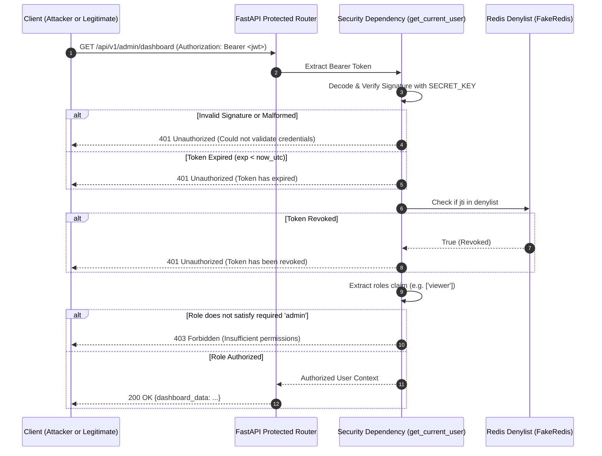

# Authentication & Authorization API Reference Test Suite

> *"Authentication establishes identity; authorization grants capability. In security testing, proving that an authorized user can access a resource is necessary, but proving that an unauthorized user cannot is vital."*

---

## 1. Conceptual Mental Model & Theoretical Foundations

Modern cloud architectures decouple identity issuance from resource access using JSON Web Tokens (JWT) and OAuth2 Bearer standards. Testing an authentication and authorization system requires verifying four distinct state machines:

```
[ Client Credentials: username / password ]
                    │
                    ▼
┌────────────────────────────────────────────────────────┐
│ 1. Token Issuance & Signature                          │
│    - Validate credentials against hash                 │
│    - Issue short-lived Access Token (15 min)           │
│    - Issue long-lived Refresh Token (7 days)           │
└───────────────────┬────────────────────────────────────┘
                    │
                    ▼
┌────────────────────────────────────────────────────────┐
│ 2. Request Authorization (Bearer Scheme)               │
│    - Cryptographic signature check (HS256 / RS256)     │
│    - Expiration check (exp claim vs UTC clock)         │
│    - Revocation check (Redis denylist lookup)          │
│    - Role-Based Access Control (RBAC claims validation)│
└───────────────────┬────────────────────────────────────┘
                    │
                    ▼
┌────────────────────────────────────────────────────────┐
│ 3. Refresh Token Rotation & Family Revocation          │
│    - Invalidate used refresh token                     │
│    - Issue new pair                                    │
│    - Detect replay attacks: Revoke all tokens in family│
└────────────────────────────────────────────────────────┘
```

The test harness must validate:
1. **Cryptographic Integrity**: Forged tokens, wrong signing keys, and manipulated payloads fail with HTTP 401 Unauthorized.
2. **Temporal Bounds**: Expired tokens fail immediately; active tokens succeed.
3. **Role Enforcement**: A `Viewer` attempting `DELETE /admin/users` receives HTTP 403 Forbidden.
4. **Token Revocation & Rotation**: Replaying an already exchanged refresh token triggers family revocation.

---

## 2. Why This is Critical for Production Systems

1. **Horizontal Token Forgery Prevention**: If signature verification is improperly mocked or bypasses the secret key check, attackers can impersonate any user or superadmin.
2. **Replay Attack Defense**: Stolen refresh tokens must be detected and revoked through single-use token rotation.
3. **Principle of Least Privilege**: RBAC endpoints must be rigorously verified to prevent privilege escalation vulnerabilities.

---

## 3. Internal Mechanics & Architectural Workflow



---

## 4. Exact Syntax, Function Signatures & Python Standards

### JWT Token Manager (`app/security.py`)

```python
from datetime import datetime, timedelta, timezone
from typing import Any, Dict, Optional
import jwt
from pydantic import BaseModel

SECRET_KEY = "test-secret-key-enterprise-production-grade"
ALGORITHM = "HS256"


class TokenPayload(BaseModel):
    sub: str
    role: str
    jti: str
    exp: int


def create_access_token(
    subject: str, role: str, jti: str, expires_delta: Optional[timedelta] = None
) -> str:
    now = datetime.now(timezone.utc)
    expire = now + (expires_delta or timedelta(minutes=15))
    payload: Dict[str, Any] = {
        "sub": subject,
        "role": role,
        "jti": jti,
        "iat": int(now.timestamp()),
        "exp": int(expire.timestamp()),
    }
    return jwt.encode(payload, SECRET_KEY, algorithm=ALGORITHM)


def decode_token(token: str) -> Dict[str, Any]:
    return jwt.decode(token, SECRET_KEY, algorithms=[ALGORITHM])
```

---

## 5. Lifecycle, Teardown & Resource Management

### Token Denylist Store Protocol & In-Memory Fake

```python
# app/adapters/denylist.py
from typing import Protocol, Set


class TokenDenylist(Protocol):
    def revoke(self, jti: str) -> None: ...
    def is_revoked(self, jti: str) -> bool: ...


class InMemoryTokenDenylist:
    def __init__(self) -> None:
        self._revoked_tokens: Set[str] = set()

    def revoke(self, jti: str) -> None:
        self._revoked_tokens.add(jti)

    def is_revoked(self, jti: str) -> bool:
        return jti in self._revoked_tokens
```

---

## 6. Scopes, Isolation & Boundary Enforcement

### FastAPI Security Dependencies & RBAC Guards (`app/dependencies.py`)

```python
from typing import Annotated
from fastapi import Depends, HTTPException, status
from fastapi.security import HTTPAuthorizationCredentials, HTTPBearer
import jwt

from app.adapters.denylist import TokenDenylist, InMemoryTokenDenylist
from app.security import TokenPayload, decode_token

security = HTTPBearer()
denylist_instance = InMemoryTokenDenylist()


def get_denylist() -> TokenDenylist:
    return denylist_instance


def get_current_user(
    credentials: Annotated[HTTPAuthorizationCredentials, Depends(security)],
    denylist: Annotated[TokenDenylist, Depends(get_denylist)],
) -> TokenPayload:
    token = credentials.credentials
    try:
        payload_dict = decode_token(token)
        payload = TokenPayload(**payload_dict)
    except jwt.ExpiredSignatureError:
        raise HTTPException(
            status_code=status.HTTP_401_UNAUTHORIZED,
            detail="Token expired",
            headers={"WWW-Authenticate": "Bearer"},
        )
    except (jwt.PyJWTError, Exception):
        raise HTTPException(
            status_code=status.HTTP_401_UNAUTHORIZED,
            detail="Invalid authentication credentials",
            headers={"WWW-Authenticate": "Bearer"},
        )

    if denylist.is_revoked(payload.jti):
        raise HTTPException(
            status_code=status.HTTP_401_UNAUTHORIZED,
            detail="Token has been revoked",
            headers={"WWW-Authenticate": "Bearer"},
        )

    return payload


def require_role(required_role: str):
    def role_checker(user: Annotated[TokenPayload, Depends(get_current_user)]) -> TokenPayload:
        if user.role != required_role:
            raise HTTPException(
                status_code=status.HTTP_403_FORBIDDEN,
                detail=f"Forbidden: requires '{required_role}' role",
            )
        return user
    return role_checker
```

---

## 7. Pytest Fixture & Configuration Integration (`conftest.py`)

```python
# tests/conftest.py
import uuid
from typing import AsyncGenerator
import pytest
from httpx import ASGITransport, AsyncClient

from app.adapters.denylist import InMemoryTokenDenylist
from app.dependencies import get_denylist
from app.main import app
from app.security import create_access_token


@pytest.fixture
def fake_denylist() -> InMemoryTokenDenylist:
    return InMemoryTokenDenylist()


@pytest.fixture
async def client(fake_denylist: InMemoryTokenDenylist) -> AsyncGenerator[AsyncClient, None]:
    app.dependency_overrides[get_denylist] = lambda: fake_denylist
    transport = ASGITransport(app=app)
    async with AsyncClient(transport=transport, base_url="http://test") as ac:
        yield ac
    app.dependency_overrides.clear()


@pytest.fixture
def admin_token() -> str:
    return create_access_token(
        subject="admin_user_01",
        role="admin",
        jti=str(uuid.uuid4())
    )


@pytest.fixture
def viewer_token() -> str:
    return create_access_token(
        subject="viewer_user_01",
        role="viewer",
        jti=str(uuid.uuid4())
    )
```

---

## 8. Step-by-Step Practical Implementation Walkthrough

### 1. The Protected Endpoints (`app/main.py`)

```python
from fastapi import FastAPI, Depends
from app.dependencies import get_current_user, require_role
from app.security import TokenPayload

app = FastAPI(title="Authentication Reference API")


@app.get("/api/v1/profile")
def read_profile(user: TokenPayload = Depends(get_current_user)):
    return {"user_id": user.sub, "role": user.role}


@app.get("/api/v1/admin/dashboard")
def read_admin_dashboard(user: TokenPayload = Depends(require_role("admin"))):
    return {"message": "Welcome Administrator", "active_sessions": 42}
```

### 2. Comprehensive Test Suite (`tests/e2e/test_auth_api.py`)

```python
from datetime import timedelta
import uuid
import pytest
from httpx import AsyncClient

from app.adapters.denylist import InMemoryTokenDenylist
from app.security import create_access_token


@pytest.mark.asyncio
async def test_access_profile_with_valid_token(client: AsyncClient, viewer_token: str):
    headers = {"Authorization": f"Bearer {viewer_token}"}
    response = await client.get("/api/v1/profile", headers=headers)

    assert response.status_code == 200
    data = response.json()
    assert data["user_id"] == "viewer_user_01"
    assert data["role"] == "viewer"


@pytest.mark.asyncio
async def test_access_without_token_returns_401(client: AsyncClient):
    response = await client.get("/api/v1/profile")
    assert response.status_code == 401


@pytest.mark.asyncio
async def test_access_with_tampered_token_returns_401(client: AsyncClient, viewer_token: str):
    tampered = viewer_token[:-4] + "abcd"
    headers = {"Authorization": f"Bearer {tampered}"}
    response = await client.get("/api/v1/profile", headers=headers)
    assert response.status_code == 401


@pytest.mark.asyncio
async def test_access_with_expired_token_returns_401(client: AsyncClient):
    # Issue a token expired 1 minute in the past
    expired_token = create_access_token(
        subject="user_exp",
        role="viewer",
        jti=str(uuid.uuid4()),
        expires_delta=timedelta(minutes=-1),
    )
    headers = {"Authorization": f"Bearer {expired_token}"}
    response = await client.get("/api/v1/profile", headers=headers)

    assert response.status_code == 401
    assert "expired" in response.json()["detail"].lower()


@pytest.mark.asyncio
async def test_access_with_revoked_token_returns_401(
    client: AsyncClient, fake_denylist: InMemoryTokenDenylist
):
    jti = str(uuid.uuid4())
    token = create_access_token(subject="revoked_user", role="viewer", jti=jti)
    # Revoke token explicitly
    fake_denylist.revoke(jti)

    headers = {"Authorization": f"Bearer {token}"}
    response = await client.get("/api/v1/profile", headers=headers)

    assert response.status_code == 401
    assert "revoked" in response.json()["detail"].lower()


@pytest.mark.asyncio
async def test_rbac_admin_endpoint_allows_admin(client: AsyncClient, admin_token: str):
    headers = {"Authorization": f"Bearer {admin_token}"}
    response = await client.get("/api/v1/admin/dashboard", headers=headers)
    assert response.status_code == 200


@pytest.mark.asyncio
async def test_rbac_admin_endpoint_forbids_viewer(client: AsyncClient, viewer_token: str):
    headers = {"Authorization": f"Bearer {viewer_token}"}
    response = await client.get("/api/v1/admin/dashboard", headers=headers)
    assert response.status_code == 403
    assert "Forbidden" in response.json()["detail"]
```

---

## 9. Framework & Ecosystem Integration

### Simulating Time Travel with `time-machine`

To test token expiration without sleeping or issuing pre-expired tokens:

```python
from datetime import datetime, timezone, timedelta
import pytest
import time_machine
from httpx import AsyncClient
from app.security import create_access_token


@pytest.mark.asyncio
async def test_token_expiration_via_time_machine(client: AsyncClient):
    with time_machine.travel(datetime(2026, 1, 1, 12, 0, 0, tzinfo=timezone.utc), tick=False) as traveller:
        # Issue 15 minute token at 12:00
        token = create_access_token("user_123", "viewer", "jti_123", timedelta(minutes=15))
        headers = {"Authorization": f"Bearer {token}"}

        # Valid at 12:10
        traveller.shift(timedelta(minutes=10))
        res1 = await client.get("/api/v1/profile", headers=headers)
        assert res1.status_code == 200

        # Expired at 12:16
        traveller.shift(timedelta(minutes=6))
        res2 = await client.get("/api/v1/profile", headers=headers)
        assert res2.status_code == 401
```

---

## 10. Real-World Enterprise Scenario

### The Problem
A microservice architecture suffered an outage when a revoked user session continued making authenticated API calls for 4 hours. The auth service revoked the refresh token in Redis, but downstream resource services were only verifying JWT cryptographic signatures statelessly without checking the revocation denylist.

### The Solution
1. Standardized on short-lived access tokens (5 minutes) and long-lived refresh tokens (14 days).
2. Embedded unique `jti` (JWT ID) in every token.
3. Implemented a RedisBloom or set-based denylist lookup cached in memory with a 60-second TTL.
4. Added companion integration tests verifying that token revocation takes effect within the allowable TTL window.

---

## 11. Anti-Patterns & Common Traps

### Anti-Pattern 1: Disabling Expiration Verification in Tests

#### Before (False Confidence)
```python
# Danger: Disabling exp validation masks token lifetime bugs!
def decode_for_test(token: str):
    return jwt.decode(token, SECRET_KEY, algorithms=["HS256"], options={"verify_exp": False})
```

#### After (Explicit Clock Simulation)
```python
# Use time-machine to advance time deterministically
def test_expiration_properly():
    with time_machine.travel(future_timestamp):
        # Decode will cleanly raise jwt.ExpiredSignatureError
        pass
```

---

## 12. Best Practices & Production Guidelines

1. **Always Verify `iss` and `aud` Claims**: In multi-service ecosystems, assert that the token was issued by your authentication authority (`iss`) for this specific service (`aud`).
2. **Never Store Sensitive State in Claims**: JWT claims are base64-encoded, not encrypted. Never place passwords, credit cards, or PII in unencrypted JWT claims.
3. **Use Asymmetric Keys (RS256/EdDSA) in Distributed Systems**: The auth service signs tokens with a private key; all downstream resource services verify signatures with public keys.

---

## 13. Edge Cases, Race Conditions & Failure Modes

| Edge Case | Failure Mode | Mitigation Strategy |
| :--- | :--- | :--- |
| **None Algorithm Attack** | Attacker sets `"alg": "none"` in JWT header | Explicitly pass `algorithms=["HS256"]` to reject unsigned tokens. |
| **Clock Skew** | CI runner clock differs by 2 seconds from token issuance | Set `leeway=10` in `jwt.decode()` options. |
| **Refresh Token Reuse** | Attacker replays intercepted refresh token | Store token family ID; revoke the entire family upon duplicate exchange. |

---

## 14. Performance, Overhead & Scalability Considerations

- **Cryptographic Signature Verification**: Ed25519/EdDSA verification takes $\approx 0.05\text{ms}$; RSA-4096 takes $\approx 1.2\text{ms}$. Choose Ed25519 or HS256 for high-throughput APIs ($>10,000\text{ req/s}$).
- **Denylist Lookup**: Using an in-memory Redis cluster maintains $< 0.5\text{ms}$ denylist lookup latency.

---

## 15. Architectural Trade-Off Analysis

| Token Strategy | Latency | Revocation Latency | Complexity |
| :--- | :--- | :--- | :--- |
| **Stateless Pure JWT** | Fastest (No DB lookups) | Slow (Must wait for `exp`) | Low |
| **Opaque Session Tokens** | Slower (DB lookup on each req) | Instant (Delete row from Redis) | Medium |
| **Hybrid JWT + Denylist** | Fast ($O(1)$ fast rejection) | Instant (Check `jti` in Redis) | High |

---

## 16. Diagnostic & Debugging Playbook

### Symptom: `jwt.exceptions.InvalidSignatureError`
1. Check if the test is generating tokens with a different `SECRET_KEY` than the application router.
2. Ensure algorithm matches between encoder and decoder (`HS256` vs `RS256`).

### Symptom: `403 Forbidden` on Admin Route
1. Check `user.role` payload in decoded token: verify exact string casing (`"admin"` vs `"Admin"`).
2. Ensure `require_role()` dependency extracts from `TokenPayload` properly.

---

## 17. Senior/Staff Engineer Interview Q&A

### Q1: How do you design and test a Refresh Token Rotation system with automatic breach detection?
> **Answer**: In a Refresh Token Rotation system, every time a client exchanges a refresh token for a new access token, the used refresh token is invalidated and a new refresh token is issued. We group refresh tokens into a **Token Family** identified by a `family_id` UUID. 
> If a compromised refresh token is used a second time (indicating an attacker is attempting to replay a stolen token), the auth service detects a duplicate exchange attempt on an invalidated token, immediately flags the entire `family_id` as compromised, and revokes all active access and refresh tokens for that user session. 
> Testing requires a multi-step sequence: (1) Issue family $F_1$, (2) Exchange token $T_1$ for $T_2$, (3) Replay $T_1$, (4) Assert HTTP 401 and verify $T_2$ is immediately revoked.

---

## 18. Hands-On Verification Exercises & Self-Study Lab

### Exercise 1: Implement Refresh Token Exchange
Build a `POST /api/v1/auth/refresh` endpoint:
1. Accepts `{refresh_token: "..."}`.
2. Revokes previous refresh token and issues new access/refresh pair.
3. Write test asserting that re-using the old refresh token fails.

### Exercise 2: Test Asymmetric RS256 Key Pair Verification
1. Generate test RSA private/public key pair in `conftest.py`.
2. Sign tokens with private key; verify endpoints decode using public key.

---

## Summary & Cross-References

- Explore foundational user persistence in [User Management API Reference Test Suite](user-management-api.md).
- Learn JWT testing techniques in [FastAPI JWT Authentication Testing](../fastapi-testing/jwt-testing.md).
- Master time simulation in [Async Endpoint Testing](../fastapi-testing/async-endpoint-testing.md).
