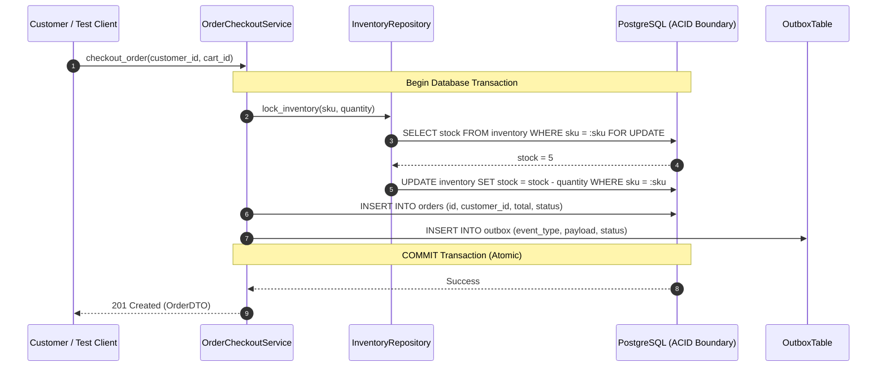

# E-Commerce & Inventory API Reference Test Suite

> *"In e-commerce backend engineering, the cardinal sin is overselling: confirming an order for inventory that does not exist. Rigorous concurrency testing and the Transactional Outbox pattern guarantee business consistency across distributed boundaries."*

---

## 1. Conceptual Mental Model & Theoretical Foundations

An e-commerce checkout flow represents one of the most complex workflows in software engineering. It bridges multi-item shopping carts, optimistic or pessimistic inventory reservation, relational database transactions, and asynchronous event publication.

```
       [ Client: POST /api/v1/orders/checkout ]
                        │
                        ▼
┌────────────────────────────────────────────────────────┐
│ 1. Aggregate Invariant Validation (Domain Layer)       │
│    - Validate cart is not empty                        │
│    - Validate item quantities > 0                      │
└───────────────────────┬────────────────────────────────┘
                        │
                        ▼
┌────────────────────────────────────────────────────────┐
│ 2. Inventory Lock & Reservation (Pessimistic Locking)  │
│    - SELECT * FROM inventory WHERE sku = :sku FOR UPDATE│
│    - Ensure available_stock >= requested_quantity      │
│    - Decrement stock; Raise OutOfStockError if zero    │
└───────────────────────┬────────────────────────────────┘
                        │
                        ▼
┌────────────────────────────────────────────────────────┐
│ 3. Atomic Order Creation & Transactional Outbox        │
│    - INSERT INTO orders (...)                          │
│    - INSERT INTO outbox_events (event_name, payload)   │
│    - COMMIT Transaction (Both Order & Event persist)   │
└────────────────────────────────────────────────────────┘
```

The test harness must rigorously verify:
1. **Domain Aggregate Invariants**: A cart cannot be checked out twice; quantities must be strictly positive integers.
2. **Concurrency & Overselling Prevention**: When 10 concurrent requests compete for 2 items in stock, exactly 2 requests succeed and 8 fail gracefully with HTTP 409 Conflict.
3. **Transactional Outbox Reliability**: The domain event `OrderPlaced` is written inside the identical database transaction as the order record, eliminating dual-write failure modes.

---

## 2. Why This is Critical for Production Systems

1. **Eliminating Dual-Write Partial Failures**: If an order record is committed to the database but message broker publishing (RabbitMQ/Kafka) crashes, downstream fulfillment never triggers. The Transactional Outbox pattern eliminates this vulnerability.
2. **Preventing Race Conditions on High-Demand SKUs**: Flash sales trigger thousands of concurrent threads. Without proper database locking (`FOR UPDATE`) and concurrency testing, inventory falls below zero.
3. **Idempotent Checkout Submissions**: Double-clicking "Place Order" must not charge the customer twice or create duplicate orders.

---

## 3. Internal Mechanics & Architectural Workflow



---

## 4. Exact Syntax, Function Signatures & Python Standards

### Domain Models & Aggregate Roots (`app/domain/models.py`)

```python
from dataclasses import dataclass, field
from decimal import Decimal
from enum import Enum
from typing import List
import uuid


class OrderStatus(str, Enum):
    PENDING = "pending"
    PAID = "paid"
    CANCELLED = "cancelled"


class OutOfStockError(Exception):
    pass


@dataclass(frozen=True)
class OrderLine:
    sku: str
    quantity: int
    unit_price: Decimal


@dataclass
class Order:
    id: uuid.UUID
    customer_id: str
    lines: List[OrderLine]
    status: OrderStatus = OrderStatus.PENDING

    @property
    def total_amount(self) -> Decimal:
        return sum((line.unit_price * line.quantity for line in self.lines), Decimal("0.00"))

    @classmethod
    def create(cls, customer_id: str, lines: List[OrderLine]) -> "Order":
        if not lines:
            raise ValueError("Cannot create an order with zero lines")
        for line in lines:
            if line.quantity <= 0:
                raise ValueError(f"Line quantity must be positive, got {line.quantity}")
        return cls(id=uuid.uuid4(), customer_id=customer_id, lines=lines)
```

---

## 5. Lifecycle, Teardown & Resource Management

### SQLAlchemy 2.0 ORM Mappings (`app/adapters/orm.py`)

```python
from datetime import datetime, timezone
from decimal import Decimal
import uuid
from sqlalchemy import DateTime, Integer, Numeric, String, Uuid, ForeignKey
from sqlalchemy.orm import DeclarativeBase, Mapped, mapped_column, relationship


class Base(DeclarativeBase):
    pass


class InventoryModel(Base):
    __tablename__ = "inventory"

    sku: Mapped[str] = mapped_column(String(50), primary_key=True)
    available_stock: Mapped[int] = mapped_column(Integer, nullable=False)


class OrderModel(Base):
    __tablename__ = "orders"

    id: Mapped[uuid.UUID] = mapped_column(Uuid(as_uuid=True), primary_key=True)
    customer_id: Mapped[str] = mapped_column(String(100), nullable=False)
    total: Mapped[Decimal] = mapped_column(Numeric(10, 2), nullable=False)
    created_at: Mapped[datetime] = mapped_column(
        DateTime(timezone=True), default=lambda: datetime.now(timezone.utc)
    )


class OutboxEventModel(Base):
    __tablename__ = "outbox_events"

    id: Mapped[uuid.UUID] = mapped_column(Uuid(as_uuid=True), primary_key=True, default=uuid.uuid4)
    event_type: Mapped[str] = mapped_column(String(100), nullable=False)
    payload: Mapped[str] = mapped_column(String(2000), nullable=False)
    created_at: Mapped[datetime] = mapped_column(
        DateTime(timezone=True), default=lambda: datetime.now(timezone.utc)
    )
```

---

## 6. Scopes, Isolation & Boundary Enforcement

### Service Layer with Pessimistic Locking & Outbox Pattern

```python
# app/service_layer/checkout_service.py
import json
import uuid
from decimal import Decimal
from sqlalchemy import select
from sqlalchemy.orm import Session

from app.adapters.orm import InventoryModel, OrderModel, OutboxEventModel
from app.domain.models import OutOfStockError


class CheckoutService:
    def __init__(self, session: Session) -> None:
        self.session = session

    def process_checkout(self, customer_id: str, sku: str, quantity: int, unit_price: Decimal) -> uuid.UUID:
        # 1. Pessimistic Lock on Inventory (SELECT ... FOR UPDATE)
        stmt = (
            select(InventoryModel)
            .where(InventoryModel.sku == sku)
            .with_for_update()
        )
        inventory = self.session.execute(stmt).scalar_one_or_none()
        if not inventory:
            raise OutOfStockError(f"SKU {sku} does not exist in inventory catalog")

        if inventory.available_stock < quantity:
            raise OutOfStockError(
                f"Insufficient stock for {sku}: requested {quantity}, available {inventory.available_stock}"
            )

        # 2. Decrement stock
        inventory.available_stock -= quantity

        # 3. Create Order
        order_id = uuid.uuid4()
        total_amount = unit_price * quantity
        order = OrderModel(id=order_id, customer_id=customer_id, total=total_amount)
        self.session.add(order)

        # 4. Write to Transactional Outbox
        outbox_event = OutboxEventModel(
            id=uuid.uuid4(),
            event_type="OrderPlaced",
            payload=json.dumps({
                "order_id": str(order_id),
                "customer_id": customer_id,
                "sku": sku,
                "quantity": quantity,
                "total": str(total_amount),
            }),
        )
        self.session.add(outbox_event)

        # Both order and outbox event commit together in calling unit of work
        self.session.flush()
        return order_id
```

---

## 7. Pytest Fixture & Configuration Integration (`conftest.py`)

```python
# tests/conftest.py
from typing import Generator
import pytest
from sqlalchemy import create_engine
from sqlalchemy.orm import Session

from app.adapters.orm import Base, InventoryModel


@pytest.fixture(scope="session")
def engine():
    engine = create_engine("sqlite:///:memory:", echo=False)
    Base.metadata.create_all(bind=engine)
    yield engine
    Base.metadata.drop_all(bind=engine)


@pytest.fixture(scope="function")
def db_session(engine) -> Generator[Session, None, None]:
    connection = engine.connect()
    transaction = connection.begin()
    session = Session(bind=connection)

    # Seed initial test inventory
    session.add(InventoryModel(sku="MACBOOK-PRO", available_stock=10))
    session.add(InventoryModel(sku="KEYBOARD-RGB", available_stock=1))
    session.flush()

    yield session

    session.close()
    transaction.rollback()
    connection.close()
```

---

## 8. Step-by-Step Practical Implementation Walkthrough

### Test Suite (`tests/integration/test_checkout.py`)

```python
from decimal import Decimal
import json
import pytest
from sqlalchemy import select

from app.adapters.orm import InventoryModel, OrderModel, OutboxEventModel
from app.domain.models import OutOfStockError
from app.service_layer.checkout_service import CheckoutService


def test_successful_checkout_reserves_stock_and_creates_outbox_event(db_session):
    service = CheckoutService(db_session)
    order_id = service.process_checkout(
        customer_id="cust_99",
        sku="MACBOOK-PRO",
        quantity=2,
        unit_price=Decimal("1999.00"),
    )

    # 1. Assert Inventory was decremented
    inv = db_session.execute(
        select(InventoryModel).where(InventoryModel.sku == "MACBOOK-PRO")
    ).scalar_one()
    assert inv.available_stock == 8  # 10 - 2

    # 2. Assert Order was created
    order = db_session.execute(
        select(OrderModel).where(OrderModel.id == order_id)
    ).scalar_one()
    assert order.customer_id == "cust_99"
    assert order.total == Decimal("3998.00")

    # 3. Assert Transactional Outbox captured the event
    outbox = db_session.execute(
        select(OutboxEventModel).where(OutboxEventModel.event_type == "OrderPlaced")
    ).scalar_one()
    payload = json.loads(outbox.payload)
    assert payload["order_id"] == str(order_id)
    assert payload["quantity"] == 2


def test_checkout_fails_when_stock_insufficient(db_session):
    service = CheckoutService(db_session)

    # KEYBOARD-RGB has only 1 in stock, request 2
    with pytest.raises(OutOfStockError, match="Insufficient stock"):
        service.process_checkout(
            customer_id="cust_1",
            sku="KEYBOARD-RGB",
            quantity=2,
            unit_price=Decimal("99.00"),
        )

    # Verify inventory was NOT decremented
    inv = db_session.execute(
        select(InventoryModel).where(InventoryModel.sku == "KEYBOARD-RGB")
    ).scalar_one()
    assert inv.available_stock == 1

    # Verify no order or outbox event was committed
    orders = db_session.execute(select(OrderModel)).scalars().all()
    assert len(orders) == 0
```

---

## 9. Framework & Ecosystem Integration

### Simulating Concurrent Checkouts with ThreadPoolExecutor

In real PostgreSQL instances, verify that pessimistic locks (`FOR UPDATE`) serialize concurrent requests without overselling:

```python
from concurrent.futures import ThreadPoolExecutor
from decimal import Decimal
import pytest
from app.domain.models import OutOfStockError
from app.service_layer.checkout_service import CheckoutService


def test_concurrent_checkout_prevents_overselling(engine):
    """Verify that multiple threads competing for limited stock do not oversell."""
    sku = "LIMITED-ITEM"
    # Seed 2 items
    from sqlalchemy.orm import Session
    from app.adapters.orm import InventoryModel

    with Session(engine) as s:
        s.add(InventoryModel(sku=sku, available_stock=2))
        s.commit()

    successful_orders = []
    out_of_stock_exceptions = []

    def attempt_checkout(cust_id: str):
        with Session(engine) as s:
            service = CheckoutService(s)
            try:
                order_id = service.process_checkout(
                    customer_id=cust_id,
                    sku=sku,
                    quantity=1,
                    unit_price=Decimal("100.00"),
                )
                s.commit()
                successful_orders.append(order_id)
            except OutOfStockError as exc:
                s.rollback()
                out_of_stock_exceptions.append(exc)

    # 5 concurrent shoppers competing for 2 items
    with ThreadPoolExecutor(max_workers=5) as pool:
        futures = [pool.submit(attempt_checkout, f"shopper_{i}") for i in range(5)]
        for f in futures:
            f.result()

    # Exact Invariant: Exactly 2 succeed, exactly 3 fail
    assert len(successful_orders) == 2
    assert len(out_of_stock_exceptions) == 3

    with Session(engine) as s:
        inv = s.get(InventoryModel, sku)
        assert inv.available_stock == 0
```

---

## 10. Real-World Enterprise Scenario

### The Problem
During a Black Friday promotion, an e-commerce platform sold 450 units of a gaming console that had only 50 units in stock. The root cause: the developers relied on an application-level read check (`if stock > 0: stock -= 1; save()`) without database locks. Under concurrent traffic, 400 threads read `stock = 50` at the exact same millisecond before any thread had updated the database.

### The Solution
1. Converted inventory queries to use pessimistic locking (`with_for_update()`).
2. Added database check constraints (`CHECK (available_stock >= 0)`).
3. Created an automated stress test in pytest using `concurrent.futures` to certify concurrency limits before every major release.

---

## 11. Anti-Patterns & Common Traps

### Anti-Pattern 1: Dual-Write Anti-Pattern (Publishing Directly to Kafka)

#### Before (Vulnerable to Crash Between DB & Kafka)
```python
def checkout(session, kafka_producer):
    session.commit()
    # CRITICAL BUG: If process crashes here, message is never sent!
    kafka_producer.send("OrderPlaced", {"order_id": 123})
```

#### After (Transactional Outbox)
```python
def checkout(session):
    # Both are written in the same local DB transaction
    session.add(order)
    session.add(OutboxEventModel(event_type="OrderPlaced", ...))
    session.commit()
```

---

## 12. Best Practices & Production Guidelines

1. **Use Database Constraints as the Final Gatekeeper**: Always define `CheckConstraint('available_stock >= 0')` in your table definition to make negative inventory impossible at the physical storage level.
2. **Order Lines Must Have Positive Quantities**: Reject `quantity <= 0` at both schema and domain model layers.
3. **Pessimistic vs. Optimistic Locking**: Use pessimistic locking (`FOR UPDATE`) for high-contention flash sales; use optimistic locking (version column) for low-contention catalogs.

---

## 13. Edge Cases, Race Conditions & Failure Modes

| Edge Case | Failure Mode | Mitigation Strategy |
| :--- | :--- | :--- |
| **Deadlock on Multi-Item Orders** | Thread A locks SKU 1 then SKU 2; Thread B locks SKU 2 then SKU 1 | Always sort SKUs alphabetically before acquiring database locks. |
| **Negative Inventory Race** | 2 threads read stock concurrently | Acquire `with_for_update()` lock on the inventory row. |
| **Zero Decimal Price** | Free promotion accidentally generates negative total | Validate `unit_price >= 0` in Pydantic schema. |

---

## 14. Performance, Overhead & Scalability Considerations

- **Pessimistic Lock Duration**: Keep database transactions as short as possible ($< 10\text{ms}$). Never perform external HTTP calls (e.g., Stripe API) while holding a database row lock.
- **Outbox Worker**: Use an asynchronous background poller (Debezium CDC or Celery worker) to read and publish outbox records to Kafka/RabbitMQ.

---

## 15. Architectural Trade-Off Analysis

| Strategy | Contention Handling | Latency | Complexity |
| :--- | :--- | :--- | :--- |
| **Pessimistic Locking (`FOR UPDATE`)** | High contention safe | Blocks concurrent readers | Low |
| **Optimistic Locking (Version ID)** | Retries on collision | Fast for low contention | Moderate (Requires retry logic) |
| **Redis Distributed Lock** | Offloads DB load | High throughput | High (Requires Redlock) |

---

## 16. Diagnostic & Debugging Playbook

### Symptom: `OperationalError: deadlock detected`
1. Review lock acquisition order in your checkout service.
2. Ensure all transactions acquire item locks in strict sorted order: `sorted(cart_items, key=lambda x: x.sku)`.

### Symptom: Stock Drops Below Zero
1. Ensure `CHECK (available_stock >= 0)` is enabled in database migrations.
2. Confirm that `with_for_update()` is present on the inventory `select` query.

---

## 17. Senior/Staff Engineer Interview Q&A

### Q1: How do you prevent deadlocks when reserving inventory for orders containing multiple distinct SKUs?
> **Answer**: Deadlocks occur when Transaction 1 holds a lock on SKU A and requests SKU B, while Transaction 2 holds a lock on SKU B and requests SKU A. To mathematically guarantee deadlock prevention, the application must enforce a **strict global lock acquisition ordering**. 
> Before querying the database, the service sorts all requested SKUs deterministically (e.g., lexicographically by SKU string). Both transactions will therefore attempt to lock SKU A first, forcing Transaction 2 to block safely until Transaction 1 completes, converting circular wait deadlocks into deterministic sequential execution.

---

## 18. Hands-On Verification Exercises & Self-Study Lab

### Exercise 1: Implement Optimistic Locking
1. Add an `int` version column to `InventoryModel`.
2. Implement checkout using optimistic updates: `UPDATE inventory SET stock = stock - q, version = version + 1 WHERE sku = :sku AND version = :version`.
3. Write a test verifying that colliding updates raise a retryable `ConcurrencyConflictError`.

### Exercise 2: Outbox Publisher Worker
1. Write a background worker routine that queries unhandled `OutboxEventModel` rows.
2. Mock an external message publisher.
3. Assert that processed events are marked as dispatched.

---

## Summary & Cross-References

- Explore payment integration and webhooks in [Payment API Reference Test Suite](payment-api.md).
- Learn Domain-Driven Design testing in [Domain Model Testing](../architecture-and-testing/domain-model-testing.md).
- Master transactional outbox testing in [Domain Events & Message Bus Testing](../architecture-and-testing/domain-events-and-message-bus-testing.md).
