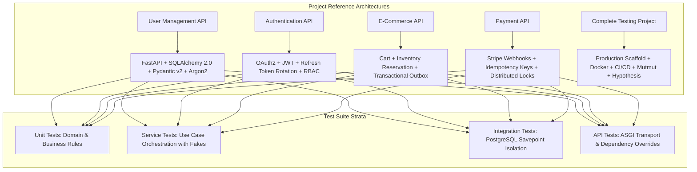

# Practical Projects: End-to-End Reference Test Suites

> *"Theory without practice is sterile; practice without theory is blind. In automated testing, architectural principles achieve reality only when concrete test suites guard production services against regressions."*

---

## Executive Overview

The **Practical Projects** module provides fully realized, production-grade reference implementations of modern Python backend services and their companion test suites. While preceding modules explored isolated techniques (fixtures, mocks, databases, async testing, mutation testing), these reference projects synthesize the entire testing stack into cohesive, multi-layered architectures.

Each project demonstrates:
1. **Domain Model & Invariants**: Encapsulated business logic tested in isolation using pure unit tests.
2. **Service Layer & Use Cases**: Application orchestration tested in "High Gear" using in-memory fakes (`FakeRepository`, `FakeUnitOfWork`).
3. **HTTP API Layer**: REST endpoints tested via `httpx.AsyncClient` with dependency overrides and schema validation.
4. **Data Persistence**: SQLAlchemy 2.0 integration tests running against containerized PostgreSQL with transaction rollback isolation.
5. **Resilience & Security**: Edge case testing, cryptographic token verification, idempotency handling, and webhook HMAC signature validation.

---

## Architectural Blueprint



---

## The Reference Projects

| Project Guide | Primary Focus | Key Technologies Tested | Architecture Pattern |
| :--- | :--- | :--- | :--- |
| **[User Management API](user-management-api.md)** | CRUD, Password Hashing, Unique Constraints, Filtering | FastAPI, SQLAlchemy 2.0, Pydantic v2, Argon2 | Clean Architecture / Repository Pattern |
| **[Authentication API](authentication-api.md)** | JWT Issuance, Refresh Token Rotation, RBAC Claims | OAuth2 Bearer, Jose/PyJWT, Redis Token Denylist | Hexagonal Architecture / Security Boundary |
| **[E-Commerce API](ecommerce-api.md)** | Cart Invariants, Inventory Reservation, Checkout | SQLAlchemy Savepoints, Event-Driven Message Bus | Domain-Driven Design / Transactional Outbox |
| **[Payment API](payment-api.md)** | Idempotency Keys, Webhook Signature Verification | Stripe API, Redis Distributed Locks, Cryptographic HMAC | Resilient Ports & Adapters / Event Webhook |
| **[Complete Testing Project](complete-testing-project.md)** | Unified Template Scaffold, All Tools Integrated | Pytest, xdist, Coverage, Hypothesis, Docker, CI/CD | Enterprise Production Blueprint |

---

## Project Structure Conventions

All reference projects follow standardized repository layouts:

```text
project-root/
├── app/
│   ├── domain/               # Pure business entities and domain exceptions
│   │   ├── models.py
│   │   └── exceptions.py
│   ├── service_layer/        # Use cases, commands, and handlers
│   │   ├── services.py
│   │   └── unit_of_work.py
│   ├── adapters/             # Repositories, ORM mappers, external clients
│   │   ├── repository.py
│   │   └── orm.py
│   └── entrypoints/          # FastAPI routers, request/response schemas
│       ├── api.py
│       └── schemas.py
├── tests/
│   ├── conftest.py           # Shared fixtures, database sessions, test clients
│   ├── unit/                 # Fast domain and service-layer tests
│   ├── integration/          # Database and external adapter tests
│   └── e2e/                  # Full HTTP request/response journey tests
├── pyproject.toml            # Dependencies, pytest config, coverage thresholds
└── Dockerfile                # Multi-stage container definition
```

---

## Recommended Learning Sequence

1. Begin with **[User Management API](user-management-api.md)** to master foundational CRUD, schema validation, and database transaction rollbacks.
2. Progress to **[Authentication API](authentication-api.md)** to learn token lifecycles, expiration testing, cryptographic mocking, and role-based access control.
3. Study **[E-Commerce API](ecommerce-api.md)** to understand aggregate roots, inventory race conditions, and event-driven testing.
4. Deep dive into **[Payment API](payment-api.md)** for idempotency, webhooks, and distributed locking.
5. Clone or inspect **[Complete Testing Project](complete-testing-project.md)** as the production-ready starting point for your next Python backend service.
