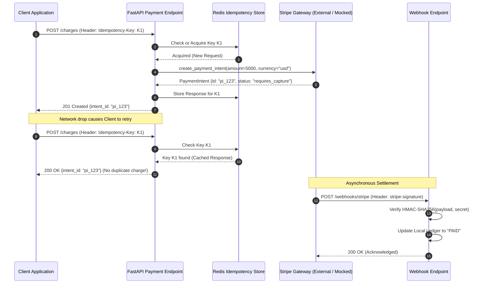

# Payment Gateway & Webhook API Reference Test Suite

> *"In payment engineering, duplicate requests are inevitable, networks are unreliable, and third-party gateways fail. Testing payment systems requires proving idempotency, cryptographic webhook verification, and fault recovery."*

---

## 1. Conceptual Mental Model & Theoretical Foundations

Payment architectures exist in an environment of zero tolerance for data loss or double billing. A payment system operates across three untrusted boundaries:
1. **The Client-to-API Boundary**: Network drops can cause the client to retry a charge request multiple times. The API must implement **Strict Idempotency Keys**.
2. **The API-to-Payment-Gateway Boundary**: Third-party providers (Stripe, Adyen, PayPal) process financial transactions via external HTTP calls. The internal service must handle timeouts and tokenized payment methods safely.
3. **The Gateway-to-API Webhook Boundary**: Asynchronous state transitions (e.g., charge succeeded, fraud review failed) arrive via inbound HTTP webhooks. The service must verify **Cryptographic HMAC-SHA256 Signatures** to prevent forged webhook attacks.

```
[ Client Request: POST /charges (Idempotency-Key: abc-123) ]
                        │
                        ▼
┌────────────────────────────────────────────────────────┐
│ 1. Idempotency Gate (Redis / DB Cache)                 │
│    - If Key exists & status=COMPLETED: Return Cached   │
│    - If Key exists & status=PROCESSING: Return 409     │
│    - If Key new: Set status=PROCESSING & Lock Key      │
└───────────────────────┬────────────────────────────────┘
                        │
                        ▼
┌────────────────────────────────────────────────────────┐
│ 2. Gateway Dispatch (Stripe Adapter)                   │
│    - Dispatch payment intent creation to Stripe        │
│    - Handle transient network drops via retry policy   │
└───────────────────────┬────────────────────────────────┘
                        │
                        ▼
┌────────────────────────────────────────────────────────┐
│ 3. Inbound Webhook Listener (POST /webhooks/stripe)    │
│    - Validate stripe-signature via HMAC-SHA256         │
│    - Validate timestamp freshness (< 5 minutes)        │
│    - Process event idempotently; Acknowledge HTTP 200  │
└────────────────────────────────────────────────────────┘
```

---

## 2. Why This is Critical for Production Systems

1. **Preventing Double Charges**: A mobile app user on a patchy cellular connection taps "Pay Now" twice. Without idempotency key testing, their credit card is charged twice.
2. **Preventing Forged Webhook Attacks**: An attacker posts a fake `payment_intent.succeeded` payload to mark orders paid without transferring funds. Rigorous HMAC signature verification tests prevent this fraud.
3. **Graceful Handling of Gateway Outages**: Third-party APIs experience downtime. Unit tests must verify that network timeouts trigger exponential backoff without corrupting database state.

---

## 3. Internal Mechanics & Architectural Workflow



---

## 4. Exact Syntax, Function Signatures & Python Standards

### HMAC Webhook Signature Verification (`app/security/webhooks.py`)

```python
import hashlib
import hmac
import time
from typing import Dict


class InvalidSignatureError(Exception):
    pass


def verify_stripe_signature(payload: bytes, signature_header: str, secret: str, tolerance: int = 300) -> bool:
    """Verify HMAC-SHA256 signature and timestamp freshness."""
    header_parts: Dict[str, str] = {}
    for item in signature_header.split(","):
        if "=" in item:
            k, v = item.strip().split("=", 1)
            header_parts[k] = v

    timestamp_str = header_parts.get("t")
    signature = header_parts.get("v1")

    if not timestamp_str or not signature:
        raise InvalidSignatureError("Missing timestamp or v1 signature in header")

    try:
        timestamp = int(timestamp_str)
    except ValueError:
        raise InvalidSignatureError("Invalid timestamp format in header")

    # Verify freshness (prevent replay attacks)
    current_time = int(time.time())
    if abs(current_time - timestamp) > tolerance:
        raise InvalidSignatureError("Webhook signature timestamp outside tolerance window")

    # Compute expected signature: HMAC_SHA256(timestamp + "." + payload)
    signed_payload = f"{timestamp}.".encode("utf-8") + payload
    expected_signature = hmac.new(
        secret.encode("utf-8"), signed_payload, hashlib.sha256
    ).hexdigest()

    if not hmac.compare_digest(expected_signature, signature):
        raise InvalidSignatureError("Signature mismatch")

    return True
```

---

## 5. Lifecycle, Teardown & Resource Management

### Idempotency Store Protocol & In-Memory Fake

```python
# app/adapters/idempotency.py
from dataclasses import dataclass
from typing import Dict, Optional, Protocol


@dataclass(frozen=True)
class IdempotencyRecord:
    key: str
    status_code: int
    response_body: str


class IdempotencyStore(Protocol):
    def get(self, key: str) -> Optional[IdempotencyRecord]: ...
    def save(self, key: str, status_code: int, response_body: str) -> None: ...


class InMemoryIdempotencyStore:
    def __init__(self) -> None:
        self._store: Dict[str, IdempotencyRecord] = {}

    def get(self, key: str) -> Optional[IdempotencyRecord]:
        return self._store.get(key)

    def save(self, key: str, status_code: int, response_body: str) -> None:
        self._store[key] = IdempotencyRecord(key, status_code, response_body)
```

---

## 6. Scopes, Isolation & Boundary Enforcement

### Stripe Gateway Protocol & Mock Adapter

```python
# app/adapters/payment_gateway.py
from typing import Dict, Protocol


class PaymentGateway(Protocol):
    def create_charge(self, amount_cents: int, currency: str, idempotency_key: str) -> Dict[str, str]: ...


class FakeStripeGateway:
    def __init__(self) -> None:
        self.charges_created = 0

    def create_charge(self, amount_cents: int, currency: str, idempotency_key: str) -> Dict[str, str]:
        self.charges_created += 1
        return {
            "id": f"ch_fake_{self.charges_created}",
            "amount": str(amount_cents),
            "currency": currency,
            "status": "succeeded",
        }
```

---

## 7. Pytest Fixture & Configuration Integration (`conftest.py`)

```python
# tests/conftest.py
from typing import AsyncGenerator
import pytest
from httpx import ASGITransport, AsyncClient

from app.adapters.idempotency import InMemoryIdempotencyStore
from app.adapters.payment_gateway import FakeStripeGateway
from app.main import app, get_idempotency_store, get_payment_gateway


@pytest.fixture
def fake_gateway() -> FakeStripeGateway:
    return FakeStripeGateway()


@pytest.fixture
def fake_idempotency() -> InMemoryIdempotencyStore:
    return InMemoryIdempotencyStore()


@pytest.fixture
async def client(fake_gateway: FakeStripeGateway, fake_idempotency: InMemoryIdempotencyStore) -> AsyncGenerator[AsyncClient, None]:
    app.dependency_overrides[get_payment_gateway] = lambda: fake_gateway
    app.dependency_overrides[get_idempotency_store] = lambda: fake_idempotency

    transport = ASGITransport(app=app)
    async with AsyncClient(transport=transport, base_url="http://test") as ac:
        yield ac

    app.dependency_overrides.clear()
```

---

## 8. Step-by-Step Practical Implementation Walkthrough

### 1. The Payment API (`app/main.py`)

```python
import json
from typing import Annotated
from fastapi import FastAPI, Depends, Header, HTTPException, Request, Response, status
from pydantic import BaseModel

from app.adapters.idempotency import IdempotencyStore, InMemoryIdempotencyStore
from app.adapters.payment_gateway import PaymentGateway, FakeStripeGateway
from app.security.webhooks import verify_stripe_signature, InvalidSignatureError

app = FastAPI(title="Payment Gateway API")
WEBHOOK_SECRET = "whsec_test_secret_key"

_idempotency_store = InMemoryIdempotencyStore()
_gateway = FakeStripeGateway()


def get_idempotency_store() -> IdempotencyStore:
    return _idempotency_store


def get_payment_gateway() -> PaymentGateway:
    return _gateway


class ChargeRequest(BaseModel):
    amount_cents: int
    currency: str


@app.post("/api/v1/charges", status_code=status.HTTP_201_CREATED)
def create_charge(
    payload: ChargeRequest,
    idempotency_key: Annotated[str, Header(alias="Idempotency-Key")],
    store: Annotated[IdempotencyStore, Depends(get_idempotency_store)],
    gateway: Annotated[PaymentGateway, Depends(get_payment_gateway)],
):
    # Check Idempotency Store
    cached = store.get(idempotency_key)
    if cached:
        return Response(
            content=cached.response_body,
            status_code=cached.status_code,
            media_type="application/json",
            headers={"X-Cache-Lookup": "HIT"},
        )

    # Process Charge via Gateway
    charge_result = gateway.create_charge(
        amount_cents=payload.amount_cents,
        currency=payload.currency,
        idempotency_key=idempotency_key,
    )

    response_body = json.dumps(charge_result)
    store.save(idempotency_key, status.HTTP_201_CREATED, response_body)

    return Response(
        content=response_body,
        status_code=status.HTTP_201_CREATED,
        media_type="application/json",
        headers={"X-Cache-Lookup": "MISS"},
    )


@app.post("/api/v1/webhooks/stripe")
async def handle_stripe_webhook(request: Request):
    sig_header = request.headers.get("stripe-signature")
    if not sig_header:
        raise HTTPException(status_code=status.HTTP_400_BAD_REQUEST, detail="Missing signature header")

    body_bytes = await request.body()
    try:
        verify_stripe_signature(body_bytes, sig_header, WEBHOOK_SECRET)
    except InvalidSignatureError as exc:
        raise HTTPException(status_code=status.HTTP_400_BAD_REQUEST, detail=str(exc))

    payload = json.loads(body_bytes.decode("utf-8"))
    # Process event payload (e.g. payment_intent.succeeded)
    return {"received": True, "event_id": payload.get("id")}
```

### 2. Comprehensive Test Suite (`tests/e2e/test_payments.py`)

```python
import hashlib
import hmac
import json
import time
import pytest
from httpx import AsyncClient

from app.adapters.payment_gateway import FakeStripeGateway


@pytest.mark.asyncio
async def test_idempotent_charge_executes_gateway_only_once(
    client: AsyncClient, fake_gateway: FakeStripeGateway
):
    headers = {"Idempotency-Key": "req_key_999"}
    payload = {"amount_cents": 5000, "currency": "usd"}

    # Initial Request: MISS
    res1 = await client.post("/api/v1/charges", headers=headers, json=payload)
    assert res1.status_code == 201
    assert res1.headers["X-Cache-Lookup"] == "MISS"
    data1 = res1.json()
    assert fake_gateway.charges_created == 1

    # Duplicate Request: HIT (Cached)
    res2 = await client.post("/api/v1/charges", headers=headers, json=payload)
    assert res2.status_code == 201
    assert res2.headers["X-Cache-Lookup"] == "HIT"
    data2 = res2.json()

    # Invariant: Response is identical, but gateway was NOT called again!
    assert data1 == data2
    assert fake_gateway.charges_created == 1


@pytest.mark.asyncio
async def test_webhook_valid_signature_succeeds(client: AsyncClient):
    webhook_secret = "whsec_test_secret_key"
    payload_data = {"id": "evt_test_1", "type": "payment_intent.succeeded"}
    payload_bytes = json.dumps(payload_data).encode("utf-8")

    current_timestamp = int(time.time())
    signed_payload = f"{current_timestamp}.".encode("utf-8") + payload_bytes
    v1_sig = hmac.new(webhook_secret.encode("utf-8"), signed_payload, hashlib.sha256).hexdigest()

    sig_header = f"t={current_timestamp},v1={v1_sig}"

    response = await client.post(
        "/api/v1/webhooks/stripe",
        content=payload_bytes,
        headers={"stripe-signature": sig_header, "Content-Type": "application/json"},
    )

    assert response.status_code == 200
    assert response.json() == {"received": True, "event_id": "evt_test_1"}


@pytest.mark.asyncio
async def test_webhook_tampered_payload_rejected(client: AsyncClient):
    webhook_secret = "whsec_test_secret_key"
    payload_bytes = b'{"id": "evt_legit"}'
    current_timestamp = int(time.time())
    signed_payload = f"{current_timestamp}.".encode("utf-8") + payload_bytes
    v1_sig = hmac.new(webhook_secret.encode("utf-8"), signed_payload, hashlib.sha256).hexdigest()

    sig_header = f"t={current_timestamp},v1={v1_sig}"

    # Attacker tampered with the payload body!
    tampered_bytes = b'{"id": "evt_hacked"}'

    response = await client.post(
        "/api/v1/webhooks/stripe",
        content=tampered_bytes,
        headers={"stripe-signature": sig_header},
    )

    assert response.status_code == 400
    assert "Signature mismatch" in response.json()["detail"]
```

---

## 9. Framework & Ecosystem Integration

### Mocking External Stripe HTTP Calls with `respx`

For integration tests interacting with the official `stripe-python` SDK:

```python
import pytest
import respx
from httpx import Response


@respx.mock
def test_stripe_integration_with_respx():
    # Mock external Stripe API endpoint
    stripe_route = respx.post("https://api.stripe.com/v1/payment_intents").mock(
        return_value=Response(
            200,
            json={
                "id": "pi_real_mock_123",
                "object": "payment_intent",
                "amount": 2500,
                "status": "succeeded",
            },
        )
    )

    # Invoke your actual payment adapter
    import httpx
    resp = httpx.post(
        "https://api.stripe.com/v1/payment_intents",
        data={"amount": "2500", "currency": "usd"},
        headers={"Authorization": "Bearer sk_test_123"},
    )

    assert resp.status_code == 200
    assert resp.json()["id"] == "pi_real_mock_123"
    assert stripe_route.called
```

---

## 10. Real-World Enterprise Scenario

### The Problem
During an international sales campaign, a payments processor reported duplicate charge errors affecting 3% of all checkout attempts. Investigation revealed that the mobile app client experienced network drops after Stripe processed the transaction but before the response reached the phone. The client auto-retried with a **newly generated random idempotency key**, resulting in double charges.

### The Solution
1. Changed client architecture to bind the `Idempotency-Key` to the unique `order_id` UUID generated during cart checkout.
2. Verified in backend integration tests that identical `order_id` values re-use the exact same idempotency key across retries.
3. Added webhook ledger synchronization to reconcile any stranded transactions.

---

## 11. Anti-Patterns & Common Traps

### Anti-Pattern 1: Webhook Handlers Performing Synchronous Heavy Work

#### Before (Vulnerable to Gateway Timeout & Retries)
```python
@app.post("/webhooks/stripe")
def handle_webhook(event: dict):
    # DANGER: Generates PDF invoice and emails customer synchronously!
    generate_pdf_invoice(event)
    send_confirmation_email(event)  # Takes 4 seconds!
    return {"status": "ok"}
```

#### After (Instant ACK with Background Worker Dispatch)
```python
@app.post("/webhooks/stripe")
def handle_webhook(event: dict, background_tasks: BackgroundTasks):
    # Verify signature and enqueue background job immediately (< 20ms)
    background_tasks.add_task(process_webhook_event_async, event)
    return {"received": True}
```

---

## 12. Best Practices & Production Guidelines

1. **Use `hmac.compare_digest` for Constant-Time Comparison**: Never use standard `==` string equality when validating HMAC signatures to prevent timing side-channel attacks.
2. **Always Enforce Timestamp Tolerances**: Reject webhooks with timestamps older than 5 minutes to prevent replay attacks from malicious network interceptors.
3. **Idempotency Keys Must Have a TTL**: Expire idempotency records after 24–48 hours in Redis using `SET key value EX 86400`.

---

## 13. Edge Cases, Race Conditions & Failure Modes

| Edge Case | Failure Mode | Mitigation Strategy |
| :--- | :--- | :--- |
| **Concurrent Duplicate Requests** | 2 identical requests arrive at the same millisecond | Use Redis `SET key value NX PX 10000` to acquire a distributed lock. |
| **Webhook Delivery Out-of-Order** | `charge.refunded` arrives before `charge.succeeded` | State machine transitions must ignore stale events or fetch state directly. |
| **Gateway Socket Timeout** | Gateway charges card but disconnects before sending response | Query gateway status using idempotency key before attempting any retry. |

---

## 14. Performance, Overhead & Scalability Considerations

- **HMAC Calculation**: SHA256 verification takes $< 0.01\text{ms}$ of CPU time, adding zero measurable latency to webhook ingestion.
- **Redis Lock Overhead**: Network round-trip to Redis takes $\approx 0.5\text{ms}$.

---

## 15. Architectural Trade-Off Analysis

| Idempotency Strategy | Latency | Storage Cost | Collision Handling |
| :--- | :--- | :--- | :--- |
| **Redis In-Memory Key Cache** | Fast ($< 1\text{ms}$) | Low (24-hour TTL) | Atomic `SET NX` |
| **SQL Database Table** | Medium ($5\text{--}10\text{ms}$) | Medium (Requires cleanup job) | Unique constraint index |
| **Gateway Native Idempotency** | Offloaded | Zero local storage | Dependent on gateway SLA |

---

## 16. Diagnostic & Debugging Playbook

### Symptom: `400 Bad Request: Signature mismatch`
1. Check if the raw body was parsed before signature calculation: Signature must be computed on raw, unparsed `bytes`, not re-serialized JSON!
2. Verify webhook signing secret: Ensure test environment uses `whsec_...` test secret, not live secret.

### Symptom: Double Charges Reported in Test
1. Check if test code uses unique idempotency keys per distinct operation.
2. Verify that `IdempotencyStore.get()` is invoked before calling `gateway.create_charge()`.

---

## 17. Senior/Staff Engineer Interview Q&A

### Q1: Why must webhook HMAC signature verification operate on raw bytes rather than deserialized JSON objects?
> **Answer**: JSON serialization is inherently non-deterministic: key ordering, whitespace indentation, character escaping (e.g. `\u0026` vs `&`), and floating-point representations differ between programming languages and JSON parsers. 
> The gateway computes the HMAC signature over the exact byte stream sent across the wire. If the receiving application parses the request into a Python dictionary and re-serializes it (`json.dumps(data)`), the byte sequence will almost certainly differ from the original payload, resulting in a cryptographic mismatch. Signature verification must therefore operate strictly on the raw, unmodified request body bytes.

---

## 18. Hands-On Verification Exercises & Self-Study Lab

### Exercise 1: Replay Attack Defense
1. Craft a valid webhook payload and HMAC signature with a timestamp 10 minutes in the past.
2. Assert that `verify_stripe_signature()` raises `InvalidSignatureError("outside tolerance window")`.

### Exercise 2: Redis Distributed Lock for Idempotent Ingestion
1. Wrap the charge endpoint with a lock acquisition pattern: if a request with key `K` is currently in progress, return HTTP 409 Conflict.
2. Write a concurrent test using `asyncio.gather()` asserting zero duplicate charges.

---

## Summary & Cross-References

- Explore checkout and inventory workflows in [E-Commerce & Inventory API Reference Test Suite](ecommerce-api.md).
- Learn external API mocking techniques in [External API Integration Testing](../integration-testing/external-api-testing.md).
- Master test suite assembly in [Complete Testing Project Blueprint](complete-testing-project.md).
