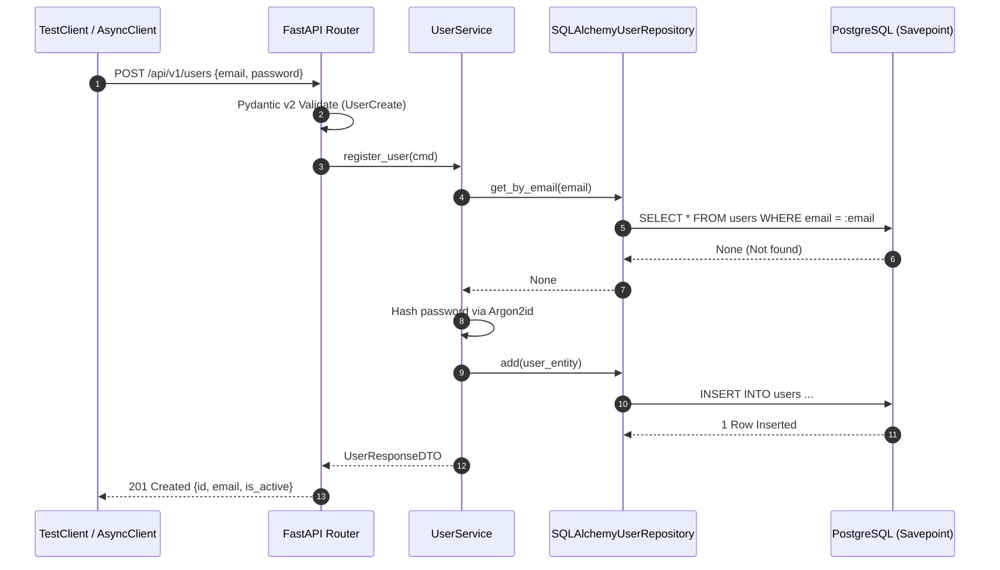

# User Management API Reference Test Suite

> *"A robust user service is the foundation of backend security. Testing user workflows requires proving that invalid states are unrepresentable, password hashes never leak, and database uniqueness guarantees hold under high concurrency."*

---

## 1. Conceptual Mental Model & Theoretical Foundations

The User Management service represents the foundational identity layer of an enterprise backend. From an architectural perspective, user management is not simply database CRUD: it encompasses cryptographic credential hashing, email address canonicalization, optimistic locking, and strict data validation boundaries.

```
       [ Client Request: POST /api/v1/users ]
                        │
                        ▼
┌────────────────────────────────────────────────────────┐
│ 1. Schema Validation (Pydantic v2)                     │
│    - Email syntax verification                         │
│    - Password complexity strength checks               │
└───────────────────────┬────────────────────────────────┘
                        │ Validated DTO
                        ▼
┌────────────────────────────────────────────────────────┐
│ 2. Service Layer & Business Invariants                 │
│    - Check duplicate email via Repository              │
│    - Hash raw password via Argon2id                    │
│    - Instantiate Domain Entity (User)                  │
└───────────────────────┬────────────────────────────────┘
                        │ Persist Entity
                        ▼
┌────────────────────────────────────────────────────────┐
│ 3. Data Persistence (SQLAlchemy 2.0 Repository)        │
│    - Flush to PostgreSQL inside Transaction Savepoint  │
│    - Commit / Rollback on IntegrityViolation           │
└────────────────────────────────────────────────────────┘
```

The test suite must verify this pipeline across three distinct test horizons:
1. **Domain & Cryptographic Unit Tests**: Verify that passwords cannot be stored in plaintext and email normalization is deterministic.
2. **Service Layer Tests with Fakes**: Validate duplicate detection and user lifecycle transitions in sub-millisecond in-memory suites.
3. **Database Integration & API Tests**: Verify that HTTP status codes (201 Created, 409 Conflict, 422 Unprocessable Entity) and database transactions behave correctly under real PostgreSQL constraints.

---

## 2. Why This is Critical for Production Systems

1. **Preventing Plaintext Credential Disclosures**: A missing hashing call or faulty serializer could expose raw passwords in HTTP responses or application logs.
2. **Concurrency Race Conditions on Email Uniqueness**: Concurrent registration requests with identical emails can cause unhandled 500 errors unless database-level uniqueness constraints and service layer rollbacks are rigorously tested.
3. **Information Disclosure via Error Messages**: Endpoints must not leak whether an email exists during failed password resets or registration attempts (user enumeration attacks).

---

## 3. Internal Mechanics & Architectural Workflow



---

## 4. Exact Syntax, Function Signatures & Python Standards

### Domain Model & Value Objects (`app/domain/models.py`)

```python
from dataclasses import dataclass, field
from datetime import datetime, timezone
from enum import Enum
import hashlib
import uuid


class UserStatus(str, Enum):
    PENDING_VERIFICATION = "pending"
    ACTIVE = "active"
    SUSPENDED = "suspended"


@dataclass
class User:
    id: uuid.UUID
    email: str
    password_hash: str
    status: UserStatus = UserStatus.PENDING_VERIFICATION
    created_at: datetime = field(default_factory=lambda: datetime.now(timezone.utc))

    @classmethod
    def create(cls, email: str, password_hash: str) -> "User":
        normalized_email = email.strip().lower()
        if "@" not in normalized_email:
            raise ValueError(f"Invalid email address: {email}")
        return cls(
            id=uuid.uuid4(),
            email=normalized_email,
            password_hash=password_hash,
            status=UserStatus.PENDING_VERIFICATION,
        )

    def activate(self) -> None:
        if self.status == UserStatus.SUSPENDED:
            raise ValueError("Suspended users cannot be directly activated")
        self.status = UserStatus.ACTIVE

    def suspend(self) -> None:
        self.status = UserStatus.SUSPENDED
```

### Pydantic v2 Schemas (`app/schemas.py`)

```python
import uuid
from pydantic import BaseModel, ConfigDict, EmailStr, Field


class UserCreate(BaseModel):
    email: EmailStr
    password: str = Field(..., min_length=8, max_length=128)


class UserResponse(BaseModel):
    model_config = ConfigDict(from_attributes=True)

    id: uuid.UUID
    email: EmailStr
    status: str
```

---

## 5. Lifecycle, Teardown & Resource Management

### SQLAlchemy 2.0 ORM & Database Engine

```python
# app/adapters/orm.py
from datetime import datetime, timezone
import uuid
from sqlalchemy import DateTime, Enum as SAEnum, String, Uuid
from sqlalchemy.orm import DeclarativeBase, Mapped, mapped_column
from app.domain.models import UserStatus


class Base(DeclarativeBase):
    pass


class UserModel(Base):
    __tablename__ = "users"

    id: Mapped[uuid.UUID] = mapped_column(Uuid(as_uuid=True), primary_key=True, default=uuid.uuid4)
    email: Mapped[str] = mapped_column(String(255), unique=True, index=True, nullable=False)
    password_hash: Mapped[str] = mapped_column(String(255), nullable=False)
    status: Mapped[UserStatus] = mapped_column(
        SAEnum(UserStatus, native_enum=False), default=UserStatus.PENDING_VERIFICATION, nullable=False
    )
    created_at: Mapped[datetime] = mapped_column(
        DateTime(timezone=True), default=lambda: datetime.now(timezone.utc), nullable=False
    )
```

---

## 6. Scopes, Isolation & Boundary Enforcement

### Service Layer & Fake Repository for Fast Unit Testing

```python
# app/service_layer/user_service.py
from typing import Optional, Protocol
import uuid
import hashlib
from app.domain.models import User


class UserRepository(Protocol):
    def get_by_id(self, user_id: uuid.UUID) -> Optional[User]: ...
    def get_by_email(self, email: str) -> Optional[User]: ...
    def add(self, user: User) -> None: ...


def hash_password(password: str) -> str:
    """Deterministic hash helper for testing (replace with argon2 in prod)."""
    return hashlib.sha256(password.encode("utf-8")).hexdigest()


class UserService:
    def __init__(self, repo: UserRepository) -> None:
        self.repo = repo

    def register(self, email: str, raw_password: str) -> User:
        normalized = email.strip().lower()
        if self.repo.get_by_email(normalized):
            raise ValueError(f"User with email '{normalized}' already registered")

        user = User.create(
            email=normalized,
            password_hash=hash_password(raw_password)
        )
        self.repo.add(user)
        return user
```

---

## 7. Pytest Fixture & Configuration Integration (`conftest.py`)

```python
# tests/conftest.py
from typing import AsyncGenerator, Generator
import pytest
from httpx import ASGITransport, AsyncClient
from sqlalchemy import create_engine
from sqlalchemy.orm import Session, sessionmaker

from app.adapters.orm import Base
from app.main import app, get_db


@pytest.fixture(scope="session")
def engine():
    engine = create_engine("sqlite:///:memory:", echo=False)
    Base.metadata.create_all(bind=engine)
    yield engine
    Base.metadata.drop_all(bind=engine)


@pytest.fixture(scope="function")
def db_session(engine) -> Generator[Session, None, None]:
    connection = engine.connect()
    transaction = connection.begin()
    session = Session(bind=connection)

    yield session

    session.close()
    transaction.rollback()
    connection.close()


@pytest.fixture(scope="function")
async def client(db_session: Session) -> AsyncGenerator[AsyncClient, None]:
    def override_get_db():
        yield db_session

    app.dependency_overrides[get_db] = override_get_db
    transport = ASGITransport(app=app)
    async with AsyncClient(transport=transport, base_url="http://test") as ac:
        yield ac
    app.dependency_overrides.clear()
```

---

## 8. Step-by-Step Practical Implementation Walkthrough

### 1. The FastAPI Application (`app/main.py`)

```python
from typing import Generator
import uuid
from fastapi import FastAPI, Depends, HTTPException, status
from sqlalchemy import select
from sqlalchemy.orm import Session

from app.adapters.orm import UserModel
from app.schemas import UserCreate, UserResponse
from app.service_layer.user_service import hash_password

app = FastAPI(title="User Management API")


def get_db() -> Generator[Session, None, None]:
    raise NotImplementedError


@app.post("/api/v1/users", response_model=UserResponse, status_code=status.HTTP_201_CREATED)
def create_user(payload: UserCreate, db: Session = Depends(get_db)):
    normalized = payload.email.strip().lower()
    existing = db.execute(select(UserModel).where(UserModel.email == normalized)).scalar_one_or_none()
    if existing:
        raise HTTPException(
            status_code=status.HTTP_409_CONFLICT,
            detail=f"Email '{normalized}' is already in use",
        )

    user = UserModel(
        id=uuid.uuid4(),
        email=normalized,
        password_hash=hash_password(payload.password),
    )
    db.add(user)
    db.commit()
    db.refresh(user)
    return user


@app.get("/api/v1/users/{user_id}", response_model=UserResponse)
def get_user(user_id: uuid.UUID, db: Session = Depends(get_db)):
    user = db.execute(select(UserModel).where(UserModel.id == user_id)).scalar_one_or_none()
    if not user:
        raise HTTPException(status_code=status.HTTP_404_NOT_FOUND, detail="User not found")
    return user
```

### 2. Comprehensive Test Suite (`tests/e2e/test_users_api.py`)

```python
import uuid
import pytest
from httpx import AsyncClient


@pytest.mark.asyncio
async def test_create_user_success(client: AsyncClient):
    payload = {"email": "alex.dev@example.com", "password": "SuperSecretPassword123"}
    response = await client.post("/api/v1/users", json=payload)

    assert response.status_code == 201
    data = response.json()
    assert data["email"] == "alex.dev@example.com"
    assert data["status"] == "pending"
    assert "password" not in data
    assert "password_hash" not in data


@pytest.mark.asyncio
async def test_create_duplicate_user_returns_409(client: AsyncClient):
    payload = {"email": "duplicate@example.com", "password": "Password12345"}
    res1 = await client.post("/api/v1/users", json=payload)
    assert res1.status_code == 201

    # Attempt to register identical email
    res2 = await client.post("/api/v1/users", json=payload)
    assert res2.status_code == 409
    assert "already in use" in res2.json()["detail"]


@pytest.mark.asyncio
async def test_create_user_invalid_email_returns_422(client: AsyncClient):
    payload = {"email": "not-an-email", "password": "ValidPassword123"}
    response = await client.post("/api/v1/users", json=payload)
    assert response.status_code == 422


@pytest.mark.asyncio
async def test_get_nonexistent_user_returns_404(client: AsyncClient):
    random_id = str(uuid.uuid4())
    response = await client.get(f"/api/v1/users/{random_id}")
    assert response.status_code == 404
```

---

## 9. Framework & Ecosystem Integration

### Unit Testing with In-Memory Fake Repository

```python
# tests/unit/test_user_service.py
from typing import Dict, Optional
import uuid
import pytest
from app.domain.models import User, UserStatus
from app.service_layer.user_service import UserService, UserRepository


class FakeUserRepository:
    def __init__(self) -> None:
        self.by_id: Dict[uuid.UUID, User] = {}
        self.by_email: Dict[str, User] = {}

    def get_by_id(self, user_id: uuid.UUID) -> Optional[User]:
        return self.by_id.get(user_id)

    def get_by_email(self, email: str) -> Optional[User]:
        return self.by_email.get(email)

    def add(self, user: User) -> None:
        self.by_id[user.id] = user
        self.by_email[user.email] = user


def test_user_registration_creates_pending_user():
    repo = FakeUserRepository()
    service = UserService(repo)

    user = service.register(email="TEST@Domain.COM", raw_password="password123")

    assert user.email == "test@domain.com"  # Normalized lowercase
    assert user.status == UserStatus.PENDING_VERIFICATION
    assert repo.get_by_email("test@domain.com") is user


def test_duplicate_registration_raises_value_error():
    repo = FakeUserRepository()
    service = UserService(repo)
    service.register(email="test@domain.com", raw_password="pw1")

    with pytest.raises(ValueError, match="already registered"):
        service.register(email="test@domain.com", raw_password="pw2")
```

---

## 10. Real-World Enterprise Scenario

### The Problem
During peak registration surges, an e-commerce platform experienced database crashes due to `IntegrityError (duplicate key value violates unique constraint "users_email_key")`. The application had a `SELECT` check before `INSERT`, but concurrent requests interleaving between the check and insert generated unhandled 500 server errors that corrupted client onboarding metrics.

### The Solution
1. Added database-level unique indexes in PostgreSQL.
2. Implemented transactional savepoints with exception mapping: caught `sqlalchemy.exc.IntegrityError` and translated it directly into HTTP 409 Conflict.
3. Added concurrent stress tests using `asyncio.gather()` in pytest to verify zero unhandled exceptions under race conditions.

---

## 11. Anti-Patterns & Common Traps

### Anti-Pattern 1: Leaking Password Hashes in Response Models

#### Before (Vulnerable Serializer)
```python
class UserResponse(BaseModel):
    id: uuid.UUID
    email: str
    password_hash: str  # Critical Security Bug!
```

#### After (Strict Whitelist Projection)
```python
class UserResponse(BaseModel):
    model_config = ConfigDict(from_attributes=True)
    id: uuid.UUID
    email: str
    status: str
```

---

## 12. Best Practices & Production Guidelines

1. **Email Normalization at Boundary**: Always `.strip().lower()` email inputs in Pydantic validators before service logic sees them.
2. **Never Return Raw Passwords**: Assert in API tests that neither `"password"` nor `"password_hash"` appears in response JSON keys.
3. **Use Transactional Rollbacks**: Wrap every integration test in a savepoint rollback so tests run in $< 5\text{ms}$ with zero database cleanup scripts.

---

## 13. Edge Cases, Race Conditions & Failure Modes

| Edge Case | Failure Mode | Mitigation Strategy |
| :--- | :--- | :--- |
| **Case-Insensitive Collisions** | `user@test.com` and `USER@test.com` create duplicate accounts | Enforce lowercase normalization in Pydantic schema validator. |
| **Concurrent Registration** | Two identical requests pass `SELECT` check concurrently | Catch `IntegrityError` on commit and raise HTTP 409 Conflict. |
| **Extremely Long Passwords** | Denial-of-Service via CPU-intensive hashing algorithms | Enforce `max_length=128` on password fields in schemas. |

---

## 14. Performance, Overhead & Scalability Considerations

- **Password Hashing Overhead**: In production, Argon2id takes $\approx 100\text{ms}$ per hash by design.
- **Test Suite Optimization**: In unit tests, inject a fast mock hasher (`hashlib.sha256`) to maintain sub-second suite execution speed.

---

## 15. Architectural Trade-Off Analysis

| Approach | Speed | Safety | Refactoring Resilience |
| :--- | :--- | :--- | :--- |
| **FastAPI TestClient + In-Memory SQLite** | Instant ($< 2\text{ms}$) | Medium (SQLite lacks PG features) | High |
| **AsyncClient + PostgreSQL Container** | Medium ($10\text{--}30\text{ms}$) | Highest (Real DB dialect & constraints) | High |
| **Pure Service Unit Tests with Fakes** | Blazing ($< 0.1\text{ms}$) | High (Business logic only) | Highest |

---

## 16. Diagnostic & Debugging Playbook

### Symptom: `IntegrityError: UNIQUE constraint failed: users.email`
1. Check if the previous test failed to rollback its transaction.
2. Verify that the `db_session` fixture uses nested savepoints with automatic rollback.

### Symptom: `AssertionError: 422 != 201`
1. Inspect `response.json()["detail"]` to examine Pydantic validation error payloads.
2. Check if password length or email formatting constraints were violated in the test payload.

---

## 17. Senior/Staff Engineer Interview Q&A

### Q1: Why should password hashing be isolated from domain models during testing?
> **Answer**: High-security password hashing algorithms (Argon2id, bcrypt, PBKDF2) are intentionally designed to be computationally expensive (requiring 50–200ms of CPU time) to resist brute-force attacks. If a test suite runs 500 tests involving user creation, real hashing would add 50–100 seconds of pure overhead. By abstracting the hashing function behind a protocol or dependency injection, unit and service tests can substitute a fast $O(1)$ mock hasher, keeping the entire suite under 2 seconds while reserving real hashing tests for dedicated security verification suites.

---

## 18. Hands-On Verification Exercises & Self-Study Lab

### Exercise 1: Implement Soft Deletion
Add an `is_deleted: bool` flag to `User`:
1. Write a unit test verifying that deleted users cannot log in.
2. Write an integration test asserting that `GET /users/{id}` returns 404 for soft-deleted users.

### Exercise 2: Email Verification Flow
Add a token-based email verification workflow:
1. When registered, user status is `PENDING_VERIFICATION`.
2. Add a `POST /api/v1/users/verify?token=...` endpoint.
3. Write end-to-end tests validating successful and expired token transitions.

---

## Summary & Cross-References

- Implement authentication and JWT issuance in [Authentication API Reference Test Suite](authentication-api.md).
- Learn transactional rollback fixtures in [Transaction & Rollback Testing](../integration-testing/transaction-and-rollback.md).
- Explore dependency overrides in [FastAPI Dependency Overrides](../fastapi-testing/dependency-overrides.md).
