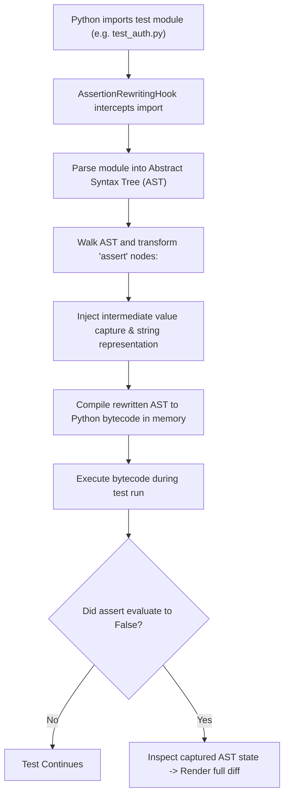
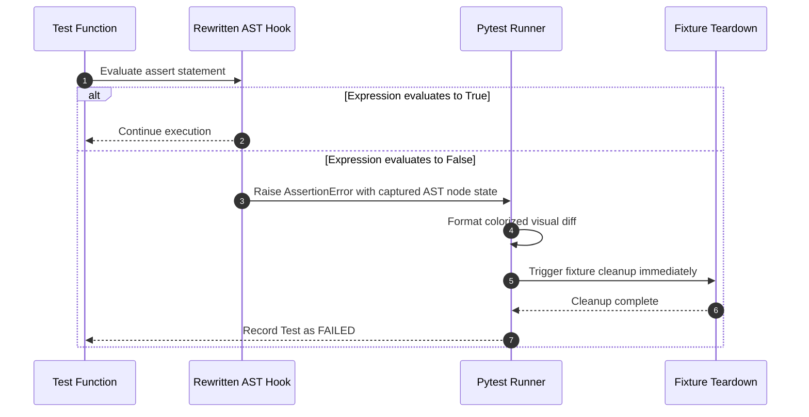

# Smart Assertions, AST Rewriting & Failure Introspection 🧠

> **Authoritative Sources & Literature:**
> - Brian Okken: *Python Testing with pytest* (Chapter 2: Writing Test Functions - Assertions, Pragmatic Bookshelf)
> - Armin Ronacher & Pytest Core Team: *How Assertion Rewriting Works in Pytest* (pytest internal architecture)
> - PEP 302 / PEP 451: *New Import Hooks and Module Spec Architecture*

---

## 1. Conceptual Definition & Core Mental Model

In standard Python, the `assert` statement simply raises an `AssertionError` with no diagnostic details if the evaluated boolean expression is falsy. In traditional xUnit frameworks (like Python's `unittest`), developers had to memorize dozens of verbose helper methods:
`self.assertEqual()`, `self.assertNotEqual()`, `self.assertDictEqual()`, `self.assertSequenceEqual()`.

**`pytest` eliminates assertion boilerplate entirely.** It allows you to write natural, plain Python `assert` statements (`assert a == b`), while providing rich, detailed, colorized failure diffs and intermediate value introspection.

### The Mental Model: What You Write vs. What Runs
```python
# What you write:
assert user.profile.get_role() == "admin"

# What standard Python outputs on failure:
AssertionError

# What pytest outputs on failure (AST Introspection):
# >       assert user.profile.get_role() == "admin"
# E       AssertionError: assert 'viewer' == 'admin'
# E         - admin
# E         + viewer
# E         where 'viewer' = <bound method Profile.get_role of <Profile object>>()
# E         where <Profile object> = <User 'alice'>.profile
```

---

## 2. Why This Is Critical in Modern Python Backend Engineering

1. **Sub-Second Failure Triage**: When a test fails in a CI log or local terminal, the developer should not have to add `print(user)` or attach a debugger just to see what the values were. Pytest prints the exact values of all intermediate variables directly in the traceback.
2. **Structural Diffing for JSON & Pydantic**: Backend APIs heavily exchange nested JSON payloads, lists of dictionaries, and Pydantic models. Pytest automatically performs deep structural diffing, highlighting missing keys, extra fields, and value discrepancies without extra plugins.
3. **Floating-Point Precision Safety**: In financial, scientific, or machine-learning backends, IEEE 754 floating-point arithmetic makes exact comparisons impossible (`0.1 + 0.2 != 0.3`). Pytest's `pytest.approx` provides mathematically sound epsilon comparisons.

---

## 3. Internal Mechanics: How AST Rewriting Works

Pytest achieves smart assertions using a custom **PEP 302 / PEP 451 Import Hook** known as the `AssertionRewritingHook`:



Because AST rewriting occurs at module load time, it incurs **zero performance overhead during normal test execution**; the detailed introspection is only constructed if the assertion fails.

---

## 4. Standard Syntax, Signatures & Key Options

### Natural Python Assertions
```python
# Equality and Inequality
assert actual == expected
assert user.is_active is True
assert user.id is not None

# Collection containment and membership
assert "superuser" in user.roles
assert 42 not in customer_ids

# Sequence comparison (renders clean diffs)
assert received_list == [1, 2, 3, 4, 5]

# Dictionary comparison (highlights missing/extra keys and value diffs)
assert actual_dict == {"id": 1, "status": "PENDING"}

# Exception / Error messages
assert "Invalid email format" in str(exc_info.value)
```

### Floating-Point Comparisons with `pytest.approx`
```python
import pytest

# Relative tolerance (default: 1e-6)
assert 0.1 + 0.2 == pytest.approx(0.3)

# Absolute tolerance (useful when values are near zero)
assert 0.00000005 == pytest.approx(0.0, abs=1e-7)

# Works recursively on lists, tuples, and dictionaries!
assert [0.1 + 0.2, 0.2 + 0.4] == pytest.approx([0.3, 0.6])
assert {"tax": 10.000001} == pytest.approx({"tax": 10.0}, abs=1e-4)
```

---

## 5. Lifecycle, Execution Flow & Teardown Mechanics



---

## 6. Scopes, Hierarchy, or Test Boundaries

By default, pytest **only rewrites files matching its test discovery rules** (`test_*.py`, `*_test.py`, and `conftest.py`).

If you extract reusable assertion helper functions into a non-test module (e.g. `tests/helpers/assertions.py`), pytest will **not** rewrite that file by default, causing failure messages inside the helper to lose smart diffing!

### Registering Custom Helper Modules for Rewriting
In your root `conftest.py`, tell pytest to rewrite the helper before it is imported:

```python
# tests/conftest.py
import pytest

# MUST be called BEFORE importing tests.helpers!
pytest.register_assert_rewrite("tests.helpers.assertions")

from tests.helpers.assertions import assert_valid_jwt_structure
```

---

## 7. Pytest Fixture & `conftest.py` Integration Patterns: Custom Failure Diffs

You can customize how pytest displays failure diffs for specific domain objects using the `pytest_assertrepr_compare` hook:

```python
# tests/conftest.py
from src.domain.money import Money

def pytest_assertrepr_compare(op, left, right):
    """Custom explanation hook for domain Money comparisons."""
    if isinstance(left, Money) and isinstance(right, Money) and op == "==":
        return [
            "Comparing Money instances:",
            f"   Currency: {left.currency} vs {right.currency}",
            f"   Amount:   {left.amount} vs {right.amount}",
            f"   Diff:     {abs(left.amount - right.amount)}",
        ]
```

When `assert money_a == money_b` fails, pytest renders your custom formatted explanation.

---

## 8. Practical Python Implementation: Step-by-Step Walkthrough

Let us build a Financial Transaction Ledger and test it with both standard and custom smart assertions.

### Step 1: Define Domain Models

```python
# src/domain/ledger.py
from dataclasses import dataclass
from decimal import Decimal
from typing import List

@dataclass(frozen=True)
class Entry:
    account_id: str
    amount: Decimal # Positive = Credit, Negative = Debit

@dataclass
class Transaction:
    reference: str
    entries: List[Entry]

    @property
    def is_balanced(self) -> bool:
        """Double-entry rule: The sum of all entries must equal zero."""
        return sum((e.amount for e in self.entries), Decimal("0.00")) == Decimal("0.00")
```

### Step 2: Implement Test Suite with Deep Introspection

```python
# tests/unit/test_ledger.py
import pytest
from decimal import Decimal
from src.domain.ledger import Transaction, Entry

def test_balanced_transaction():
    tx = Transaction(
        reference="TX-101",
        entries=[
            Entry(account_id="CASH", amount=Decimal("100.00")),
            Entry(account_id="SALES_REVENUE", amount=Decimal("-100.00")),
        ]
    )
    assert tx.is_balanced is True

def test_unbalanced_transaction_intermediate_inspection():
    tx = Transaction(
        reference="TX-102",
        entries=[
            Entry(account_id="CASH", amount=Decimal("100.00")),
            Entry(account_id="ACCOUNTS_PAYABLE", amount=Decimal("-95.00")),
        ]
    )
    # Pytest will introspect tx.entries, the generator expression, and the sum!
    assert tx.is_balanced is False

def test_dictionary_diff_introspection():
    expected_payload = {
        "transaction_id": "TX-101",
        "status": "SETTLED",
        "currency": "USD",
        "metadata": {"cleared_by": "system", "risk_score": 0.12},
    }
    actual_payload = {
        "transaction_id": "TX-101",
        "status": "PENDING", # Mismatched value
        "currency": "USD",
        "metadata": {"cleared_by": "system", "risk_score": 0.12},
    }
    # Pytest displays an exact line-by-line colored diff showing status diff
    assert actual_payload == expected_payload
```

---

## 9. Framework-Specific Integration: FastAPI & Pydantic v2

When testing FastAPI endpoints, avoid asserting on raw response strings. Assert against native parsed dictionaries or Pydantic models:

```python
# tests/integration/test_user_api.py
import pytest
from httpx import AsyncClient, ASGITransport
from src.main import app

@pytest.mark.asyncio
async def test_get_user_profile():
    async with AsyncClient(transport=ASGITransport(app=app), base_url="http://test") as client:
        response = await client.get("/api/v1/users/usr_42")
        
        assert response.status_code == 200
        
        # Smart dict comparison: highlights missing or wrong keys with precision
        assert response.json() == {
            "id": "usr_42",
            "email": "dev@example.com",
            "role": "MEMBER",
            "is_verified": True,
        }
```

---

## 10. Real-World Enterprise Backend Scenario: Complex Decimal & Tax Diffs

In an enterprise e-commerce backend with multi-tier tax jurisdictions (state tax, county tax, municipal tax):

```python
# tests/unit/test_tax_breakdown.py
import pytest
from decimal import Decimal

def test_california_tax_breakdown(order_service):
    order = order_service.calculate_tax(subtotal=Decimal("100.00"), zip_code="94105")
    
    assert order.tax_breakdown == {
        "state_tax": Decimal("6.00"),
        "county_tax": Decimal("0.25"),
        "city_tax": Decimal("1.25"),
        "special_district_tax": Decimal("1.00"),
    }
```
If `city_tax` is off by even a single cent, pytest produces an inline diff showing exactly which key differed, what was returned, and what was expected.

---

## 11. Anti-Patterns & Common Pitfalls

### Anti-Pattern 1: The Python Tuple Assertion Trap
In Python, any non-empty tuple evaluates to `True` in a boolean context!
```python
# ❌ CATASTROPHIC BUG: This test NEVER fails, even when 1 == 2!
def test_tuple_trap_disaster():
    # Because of parentheses, Python treats (1 == 2, "Error message") as a 2-element tuple!
    assert (1 == 2, "One should equal two")
```
Pytest detects this common human error and raises a syntax warning: `pytest.PytestAssertRewriteWarning: assertion is always true, perhaps remove parentheses?`

### Anti-Pattern 2: The Direct Float Equality Trap
```python
# ❌ BUG: Fails due to IEEE 754 precision!
def test_float_bug():
    assert 0.1 + 0.2 == 0.3 # 0.30000000000000004 != 0.3

# ✅ GOOD: Use pytest.approx
def test_float_fixed():
    assert 0.1 + 0.2 == pytest.approx(0.3)
```

### Anti-Pattern 3: Obscuring Assertions Behind Redundant Booleans
```python
# ❌ POOR: Loses rich diffs
assert (actual_dict == expected_dict) is True

# ✅ GOOD: Enables deep structural diffing
assert actual_dict == expected_dict
```

---

## 12. Best Practices & Production Guidelines

1. **Keep Assertions Simple & Declarative**: Write plain comparisons (`assert a == b`). Let pytest handle the failure formatting.
2. **One Logical Invariant per Test**: Verify one logical outcome per test function.
3. **Always Register Custom Assertion Helpers**: If you place reusable assert functions in `tests/helpers/`, always call `pytest.register_assert_rewrite("tests.helpers")` in your root `conftest.py`.
4. **Use `-vv` in CI Pipelines**: Ensure your CI runner passes `-vv` so complete assertion diffs are captured in build logs without truncation.

---

## 13. Trade-Off Analysis: Assertion Styles

| Feature | Pytest Native `assert` | Python `unittest` | Third-Party (Hamcrest / Fluent) |
| :--- | :--- | :--- | :--- |
| **Syntax Style** | Plain Python (`assert x == y`) | Verbose methods (`assertEqual`) | Method chaining (`assertThat(x, is(y))`) |
| **Dependencies** | None (Built-in) | Standard library | Extra library dependency |
| **Failure Diffs** | Automatic AST introspection | Manual method-dependent diffs | Custom matcher messages |
| **Learning Curve** | Zero (Standard Python) | Moderate | High (Need to learn matcher DSL) |
| **Execution Overhead** | Zero when passing | Zero | Moderate (object allocation) |

---

## 14. Diagnostic & Debugging Playbook

```bash
# 1. Show full diffs without truncating long lines or large dicts
pytest -vv

# 2. Control traceback verbosity
pytest --tb=short      # Standard concise trace
pytest --tb=line       # One line per failure
pytest --tb=long       # Full code context

# 3. Disable AST rewriting for benchmarking or debugging
pytest --assert=plain

# 4. Drop into debugger at the exact assertion failure point
pytest --pdb
```

---

## 15. Senior Staff Interview Questions & Deep Dives

### Question 1: How does pytest's AST rewriting differ from monkey-patching or wrapping Python's built-in `assert` statement?
**Answer**:
Python's `assert` is a built-in statement and keyword in the language syntax grammar; it is not a function or object that can be monkey-patched or overridden at runtime. Pytest intercepts the module loading pipeline using a **PEP 302/451 import hook** (`AssertionRewritingHook`). When a test file is imported, pytest parses the source code into an Abstract Syntax Tree (AST), replaces each `ast.Assert` node with a series of AST instructions that evaluate intermediate sub-expressions into temporary variables, and compiles the modified AST to bytecode. This compiles directly into the Python virtual machine without runtime wrapping overhead.

### Question 2: Why does `assert (a == b, "msg")` evaluate as `True` in Python, and how does pytest protect developers from this?
**Answer**:
In Python, parentheses surrounding comma-separated expressions create a `tuple`. The statement `assert (a == b, "msg")` is parsed by Python as `assert (<bool>, <str>)`. In Python boolean logic, any non-empty tuple (even `(False, "msg")`) has a truthiness of `True`. Therefore, the assertion will never fail! Pytest's AST rewriting parser explicitly inspects the AST of every assert statement; if it detects an `ast.Tuple` as the test expression, it emits a `PytestAssertRewriteWarning` and flags the test.

---

## 16. Hands-on Engineering Exercises & Challenges

### Exercise 1: Registering an Assertion Helper Module
1. Create a file `tests/helpers/validators.py` with a function:
   ```python
   def assert_valid_order_status(order: dict, expected_status: str):
       assert order["status"] == expected_status
       assert order["updated_at"] is not None
   ```
2. Write a failing test in `tests/unit/test_orders.py` using this helper.
3. Observe that the failure diff lacks AST intermediate expression details.
4. Add `pytest.register_assert_rewrite("tests.helpers.validators")` to `conftest.py` and verify that rich AST failure diffs are restored.

### Exercise 2: Implementing a Custom Domain Diff Hook
Write a `pytest_assertrepr_compare` hook in `conftest.py` that formats a custom visual side-by-side diff when two instances of a `UserPermission` class are compared with `==`.

---

## 17. Summary, Cross-References & Further Reading

Smart assertions and AST rewriting make `pytest` the most ergonomic and diagnostic-friendly testing framework in the Python ecosystem. By using plain `assert` statements, leveraging `pytest.approx`, and understanding helper module rewriting, backend teams diagnose failures in seconds.

### Cross-References:
- Previous: [Test Discovery & Execution](test-discovery.md)
- Next: [Fixtures Mechanics & Dependency Injection](fixtures.md)
- [Fixture Scopes & Lifecycle Management](fixture-scopes.md)
- [Exception Testing with pytest.raises](../advanced-pytest/exception-testing.md)
