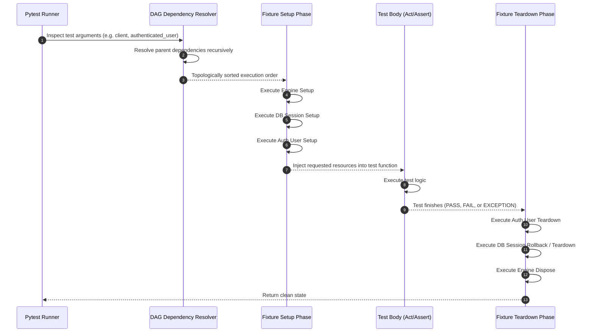
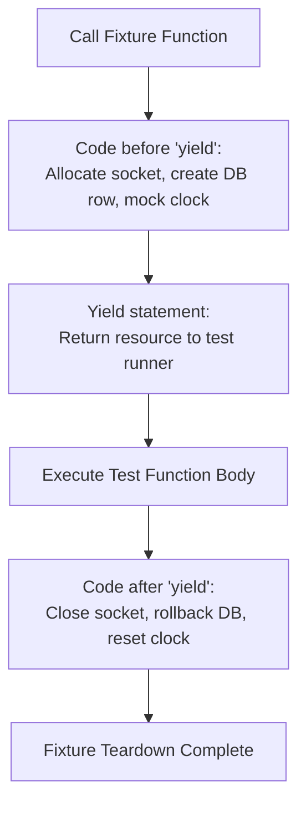

# Pytest Fixtures & Dependency Injection Mechanics 💉

> **Authoritative Sources & Literature:**
> - Brian Okken: *Python Testing with pytest* (Chapter 3: pytest Fixtures, Pragmatic Bookshelf)
> - Gerard Meszaros: *xUnit Test Patterns: Refactoring Test Code* (Fresh Fixture vs. Shared Fixture, Addison-Wesley)
> - Holger Krekel: *Design of the Pytest Fixture Dependency Graph* (pytest.org)

---

## 1. Conceptual Definition & Core Mental Model

A **Pytest Fixture** is a declarative dependency injection mechanism that prepares the environment, supplies resources, and handles teardown for automated tests.

In traditional xUnit frameworks (such as Python's `unittest`), setup and teardown are bound to class hierarchies (`setUp()` and `tearDown()`). If five tests need a database connection and two need an authenticated user, developers either suffer through bloated `setUp()` methods or complex multi-tier class inheritance.

### The Pytest Mental Model: Dependency Injection via DAG
In `pytest`, tests declare **what** they need simply by listing fixture names as function arguments. Pytest analyzes the argument names via reflection, constructs a **Directed Acyclic Graph (DAG)** of dependencies, topologically sorts the graph, executes setups, injects the values, runs the test, and guarantees teardown in reverse order.

```
       [ Test Function: test_transfer(auth_user, db_session) ]
                                   │
               ┌───────────────────┴───────────────────┐
               ▼                                       ▼
       [ auth_user fixture ]                  [ db_session fixture ]
               │                                       │
               └───────────────────┬───────────────────┘
                                   ▼
                         [ db_engine fixture ]
```

---

## 2. Why This Is Critical in Modern Python Backend Engineering

1. **Composable Building Blocks**: Modern backends require layered infrastructure: Database Engines $\rightarrow$ Connection Pools $\rightarrow$ Transactions $\rightarrow$ Repositories $\rightarrow$ Service Layers $\rightarrow$ HTTP Test Clients. Pytest fixtures compose naturally across these layers.
2. **Guaranteed Teardown Execution**: Resources like open database transactions, Docker containers, temporary files, and mocked network clients must be cleanly torn down even if the test crashes or raises an unexpected exception.
3. **Decoupling Test Logic from Resource Lifecycle**: Test functions focus exclusively on **Act** and **Assert**; fixtures handle **Arrange** and **Teardown**.

---

## 3. Internal Mechanics: The Topological DAG Resolution

When pytest executes a test, it resolves fixtures using this exact algorithm:



Teardown is strictly executed in **reverse order of setup**.

---

## 4. Standard Syntax, Signatures & Key Options

### The Core `@pytest.fixture` Decorator

```python
import pytest
from typing import Generator
from src.database import DatabaseConnection

@pytest.fixture
def db_conn() -> Generator[DatabaseConnection, None, None]:
    """
    Standard yield fixture pattern:
    - Code before yield = Setup
    - Expression in yield = Value injected into test
    - Code after yield  = Teardown (Guaranteed to run)
    """
    # 1. SETUP
    connection = DatabaseConnection.connect("localhost:5432")
    
    # 2. INJECT
    yield connection
    
    # 3. TEARDOWN
    connection.close()
```

### Key Fixture Parameters

```python
@pytest.fixture(
    scope="function",          # Lifecycle: function, class, module, package, session
    autouse=False,             # If True, runs automatically for all tests in scope
    name="custom_client",      # Renames the fixture in test signatures
)
def my_fixture():
    ...
```

---

## 5. Lifecycle, Execution Flow & Teardown Mechanics

Pytest fixtures use Python's **generator pattern (`yield`)** to guarantee clean teardown mechanics.



### Context Managers Inside Fixtures
Fixtures work seamlessly with Python context managers:

```python
import pytest
from unittest.mock import patch

@pytest.fixture
def mock_payment_gateway():
    with patch("src.services.PaymentGateway.charge") as mock_charge:
        mock_charge.return_value = {"status": "SUCCESS", "id": "ch_123"}
        yield mock_charge
    # Context manager automatically exits and reverts the patch!
```

---

## 6. Scopes, Hierarchy, or Test Boundaries

A fixture can **only depend on fixtures of equal or broader scope**:

| Scope Hierarchy (Broadest to Narrowest) | Can Depend On: |
| :--- | :--- |
| **`session`** | Other `session` fixtures |
| **`package`** | `package`, `session` |
| **`module`** | `module`, `package`, `session` |
| **`class`** | `class`, `module`, `package`, `session` |
| **`function`** (Default) | `function`, `class`, `module`, `package`, `session` |

> [!CAUTION]
> **Scope Inversion Error**: A `session`-scoped fixture attempting to depend on a `function`-scoped fixture raises `ScopeMismatch: You tried to access the function scoped fixture from session scoped fixture`.

---

## 7. Pytest Fixture & `conftest.py` Integration Patterns: Factory Fixtures

When tests need multiple variations of the same resource (e.g., users with different tiers or balances), do not write 10 distinct fixtures. Use a **Factory Fixture** (a fixture returning a callable generator):

```python
# tests/conftest.py
import pytest
from dataclasses import dataclass
from decimal import Decimal
from uuid import uuid4

@dataclass
class Account:
    id: str
    email: str
    tier: str
    balance: Decimal

@pytest.fixture
def account_factory():
    """Factory fixture returning a fresh, customizable Account instance."""
    def _create_account(
        tier: str = "STANDARD",
        balance: Decimal = Decimal("100.00"),
        **kwargs
    ) -> Account:
        return Account(
            id=f"acc_{uuid4().hex[:6]}",
            email=f"user_{uuid4().hex[:6]}@example.com",
            tier=tier,
            balance=balance,
            **kwargs
        )
    return _create_account

# tests/unit/test_accounts.py
def test_vip_transfer(account_factory):
    # Create two completely distinct accounts in the same test
    sender = account_factory(tier="VIP", balance=Decimal("1000.00"))
    receiver = account_factory(tier="STANDARD", balance=Decimal("50.00"))
    
    assert sender.tier == "VIP"
    assert receiver.tier == "STANDARD"
```

---

## 8. Practical Python Implementation: Step-by-Step Walkthrough

We will construct an enterprise-grade, multi-tier composable fixture hierarchy for an e-commerce backend.

### Step 1: Define Application Domain & Database Models

```python
# src/domain/models.py
from dataclasses import dataclass
from decimal import Decimal

@dataclass
class User:
    id: str
    name: str
    role: str

@dataclass
class Order:
    id: str
    user_id: str
    amount: Decimal
    is_settled: bool = False
```

### Step 2: Build the Composable Fixture Graph

```python
# tests/conftest.py
import pytest
from typing import Generator, Dict
from decimal import Decimal
from src.domain.models import User, Order

# Layer 1: In-memory database dictionary (Session Scope)
@pytest.fixture(scope="session")
def raw_storage() -> Dict[str, dict]:
    return {"users": {}, "orders": {}}

# Layer 2: Clean transaction sandbox (Function Scope)
@pytest.fixture(scope="function")
def clean_storage(raw_storage) -> Generator[Dict[str, dict], None, None]:
    # Setup: Yield storage
    yield raw_storage
    # Teardown: Guaranteed cleanup
    raw_storage["users"].clear()
    raw_storage["orders"].clear()

# Layer 3: Seeded Admin User (Depends on clean_storage)
@pytest.fixture
def admin_user(clean_storage) -> User:
    user = User(id="usr_admin", name="Super Admin", role="ADMIN")
    clean_storage["users"][user.id] = user
    return user

# Layer 4: Order for Admin (Depends on admin_user AND clean_storage)
@pytest.fixture
def admin_order(clean_storage, admin_user) -> Order:
    order = Order(id="ord_101", user_id=admin_user.id, amount=Decimal("250.00"))
    clean_storage["orders"][order.id] = order
    return order
```

### Step 3: Write Clean, Declarative Tests

```python
# tests/unit/test_order_processing.py
from decimal import Decimal

def test_admin_can_settle_order(admin_user, admin_order, clean_storage):
    # Arrange: All resources were automatically injected!
    assert admin_order.user_id == admin_user.id
    assert admin_order.is_settled is False

    # Act
    admin_order.is_settled = True

    # Assert
    assert clean_storage["orders"][admin_order.id].is_settled is True
```

---

## 9. Framework-Specific Integration: FastAPI Async TestClient

Modern FastAPI backends use `httpx.AsyncClient` with lifespan management:

```python
# tests/conftest.py
import pytest
from typing import AsyncGenerator
from httpx import AsyncClient, ASGITransport
from fastapi import FastAPI
from src.main import create_app

@pytest.fixture(scope="session")
def app() -> FastAPI:
    return create_app()

@pytest.fixture
async def async_client(app: FastAPI) -> AsyncGenerator[AsyncClient, None]:
    """Composable async client fixture for FastAPI routes."""
    transport = ASGITransport(app=app)
    async with AsyncClient(transport=transport, base_url="http://testserver") as client:
        yield client
    # AsyncClient session closed automatically on teardown
```

---

## 10. Real-World Enterprise Backend Scenario: Stripe & Redis Integration

In an enterprise billing platform, an integration test requires:
1. An ephemeral Redis cache for rate-limiting.
2. A PostgreSQL transaction sandbox.
3. A mocked Stripe API client.

```python
# tests/integration/test_subscription_checkout.py
import pytest
from decimal import Decimal

@pytest.fixture
def mock_stripe(mocker):
    return mocker.patch("src.gateways.stripe.StripeClient.create_customer", return_value="cus_123")

def test_checkout_subscription(async_client, db_session, redis_client, mock_stripe):
    # Act: Call checkout API
    # All 4 complex dependencies are managed independently by pytest's DAG!
    ...
```

---

## 11. Anti-Patterns & Common Pitfalls

### Anti-Pattern 1: The "Kitchen Sink" Fixture
Creating one massive fixture that sets up 20 database tables, 5 users, and 10 orders for every test.
- **Consequence**: Every test takes 300ms to run, even tests that only needed a single user.
- **Fix**: Keep fixtures small, atomic, and composable.

### Anti-Pattern 2: Overusing `autouse=True`
Marking fixtures with `autouse=True` without strict justification.
```python
# ❌ DANGEROUS: Automatically runs for EVERY test in the repository!
@pytest.fixture(autouse=True)
def wipe_database():
    ...
```
- **Consequence**: Hidden side-effects, slow test suites, and impossible-to-debug order dependencies.
- **Rule**: Only use `autouse=True` for system-wide invariant resetters (e.g. clearing in-memory caches or resetting environment variables).

### Anti-Pattern 3: Mutating Shared Session Fixtures
```python
# ❌ DISASTER: Mutating a session fixture leaks into subsequent tests!
@pytest.fixture(scope="session")
def default_settings():
    return {"MAX_RETRIES": 3}

def test_override(default_settings):
    default_settings["MAX_RETRIES"] = 10 # TEST POLLUTION!
```

---

## 12. Best Practices & Production Guidelines

1. **Prefer Explicit Fixture Declarations**: Explicit argument naming (`def test_login(auth_client):`) is clear, traceable, and IDE-friendly.
2. **Use Factory Fixtures for Dynamic Data**: When you need variations of domain objects, return a function from the fixture.
3. **Always Clean Up with `yield`**: Put teardown code directly after `yield`, or use a `try...finally` block if setup operations could fail.
4. **Inspect the Fixture Execution Plan**: Use `pytest --setup-show` to visually verify that fixtures are being instantiated and torn down at the expected lifecycle stages.

---

## 13. Trade-Off Analysis: Fixtures vs. Setup Methods vs. Factories

| Feature | Pytest Fixtures | `unittest.TestCase.setUp` | Factory Boy Classes | Plain Helper Functions |
| :--- | :--- | :--- | :--- | :--- |
| **Composition** | DAG (Graph-based) | Class Inheritance | Functional | Imperative Calls |
| **Teardown Safety** | Guaranteed via `yield` | Manual `tearDown()` | None (Needs fixture) | Manual `try/finally` |
| **Scoping** | 5 Granular Scopes | Class/Method only | None | None |
| **Coupling** | Loosely coupled | Bound to class | Moderate | High |

---

## 14. Diagnostic & Debugging Playbook

```bash
# 1. Print the exact setup and teardown sequence of all fixtures for your tests
pytest --setup-show

# 2. Print the planned setup sequence without actually executing tests
pytest --setup-plan

# 3. List all available fixtures sorted by location and docstring
pytest --fixtures

# 4. List fixtures used by a specific test file
pytest tests/unit/test_orders.py --fixtures-per-test
```

---

## 15. Senior Staff Interview Questions & Deep Dives

### Question 1: How does pytest's fixture resolution differ from traditional dependency injection frameworks like Google Guice or Spring?
**Answer**:
Pytest performs **runtime reflection and name-based dependency resolution** rather than type-based injection. When a test function or another fixture specifies an argument name (e.g. `db_session`), pytest looks up that exact string in its fixture registry, traversing from the local module through the `conftest.py` hierarchy to installed plugins and built-in fixtures. It constructs a Directed Acyclic Graph (DAG), validates that no circular dependencies exist, and evaluates each node according to its declared lifecycle scope. Unlike Spring, pytest does not require type annotations or container XML, making it exceptionally lightweight and pythonic.

### Question 2: What happens if an exception is raised inside the setup phase of a fixture vs. the teardown phase?
**Answer**:
- If an exception occurs in the **setup phase** (before `yield`), pytest aborts the test function immediately and records the test outcome as an **ERROR** (not a FAILURE). No subsequent fixtures in the DAG are set up, but any previously executed parent fixtures will still execute their teardown blocks.
- If an exception occurs in the **teardown phase** (after `yield`), the test function has already executed. Even if the test assertions passed, pytest marks the test outcome as an **ERROR** due to the teardown failure. If multiple fixtures fail during teardown, pytest collects all teardown exceptions and reports them.

---

## 16. Hands-on Engineering Exercises & Challenges

### Exercise 1: Refactoring Class-Based `setUp` to Composable Fixtures
Take a legacy test class inheriting from `unittest.TestCase` with a 40-line `setUp` method that instantiates a database, creates a user, and logs in. Refactor it into three separate, composable `@pytest.fixture` functions.

### Exercise 2: Implementing a Context-Manager Safe Fixture
Implement a fixture `ephemeral_directory` that creates a temporary directory using `tmp_path`, writes a configuration file into it, sets an environment variable pointing to that file, yields the directory path to the test, and guarantees that on teardown, the environment variable is deleted and the directory is cleaned up.

---

## 17. Summary, Cross-References & Further Reading

Pytest fixtures represent the gold standard of automated test dependency injection. By replacing rigid class inheritance with flexible, composable DAG graphs and guaranteed `yield` teardowns, backend teams write maintainable, modular, and expressive test suites.

### Cross-References:
- Previous: [Smart Assertions & AST Rewriting](assertions.md)
- Next: [Centralized Configuration with conftest.py](conftest.md)
- [Fixture Scopes & Lifecycle Management](fixture-scopes.md)
- [Data-Driven Parametrization](parametrization.md)
