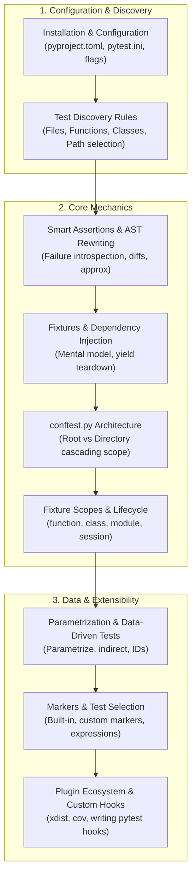

# Pytest Fundamentals: Modern Testing Mechanics ⚙️

> **Authoritative Sources & Literature:**
> - Brian Okken: *Python Testing with pytest: Simple, Rapid, Effective, and Scalable* (2nd Edition, Pragmatic Bookshelf)
> - Holger Krekel & Pytest Core Development Team: *pytest Documentation & Architecture* (docs.pytest.org)
> - David Beazley: *Python Cookbook & Metaprogramming Mechanics*

---

## 📖 Module Overview

`pytest` is the undisputed industry standard testing framework for Python. Unlike traditional xUnit frameworks (such as Python's standard `unittest`), which force developers to subclass boilerplate test cases and use verbose assertion methods, `pytest` embraces idiomatic Python:
- Plain Python `assert` statements enhanced via Abstract Syntax Tree (AST) rewriting.
- A functional, declarative dependency injection model based on **fixtures**.
- Hierarchical, cascading test configuration via `conftest.py`.
- Declarative test data generation via `@pytest.mark.parametrize`.
- Granular test execution filtering via custom markers and metadata.

This module provides exhaustive, production-grade mastery of `pytest` core mechanics, grounded in Brian Okken's foundational literature and modern Python 3.10+ practices.

---

## 🗺️ Module Guides

### 1. [Installation & Configuration](installation-and-configuration.md)
Master `pyproject.toml` and `pytest.ini` configuration. Set production defaults (`addopts`), configure testpaths, enable strict marker checking (`--strict-markers`), and manage virtual environment execution.

### 2. [Test Discovery & Execution](test-discovery.md)
Understand pytest's file, class, and method discovery algorithms (`test_*.py`, `*_test.py`, `Test*`, `test_*`). Learn exact path selection, keyword filtering (`-k`), and custom collectors.

### 3. [Smart Assertions & Failure Introspection](assertions.md)
Deep dive into AST rewriting: how pytest intercepts Python's native `assert` statement at compile time to render readable diffs. Master floating-point precision comparisons with `pytest.approx` and custom assertion helpers.

### 4. [Fixtures Mechanics & Dependency Injection](fixtures.md)
The fixture mental model: separating test setup/teardown from test logic. Master the `yield` fixture pattern, guaranteed teardown execution, and fixture composition.

### 5. [Centralized Configuration with `conftest.py`](conftest.md)
Architect scalable fixture hierarchies. Understand how root and subdirectory `conftest.py` files cascade, isolate scope, and prevent circular dependencies in large codebases.

### 6. [Fixture Scopes & Lifecycle Management](fixture-scopes.md)
Learn the lifecycle mechanics of `function`, `class`, `module`, `package`, and `session` scopes. Master the rules of mutation safety and avoid the disaster of mutable session-scoped state.

### 7. [Data-Driven Parametrization](parametrization.md)
Eliminate repetitive test code. Master `@pytest.mark.parametrize`, custom test IDs (`ids=...`), indirect fixture parametrization, and Cartesian product generation.

### 8. [Markers & Test Selection](markers.md)
Tag and filter test execution. Use built-in markers (`@pytest.mark.skip`, `@pytest.mark.skipif`, `@pytest.mark.xfail`) and define strict custom markers (`@pytest.mark.slow`, `@pytest.mark.integration`).

### 9. [Pytest Plugin Ecosystem](plugins.md)
Supercharge your test suite with key plugins: distributed parallel execution with `pytest-xdist`, coverage reporting with `pytest-cov`, and authoring custom pytest hooks (`pytest_runtest_makereport`).

---

## 📊 Pytest Core Mechanics Overview

| Feature | Standard `unittest` | `pytest` Alternative | Engineering Benefit |
| :--- | :--- | :--- | :--- |
| **Assertions** | `self.assertEqual(a, b)` | `assert a == b` | Native Python syntax + rich AST diffs |
| **Setup/Teardown** | `setUp()`, `tearDown()` | `@pytest.fixture` with `yield` | Composable, modular dependency injection |
| **Data Variation** | `subTest()` loops | `@pytest.mark.parametrize` | Individual test reporting & failure isolation |
| **Configuration** | Custom test runner script | `pyproject.toml` | Standardized declarative settings |
| **Test Tagging** | Custom attributes / suites | `@pytest.mark.<tag>` | CLI-driven filtering (`-m "not slow"`) |

---

## ⏭️ Next Steps

Begin with **[Installation & Configuration](installation-and-configuration.md)** to establish your project's standardized test configuration.
