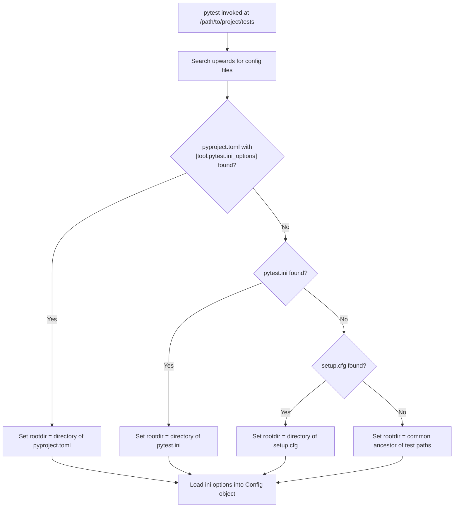
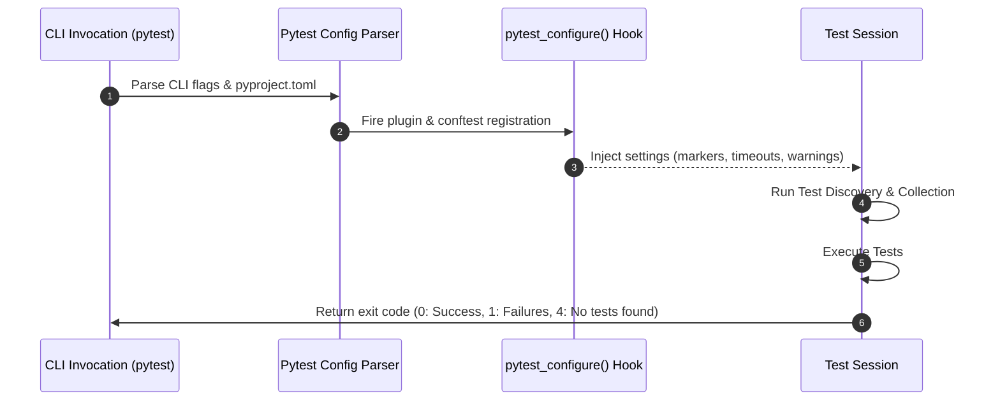

# Pytest Installation & Configuration Architecture ⚙️

> **Authoritative Sources & Literature:**
> - Brian Okken: *Python Testing with pytest* (Chapter 6: Configuration, Pragmatic Bookshelf)
> - PEP 518 / PEP 621: *Specifying Project Build Dependencies and Metadata in pyproject.toml*
> - Holger Krekel & Pytest Team: *pytest Configuration Mechanics* (docs.pytest.org)

---

## 1. Conceptual Definition & Core Mental Model

The **configuration architecture** of pytest governs how the test runner locates test files, registers plugins, enforces behavioral flags, and establishes the project root (`rootdir`).

In modern Python engineering, test configuration is not scattered across ad-hoc CLI flags or legacy `.ini` files; it is declared deterministically inside **`pyproject.toml`** under the `[tool.pytest.ini_options]` table.

```
       [ CLI Command Line Flags ] (Highest Precedence)
                   ▲
                   │ Overrides
       [ pyproject.toml [tool.pytest.ini_options] ]
                   ▲
                   │ Overrides
       [ pytest.ini / setup.cfg ] (Legacy Precedence)
                   ▲
                   │ Overrides
       [ Built-in Pytest Defaults ]
```

---

## 2. Why This Is Critical in Modern Python Backend Engineering

1. **Eliminating the "Works on My Machine" Syndrome**: If developers run `pytest` with different implicit options (e.g., one person uses `-vv` and branch coverage while another runs without warnings), CI pipelines diverge from local workflows.
2. **Preventing Marker Typo Disasters**: By default, pytest dynamically creates any marker you type. If a developer accidentally writes `@pytest.mark.smok` instead of `@pytest.mark.smoke`, pytest silently ignores the marker, causing critical tests to never run. Configuring `--strict-markers` transforms this silent failure into an immediate fatal error.
3. **Establishing `rootdir` and `pythonpath`**: When running backend applications with nested modules (`src/api`, `src/services`), pytest must know how to resolve imports without requiring manual `export PYTHONPATH=.` hacks.

---

## 3. Internal Mechanics: The `rootdir` Resolution Algorithm

When you run `pytest`, it traverses up the directory tree to identify the **root directory (`rootdir`)** and configuration file:



Once `rootdir` is established, pytest locks in relative paths for test discovery, log file output, and plugin resolution.

---

## 4. Standard Syntax, Signatures & Key Options

### Production Configuration Template (`pyproject.toml`)

```toml
[tool.pytest.ini_options]
# Minimum pytest version required
minversion = "8.0"

# Directories where tests are located (accelerates discovery)
testpaths = ["tests"]

# Default CLI arguments added to every run
addopts = [
    "-ra",                    # Show summary of all non-passing tests (skipped, xfailed, failed)
    "--strict-markers",       # Disallow unregistered markers (prevents typos)
    "--strict-config",        # Any error in configuration files will fail the run
    "--tb=short",             # Concise, readable tracebacks
    "--color=yes",            # Force colored output
]

# Enforce Python import path resolution
pythonpath = ["src"]

# Custom test file and class naming patterns
python_files = ["test_*.py", "*_test.py"]
python_classes = ["Test*", "*Tests"]
python_functions = ["test_*"]

# Registration of allowed custom markers
markers = [
    "unit: Isolated in-memory unit tests with zero I/O",
    "integration: Tests requiring PostgreSQL, Redis, or local external services",
    "e2e: Complete end-to-end API and workflow tests",
    "slow: Tests taking longer than 1 second to execute",
]

# Warning filtering
filterwarnings = [
    "error",                                  # Treat warnings as errors
    "ignore::DeprecationWarning:pkg_resources", # Ignore known benign 3rd party deprecations
]
```

---

## 5. Standard CLI Flags & Options

| Flag | Purpose | Production Use Case |
| :--- | :--- | :--- |
| `-v` / `-vv` | Verbose / Maximum Verbosity | CI logs and debugging complex test names |
| `-q` | Quiet mode | Pre-commit git hooks for speed |
| `-x` | Exit instantly on first failure | Rapid TDD local feedback |
| `--maxfail=N` | Exit after $N$ failures | CI builds to prevent runner log overflow |
| `-s` | Disable stdout/stderr capture | Debugging `print()` statements and logs |
| `-k "<expr>"` | Filter tests by keyword expression | `pytest -k "transfer and not slow"` |
| `-m "<expr>"` | Filter tests by registered markers | `pytest -m "unit or integration"` |
| `-o <opt>=<val>`| Override any configuration value | `pytest -o addopts="-v"` |

---

## 6. Lifecycle, Execution Flow & Teardown Mechanics



### Pytest Exit Codes
- `0`: All tests passed.
- `1`: Tests were collected and run, but some failed.
- `2`: Test execution was interrupted by the user (Ctrl+C).
- `3`: Internal error occurred in pytest or a plugin.
- `4`: Pytest command-line usage error, or no tests collected.
- `5`: No tests were collected (often treated as failure in CI unless `--suppress-no-test-exit-code` is passed).

---

## 7. Scopes, Hierarchy, or Test Boundaries

Configuration flows strictly from the top of the repository down:
```
/my_project/
├── pyproject.toml           # Global project-wide configuration
├── tests/
│   ├── conftest.py          # Session-wide hooks & global fixtures
│   ├── unit/
│   │   └── conftest.py      # Unit-tier overrides
│   └── integration/
│       └── conftest.py      # Integration-tier overrides
```
Configuration options set in `pyproject.toml` apply across all test subdirectories. Subdirectories can customize fixtures via `conftest.py`, but cannot override `[tool.pytest.ini_options]`.

---

## 8. Pytest Fixture & `conftest.py` Integration Patterns

You can programmatically extend pytest configuration using the `pytest_addoption` and `pytest_configure` hooks:

```python
# tests/conftest.py
import pytest

def pytest_addoption(parser):
    """Add custom CLI options to pytest."""
    parser.addoption(
        "--run-slow",
        action="store_true",
        default=False,
        help="Run slow-marked tests that are skipped by default"
    )

def pytest_configure(config):
    """Register custom marker programmatically."""
    config.addinivalue_line(
        "markers", "slow: marks tests as slow (deselect with '-m \"not slow\"')"
    )

def pytest_collection_modifyitems(config, items):
    """Skip tests marked slow unless --run-slow flag is passed."""
    if config.getoption("--run-slow"):
        return
    skip_slow = pytest.mark.skip(reason="Need --run-slow flag to run")
    for item in items:
        if "slow" in item.keywords:
            item.add_marker(skip_slow)
```

---

## 9. Practical Python Implementation: Step-by-Step Walkthrough

Let us build a complete, production-configured backend module with a custom CLI flag.

### Step 1: Install Dependencies
```bash
pip install pytest pytest-cov
```

### Step 2: Create Application Code
```python
# src/calculator/engine.py
import time

def fast_add(a: int, b: int) -> int:
    return a + b

def slow_compute_pi(iterations: int) -> float:
    time.sleep(1.2) # Simulate heavy computational workload
    return 3.1415926535
```

### Step 3: Implement Tests with Markers
```python
# tests/unit/test_engine.py
import pytest
from calculator.engine import fast_add, slow_compute_pi

@pytest.mark.unit
def test_fast_add():
    assert fast_add(10, 20) == 30

@pytest.mark.unit
@pytest.mark.slow
def test_slow_compute():
    assert slow_compute_pi(1000) == pytest.approx(3.1415, rel=1e-3)
```

### Step 4: Run with Strict Configuration
```bash
# By default, the slow test is automatically skipped!
pytest -v

# Output:
# tests/unit/test_engine.py::test_fast_add PASSED
# tests/unit/test_engine.py::test_slow_compute SKIPPED (Need --run-slow flag to run)
# 1 passed, 1 skipped in 0.05s

# Run with custom option:
pytest -v --run-slow
# 2 passed in 1.25s
```

---

## 10. Framework-Specific Integration: FastAPI & ASGI

For modern async FastAPI backends, configuration must specify async backend engines and prevent Starlette deprecation warnings from breaking CI:

```toml
# pyproject.toml
[tool.pytest.ini_options]
asyncio_mode = "auto"
asyncio_default_fixture_loop_scope = "function"

filterwarnings = [
    "error",
    # Ignore harmless Starlette lifespan deprecation notices from older dependencies
    "ignore:on_event is deprecated, use lifespan event handlers instead:DeprecationWarning",
]
```

---

## 11. Real-World Enterprise Backend Scenario: Multi-Environment CI/CD

An enterprise SaaS engineering organization deploys to Local, Staging, and Production environments. The test suite needs to connect to different database hosts depending on the environment:

```python
# tests/conftest.py
import pytest
import os

def pytest_addoption(parser):
    parser.addoption(
        "--env",
        action="store",
        default="local",
        choices=["local", "ci", "staging"],
        help="Target environment for integration tests"
    )

@pytest.fixture(scope="session")
def env_config(request) -> dict:
    target_env = request.config.getoption("--env")
    if target_env == "local":
        return {"db_host": "localhost", "port": 5432, "ssl": False}
    elif target_env == "ci":
        return {"db_host": "postgres-service", "port": 5432, "ssl": False}
    elif target_env == "staging":
        return {"db_host": os.environ["STAGING_DB_HOST"], "port": 5432, "ssl": True}
    raise ValueError(f"Unknown env: {target_env}")
```

Execution command in GitHub Actions:
```bash
pytest --env=ci -m "integration"
```

---

## 12. Anti-Patterns & Common Pitfalls

### Anti-Pattern 1: The Missing `--strict-markers`
Without `--strict-markers`, spelling mistakes in decorators pass silently without warning:
```python
# ❌ BUG: Typo "integraiton" silently registers as a dummy marker!
# Running `pytest -m integration` will SKIP this test entirely!
@pytest.mark.integraiton
def test_database_write():
    ...
```
With `--strict-markers` configured, pytest immediately halts with:
`pytest.PytestUnknownMarkWarning: Unknown mark: 'integraiton'. Did you mean 'integration'?`

### Anti-Pattern 2: Scattering Config across `pytest.ini`, `setup.cfg`, and `tox.ini`
Having three different configuration files with conflicting settings causes pytest to load only one (often the wrong one).
- **Remediation**: Standardize entirely on `pyproject.toml`. Delete legacy `.ini` files.

---

## 13. Best Practices & Production Guidelines

1. **Always Use `addopts = "-ra --strict-markers --strict-config"`**:
   - `-ra` gives full diagnostics for all failures, errors, skips, and xfails.
   - `--strict-markers` catches typos in marker names.
   - `--strict-config` catches syntax errors in configuration files.
2. **Specify `testpaths = ["tests"]`**: Prevents pytest from searching through `node_modules`, `.venv`, or virtual environment directories.
3. **Set `pythonpath = ["src"]`**: Ensures clean absolute imports (e.g. `from myapp.service import ...`) without requiring editable pip installs (`pip install -e .`).
4. **Treat Warnings as Errors**: Use `filterwarnings = ["error"]` to catch deprecations and unclosed asynchronous coroutines early.

---

## 14. Trade-Off Analysis: Configuration Formats

| Feature | `pyproject.toml` | `pytest.ini` | `setup.cfg` | CLI Flags Only |
| :--- | :--- | :--- | :--- | :--- |
| **Standard Status** | Modern PEP 621 Standard | Legacy Standalone | Deprecated packaging | Ad-hoc |
| **Centralization** | Single file for Ruff, Mypy, Pytest | Separate file | Combined with setuptools | None |
| **Syntax** | TOML (Strongly typed) | INI (Strings only) | INI | Shell arguments |
| **CI Consistency** | High (Committed to Git) | High | High | Low (Prone to drift) |

---

## 15. Diagnostic & Debugging Playbook

```bash
# 1. Print full configuration diagnosis, active plugins, and rootdir
pytest -v --trace-config

# 2. List all available built-in and registered custom markers
pytest --markers

# 3. List all available fixtures and where they are defined
pytest --fixtures

# 4. Temporarily override any setting from the CLI
pytest -o addopts="-vv --capture=no"
```

---

## 16. Senior Staff Interview Questions & Deep Dives

### Question 1: How does pytest determine its `rootdir`, and what problems occur if `rootdir` is incorrectly resolved?
**Answer**:
Pytest determines `rootdir` by scanning upward from the common ancestor directory of the specified test paths until it finds a configuration file (`pyproject.toml` with `[tool.pytest.ini_options]`, `pytest.ini`, or `setup.cfg`). If no config file is found, it uses the directory containing the tests.
**Problems with incorrect rootdir**:
1. Pytest cannot resolve relative import paths (`pythonpath`), causing `ModuleNotFoundError`.
2. Relative paths in `conftest.py` files point to the wrong locations.
3. Cache files (`.pytest_cache`) are written to random subdirectories instead of the repository root, polluting git working directories.

### Question 2: Why should teams avoid putting test configuration into bash scripts rather than `pyproject.toml`?
**Answer**:
Putting flags into scripts (e.g. `run_tests.sh: pytest -v -m "not slow" --cov`) creates tool fragmentation. Developers using IDE test runners (VS Code, PyCharm, Neovim) invoke `pytest` directly, bypassing the shell script. Consequently, their local test runs behave differently from the shell script, masking configuration errors and failing to register markers. Declaring configuration in `pyproject.toml` guarantees that **all** invocation vectors (CLI, IDEs, CI runners, pre-commit hooks) execute under the identical configuration rules.

---

## 17. Hands-on Engineering Exercises & Challenges

### Exercise 1: Migrating Legacy INI to `pyproject.toml`
Take an existing `pytest.ini` with `addopts = -s`, `markers = smoke`, and `testpaths = tests`. Convert it into a valid `pyproject.toml` `[tool.pytest.ini_options]` table with strict markers and `-ra` enabled.

### Exercise 2: Implementing a `--fail-fast-on-integration` Custom Option
Write a `pytest_addoption` hook in `conftest.py` that accepts a `--fail-fast-on-integration` flag. If passed, automatically sets `config.option.maxfail = 1` whenever an integration test fails.

---

## 18. Summary, Cross-References & Further Reading

Mastering pytest configuration provides a rock-solid, deterministic foundation for any backend engineering organization. By standardizing on `pyproject.toml`, enforcing strict markers, and establishing clean import paths, teams eliminate environment drift and configuration bugs.

### Cross-References:
- Previous: [Foundations: Test Isolation & Determinism](../foundations/test-isolation.md)
- Next: [Test Discovery & Execution](test-discovery.md)
- [Pytest Smart Assertions](assertions.md)
- [Pytest Centralized Conftest Architecture](conftest.md)
