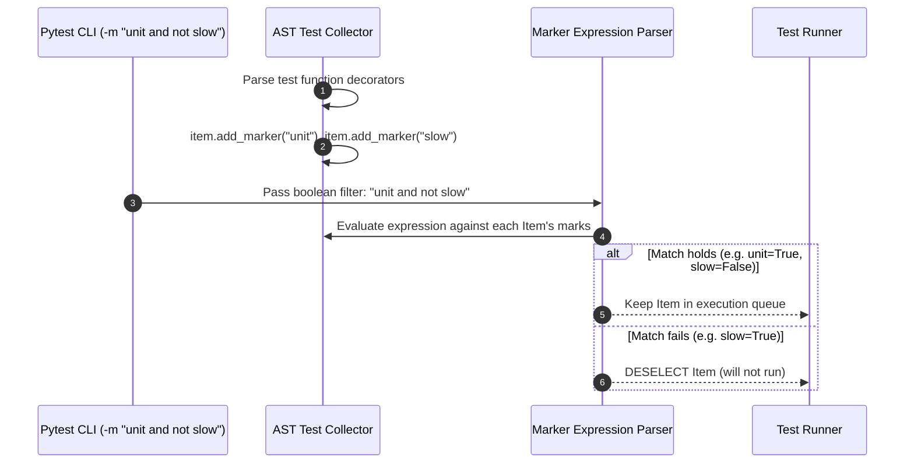

# Pytest Markers & Selective Test Execution 🏷️

> **Authoritative Sources & Literature:**
> - Brian Okken: *Python Testing with pytest* (Chapter 5: Markers, Pragmatic Bookshelf)
> - Holger Krekel: *Pytest Mark Mechanics & Metadata Annotation* (docs.pytest.org)
> - Martin Fowler: *Deployment Pipelines & Test Tagging*

---

## 1. Conceptual Definition & Core Mental Model

A **Pytest Marker** is a decorator used to attach metadata to test functions, classes, or entire test modules.

Markers fulfill two distinct functions:
1. **Test Selection & Filtering**: Slicing the test suite into targeted subsets via the `-m` CLI option (e.g. running only `smoke` tests, or excluding `slow` tests).
2. **Behavior Modification**: Informing pytest to alter how a test executes (e.g. skipping a test under certain conditions, expecting a test to fail, or injecting fixtures without declaring them as arguments).

```
                      [ Entire Test Suite: 2,000 Tests ]
                                      │
              ┌───────────────────────┴───────────────────────┐
              ▼                                               ▼
    Tagged: @pytest.mark.unit                       Tagged: @pytest.mark.slow
    Selected: pytest -m unit                        Deselected: pytest -m "not slow"
    Runs in 4 seconds in CI                         Deferred to nightly run
```

---

## 2. Why This Is Critical in Modern Python Backend Engineering

1. **Partitioning the CI/CD Pipeline**: Running a 25-minute test suite on every pull request slows down engineering teams. Markers allow running fast unit tests in 10 seconds on PR creation, and running integration/E2E tests only before merging to main.
2. **Handling Upstream Outages & Flakes Gracefully**: When an external sandbox (e.g., Stripe Test API) is experiencing downtime, tests can be marked with `@pytest.mark.skipif` instead of deleting or commenting out code.
3. **Tracking Known Regressions with `xfail`**: When a bug is identified in production, write a reproducing test immediately with `@pytest.mark.xfail`. The test documents the defect in version control without breaking the main CI build.

---

## 3. Internal Mechanics: Marker Registration & Filtering

During test collection, pytest parses marker decorators and attaches `Mark` objects to the test `Item.keywords` dictionary:



---

## 4. Built-in Pytest Markers

Pytest includes powerful built-in markers:

### A. `@pytest.mark.skip`
Unconditionally skips a test. Setup and teardown code will not execute:

```python
import pytest

@pytest.mark.skip(reason="Legacy v1 auth deprecated; pending removal in Sprint 14")
def test_legacy_login():
    ...
```

### B. `@pytest.mark.skipif`
Skips a test only when a runtime condition evaluates to `True`:

```python
import sys
import os

@pytest.mark.skipif(
    sys.platform == "win32",
    reason="POSIX-specific socket operations do not run on Windows"
)
def test_unix_domain_sockets():
    ...

@pytest.mark.skipif(
    not os.getenv("STRIPE_API_KEY"),
    reason="Requires live STRIPE_API_KEY in environment"
)
def test_live_stripe_charge():
    ...
```

### C. `@pytest.mark.xfail` (Expected Failure)
Indicates that a test is expected to fail due to a known bug or unimplemented feature:

```python
@pytest.mark.xfail(
    reason="Issue #481: Database deadlocks under serializable isolation level",
    strict=True # CRITICAL: If the test unexpectedly passes, mark it as FAILED!
)
def test_concurrent_transfers():
    ...
```

#### The `strict=True` Mandate
> [!IMPORTANT]
> Always set `strict=True` on `xfail` markers. Without `strict=True`, if someone accidentally fixes the underlying bug, pytest will silently report `XPASS` and continue. With `strict=True`, an unexpected pass turns into an immediate test **FAILURE**, alerting the developer to remove the obsolete `xfail` marker!

### D. `@pytest.mark.usefixtures`
Applies fixtures to a test class or function without needing to pass them as unused parameters:

```python
@pytest.mark.usefixtures("clean_database", "mock_redis")
class TestOrderWorkflows:
    def test_workflow_one(self):
        # clean_database and mock_redis automatically executed!
        ...
```

---

## 5. Custom Markers & Strict Marker Registration

To prevent typos (such as `@pytest.mark.smok` instead of `@pytest.mark.smoke`), you **must register custom markers** in `pyproject.toml`:

```toml
# pyproject.toml
[tool.pytest.ini_options]
addopts = ["--strict-markers"] # Halt immediately if an unregistered marker is used!

markers = [
    "unit: Fast, in-memory unit tests with zero I/O",
    "integration: Tests requiring PostgreSQL, Redis, or external services",
    "e2e: Complete end-to-end user workflows",
    "smoke: Critical sanity tests required for production release",
    "slow: Tests taking longer than 1.0 second to execute",
]
```

---

## 6. Scopes, Hierarchy, or Test Boundaries: Applying Markers

Markers can be applied at three different granularities:

### 1. Function Level
```python
@pytest.mark.unit
def test_addition(): ...
```

### 2. Class Level (Applies to all methods in the class)
```python
@pytest.mark.integration
class TestCustomerRepository:
    def test_save(self): ...
    def test_delete(self): ...
```

### 3. Module Level (Applies to ALL tests in the entire file)
Define the special global variable `pytestmark` at the top of the file:

```python
# tests/integration/test_billing.py
import pytest

# Every single test in this file receives BOTH markers automatically!
pytestmark = [pytest.mark.integration, pytest.mark.slow]

def test_charge(): ...
def test_refund(): ...
```

---

## 7. CLI Filtering with Boolean Expressions (`-m`)

Pytest supports rich boolean logic when filtering markers:

```bash
# Run only unit tests
pytest -m unit

# Run unit tests OR integration tests
pytest -m "unit or integration"

# Run integration tests, but EXCLUDE slow ones
pytest -m "integration and not slow"

# Run smoke tests on staging
pytest -m "smoke and not e2e"
```

---

## 8. Pytest Fixture & `conftest.py` Integration Patterns: Inspecting Markers

Fixtures can dynamically inspect the markers applied to the test function that requested them using the `request.node` API:

```python
# tests/conftest.py
import pytest

@pytest.fixture
def database_client(request):
    """Dynamically adapts based on custom @pytest.mark.db marker."""
    marker = request.node.get_closest_marker("db")
    
    if marker and marker.kwargs.get("engine") == "mysql":
        client = create_mysql_client()
    else:
        client = create_postgres_client()
        
    yield client
    client.close()

# tests/integration/test_multi_db.py
@pytest.mark.db(engine="mysql")
def test_mysql_features(database_client):
    assert database_client.dialect == "mysql"
```

---

## 9. Practical Python Implementation: Step-by-Step Walkthrough

Let us build a backend service and mark its tests across tiers, demonstrating selective filtering.

### Step 1: Define Application Logic

```python
# src/payments/gateway.py
import time

class PaymentGateway:
    @staticmethod
    def validate_card_number(card: str) -> bool:
        # Fast algorithmic check (Luhn algorithm)
        clean = card.replace(" ", "")
        return len(clean) == 16 and clean.isdigit()

    @staticmethod
    def process_live_charge(amount: float) -> str:
        # Simulate network latency to external bank
        time.sleep(1.5)
        return "ch_live_9999"
```

### Step 2: Implement Tests with Custom Markers

```python
# tests/unit/test_payments.py
import pytest
from src.payments.gateway import PaymentGateway

@pytest.mark.unit
@pytest.mark.smoke
def test_valid_card():
    assert PaymentGateway.validate_card_number("4111 1111 1111 1111") is True

@pytest.mark.unit
def test_invalid_card():
    assert PaymentGateway.validate_card_number("invalid") is False

@pytest.mark.integration
@pytest.mark.slow
def test_live_charge():
    charge_id = PaymentGateway.process_live_charge(100.0)
    assert charge_id == "ch_live_9999"
```

### Step 3: Run Targeted Executions

```bash
# 1. Run only fast unit tests (Executes in 0.02s)
pytest -m "unit and not slow"

# 2. Run only the critical release smoke test
pytest -m "smoke"

# 3. Run everything EXCEPT slow tests
pytest -m "not slow"
```

---

## 10. Framework-Specific Integration: FastAPI E2E Tagging

In FastAPI backends, tag complete API workflow tests with `@pytest.mark.e2e` so they can be easily skipped during pre-commit git hooks:

```python
# tests/e2e/test_checkout_flow.py
import pytest
from httpx import AsyncClient

pytestmark = pytest.mark.e2e

@pytest.mark.asyncio
async def test_complete_checkout(async_client: AsyncClient):
    response = await async_client.post("/api/v1/checkout", json={"items": ["book"]})
    assert response.status_code == 201
```

Pre-commit configuration (`.pre-commit-config.yaml`):
```yaml
- id: pytest-check
  name: Fast Unit Tests
  entry: pytest -m "unit and not slow"
  language: system
  pass_filenames: false
```

---

## 11. Real-World Enterprise Backend Scenario: Production Deployment Gating

In an enterprise banking platform:
1. **Pull Request CI**: Runs `pytest -m "unit"` (takes 8 seconds).
2. **Merge to Main CI**: Runs `pytest -m "unit or integration"` (takes 45 seconds).
3. **Pre-Deployment Staging Gate**: Runs `pytest -m "smoke"` against the staging cluster (takes 30 seconds).
4. **Nightly Regression Run**: Runs `pytest` with zero marker filters, executing all 5,000 tests including `@pytest.mark.slow` load tests.

---

## 12. Anti-Patterns & Common Pitfalls

### Anti-Pattern 1: The Marker Typo
```python
# ❌ BUG: Developer meant 'integration', but misspelled it.
# With default pytest, this silently passes without warning!
@pytest.mark.integraiton
def test_database(): ...
```
- **Fix**: Always configure `--strict-markers` in `pyproject.toml`. Pytest will immediately fail with an unrecognized marker error.

### Anti-Pattern 2: The Reason-Less Skip
```python
# ❌ BAD: No one knows why this was skipped or when it can be re-enabled
@pytest.mark.skip
def test_subscription_cancel(): ...

# ✅ GOOD: Transparent, traceable rationale
@pytest.mark.skip(reason="Jira ticket PAY-104: Awaiting Stripe v3 API upgrade")
def test_subscription_cancel(): ...
```

### Anti-Pattern 3: Soft `xfail` That Masks Fixes
Leaving `@pytest.mark.xfail` without `strict=True`. When another developer fixes the bug as a side effect, the test silently passes as `XPASS` and the obsolete marker remains in the codebase forever.

---

## 13. Best Practices & Production Guidelines

1. **Enforce `--strict-markers` in `pyproject.toml`**: Never permit unregistered markers.
2. **Use Module-Level `pytestmark`**: When an entire file belongs to one tier (`tests/integration/test_orders.py`), define `pytestmark = pytest.mark.integration` at the top of the file rather than decorating 20 methods.
3. **Always Include Issue References in `xfail`**: Format `reason="Jira PROJ-123: Description"`.
4. **Show Reason in Test Output**: Use `pytest -ra` to print the explicit skip and xfail reasons in terminal summaries.

---

## 14. Trade-Off Analysis: Test Partitioning Mechanisms

| Approach | Flexibility | Maintenance | Typos Protected? | CI Simplicity |
| :--- | :--- | :--- | :--- | :--- |
| **Pytest Markers (`-m`)** | High (Multi-tagging) | Low (Decorators) | Yes (with `--strict-markers`) | High |
| **Folder Partitioning** (`tests/unit/`) | Moderate | Zero | Yes (Filesystem) | Maximum |
| **Filename Conventions** (`test_slow_*.py`) | Low | High | No | Moderate |
| **Environment Variables** (`if os.getenv(...)`) | Low | High | No | Complex |

---

## 15. Diagnostic & Debugging Playbook

```bash
# 1. List all registered custom and built-in markers with descriptions
pytest --markers

# 2. See which tests match a marker expression without running them
pytest -m "integration and not slow" --collect-only -q

# 3. Show detailed summary of all skipped and xfailed tests with reasons
pytest -ra

# 4. Force xfail tests to run as normal tests (failing on error)
pytest --runxfail
```

---

## 16. Senior Staff Interview Questions & Deep Dives

### Question 1: What is the difference between `XFAIL` (Expected Failure) and `XPASS` (Unexpected Pass), and why is `strict=True` recommended in production?
**Answer**:
- **`XFAIL`**: The test was marked with `@pytest.mark.xfail`, executed, and failed as expected (e.g. raised an `AssertionError`). Pytest marks the test run as passing overall because the failure was anticipated.
- **`XPASS`**: The test was marked as expected-to-fail, but it unexpectedly passed! By default, pytest reports `XPASS` as a neutral status and passes the test suite.
- **Why `strict=True` is vital**: If a test passes unexpectedly, either the underlying bug was fixed or the test assertions became invalid. With `strict=True`, pytest converts an `XPASS` into a **BUILD FAILURE**. This forces the team to review the test, verify that the bug is genuinely resolved, and remove the obsolete `xfail` marker from the codebase.

### Question 2: How can custom markers be used to dynamically inject configuration into fixtures?
**Answer**:
Pytest fixtures have access to the special `request` built-in fixture. By calling `request.node.get_closest_marker("my_marker")`, the fixture can inspect any arguments (`marker.args`) or keyword arguments (`marker.kwargs`) passed into the marker on the requesting test. This enables polymorphic fixture behavior—for example, a single `database_session` fixture can inspect `@pytest.mark.database(schema="isolated_tenant_2")` and dynamically configure its search path or isolation level without requiring separate fixture definitions.

---

## 17. Hands-on Engineering Exercises & Challenges

### Exercise 1: Registering and Enforcing Custom Markers
1. In `pyproject.toml`, enable `--strict-markers` and register two markers: `smoke` and `regression`.
2. Write a test marked with `@pytest.mark.smok` (typo) and verify that pytest halts with a validation error.
3. Fix the typo, and run only tests matching `-m "smoke"`.

### Exercise 2: Implementing a Strict Xfail for an Unimplemented Feature
Write a test for a new `calculate_compound_interest()` function that does not yet exist. Mark it with `@pytest.mark.xfail(strict=True, reason="Pending sprint 2")`. Run the test and verify it passes as `XFAIL`. Then implement the function and observe that pytest now fails with `XPASS(strict)`, indicating the marker should be removed!

---

## 18. Summary, Cross-References & Further Reading

Markers provide the metadata foundation necessary to orchestrate, slice, and optimize modern Python test suites. By combining strict marker registration, boolean `-m` CLI filters, and expressive `skipif`/`xfail` decorators, backend teams maintain high delivery velocity with zero test bloat.

### Cross-References:
- Previous: [Data-Driven Parametrization](parametrization.md)
- Next: [Pytest Plugin Ecosystem & Custom Hooks](plugins.md)
- [Pytest Installation & Configuration](installation-and-configuration.md)
- [FastAPI Endpoint Testing](../fastapi-testing/endpoint-testing.md)
