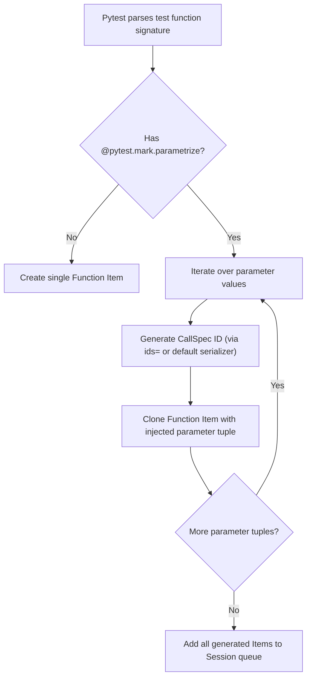
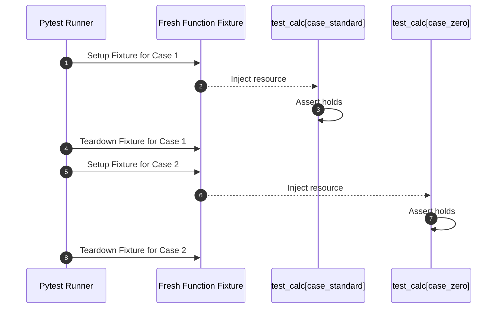

# Data-Driven Testing with Pytest Parametrization 🎛️

> **Authoritative Sources & Literature:**
> - Brian Okken: *Python Testing with pytest* (Chapter 4: Builtin Fixtures & Parametrization, Pragmatic Bookshelf)
> - Gerard Meszaros: *xUnit Test Patterns: Refactoring Test Code* (Data-Driven Test Pattern, Addison-Wesley)
> - Holger Krekel: *Pytest Parametrization & Metafunc Architecture* (docs.pytest.org)

---

## 1. Conceptual Definition & Core Mental Model

**Parametrization** is the testing technique where a single test function is executed repeatedly across multiple sets of input parameters and expected outcomes, with pytest treating each parameter set as an **independent, isolated test item**.

### The Anti-Pattern: A `for` Loop Inside a Test
In naive testing, developers write a `for` loop inside a single test function:
```python
# ❌ ANTI-PATTERN: A loop inside a test function
def test_all_currencies():
    for currency in ["USD", "EUR", "GBP", "JPY", "INVALID"]:
        assert is_valid_currency(currency) # When INVALID fails, execution ABORTS!
```
**Fatal Flaw**: If case 2 fails, cases 3, 4, and 5 never run. The developer only sees one failure, obscuring whether the other cases work.

### The Pytest Solution: Declarative Parametrization
Pytest expands the test at collection time into distinct test items:

```
                  [ @pytest.mark.parametrize ]
                                │
        ┌───────────────────────┼───────────────────────┐
        ▼                       ▼                       ▼
test_currency[USD]      test_currency[EUR]      test_currency[INVALID]
     (PASS)                  (PASS)                  (FAIL)
```
Each parameter case has its own unique `nodeid`, executes in isolation, reports independently, and can be re-run on demand.

---

## 2. Why This Is Critical in Modern Python Backend Engineering

1. **Exhaustive Boundary Value Analysis**: Backend domains (tax engines, credit ratings, permission matrices) involve dozens of input permutations. Parametrization allows testing 30 edge cases in 10 lines of code.
2. **Independent Failure Isolation**: When 1 out of 50 test cases fails, pytest clearly identifies the exact failing parameter tuple without masking the remaining 49 passing cases.
3. **Data-Driven API Validation**: Testing HTTP status codes (200, 400, 401, 403, 422) against various payload permutations without duplicating endpoint invocation logic.

---

## 3. Internal Mechanics: The Collection Expansion Pipeline

When pytest encounters `@pytest.mark.parametrize`, it intercepts the test collection process:



---

## 4. Standard Syntax, Signatures & Key Options

### Basic Parametrization Syntax

```python
import pytest
from decimal import Decimal

@pytest.mark.parametrize(
    "price,tax_rate,expected_total",
    [
        (Decimal("100.00"), Decimal("0.20"), Decimal("120.00")),
        (Decimal("50.00"), Decimal("0.00"), Decimal("50.00")),
        (Decimal("0.00"), Decimal("0.10"), Decimal("0.00")),
    ],
    ids=["standard_vat", "zero_tax", "zero_price"]  # Human-readable test IDs
)
def test_calculate_total(price: Decimal, tax_rate: Decimal, expected_total: Decimal):
    assert price * (1 + tax_rate) == expected_total
```

### Stacking Decorators: Generating Cartesian Products
When multiple `@pytest.mark.parametrize` decorators are stacked, pytest generates the **Cartesian product** ($M \times N$) of all combinations:

```python
# 3 user roles x 2 subscription states = 6 independent test cases!
@pytest.mark.parametrize("role", ["ADMIN", "MANAGER", "GUEST"])
@pytest.mark.parametrize("is_active", [True, False])
def test_permission_matrix(role: str, is_active: bool):
    ...
```

### Annotating Individual Cases with `pytest.param`
You can attach markers, custom IDs, or `xfail` expectations to specific parameter tuples:

```python
@pytest.mark.parametrize(
    "email,is_valid",
    [
        ("user@example.com", True),
        ("admin.corp@sub.domain.co", True),
        ("missing_at_symbol.com", False),
        pytest.param(
            "unicode@ñandú.com", True,
            marks=pytest.mark.xfail(reason="Unicode emails not yet supported by parser"),
            id="unicode_international_email"
        ),
    ]
)
def test_email_validation(email: str, is_valid: bool):
    assert validate_email(email) is is_valid
```

---

## 5. Indirect Parametrization (`indirect=True`)

Sometimes you want to pass parameters **into a fixture** rather than directly into the test function. This is achieved via `indirect=True`:

```python
# tests/conftest.py
import pytest
from src.domain.models import User

@pytest.fixture
def user_with_role(request) -> User:
    """Fixture that consumes the parametrized role argument!"""
    role = request.param
    return User(id="u1", role=role, is_active=True)

# tests/unit/test_auth.py
@pytest.mark.parametrize(
    "user_with_role",
    ["ADMIN", "SUPERUSER", "SECURITY_AUDITOR"],
    indirect=True, # Sends values to user_with_role fixture!
)
def test_privileged_access(user_with_role: User):
    assert user_with_role.has_permission("view_audit_logs") is True
```

---

## 6. Lifecycle, Execution Flow & Teardown Mechanics

Every parametrized case executes through its own complete **Setup $\rightarrow$ Act $\rightarrow$ Assert $\rightarrow$ Teardown** lifecycle:



---

## 7. Scopes, Hierarchy, or Test Boundaries

| Level | Syntax | Scope of Application |
| :--- | :--- | :--- |
| **Function Level** | `@pytest.mark.parametrize` on a `def test_*` | Generates variations of a single test function |
| **Class Level** | `@pytest.mark.parametrize` on `class Test*` | Generates variations of every method in the class |
| **Fixture Level** | `@pytest.fixture(params=[...])` | Any test requesting the fixture runs for each param |
| **Dynamic / Hook Level** | `pytest_generate_tests(metafunc)` in `conftest` | Dynamic generation from JSON, CSV, or CLI flags |

---

## 8. Dynamic Parametrization with `pytest_generate_tests`

To generate test cases dynamically from an external source (like a YAML/JSON file or a database table), use the `pytest_generate_tests` hook:

```python
# tests/conftest.py
import json
from pathlib import Path

def pytest_generate_tests(metafunc):
    """Dynamically parameterize tests requesting 'scenario_data'."""
    if "scenario_data" in metafunc.fixturenames:
        json_path = Path(__file__).parent / "data" / "scenarios.json"
        scenarios = json.loads(json_path.read_text())
        metafunc.parametrize("scenario_data", scenarios, ids=[s["name"] for s in scenarios])
```

---

## 9. Practical Python Implementation: Step-by-Step Walkthrough

We will build a **Credit Card Payment Routing & Fee Engine** and test it across card brands, domestic vs. international transactions, and amounts using parametrization.

### Step 1: Define Application Logic

```python
# src/billing/card_router.py
from dataclasses import dataclass
from decimal import Decimal
from enum import Enum

class CardBrand(str, Enum):
    VISA = "VISA"
    MASTERCARD = "MASTERCARD"
    AMEX = "AMEX"

@dataclass(frozen=True)
class PaymentRoutingRule:
    brand: CardBrand
    is_international: bool
    base_fee_cents: int
    rate: Decimal

class PaymentFeeCalculator:
    # Interchange fee schedule
    SCHEDULE = {
        (CardBrand.VISA, False): Decimal("0.015"),       # 1.5%
        (CardBrand.VISA, True): Decimal("0.025"),        # 2.5%
        (CardBrand.MASTERCARD, False): Decimal("0.016"), # 1.6%
        (CardBrand.MASTERCARD, True): Decimal("0.026"),  # 2.6%
        (CardBrand.AMEX, False): Decimal("0.029"),       # 2.9%
        (CardBrand.AMEX, True): Decimal("0.035"),        # 3.5%
    }
    FIXED_FEE = Decimal("0.30") # $0.30 fixed fee per transaction

    @classmethod
    def calculate_fee(cls, brand: CardBrand, is_international: bool, amount: Decimal) -> Decimal:
        if amount <= Decimal("0.00"):
            raise ValueError("Transaction amount must be positive")
        
        rate = cls.SCHEDULE[(brand, is_international)]
        variable_fee = amount * rate
        total = variable_fee + cls.FIXED_FEE
        return total.quantize(Decimal("0.01"))
```

### Step 2: Implement Exhaustive Parametrized Suite

```python
# tests/unit/test_card_router.py
import pytest
from decimal import Decimal
from src.billing.card_router import PaymentFeeCalculator, CardBrand

@pytest.mark.unit
@pytest.mark.parametrize(
    "brand,is_intl,amount,expected_fee",
    [
        # Visa Domestic ($100 * 1.5% + $0.30 = $1.80)
        (CardBrand.VISA, False, Decimal("100.00"), Decimal("1.80")),
        # Visa International ($100 * 2.5% + $0.30 = $2.80)
        (CardBrand.VISA, True, Decimal("100.00"), Decimal("2.80")),
        # Mastercard Domestic ($100 * 1.6% + $0.30 = $1.90)
        (CardBrand.MASTERCARD, False, Decimal("100.00"), Decimal("1.90")),
        # Mastercard International ($100 * 2.6% + $0.30 = $2.90)
        (CardBrand.MASTERCARD, True, Decimal("100.00"), Decimal("2.90")),
        # Amex Domestic ($100 * 2.9% + $0.30 = $3.20)
        (CardBrand.AMEX, False, Decimal("100.00"), Decimal("3.20")),
        # Amex International ($100 * 3.5% + $0.30 = $3.80)
        (CardBrand.AMEX, True, Decimal("100.00"), Decimal("3.80")),
        # Micro-transaction ($1.00 * 1.5% + $0.30 = $0.32)
        (CardBrand.VISA, False, Decimal("1.00"), Decimal("0.32")),
    ],
    ids=[
        "visa_domestic",
        "visa_international",
        "mastercard_domestic",
        "mastercard_international",
        "amex_domestic",
        "amex_international",
        "visa_micro_transaction",
    ]
)
def test_calculate_fee_matrix(
    brand: CardBrand, is_intl: bool, amount: Decimal, expected_fee: Decimal
):
    fee = PaymentFeeCalculator.calculate_fee(brand, is_intl, amount)
    assert fee == expected_fee


@pytest.mark.unit
@pytest.mark.parametrize("invalid_amount", [Decimal("0.00"), Decimal("-10.00"), Decimal("-0.01")])
def test_invalid_amount_raises_value_error(invalid_amount: Decimal):
    with pytest.raises(ValueError, match="must be positive"):
        PaymentFeeCalculator.calculate_fee(CardBrand.VISA, False, invalid_amount)
```

---

## 10. Framework-Specific Integration: FastAPI Validation Testing

Parametrization is the ultimate pattern for testing FastAPI schema validation errors (HTTP 422):

```python
# tests/integration/test_registration_validation.py
import pytest
from httpx import AsyncClient

@pytest.mark.asyncio
@pytest.mark.parametrize(
    "payload,missing_or_invalid_field",
    [
        ({"password": "ValidPassword123!"}, "email"),                 # Missing email
        ({"email": "not-an-email", "password": "Valid123!"}, "email"), # Bad email format
        ({"email": "test@example.com"}, "password"),                  # Missing password
        ({"email": "test@example.com", "password": "short"}, "password"), # Too short
    ],
    ids=["missing_email", "malformed_email", "missing_password", "short_password"]
)
async def test_registration_validation_errors(async_client: AsyncClient, payload, missing_or_invalid_field):
    response = await async_client.post("/api/v1/users/register", json=payload)
    
    assert response.status_code == 422
    error_details = response.json()["detail"]
    assert any(missing_or_invalid_field in err["loc"] for err in error_details)
```

---

## 11. Real-World Enterprise Backend Scenario: International Tax Exemption Rules

In an enterprise billing platform supporting 20 countries:
- Instead of writing 20 separate tests, an engineer uses a single parametrized test with an `ids=...` generator function.
- When tax regulations change in Germany, the developer runs `pytest -k "tax_germany"` to test only the German rules locally in 0.02 seconds.

---

## 12. Anti-Patterns & Common Pitfalls

### Anti-Pattern 1: Unlabeled Cryptic Tuples
Omitting the `ids` parameter when testing complex objects:
```python
# ❌ UNREADABLE: Terminal prints: test_rule[<Rule object at 0x7f8>-True-10.0]
@pytest.mark.parametrize("rule,flag,val", [...])
def test_rule(rule, flag, val): ...
```
- **Fix**: Always provide descriptive string `ids`, or pass a callable `ids=lambda x: getattr(x, "name", str(x))`.

### Anti-Pattern 2: The Cartesian Explosion
```python
# ❌ DANGEROUS: 10 x 10 x 10 x 10 = 10,000 test cases!
@pytest.mark.parametrize("a", range(10))
@pytest.mark.parametrize("b", range(10))
@pytest.mark.parametrize("c", range(10))
@pytest.mark.parametrize("d", range(10))
def test_heavy_database(a, b, c, d, db_session): ...
```
Stacking 4 decorators can turn an 8-second test suite into a 30-minute CI blocker.

---

## 13. Best Practices & Production Guidelines

1. **Always Supply Explicit Test IDs**: Use `ids=[...]` to give each test case a readable business title in terminal and CI logs.
2. **Use `pytest.param` for Edge Annotations**: Annotate known bugs with `pytest.param(..., marks=pytest.mark.xfail)`.
3. **Use `indirect=True` for Complex Setup**: When parameter data requires heavy initialization, pass it into a fixture rather than polluting the test function body.
4. **Target Specific Cases on Failure**: When a parametrized test fails in CI, copy the exact nodeid: `pytest tests/test_billing.py::test_calculate_total[standard_vat]` to isolate and fix it locally.

---

## 14. Trade-Off Analysis: Data-Driven Approaches

| Approach | Readability | Failure Isolation | Setup Reusability | Dynamic Data Loading |
| :--- | :--- | :--- | :--- | :--- |
| **`@pytest.mark.parametrize`** | High | Individual Test Item | Moderate | Compile-time static |
| **Fixture `params=[...]`** | Moderate | Individual Test Item | Maximum (Reusable) | Compile-time static |
| **`pytest_generate_tests`** | Moderate | Individual Test Item | High | Runtime Dynamic (Files/DB) |
| **`for` loop inside test** | Poor | Zero (Aborts on first fail) | Zero | Imperative runtime |

---

## 15. Diagnostic & Debugging Playbook

```bash
# 1. List all parametrized test permutations without running them
pytest tests/unit/test_card_router.py --collect-only -q

# 2. Run only a single specific parameter case by ID
pytest tests/unit/test_card_router.py::test_calculate_fee_matrix[amex_international]

# 3. Filter parametrized cases using keyword search
pytest -k "visa and domestic"
```

---

## 16. Senior Staff Interview Questions & Deep Dives

### Question 1: What is the difference between `@pytest.mark.parametrize` and fixture-level parametrization (`@pytest.fixture(params=[...])`), and when should each be used?
**Answer**:
- **Function Parametrization (`@pytest.mark.parametrize`)** is bound to a single test function (or class). It is ideal when the test logic is specific to that function and the parameters represent domain inputs and expected outputs (e.g. testing mathematical rules or boundary conditions).
- **Fixture Parametrization (`@pytest.fixture(params=[...])`)** parameterizes the fixture itself. Any test function across the entire test suite that requests this fixture will automatically run for every parameter value. It is ideal for **environmental or configuration variations** (e.g. testing an entire API suite against three different database backends: SQLite, PostgreSQL, and MySQL, or testing against multiple browser types in Playwright).

### Question 2: How does `pytest.param(..., marks=pytest.mark.xfail)` differ from putting `try...except` or `@pytest.mark.xfail` on the entire test function?
**Answer**:
Putting `@pytest.mark.xfail` on the test function marks *every* parameter iteration as expected-to-fail. If only 1 out of 20 edge cases fails due to a known bug, marking the entire function hides regressions if the other 19 cases break! Using `pytest.param(..., marks=pytest.mark.xfail)` isolates the `xfail` behavior strictly to that single defective parameter case, while ensuring that the remaining 19 test cases are strictly enforced as passing.

---

## 17. Hands-on Engineering Exercises & Challenges

### Exercise 1: Refactoring a Fragile Loop into Parametrized Cases
Refactor this fragile test into an idiomatic, isolated `@pytest.mark.parametrize` test with descriptive `ids`:
```python
def test_slugify():
    cases = [
        ("Hello World", "hello-world"),
        ("Pytest & Testing!", "pytest-testing"),
        ("  spaces  ", "spaces"),
    ]
    for raw, expected in cases:
        assert slugify(raw) == expected
```

### Exercise 2: Implementing Indirect Fixture Parametrization
Create a fixture `temporary_user` that receives a role name via `indirect=True`. Write a test that verifies permission elevation across `["GUEST", "USER", "STAFF", "ADMIN"]`.

---

## 18. Summary, Cross-References & Further Reading

Parametrization transforms repetitive tests into declarative, data-driven behavioral matrices. By isolating each parameter set as an independent test item and leveraging explicit IDs, backend teams achieve massive test coverage with minimal code.

### Cross-References:
- Previous: [Fixture Scopes & Lifecycle Management](fixture-scopes.md)
- Next: [Markers & Test Selection](markers.md)
- [Boundary Value Analysis](../unit-testing/boundary-value-testing.md)
- [Property-Based Testing with Hypothesis](../ai-assisted-testing/property-based-testing.md)
