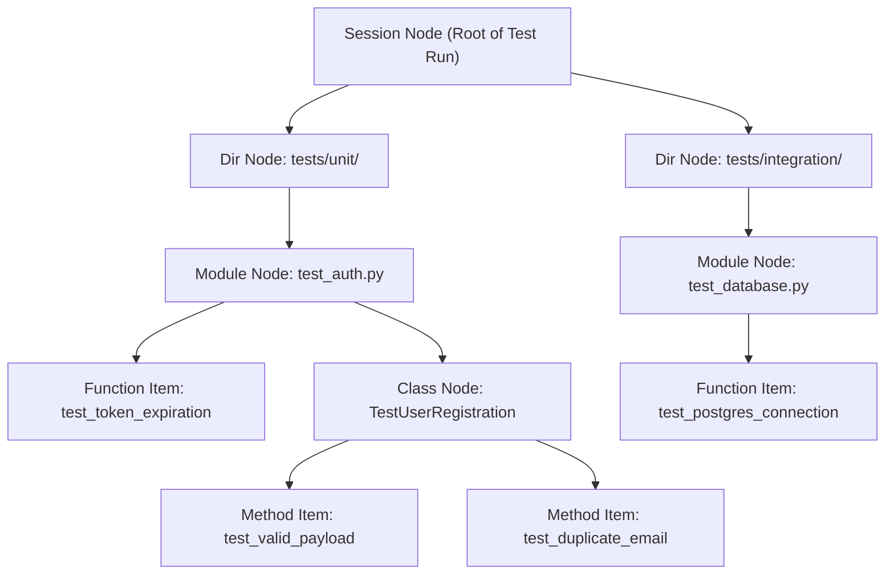
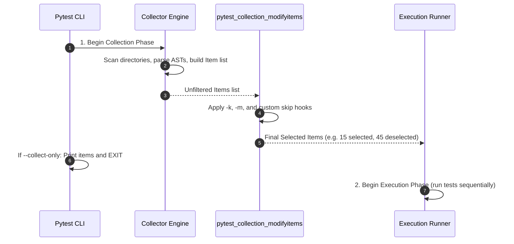
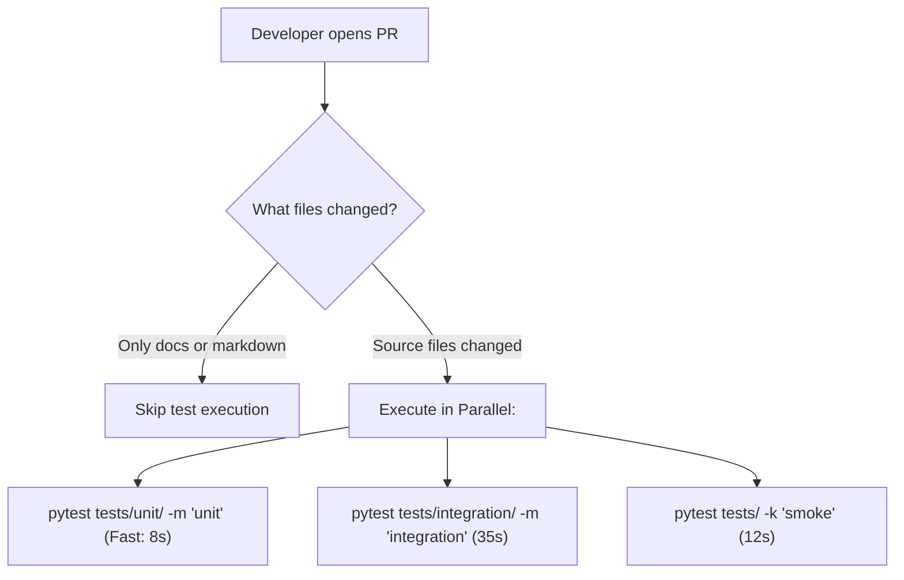

# Pytest Test Discovery & Execution Targeting 🔍

> **Authoritative Sources & Literature:**
> - Brian Okken: *Python Testing with pytest* (Chapter 1: Getting Started with pytest, Chapter 2: Writing Test Functions, Pragmatic Bookshelf)
> - Holger Krekel & Pytest Core Development Team: *Pytest Discovery Mechanics & Collector Architecture* (docs.pytest.org)
> - Python Packaging Authority (PyPA): *Source Layouts and Import Resolution*

---

## 1. Conceptual Definition & Core Mental Model

**Test Discovery** is the automated mechanism by which pytest scans directories, identifies testable Python files, parses their Abstract Syntax Trees (ASTs), discovers test functions and classes, and builds an in-memory execution tree.

Unlike traditional xUnit runners that require maintaining centralized test suite manifests (e.g. `suite.addTest(...)`), pytest relies on **convention over configuration**.

```
                [ pytest Invocation ]
                          │
                 Scan "testpaths"
                          │
            Matches "test_*.py" or "*_test.py"?
             ├── NO  ──> Ignore File
             └── YES ──> Parse AST & Collect Items
                           │
             ┌─────────────┴─────────────┐
             ▼                           ▼
      Class "Test*"?              Function "test_*"?
  (Has NO __init__ method)               │
             │                           └── Collect Function Item
             ▼
      Method "test_*"?
             │
             └── Collect Class Method Item
```

---

## 2. Why This Is Critical in Modern Python Backend Engineering

1. **The Silent Omission Risk**: If a developer names a test function `verify_account_balance()` instead of `test_account_balance()`, pytest skips the function completely. The test suite reports "100% PASS", but the critical verification logic was never executed!
2. **Targeted Sub-Suite Execution**: In a large backend monolith with 4,000 tests, running the entire suite on every code save is impossible. Developers must be able to target a single file, a single class, or a single test method in sub-second cycles.
3. **Module Name Collision Defense**: In large codebases, developers often create `tests/unit/test_service.py` and `tests/integration/test_service.py`. Without understanding pytest's discovery and import modes (`importlib` vs `prepend`), Python throws duplicate module name collisions.

---

## 3. The Pytest Collector Tree Architecture

Discovery occurs in a distinct **Collection Phase** before any test executes:



Every collected test is represented as an **`Item`** node with a unique node identifier (`nodeid`):
`tests/unit/test_auth.py::TestUserRegistration::test_valid_payload`

---

## 4. Standard Syntax, Signatures & Key Options

### Targeting Syntax by Node Identifier (`nodeid`)

```bash
# 1. Target an entire directory
pytest tests/unit/

# 2. Target a single test file
pytest tests/unit/test_billing.py

# 3. Target a specific test class within a file
pytest tests/unit/test_billing.py::TestInvoiceCalculations

# 4. Target a single test function or method
pytest tests/unit/test_billing.py::TestInvoiceCalculations::test_prorated_tax

# 5. Target a specific parametrized case by parameter ID
pytest tests/unit/test_billing.py::test_tax_brackets[tier_1_uk]
```

### Keyword Expression Filtering (`-k`)
The `-k` flag matches substrings against the test's `nodeid` and custom attributes using boolean logic:

```bash
# Run tests whose name contains "transfer" but not "crypto"
pytest -k "transfer and not crypto"

# Run tests matching login or signup
pytest -k "login or signup"

# Run all tests in the TestBilling class
pytest -k "TestBilling"
```

---

## 5. Standard Configuration in `pyproject.toml`

You can customize discovery conventions to fit company naming standards:

```toml
[tool.pytest.ini_options]
testpaths = ["tests"]

# File patterns to treat as test modules
python_files = [
    "test_*.py",
    "*_test.py",
    "check_*.py", # Custom convention
]

# Class patterns to collect (Must NOT have an __init__ constructor)
python_classes = [
    "Test*",
    "*Suite",
]

# Function and method patterns to collect
python_functions = [
    "test_*",
    "check_*",
]
```

---

## 6. Lifecycle, Execution Flow & Teardown Mechanics

The test execution lifecycle is divided into two distinct phases:



Running `pytest --collect-only` executes **only Phase 1**, allowing you to inspect what will be run without executing any test bodies or slow fixtures.

---

## 7. Scopes, Hierarchy, or Test Boundaries

```
[ Root Directory ]
       │
[ tests/ Directory (testpaths) ]
       │
├── [ Package / Subdirectory Node ] (requires __init__.py for unique import)
│      │
│      └── [ Module Node: test_*.py ]
│             │
│             ├── [ Top-Level Function Node: test_* ]
│             │
│             └── [ Class Node: Test* ]
│                    │
│                    └── [ Method Node: test_* ]
```

---

## 8. Pytest Fixture & `conftest.py` Integration Patterns

You can hook into the collection phase to dynamically inspect or modify discovered tests:

```python
# tests/conftest.py
import pytest

def pytest_collection_modifyitems(session, config, items):
    """
    Hook called after collection is complete.
    Allows sorting, filtering, or modifying items dynamically.
    """
    # Automatically tag any test in an 'integration' directory with the integration marker
    for item in items:
        if "integration" in str(item.fspath):
            item.add_marker(pytest.mark.integration)

def pytest_ignore_collect(collection_path, config):
    """
    Skip collecting specific paths completely (e.g., legacy experimental tests).
    """
    if "legacy_experimental" in str(collection_path):
        return True
    return False
```

---

## 9. Practical Python Implementation: Step-by-Step Walkthrough

Let us build a multi-class test module and demonstrate targeted discovery.

### Step 1: Create Application Code

```python
# src/auth/service.py
class AuthService:
    @staticmethod
    def validate_password(password: str) -> bool:
        return len(password) >= 8 and any(c.isupper() for c in password)

    @staticmethod
    def generate_token(user_id: str) -> str:
        return f"token_for_{user_id}"
```

### Step 2: Create Test File with Functions and Classes

```python
# tests/unit/test_auth_discovery.py
import pytest
from auth.service import AuthService

# Top-level test function
def test_password_length_validation():
    assert AuthService.validate_password("Short1") is False
    assert AuthService.validate_password("ValidPassword1") is True

class TestTokenOperations:
    """Class-grouped tests. Must NOT define __init__!"""
    
    def test_token_generation_format(self):
        token = AuthService.generate_token("alice")
        assert token == "token_for_alice"

    def test_token_contains_user_id(self):
        token = AuthService.generate_token("bob")
        assert "bob" in token
```

### Step 3: Run Discovery Diagnostics

```bash
# 1. Inspect collection without running tests
pytest tests/unit/test_auth_discovery.py --collect-only

# Output:
# <Module test_auth_discovery.py>
#   <Function test_password_length_validation>
#   <Class TestTokenOperations>
#     <Function test_token_generation_format>
#     <Function test_token_contains_user_id>
# 3 tests collected

# 2. Run ONLY the class method
pytest tests/unit/test_auth_discovery.py::TestTokenOperations::test_token_generation_format

# 3. Filter using keyword expression
pytest -k "Token and bob"
```

---

## 10. Framework-Specific Integration: Modern Package Layouts

In modern Python repositories, code lives in a `src/` layout:
```text
my_project/
├── pyproject.toml
├── src/
│   └── my_backend/
│       ├── __init__.py
│       └── api/
└── tests/
    ├── __init__.py
    ├── unit/
    │   ├── __init__.py
    │   └── test_api.py
    └── integration/
        ├── __init__.py
        └── test_api.py
```

### The Import Mode Setting
In `pyproject.toml`, always configure `addopts = ["--import-mode=importlib"]`:
```toml
[tool.pytest.ini_options]
addopts = ["--import-mode=importlib"]
```
This forces pytest to use Python's modern `importlib` instead of prepending each directory to `sys.path`. This guarantees that `tests/unit/test_api.py` and `tests/integration/test_api.py` will never clash with each other.

---

## 11. Real-World Enterprise Backend Scenario: Selective CI Matrix

In large enterprise CI pipelines, running all 5,000 tests on every pull request takes 30 minutes. To optimize developer velocity, the pipeline partitions test execution:



Using pytest's targeted directory and nodeid syntax allows CI runners to execute only the tests relevant to modified code.

---

## 12. Anti-Patterns & Common Pitfalls

### Anti-Pattern 1: The `__init__` Constructor in a Test Class
Developers coming from traditional object-oriented languages often add `__init__` to a test class:

```python
# ❌ DISASTER: Pytest will skip this entire class with a warning!
class TestPaymentProcessor:
    def __init__(self): # NEVER DO THIS!
        self.gateway = "stripe"

    def test_charge(self):
        assert self.gateway == "stripe"
```
Pytest emits: `PytestCollectionWarning: cannot collect test class 'TestPaymentProcessor' because it has a __init__ constructor`.
**Fix**: Use a `@pytest.fixture` or `setup_method()` instead.

### Anti-Pattern 2: Naming Helper Functions `test_*`
```python
# ❌ BUG: Pytest will attempt to run this helper function as a test!
def test_create_mock_user(email: str): # Missing argument error during run!
    return {"email": email, "id": 1}

# ✅ GOOD: Name helpers clearly
def create_mock_user(email: str):
    return {"email": email, "id": 1}
```

### Anti-Pattern 3: Omitting `__init__.py` in Subdirectories
If `tests/unit/test_views.py` and `tests/integration/test_views.py` exist without `__init__.py` files, pytest will encounter import clashes under legacy import modes.
**Fix**: Always place an empty `__init__.py` in every test subdirectory.

---

## 13. Best Practices & Production Guidelines

1. **Verify Collection in CI Before Running**: Add a quick sanity step in CI: `pytest --collect-only -q` to verify the expected number of tests are discovered.
2. **Standardize on `test_*.py`**: Never mix naming schemes (`tests_*.py`, `check_*.py`). Adhere strictly to Python's community standard.
3. **Use NodeIDs for Rapid Local Debugging**: When a test fails in CI, copy the exact nodeid printed in the report (e.g. `tests/unit/test_auth.py::TestLogin::test_failure`) and paste it into your local terminal to re-run only that test.
4. **Group Cohesive Tests in Classes Without Inheritance**: Group related tests inside `class TestFeatureName:` for readable test output hierarchies, but avoid deep OOP inheritance across test classes.

---

## 14. Trade-Off Analysis: Test Selection Mechanisms

| Selection Method | Precision | Maintenance Overhead | Typical Engineering Use Case |
| :--- | :--- | :--- | :--- |
| **Directory Path** (`pytest tests/unit`) | Coarse | Zero | Running pyramid tiers in CI |
| **Exact NodeID** (`pytest file.py::test_fn`) | Exact (Single test) | Zero | Rapid local TDD & debugging |
| **Keyword (`-k "auth and not slow"`)** | Dynamic | Low | Ad-hoc local filtering |
| **Marker (`-m "smoke"`)** | Explicit & Tagged | Moderate (Requires decorators) | Production release gates |

---

## 15. Diagnostic & Debugging Playbook

```bash
# 1. Print all collected tests as a flat list of node IDs
pytest --collect-only -q

# 2. Check why a specific file or test is not being collected
pytest tests/unit/test_mystery.py -vv --collect-only

# 3. Print the top 5 longest collection times (slow module imports)
pytest --durations=5 --collect-only

# 4. Show which tests would be selected by a keyword expression without running them
pytest -k "billing and not invoice" --collect-only -q
```

---

## 16. Senior Staff Interview Questions & Deep Dives

### Question 1: How does pytest's `--import-mode=importlib` differ from `--import-mode=prepend`, and why is it recommended for modern projects?
**Answer**:
Under `--import-mode=prepend` (the legacy default), pytest adds the directory of each test module to the beginning of `sys.path`. If two test files have the same filename in different directories (e.g., `tests/unit/test_app.py` and `tests/e2e/test_app.py`), the second one will often collide or fail to import properly because Python caches the module in `sys.modules` under the bare name `test_app`.
Under `--import-mode=importlib`, pytest uses Python's standard `importlib.import_module` mechanics with unique synthetic module names based on their full relative path. This ensures complete isolation, allows identical test filenames across directories, and avoids mutating the global `sys.path`.

### Question 2: Why does pytest refuse to collect classes that implement an `__init__` method?
**Answer**:
Pytest manages the instantiation of test classes automatically, injecting requested fixtures into test methods via parameter reflection. If a class defines `__init__`, pytest would not know what parameters to pass to the constructor during its collection and instantiation lifecycle. If instance-level state initialization is required, pytest provides the standard `setup_method(self, method)` lifecycle hook or class-scoped fixtures (`@pytest.fixture(scope="class")`), which fit deterministically into the dependency injection graph.

---

## 17. Hands-on Engineering Exercises & Challenges

### Exercise 1: Isolating a Non-Discovered Test Function
A junior engineer added a test to verify JWT expiration, but it never appears in the test output.
```python
class TestJWT:
    def verify_expired_token(self):
        assert is_token_expired("expired_token") is True
```
1. Run `pytest --collect-only` and explain why the test is missing.
2. Fix the test without changing its assertion logic.
3. Verify that pytest discovers and runs it.

### Exercise 2: Implementing a Dynamic Directory Marker Hook
Write a `pytest_collection_modifyitems` hook in `tests/conftest.py` that automatically tags every test located inside `tests/e2e/` with `@pytest.mark.e2e` without needing manual decorators on every test function.

---

## 18. Summary, Cross-References & Further Reading

Mastering test discovery enables engineers to target and execute test subsets with pinpoint accuracy. By understanding node IDs, collection lifecycles, and import modes, backend teams maintain clean, collision-free test suites across massive codebases.

### Cross-References:
- Previous: [Installation & Configuration](installation-and-configuration.md)
- Next: [Smart Assertions & Failure Introspection](assertions.md)
- [Pytest Markers & Test Selection](markers.md)
- [Centralized Configuration with conftest.py](conftest.md)
