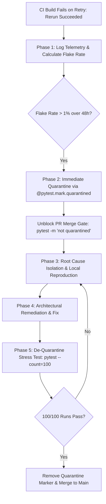

# Flaky Test Diagnostic & Remediation Playbook

> *"A flaky test is a system alarm that cries wolf. The moment engineers stop treating test failures as urgent defects, the test suite loses all protective value. Follow this playbook to diagnose, quarantine, and permanently eliminate flakiness."*

---

## 1. The Five Common Root Causes of Flakiness

```
┌────────────────────────────────────────────────────────────────────────┐
│                      THE 5 FLAKINESS ARCHETYPES                        │
├────────────────────────────────────────────────────────────────────────┤
│ 1. State Pollution: Prior test leaked memory, DB rows, or singletons   │
│ 2. Timing & Clock Races: Relying on sleep() or wall-clock timestamps   │
│ 3. Concurrency Contention: DB row locks, port clashes under xdist      │
│ 4. Unseeded Non-Determinism: random.choice(), dict iteration order     │
│ 5. External Network Leaks: Live internet calls without mocked adapters │
└────────────────────────────────────────────────────────────────────────┘
```

---

## 2. The 5-Phase Remediation Lifecycle



---

## 3. Phase 1: Detection & Telemetry

Enable rerun tracking in `pyproject.toml` so intermittent failures do not fail builds silently without recording diagnostic telemetry:

```toml
[tool.pytest.ini_options]
addopts = ["--reruns", "2", "--reruns-delay", "0.5", "-rR"]
```

When a rerun occurs, log the failure trace to your observability platform (Datadog/Elasticsearch):

```python
# tests/conftest.py
import logging
import pytest

logger = logging.getLogger("flake_telemetry")


def pytest_runtest_logreport(report: pytest.TestReport):
    if report.outcome == "rerun":
        logger.error(
            "FLAKE_DETECTED: test=%s duration=%.3f error=%s",
            report.nodeid,
            report.duration,
            report.longreprtext,
        )
```

---

## 4. Phase 2: Immediate Quarantine

Never let a flaky test block developers from shipping features. Apply the quarantine marker immediately:

```python
import pytest


@pytest.mark.quarantined(reason="FLAKE-842: Intermittent deadlock under concurrent checkout")
def test_checkout_under_load():
    pass
```

Ensure default CI test execution ignores quarantined tests:
```bash
pytest -m "not quarantined"
```

---

## 5. Phase 3: Root Cause Reproduction Playbook

### Diagnostic Step 1: Is It Order-Dependent? (State Pollution)

Tests that pass when run alone but fail when run as part of the full suite are suffering from **State Pollution**:

```bash
# 1. Install pytest-randomly
pip install pytest-randomly

# 2. Run test suite with random seed
pytest --randomly-seed=12345

# 3. If it fails, rerun with the EXACT same seed to reproduce
pytest --randomly-seed=12345
```

#### Finding the Polluter:
Use binary search to find which preceding test polluted the state:
```bash
pytest --bisect tests/
```

---

### Diagnostic Step 2: Is It a Timing / Clock Bug?

Tests that fail around midnight UTC, month boundaries, or rely on `time.sleep()`:

```python
# Symptom: Test passes locally at 2:00 PM, fails in CI at 00:00 UTC
# FIX: Freeze time deterministically using time-machine
import time_machine
from datetime import datetime, timezone

def test_monthly_billing_cycle():
    with time_machine.travel(datetime(2026, 6, 15, 12, 0, 0, tzinfo=timezone.utc)):
        # System clock is completely frozen; zero midnight race conditions
        invoice = generate_monthly_invoice()
        assert invoice.billing_period == "2026-06"
```

---

### Diagnostic Step 3: Is It Port or File Collision Under `pytest-xdist`?

If tests pass sequentially but fail under `pytest -n auto`:

```bash
# Reproduce with 2 workers against the failing file
pytest tests/integration/test_orders.py -n 2
```

#### Fix Checklist:
1. **Never hardcode ports** (`8000`, `5432`). Use dynamic ephemeral ports: `socket.bind(("", 0))`.
2. **Never hardcode file paths** (`/tmp/output.csv`). Use `tmp_path: Path` fixture.
3. **Never share database schemas**. Partition database names using `worker_id` (`test_db_gw0`).

---

## 6. Phase 4: Permanent Architectural Remediation

| Flake Trigger | Anti-Pattern Code | Production Remediation |
| :--- | :--- | :--- |
| **Sleeping in Tests** | `time.sleep(0.5)` waiting for background task | Poll with backoff: `wait_for(lambda: condition(), timeout=2.0)` |
| **Unsorted Iteration** | `for item in set_of_items:` | Deterministic sort: `for item in sorted(items):` |
| **Leaked Database Rows** | Manual cleanup in `teardown()` that gets skipped on assert | Wrap every test in a nested `SAVEPOINT` rolled back automatically |
| **Unpatched Globals** | Mutating `os.environ` directly | Always use `monkeypatch.setenv()` |

---

## 7. Phase 5: De-Quarantine Stress Testing

Before removing the `@pytest.mark.quarantined` marker and returning the test to mainline CI, stress test the fix with **100 consecutive executions**:

```bash
# Run the repaired test 100 times back-to-back under random ordering
pytest tests/integration/test_orders.py::test_checkout_under_load --count=100 --randomly-seed=auto
```

If all 100 iterations pass with zero reruns, the test is certified clean:
1. Delete the `@pytest.mark.quarantined` marker.
2. Close the tracking issue with reference to the root cause fix.
3. Merge back into the mainline branch.

---

## Summary & Cross-References

- Review parallel isolation techniques in [Parallel Test Execution with pytest-xdist](../ci-cd-and-devops/parallel-testing.md).
- Learn database savepoint mechanics in [Transaction & Rollback Testing](../integration-testing/transaction-and-rollback.md).
- Review organizational testing standards in [Testing Strategy RFC Template](testing-strategy-template.md).
