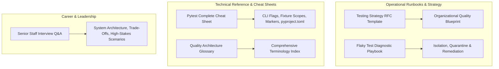

# Testing Engineering Resources, Cheat Sheets & Operational Runbooks

> *"Engineering excellence is sustained by clear documentation, reusable templates, and rigorous operational playbooks. A team armed with shared standards consistently delivers software with zero downtime."*

---

## Executive Overview

The **Resources & Operational Runbooks** module serves as the professional reference desk and execution toolkit for backend software engineers, tech leads, and quality architects. While prior modules detailed theoretical models, framework mechanics, and complete API projects, this module concentrates on high-density reference material, interview mastery, engineering templates, and incident remediation.

---

## Resource Index & Quick Links

---

## The Resource Portfolio

| Guide / Resource | Target Audience | Primary Focus | Summary & Deliverables |
| :--- | :--- | :--- | :--- |
| **[Senior/Staff Interview Q&A](interview-questions.md)** | Senior, Staff, Principal Engineers | Architectural Reasoning & System Design | 30 in-depth architectural questions covering testing pyramid, mocking vs fakes, savepoints, xdist, and flaky triage. |
| **[Pytest Complete Cheat Sheet](pytest-cheat-sheet.md)** | All Python Developers | CLI Reference & Configuration Syntax | High-density desk reference for CLI options, standard markers, conftest patterns, and `pyproject.toml` directives. |
| **[Testing Strategy RFC Template](testing-strategy-template.md)** | Engineering Leads & Architects | Organizational Quality Governance | A battle-tested RFC template for establishing company-wide testing policies, coverage gates, and CI SLAs. |
| **[Flaky Test Remediation Playbook](flaky-test-playbook.md)** | On-Call Engineers & Tech Leads | Incident Response & Triage Runbook | Step-by-step diagnostic workflow to isolate, quarantine, debug, and permanently eliminate intermittent test failures. |
| **[Quality Architecture Glossary](glossary.md)** | All Engineers & QA Specialists | Standardized Definitions & Taxonomy | Comprehensive alphabetical dictionary defining 100+ software testing, architecture, and verification terms. |

---

## How to Leverage These Resources

1. **For Team Standardization**: Copy and adapt the **[Testing Strategy RFC Template](testing-strategy-template.md)** when defining testing requirements for a new microservice or platform migration.
2. **For CI Breakages**: When a test fails intermittently in CI, invoke the 5-step triage process in the **[Flaky Test Remediation Playbook](flaky-test-playbook.md)**.
3. **For Daily Development**: Keep the **[Pytest Complete Cheat Sheet](pytest-cheat-sheet.md)** open for instant CLI flags, filter syntax, and fixture declarations.
4. **For Technical Interviews**: Study the **[Senior/Staff Interview Q&A](interview-questions.md)** to master high-level architectural trade-offs and edge-case defenses.
