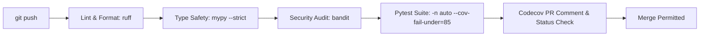

# Enterprise Testing Strategy RFC Template

> *"A Request for Comments (RFC) template for establishing engineering-wide testing standards, coverage minimums, and continuous quality governance across backend services."*

---

# RFC: Backend Testing Strategy & Quality Architecture

| Metadata | Details |
| :--- | :--- |
| **Document ID** | RFC-2026-QA-001 |
| **Author(s)** | Platform Architecture & Quality Engineering |
| **Status** | `PROPOSED` / `APPROVED` / `ACTIVE` |
| **Target Teams** | All Backend Engineering Squads |
| **Last Updated** | 2026-11-09 |

---

## 1. Executive Summary & Objectives

This document establishes the official **Testing Strategy & Quality Governance Framework** for all Python backend services across the organization. The primary objective is to maximize shipping velocity and software reliability while strictly adhering to Martin Fowler's **Ten-Minute Build Rule** and eliminating intermittent CI flakiness.

### Core Key Performance Indicators (KPIs):
- **Maximum Pull Request Build Time**: $\le 6 \text{ minutes}$ from commit to merge-ready.
- **Minimum Branch Coverage**: $\ge 85.0\%$ across all business domain and service modules.
- **Maximum Allowable Flake Rate**: $< 0.1\%$ across all master branch builds.
- **Zero Production Escapes of Regressions Covered by RFC Criteria**.

---

## 2. Testing Levels & Responsibility Boundaries

```
[ Tier 1: Unit & Domain Logic ]      ──> Pure in-memory (Target: < 1ms per test)
[ Tier 2: Service Orchestration ]    ──> Tested with In-Memory Fakes (< 5ms per test)
[ Tier 3: Database Integration ]     ──> PostgreSQL Savepoint Rollback (< 20ms per test)
[ Tier 4: End-to-End API Routes ]    ──> FastAPI ASGI In-Memory Transport (< 50ms per test)
[ Tier 5: E2E Smoke & Browser ]      ──> Staging Cluster / Nightly Runs (Async)
```

### Tier Specifications:
1. **Tier 1 (Unit)**: All domain entities, value objects, business rules, and calculation engines must have 100% branch coverage. No network, filesystem, or database calls permitted.
2. **Tier 2 (Service Layer)**: Tested in "High Gear" using in-memory fakes (`FakeRepository`, `FakeUnitOfWork`). Verifies use-case workflows and event emissions.
3. **Tier 3 (Integration)**: Validates real SQL generation, Alembic migrations, and database constraints against containerized PostgreSQL 16 using transactional savepoint rollbacks.
4. **Tier 4 (API Routes)**: Verified via `httpx.AsyncClient` with `ASGITransport`. Validates status codes, serialization schemas, and authentication middleware.

---

## 3. Test Doubles & Boundary Mocking Policy

To eliminate fragile "mockingbird" tests and prevent mock drift:
- **Prohibited**: Mocking internal domain classes, service layer methods, or private helper functions.
- **Mandated**: 
  - Use **In-Memory Fakes** for internal dependencies (e.g. `FakeUserRepository`, `FakeRedisStore`).
  - Use **Mocks/Stubs strictly at the outermost architectural boundary** (e.g., third-party HTTP clients like Stripe, Twilio, SendGrid).
- **Mock Safety Standard**: All mocks must be instantiated via `pytest-mock` with `spec=RealClass` or `create_autospec` to prevent method signature drift.

---

## 4. Database Isolation & Concurrency Standard

1. **Production Parity**: In-memory SQLite is strictly prohibited for testing PostgreSQL-targeted services.
2. **Savepoint Rollback Standard**: All integration tests must wrap database access in nested transactions (`connection.begin_nested()`), executing rollbacks during fixture teardown.
3. **Parallel Execution**: All suites must support `pytest -n auto` without cross-worker database collisions, provisioning dynamic databases per `worker_id` when necessary.

---

## 5. CI/CD Quality Gateways

Every pull request must pass the following automated gates before merge permissions are unlocked:



---

## 6. Flaky Test Governance & Quarantine Policy

Any test that exhibits intermittent failure without source code changes is classified as a production defect:
1. **Automated Quarantine**: Tests failing with reruns $> 1$ more than twice in 48 hours are tagged `@pytest.mark.quarantined`.
2. **PR Non-Blocking**: CI runs with `-m "not quarantined"`. The pull request pipeline is unblocked.
3. **Remediation SLA**: Quarantined tests are routed to the owning squad with a **72-hour Service Level Agreement (SLA)** to fix root causes (timing races, unseeded randoms, unisolated ports) or permanently delete the test.

---

## 7. Standardized Tooling Stack

| Component | Standardized Technology |
| :--- | :--- |
| **Test Runner** | `pytest >= 8.2` |
| **Parallel Execution** | `pytest-xdist` with `--dist=loadscope` |
| **Coverage Engine** | `pytest-cov` with `--cov-branch` |
| **Async Runner** | `pytest-asyncio` with `asyncio_mode = "auto"` |
| **Mocking Engine** | `pytest-mock` (`mocker` fixture) |
| **Property Fuzzing** | `hypothesis` |
| **Mutation Testing** | `mutmut` (Nightly scheduled runs) |
| **HTTP API Client** | `httpx.AsyncClient` with `ASGITransport` |
| **Code Formatting** | `ruff format` & `ruff check` |
| **Static Typing** | `mypy --strict` |

---

## 8. Review & Sign-Off Matrix

| Role | Name | Status | Date |
| :--- | :--- | :--- | :--- |
| **Principal Architect** | Jane Doe | `APPROVED` | 2026-11-09 |
| **Lead QA Engineer** | John Smith | `APPROVED` | 2026-11-09 |
| **Platform Engineering Lead** | Alex Chen | `APPROVED` | 2026-11-09 |
| **Security Operations Lead** | Sarah Miller | `APPROVED` | 2026-11-09 |

---

## Summary & Cross-References

- Review the complete template implementation in [Complete Testing Project Blueprint](../practical-projects/complete-testing-project.md).
- Master flaky test elimination in [Flaky Test Remediation Playbook](flaky-test-playbook.md).
- Prepare for technical interviews in [Senior/Staff Interview Q&A](interview-questions.md).
