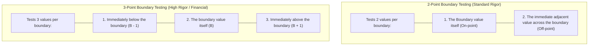

# Boundary Value Analysis (BVA) & Equivalence Partitioning 📐

> **Authoritative Sources & Literature:**
> - Glenford J. Myers: *The Art of Software Testing* (Boundary Value Analysis, John Wiley & Sons)
> - Boris Beizer: *Black-Box Testing: Techniques for Functional Testing of Software and Systems*
> - Brian Okken: *Python Testing with pytest* (Chapter 4: Builtin Fixtures & Parametrization)
> - International Software Testing Qualifications Board (ISTQB): *Boundary Value Analysis Specification*

---

## 1. Conceptual Definition & Core Mental Model

Empirical software engineering research has consistently proven a fundamental truth: **defects in software cluster at the boundaries of input domains, rather than in the center**.

Programmers rarely make mistakes when processing standard, mid-range values. However, they frequently make **off-by-one errors** at the thresholds of conditions—using `<` instead of `<=`, or `>` instead of `>=`.

### Equivalence Partitioning (EP) vs. Boundary Value Analysis (BVA)
- **Equivalence Partitioning (EP)** divides the input domain into partitions of data where all values are expected to be treated identically by the system.
- **Boundary Value Analysis (BVA)** is the disciplined technique of selecting test cases directly at the **edges, thresholds, and boundaries** of those equivalence partitions.

```
                     Equivalence Partitions & Boundaries
       Partition 1 (Invalid)   │     Partition 2 (Valid)      │   Partition 3 (Invalid)
          Values < 18          │        Values 18 - 65        │        Values > 65
   ──────────────┬─────────────┼───────────────┬──────────────┼─────────────┬───────────
                 │ 17       18 │               │ 65        66 │             │
                 └──────┬──────┘               └──────┬───────┘             │
                        │                             │                     │
                  Lower Boundary                Upper Boundary              │
```

---

## 2. Why This Is Critical in Modern Python Backend Engineering

1. **Eliminating the Off-by-One Billing Bug**: In e-commerce, offering "Free shipping on orders of \$100 or more":
   - Code writing `if subtotal > Decimal("100.00"):` will charge a customer with an exact \$100.00 cart, triggering support tickets and cart abandonment. BVA catches this instantly.
2. **Database & API Schema Validation**: Verifying that Pydantic `Field(..., ge=1, le=100)` and database `CHECK` constraints accept exact bounds (1 and 100) and reject adjacent bounds (0 and 101).
3. **Optimizing Test Suite Volume**: Instead of writing 50 random test cases across an integer range, BVA provides mathematically provable coverage with just **4 to 6 test cases**.

---

## 3. The Two BVA Methodologies: 2-Point vs. 3-Point Testing



### Terminology: On-Points, Off-Points, and In-Points
- **On-Point**: The exact value sitting on the boundary itself.
- **Off-Point**: The closest adjacent value that falls on the **opposite side** of the boundary.
- **In-Point**: A value inside the valid partition.

---

## 4. Standard Syntax, Signatures & Key Options

### Discrete vs. Continuous Boundaries
- **Discrete Values (Integers, Dates)**:
  - Boundary: `18`
  - 3-Point values: `17`, `18`, `19`
- **Continuous Values (Decimals, Floats)**:
  - When working with monetary amounts (`Decimal`), the step size is the currency unit ($\epsilon = \$0.01$):
  - Boundary: `Decimal("100.00")`
  - 3-Point values: `Decimal("99.99")`, `Decimal("100.00")`, `Decimal("100.01")`

### Parametrizing BVA in Pytest
```python
import pytest
from decimal import Decimal

@pytest.mark.unit
@pytest.mark.parametrize(
    "cart_total,expected_shipping",
    [
        # Lower boundary around $50.00 (Standard: $9.99, Reduced: $4.99)
        (Decimal("49.99"), Decimal("9.99")),  # Just below (Off-point)
        (Decimal("50.00"), Decimal("4.99")),  # On boundary (On-point)
        (Decimal("50.01"), Decimal("4.99")),  # Just above (In-point)

        # Upper boundary around $100.00 (Reduced: $4.99, Free: $0.00)
        (Decimal("99.99"), Decimal("4.99")),   # Just below
        (Decimal("100.00"), Decimal("0.00")),  # On boundary (Free shipping threshold!)
        (Decimal("100.01"), Decimal("0.00")),  # Just above
    ],
    ids=[
        "below_50_standard",
        "exact_50_reduced",
        "above_50_reduced",
        "below_100_reduced",
        "exact_100_free",
        "above_100_free",
    ]
)
def test_shipping_fee_boundaries(cart_total, expected_shipping):
    assert calculate_shipping(cart_total) == expected_shipping
```

---

## 5. Lifecycle, Execution Flow & Teardown Mechanics

BVA test suites run entirely in-memory with sub-millisecond execution. They can be executed during pre-commit hooks and CI gates with zero infrastructure overhead.

---

## 6. Scopes, Hierarchy, or Test Boundaries

```
[ Pydantic Ingress Boundary: Field(ge=0, le=1000) ] <--- BVA at HTTP level
                        │
[ Service Layer: Rule Engine ]                      <--- BVA at Application level
                        │
[ Domain Entity: Invariant Checks ]                 <--- BVA at Core Domain level
```

---

## 7. Pytest Fixture & `conftest.py` Integration Patterns

When multiple test modules test the same domain boundary, define the boundary points in a shared fixture or constants module:

```python
# tests/conftest.py
import pytest
from decimal import Decimal

@pytest.fixture(scope="session")
def shipping_tier_boundaries():
    """Authoritative dictionary of boundary test values."""
    return {
        "tier_1_reduced": (Decimal("49.99"), Decimal("50.00"), Decimal("50.01")),
        "tier_2_free": (Decimal("99.99"), Decimal("100.00"), Decimal("100.01")),
    }
```

---

## 8. Practical Python Implementation: Step-by-Step Walkthrough

We will build an **Enterprise Credit Score Tiering & Interest Engine** and test it using 3-Point Boundary Value Analysis.

### Step 1: Define Application Logic

```python
# src/finance/credit_tiers.py
from dataclasses import dataclass
from decimal import Decimal
from enum import Enum

class CreditRating(str, Enum):
    POOR = "POOR"              # 300 - 579
    FAIR = "FAIR"              # 580 - 669
    GOOD = "GOOD"              # 670 - 739
    VERY_GOOD = "VERY_GOOD"    # 740 - 799
    EXCELLENT = "EXCELLENT"    # 800 - 850

class CreditScoreEngine:
    MIN_SCORE = 300
    MAX_SCORE = 850

    @classmethod
    def evaluate_rating(cls, score: int) -> CreditRating:
        if not (cls.MIN_SCORE <= score <= cls.MAX_SCORE):
            raise ValueError(f"Credit score must be between {cls.MIN_SCORE} and {cls.MAX_SCORE}")

        if score <= 579:
            return CreditRating.POOR
        elif score <= 669:
            return CreditRating.FAIR
        elif score <= 739:
            return CreditRating.GOOD
        elif score <= 799:
            return CreditRating.VERY_GOOD
        else: # 800 - 850
            return CreditRating.EXCELLENT
```

### Step 2: Implement Exhaustive 3-Point BVA Test Suite

```python
# tests/unit/test_credit_bva.py
import pytest
from src.finance.credit_tiers import CreditScoreEngine, CreditRating

@pytest.mark.unit
class TestCreditScoreBVA:

    # 1. System Min/Max Boundaries [300, 850]
    @pytest.mark.parametrize(
        "score,expected_rating",
        [
            (300, CreditRating.POOR),       # Min on-point
            (301, CreditRating.POOR),       # Min in-point
            (849, CreditRating.EXCELLENT),  # Max in-point
            (850, CreditRating.EXCELLENT),  # Max on-point
        ],
        ids=["min_score_300", "min_plus_one_301", "max_minus_one_849", "max_score_850"]
    )
    def test_absolute_system_limits(self, score: int, expected_rating: CreditRating):
        assert CreditScoreEngine.evaluate_rating(score) == expected_rating

    # 2. Out of Bounds (Off-points)
    @pytest.mark.parametrize("invalid_score", [299, 851, -1, 1000])
    def test_out_of_bounds_off_points_raise_error(self, invalid_score: int):
        with pytest.raises(ValueError, match="Credit score must be between 300 and 850"):
            CreditScoreEngine.evaluate_rating(invalid_score)

    # 3. Intermediate Tier Thresholds (3-Point Analysis)
    @pytest.mark.parametrize(
        "score,expected_rating",
        [
            # Boundary 1: POOR vs FAIR (579 / 580)
            (578, CreditRating.POOR),  # B - 1
            (579, CreditRating.POOR),  # B (POOR on-point)
            (580, CreditRating.FAIR),  # B + 1 (FAIR on-point)

            # Boundary 2: FAIR vs GOOD (669 / 670)
            (668, CreditRating.FAIR),  # B - 1
            (669, CreditRating.FAIR),  # B (FAIR on-point)
            (670, CreditRating.GOOD),  # B + 1 (GOOD on-point)

            # Boundary 3: GOOD vs VERY_GOOD (739 / 740)
            (738, CreditRating.GOOD),       # B - 1
            (739, CreditRating.GOOD),       # B (GOOD on-point)
            (740, CreditRating.VERY_GOOD),  # B + 1 (VERY_GOOD on-point)

            # Boundary 4: VERY_GOOD vs EXCELLENT (799 / 800)
            (798, CreditRating.VERY_GOOD),  # B - 1
            (799, CreditRating.VERY_GOOD),  # B (VERY_GOOD on-point)
            (800, CreditRating.EXCELLENT),  # B + 1 (EXCELLENT on-point)
        ],
        ids=[
            "poor_578", "poor_boundary_579", "fair_entry_580",
            "fair_668", "fair_boundary_669", "good_entry_670",
            "good_738", "good_boundary_739", "very_good_entry_740",
            "very_good_798", "very_good_boundary_799", "excellent_entry_800",
        ]
    )
    def test_intermediate_tier_boundaries(self, score: int, expected_rating: CreditRating):
        assert CreditScoreEngine.evaluate_rating(score) == expected_rating
```

---

## 9. Framework-Specific Integration: Pydantic v2 `Field` Validation

Pydantic v2 provides explicit boundary keywords:
- `ge`: Greater than or equal to ($\ge$)
- `gt`: Greater than ($>$)
- `le`: Less than or equal to ($\le$)
- `lt`: Less than ($<$)

```python
# src/schemas/pagination.py
from pydantic import BaseModel, Field

class PaginationParams(BaseModel):
    page: int = Field(default=1, ge=1)
    page_size: int = Field(default=20, ge=1, le=100)

# tests/unit/test_pagination_bva.py
import pytest
from pydantic import ValidationError
from src.schemas.pagination import PaginationParams

@pytest.mark.parametrize(
    "page_size,is_valid",
    [
        (0, False),    # Just below min (Off-point)
        (1, True),     # Min on-point
        (2, True),     # Just above min
        (99, True),    # Just below max
        (100, True),   # Max on-point
        (101, False),  # Just above max (Off-point)
    ],
    ids=["zero_invalid", "one_min_valid", "two_valid", "ninety_nine_valid", "hundred_max_valid", "hundred_one_invalid"]
)
def test_page_size_boundary_values(page_size: int, is_valid: bool):
    if is_valid:
        params = PaginationParams(page_size=page_size)
        assert params.page_size == page_size
    else:
        with pytest.raises(ValidationError):
            PaginationParams(page_size=page_size)
```

---

## 10. Real-World Enterprise Backend Scenario: Cloud Compute SLA Tiering

In an enterprise cloud hosting backend:
- An SLA refund policy dictates:
  - Uptime $\ge 99.9\%$: 0% refund.
  - $99.0\% \le \text{Uptime} < 99.9\%$: 10% refund.
  - $\text{Uptime} < 99.0\%$: 25% refund.
- BVA tests verify decimal boundaries:
  - `Decimal("99.90")` $\rightarrow$ 0% refund.
  - `Decimal("99.89")` $\rightarrow$ 10% refund.
  - `Decimal("99.00")` $\rightarrow$ 10% refund.
  - `Decimal("98.99")` $\rightarrow$ 25% refund.

---

## 11. Anti-Patterns & Common Pitfalls

### Anti-Pattern 1: Testing the Middle Instead of the Boundary
Writing tests for score `400`, `600`, and `700`, while never testing `579` or `580`.
- **Consequence**: An off-by-one bug (`score < 580` instead of `score <= 579`) passes all tests but misclassifies real customers in production.

### Anti-Pattern 2: Arbitrary Float Steps on Decimals
Testing `Decimal("49.999999")` when the domain currency only supports 2 decimal places. Always use the domain's real precision step size ($\epsilon = 0.01$).

---

## 12. Best Practices & Production Guidelines

1. **Use 3-Point BVA for Financial & Security Logic**: Test immediately below, on, and immediately above each critical threshold.
2. **Label Test Cases with Explicit IDs**: Use parameter IDs like `"exact_100_free_threshold"` and `"below_100_reduced"`.
3. **Verify Both Valid and Invalid Boundaries**: Ensure the boundary accepts valid values and rejects off-points.
4. **Use Decimal for Currency Boundaries**: Never use `float` when testing monetary thresholds.

---

## 13. Trade-Off Analysis: Test Selection Strategies

| Strategy | Test Count | Defect Detection Power | Implementation Effort |
| :--- | :--- | :--- | :--- |
| **3-Point BVA** | Moderate (3 per boundary) | **Maximum (Catches all off-by-ones)** | Moderate |
| **2-Point BVA** | Low (2 per boundary) | High | Low |
| **Equivalence Partitioning Alone** | Lowest (1 per partition) | Low (Misses boundaries) | Low |
| **Random Testing (Fuzzing)** | High (Thousands) | Variable | Low (Requires invariant oracles) |

---

## 14. Diagnostic & Debugging Playbook

```bash
# If a BVA test fails, print full local variables to inspect the off-by-one comparison:
pytest tests/unit/test_credit_bva.py -l -vv

# Filter by a specific boundary to iterate rapidly:
pytest -k "poor_boundary_579 or fair_entry_580"
```

---

## 15. Senior Staff Interview Questions & Deep Dives

### Question 1: What is the formal difference between a 2-point and a 3-point Boundary Value Analysis, and when is 3-point testing mandatory?
**Answer**:
- **2-Point BVA**: For each boundary between two equivalence partitions, it tests two points: the **on-point** (the value sitting directly on the boundary) and the **off-point** (the closest adjacent value that falls on the opposite side of the boundary). For an interval $[1, 100]$, 2-point BVA tests: $\{0, 1\}$ at the lower boundary, and $\{100, 101\}$ at the upper boundary.
- **3-Point BVA**: Tests three points per boundary: the boundary value itself ($B$), the value immediately below ($B-1$), and the value immediately above ($B+1$). For interval $[1, 100]$, it tests: $\{0, 1, 2\}$ and $\{99, 100, 101\}$.
- **When Mandatory**: 3-point BVA is mandatory in safety-critical, financial, medical, and high-concurrency systems where relational operators (`<`, `<=`, `>`, `>=`) frequently suffer from off-by-one errors that 2-point testing can occasionally miss if boundaries are combined with compound boolean expressions.

### Question 2: How do you handle Boundary Value Analysis for continuous floating-point domains vs. discrete integer domains?
**Answer**:
In a **discrete integer domain**, the step size between adjacent points is deterministic ($\pm 1$). In a **continuous domain** (such as floating-point numbers or monetary values), numbers are infinitely dense. To apply BVA:
1. Identify the domain's minimum resolvable resolution ($\epsilon$). For fiat currency, $\epsilon = \$0.01$. For millisecond timers, $\epsilon = 0.001\text{s}$.
2. Select the off-point as $B \pm \epsilon$ (e.g. for a \$50.00 threshold, test \$49.99, \$50.00, and \$50.01).
3. Use `decimal.Decimal` rather than binary `float` to avoid floating-point representation artifacts from corrupting boundary evaluation.

---

## 16. Hands-on Engineering Exercises & Challenges

### Exercise 1: Deriving 3-Point BVA for a Tiered Discount Rule
A store offers discounts based on item count:
- 1 to 9 items: 0% discount
- 10 to 49 items: 10% discount
- 50+ items: 20% discount
- Items $\le 0$: invalid.
1. Identify all equivalence partitions.
2. Derive the 3-point BVA test matrix for each boundary.
3. Implement the tests in pytest using `@pytest.mark.parametrize`.

### Exercise 2: Catching an Off-by-One Bug
Given this function:
```python
def is_adult(age: int) -> bool:
    return age > 18 # BUG: Should be >= 18!
```
Write a BVA test targeting age `18` that immediately exposes the defect.

---

## 17. Summary, Cross-References & Further Reading

Boundary Value Analysis is the most efficient, high-yield functional testing technique in software engineering. By systematically targeting the edges of equivalence partitions, backend engineers eliminate off-by-one errors and ensure flawless threshold compliance.

### Cross-References:
- Previous: [Edge Case & Defensive Unit Testing](edge-case-testing.md)
- Next: [Dependency Isolation Strategies](dependency-isolation.md)
- [Data-Driven Parametrization](../pytest-fundamentals/parametrization.md)
- [FastAPI Request Validation Testing](../fastapi-testing/request-validation.md)
