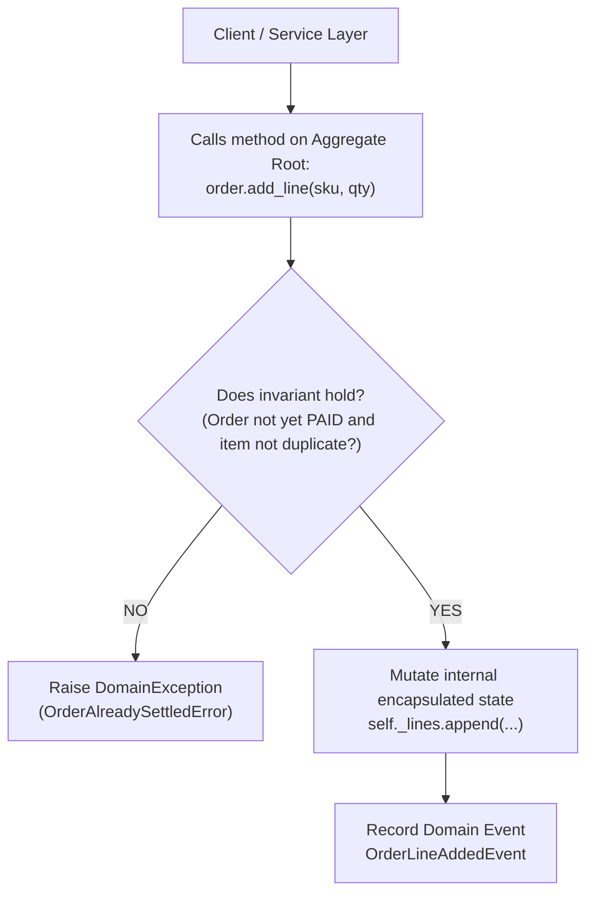
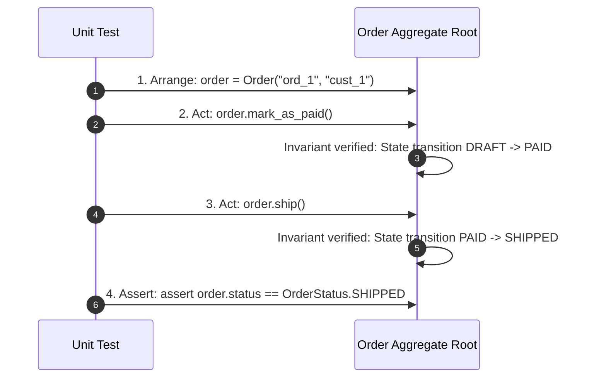

# Business Logic & Domain Invariant Unit Testing 🏰

> **Authoritative Sources & Literature:**
> - Eric Evans: *Domain-Driven Design: Tackling Complexity in the Heart of Software* (Addison-Wesley)
> - Harry Percival & Bob Gregory: *Architecture Patterns with Python* (Chapter 1: Domain Modeling, O'Reilly)
> - Martin Fowler: *Anemic Domain Model vs. Rich Domain Model* (martinfowler.com)
> - Vaughn Vernon: *Implementing Domain-Driven Design* (The Aggregate Pattern)

---

## 1. Conceptual Definition & Core Mental Model

In software architecture, **Business Invariants** are rules, constraints, and business logic that must remain 100% valid at all times within a bounded context, regardless of which database, API framework, or user interface is executing.

### Rich Domain Model vs. Anemic Domain Model
- **Anemic Domain Model (Anti-Pattern)**: Entities are passive "data bags" (e.g. plain dataclasses with public fields). All business rules, checks, and state mutations are scattered across procedural service scripts. Anyone can execute `order.status = "SHIPPED"` even if the order was never paid!
- **Rich Domain Model (Clean Architecture Standard)**: Entities and **Aggregates** encapsulate their internal state. State cannot be modified directly; all mutations happen through domain methods that rigorously enforce invariants.

```
       Anemic Model (Fragile)                  Rich Domain Aggregate (Hermetic)
    ┌───────────────────────────┐           ┌──────────────────────────────────────────┐
    │  Order (Data Bag)         │           │  Order Aggregate Root                    │
    │  - status: "SHIPPED"      │           │  - _status: OrderStatus (Private)        │
    │  - is_paid: False  💥     │           │  - _items: list[OrderItem] (Private)     │
    │  (Invalid state allowed!) │           │                                          │
    └───────────────────────────┘           │  + mark_as_paid()                        │
                                            │  + ship() ──> Enforces: must be PAID!    │
                                            └──────────────────────────────────────────┘
```

---

## 2. Why This Is Critical in Modern Python Backend Engineering

1. **Preventing Silent Data Corruption**: If state transitions are not validated by the domain entity, invalid data leaks into PostgreSQL (e.g. negative bank balances, shipments dispatched without payment, duplicate seat allocations).
2. **Zero-Dependency Testing**: Rich domain entities have **zero dependencies**—no SQLAlchemy, no Pydantic, no Redis, no network. Their unit tests execute in microseconds ($< 0.1\text{ms}$) without mocks.
3. **Living Business Specifications**: The domain unit test suite serves as the executable specification of your company's core business policies.

---

## 3. The Aggregate Root Invariant Boundary



---

## 4. Standard Syntax, Signatures & Key Options

### Implementing Value Objects & Aggregates in Modern Python 3.10+

```python
from dataclasses import dataclass, field
from decimal import Decimal
from enum import Enum
from typing import List

class OrderStatus(str, Enum):
    DRAFT = "DRAFT"
    PAID = "PAID"
    SHIPPED = "SHIPPED"
    CANCELLED = "CANCELLED"

# 1. VALUE OBJECT: Immutable, equality by value, no identity
@dataclass(frozen=True)
class Money:
    amount: Decimal
    currency: str

    def __post_init__(self):
        if self.amount < Decimal("0.00"):
            raise ValueError("Money amount cannot be negative")

    def __add__(self, other: "Money") -> "Money":
        if self.currency != other.currency:
            raise ValueError(f"Cannot add {self.currency} to {other.currency}")
        return Money(self.amount + other.amount, self.currency)

# 2. DOMAIN ENTITY / AGGREGATE ROOT: Identity, encapsulated state
class Order:
    def __init__(self, order_id: str, customer_id: str):
        self.id = order_id
        self.customer_id = customer_id
        self._status = OrderStatus.DRAFT
        self._items: List[dict] = []

    @property
    def status(self) -> OrderStatus:
        return self._status

    def mark_as_paid(self) -> None:
        if self._status != OrderStatus.DRAFT:
            raise InvalidStateTransitionError(f"Cannot pay for order in {self._status} state")
        self._status = OrderStatus.PAID

    def ship(self) -> None:
        if self._status != OrderStatus.PAID:
            raise InvariantViolationError("Cannot ship an order that has not been paid!")
        self._status = OrderStatus.SHIPPED
```

---

## 5. Lifecycle, Execution Flow & Teardown Mechanics

Domain entity tests follow the pure **Arrange-Act-Assert** state machine lifecycle:



---

## 6. Scopes, Hierarchy, or Test Boundaries

```
[ Domain Core ] <─── ZERO DEPENDENCIES (Pure Python)
  ├── Value Objects (Money, Currency, Address) -> Tested for immutability & equality
  └── Aggregate Roots (Order, Account, User)   -> Tested for invariant enforcement
```

Domain models must **never import from web frameworks (FastAPI/Flask) or ORMs (SQLAlchemy/Django)**.

---

## 7. Pytest Fixture & `conftest.py` Integration Patterns

Create fixtures that yield aggregates in specific lifecycle states:

```python
# tests/unit/conftest.py
import pytest
from decimal import Decimal
from src.domain.models import Order, OrderItem, Money

@pytest.fixture
def draft_order() -> Order:
    order = Order(order_id="ord_test_1", customer_id="cust_100")
    order.add_item(OrderItem(sku="BOOK", price=Money(Decimal("20.00"), "USD"), qty=1))
    return order

@pytest.fixture
def paid_order(draft_order: Order) -> Order:
    draft_order.mark_as_paid()
    return draft_order
```

---

## 8. Practical Python Implementation: Step-by-Step Walkthrough

We will build an enterprise **Order & Discount Aggregate Root** and verify its state machine transitions and business invariants.

### Step 1: Define Application Domain

```python
# src/domain/ecommerce.py
from dataclasses import dataclass
from decimal import Decimal
from enum import Enum
from typing import List

class OrderStatus(str, Enum):
    NEW = "NEW"
    PAID = "PAID"
    SHIPPED = "SHIPPED"
    CANCELLED = "CANCELLED"

class DomainError(Exception):
    pass

class OrderStateError(DomainError):
    pass

class InvariantError(DomainError):
    pass

@dataclass(frozen=True)
class OrderLine:
    sku: str
    price: Decimal
    qty: int

    def __post_init__(self):
        if self.qty <= 0:
            raise InvariantError("OrderLine quantity must be at least 1")
        if self.price <= Decimal("0.00"):
            raise InvariantError("OrderLine price must be positive")

class OrderAggregate:
    def __init__(self, order_id: str, customer_id: str):
        self.order_id = order_id
        self.customer_id = customer_id
        self._status = OrderStatus.NEW
        self._lines: List[OrderLine] = []

    @property
    def status(self) -> OrderStatus:
        return self._status

    @property
    def total_amount(self) -> Decimal:
        return sum((line.price * line.qty for line in self._lines), Decimal("0.00"))

    def add_line(self, line: OrderLine) -> None:
        if self._status != OrderStatus.NEW:
            raise OrderStateError("Cannot add items to an order that is no longer NEW")
        
        # Invariant: Disallow duplicate SKUs (aggregate must coalesce)
        if any(existing.sku == line.sku for existing in self._lines):
            raise InvariantError(f"SKU {line.sku} is already present in this order")

        self._lines.append(line)

    def mark_as_paid(self) -> None:
        if self._status != OrderStatus.NEW:
            raise OrderStateError(f"Cannot pay for order in state {self._status}")
        if not self._lines:
            raise InvariantError("Cannot pay for an empty order")

        self._status = OrderStatus.PAID

    def ship(self) -> None:
        if self._status != OrderStatus.PAID:
            raise OrderStateError("Cannot ship an order that has not been PAID")
        self._status = OrderStatus.SHIPPED

    def cancel(self, reason: str) -> None:
        if self._status == OrderStatus.SHIPPED:
            raise OrderStateError("Cannot cancel an order that has already SHIPPED")
        self._status = OrderStatus.CANCELLED
```

### Step 2: Implement Exhaustive Invariant & State Transition Tests

```python
# tests/unit/test_order_aggregate.py
import pytest
from decimal import Decimal
from src.domain.ecommerce import (
    OrderAggregate, OrderLine, OrderStatus, OrderStateError, InvariantError
)

class TestOrderLifecycle:
    """Verifies valid state machine transitions and calculations."""

    def test_new_order_can_add_lines_and_compute_total(self):
        order = OrderAggregate("ord_1", "cust_1")
        order.add_line(OrderLine(sku="DESK", price=Decimal("150.00"), qty=2))
        order.add_line(OrderLine(sku="CHAIR", price=Decimal("75.00"), qty=1))

        assert order.total_amount == Decimal("375.00")
        assert order.status == OrderStatus.NEW

    def test_complete_valid_lifecycle(self):
        order = OrderAggregate("ord_1", "cust_1")
        order.add_line(OrderLine(sku="DESK", price=Decimal("150.00"), qty=1))
        
        # NEW -> PAID
        order.mark_as_paid()
        assert order.status == OrderStatus.PAID

        # PAID -> SHIPPED
        order.ship()
        assert order.status == OrderStatus.SHIPPED


class TestOrderInvariants:
    """Verifies that invalid operations raise domain exceptions."""

    def test_empty_order_cannot_be_paid(self):
        order = OrderAggregate("ord_1", "cust_1")
        with pytest.raises(InvariantError, match="Cannot pay for an empty order"):
            order.mark_as_paid()

    def test_cannot_add_items_after_paid(self):
        order = OrderAggregate("ord_1", "cust_1")
        order.add_line(OrderLine(sku="DESK", price=Decimal("150.00"), qty=1))
        order.mark_as_paid()

        with pytest.raises(OrderStateError, match="Cannot add items to an order that is no longer NEW"):
            order.add_line(OrderLine(sku="CHAIR", price=Decimal("50.00"), qty=1))

    def test_cannot_ship_unpaid_order(self):
        order = OrderAggregate("ord_1", "cust_1")
        order.add_line(OrderLine(sku="DESK", price=Decimal("150.00"), qty=1))

        with pytest.raises(OrderStateError, match="Cannot ship an order that has not been PAID"):
            order.ship()

    def test_cannot_cancel_shipped_order(self):
        order = OrderAggregate("ord_1", "cust_1")
        order.add_line(OrderLine(sku="DESK", price=Decimal("150.00"), qty=1))
        order.mark_as_paid()
        order.ship()

        with pytest.raises(OrderStateError, match="Cannot cancel an order that has already SHIPPED"):
            order.cancel(reason="Customer changed mind")

    def test_disallow_duplicate_skus(self):
        order = OrderAggregate("ord_1", "cust_1")
        order.add_line(OrderLine(sku="DESK", price=Decimal("150.00"), qty=1))

        with pytest.raises(InvariantError, match="SKU DESK is already present"):
            order.add_line(OrderLine(sku="DESK", price=Decimal("150.00"), qty=2))
```

---

## 9. Framework-Specific Integration: Decoupling from SQLAlchemy ORM

In modern Clean Architecture (Percival & Gregory), domain models are decoupled from SQLAlchemy using **Classical Mapping** (`imperative_mapping`):

```python
# src/adapters/orm.py
from sqlalchemy import Table, Column, String, Numeric, MetaData
from sqlalchemy.orm import registry
from src.domain.ecommerce import OrderAggregate

metadata = MetaData()
mapper_registry = registry()

orders_table = Table(
    "orders",
    metadata,
    Column("order_id", String, primary_key=True),
    Column("customer_id", String, nullable=False),
    Column("_status", String, nullable=False),
)

def start_mappers():
    mapper_registry.map_imperatively(OrderAggregate, orders_table)
```
Because `OrderAggregate` is a 100% pure Python class, unit testing its business invariants requires **zero SQLAlchemy code**, zero database connections, and runs in sub-milliseconds.

---

## 10. Real-World Enterprise Backend Scenario: B2B SaaS Seat Allocation

In an enterprise subscription service:
- A `Subscription` aggregate root protects customer license capacity:
  - Enterprise plan: Max 100 seats.
  - Calling `subscription.assign_seat(user_id)` checks `len(self._assigned_seats) < self.max_seats`.
  - Calling `subscription.downgrade(new_limit)` verifies that current active users do not exceed `new_limit`.
- Testing these domain invariants verifies complex capacity allocation rules without touching Redis or PostgreSQL.

---

## 11. Anti-Patterns & Common Pitfalls

### Anti-Pattern 1: The Anemic Data Bag
```python
# ❌ ANEMIC: No encapsulation; public mutations bypass validation
@dataclass
class AnemicOrder:
    status: str = "NEW"
    is_paid: bool = False

# Caller can execute this anywhere in the codebase without checks:
order.status = "SHIPPED" # Shipped without ever being paid!
```

### Anti-Pattern 2: Domain Entities Querying Repositories
An entity method that calls `db.query()` directly:
```python
# ❌ TIGHTLY COUPLED: Entity imports infrastructure!
class BadOrder:
    def ship(self):
        db.execute("UPDATE orders SET status = 'SHIPPED'")
```
- **Rule**: Entities only manipulate their internal state. The Service Layer coordinates repositories.

---

## 12. Best Practices & Production Guidelines

1. **Keep Entities 100% Pure Python**: Disallow imports from web or database frameworks inside domain models.
2. **Make Value Objects Immutable**: Use `@dataclass(frozen=True)` for values defined by their attributes (e.g., `Money`, `Coordinates`, `EmailAddress`).
3. **Encapsulate State Mutation Behind Methods**: Use private attributes (`_status`) and expose read-only properties (`@property`).
4. **Test Every Invalid State Transition**: For a state machine with $N$ states, test all illegal transitions (e.g. `NEW -> SHIPPED`, `CANCELLED -> PAID`).

---

## 13. Trade-Off Analysis: Domain Modeling Styles

| Dimension | Rich Domain Model (DDD) | Anemic Model + Service Layer | Transaction Script |
| :--- | :--- | :--- | :--- |
| **Invariant Protection** | **Hermetic (Inside Entity)** | Leaky (Depends on caller) | Non-existent |
| **Unit Test Speed** | **Sub-millisecond (< 0.1ms)** | Moderate | Slow (Heavy DB calls) |
| **Refactoring Safety** | **Maximum** | Low | Low |
| **Initial Learning Curve** | High | Low | Very Low |

---

## 14. Diagnostic & Debugging Playbook

```python
# Print internal entity state during test failure
print("Order status:", order.status)
print("Order lines count:", len(order._lines))
print("Computed total:", order.total_amount)
```

---

## 15. Senior Staff Interview Questions & Deep Dives

### Question 1: What is an "Aggregate Root" in Domain-Driven Design, and how does it establish an invariant boundary for unit testing?
**Answer**:
An **Aggregate Root** is the primary entity within a cluster of related domain objects (entities and value objects) that treats the entire cluster as a single conceptual unit of data consistency. Outside collaborators are strictly forbidden from modifying internal members directly; they may only interact through the public API methods of the Aggregate Root.
**In Testing**: The Aggregate Root establishes the exact unit test boundary. By testing exclusively through the Aggregate Root's public methods, the test suite verifies that the aggregate's internal state machine and business invariants remain consistent throughout all state transitions, without needing to mock internal child entities.

### Question 2: Why does Martin Fowler consider the "Anemic Domain Model" an architectural anti-pattern?
**Answer**:
In an Anemic Domain Model, domain objects contain only getters, setters, and state, while all business logic resides in external procedural "Service" classes. This violates fundamental object-oriented design principles: data and the operations that mutate that data are separated.
**Consequences**:
1. Business logic is duplicated across multiple services that manipulate the same anemic entity.
2. The entity cannot enforce its own invariants, allowing invalid states to be created anywhere in the codebase.
3. Unit testing becomes fragmented because testing a business rule requires testing procedural service scripts rather than testing a self-contained, hermetic domain model.

---

## 16. Hands-on Engineering Exercises & Challenges

### Exercise 1: Refactoring an Anemic Model to an Aggregate Root
Given an anemic `Wallet(balance: Decimal, is_locked: bool)` with public attributes:
1. Encapsulate attributes behind private properties.
2. Implement `.deposit(amount)` and `.withdraw(amount)` methods that enforce:
   - Amounts must be positive.
   - Cannot withdraw from a locked wallet.
   - Cannot overdraft.
3. Write a pytest suite verifying all invariants.

### Exercise 2: State Machine Transition Matrix Testing
Given an `Invoice` with states `[DRAFT, ISSUED, PAID, VOID]`:
1. Use `@pytest.mark.parametrize` to assert that legal transitions succeed.
2. Use `@pytest.mark.parametrize` to assert that all illegal transitions (e.g. `PAID -> DRAFT`, `VOID -> ISSUED`) raise `InvalidStateTransitionError`.

---

## 17. Summary, Cross-References & Further Reading

Testing business logic within rich domain aggregates guarantees data consistency and enables lightning-fast unit tests. By encapsulating state mutation behind domain methods and testing state machine transitions with mathematical rigor, backend teams build impenetrable core business engines.

### Cross-References:
- Previous: [Service Layer Unit Testing](service-layer-testing.md)
- Next: [Edge Case & Defensive Testing](edge-case-testing.md)
- [Domain Model & Pure Entity Invariants](../architecture-and-testing/domain-model-testing.md)
- [Unit of Work Testing](../architecture-and-testing/unit-of-work.md)
