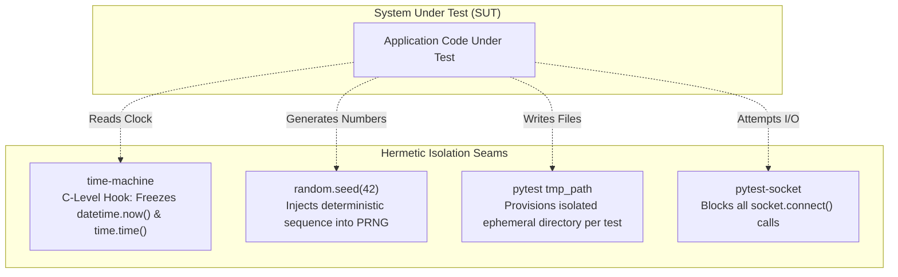
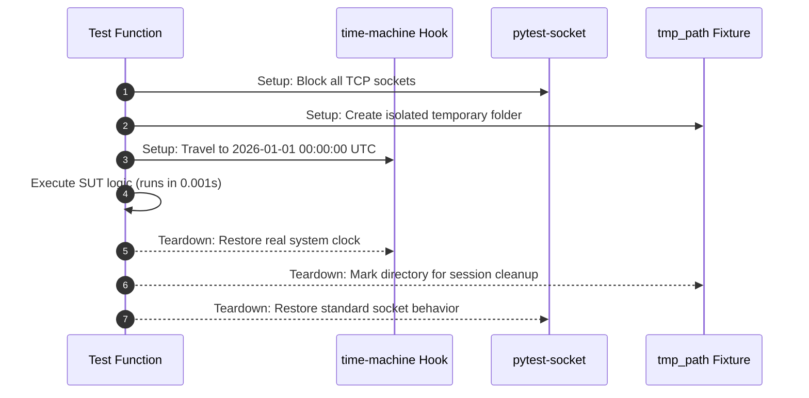

# Dependency Isolation: Time, Randomness, Filesystem & Sockets ⏳

> **Authoritative Sources & Literature:**
> - Michael Feathers: *Working Effectively with Legacy Code* (Chapter 3: Sensing and Separation - Seams, Prentice Hall)
> - Gerard Meszaros: *xUnit Test Patterns: Refactoring Test Code* (Test Isolation & Non-Deterministic Tests)
> - Adam Johnson: *time-machine: Travel through time in Python tests* (github.com/adamchainz/time-machine)
> - Brian Okken: *Python Testing with pytest* (Chapter 8: Built-in Fixtures - tmp_path)

---

## 1. Conceptual Definition & Core Mental Model

In unit testing, **Dependency Isolation** is the architectural practice of severing all volatile, non-deterministic environmental dependencies from the System Under Test (SUT).

A unit test must produce the exact same outcome whether run at midnight on New Year's Eve, inside a multi-threaded parallel CI runner, or in an airplane without internet access.

### The Four Enemies of Determinism
1. **The System Clock (`datetime.now()`)**: Causes intermittent failures due to timezone drift, daylight saving transitions, leap seconds, and token expirations.
2. **Stochastic Behavior (`random.random()`, UUIDs)**: Unseeded pseudo-random number generators cause non-reproducible test failures.
3. **The Local Filesystem (`./tmp`)**: Writing to hardcoded relative paths causes file collisions during parallel test runs (`pytest-xdist`).
4. **Network Sockets**: Accidental DNS resolutions and HTTP calls cause tests to hang, fail during network hiccups, or incur third-party API costs.

```
                  [ The 4 Hermetic Seams in Unit Testing ]
                                     │
         ┌──────────────┬────────────┼────────────┬──────────────┐
         ▼              ▼            ▼            ▼              ▼
     [ CLOCK ]     [ RANDOM ]    [ DISK ]     [ NETWORK ]    [ SUT ]
    time-machine   random.seed   tmp_path    pytest-socket   (Pure Logic)
    (Frozen UTC)   (Predictable) (Ephemeral) (Zero Sockets)
```

---

## 2. Why This Is Critical in Modern Python Backend Engineering

1. **Eliminating the Infamous Midnight Flake**: A test verifying that an authentication token expires in 15 minutes passes during the day, but fails at 11:59 PM if date formatting rolls over into the next month.
2. **Accelerating Slow Timeout Tests**: If an operation retries after a 5-minute timeout, naive tests use `time.sleep(300)` (wasting 5 minutes!). Time travel allows jumping forward 5 minutes in **0.001 seconds**.
3. **Preventing Accidental Cloud API Billing**: If a developer forgets to mock an AWS Boto3 client, a test loop could upload 5,000 files to a real AWS S3 bucket, creating unexpected cloud bills.

---

## 3. The Modern Isolation Toolkit



---

## 4. Standard Syntax, Signatures & Key Options

### 1. Freezing Time with `time-machine`
Modern Python 3.10+ projects prefer **`time-machine`** over legacy `freezegun`. `time-machine` is written as a C-extension; it is **10x faster**, thread-safe, and patches both Python and C-level time APIs (`time.time()`, `datetime.now()`, `time.monotonic()`):

```python
import time_machine
from datetime import datetime, timezone

# 1. As a context manager
def test_time_travel_context():
    with time_machine.travel("2026-06-01 12:00:00 UTC", tick=False):
        now = datetime.now(timezone.utc)
        assert now.year == 2026
        assert now.month == 6

# 2. As a decorator
@time_machine.travel("2026-01-01 00:00:00 UTC", tick=False)
def test_new_year():
    assert datetime.now(timezone.utc).year == 2026
```

### 2. Sandboxing Files with Pytest's `tmp_path` Fixture
Pytest's built-in `tmp_path` fixture provides a unique, isolated `pathlib.Path` instance for every test function, automatically deleted after the test session:

```python
from pathlib import Path

def test_file_persistence(tmp_path: Path):
    # tmp_path is a unique directory: /tmp/pytest-of-user/pytest-12/test_file_persistence0/
    data_file = tmp_path / "orders.json"
    data_file.write_text('{"order_id": "123"}')

    assert data_file.exists()
    assert "order_id" in data_file.read_text()
```

### 3. Enforcing Zero Sockets with `pytest-socket`
Prevent tests from making accidental network calls:

```bash
# Block all external network calls; allow unix sockets or localhost if needed
pytest -m unit --disable-socket --allow-unix-socket
```

If any unit test attempts a network call, pytest immediately raises `SocketBlockedError`.

---

## 5. Lifecycle, Execution Flow & Teardown Mechanics



---

## 6. Scopes, Hierarchy, or Test Boundaries

```
[ Unit Testing Boundary ]
  ├── Clock: Strictly Frozen (time-machine)
  ├── Network: Strictly Blocked (--disable-socket)
  └── Disk: Isolated Ephemeral Paths (tmp_path)
```

Integration tests are permitted to open network sockets to `localhost:5432` (PostgreSQL) or use real Docker containers, but **unit tests must enforce total isolation**.

---

## 7. Pytest Fixture & `conftest.py` Integration Patterns

```python
# tests/unit/conftest.py
import pytest
import time_machine

@pytest.fixture
def frozen_utc():
    """Fixture providing time-travel controls to tests."""
    with time_machine.travel("2026-06-15 10:00:00 UTC", tick=False) as traveller:
        yield traveller

# tests/conftest.py (Global autouse socket blocker for unit tests)
@pytest.fixture(autouse=True)
def enforce_unit_test_isolation(request):
    """Automatically blocks network sockets for all unit tests."""
    if "unit" in request.keywords:
        import pytest_socket
        pytest_socket.disable_socket()
        yield
        pytest_socket.enable_socket()
    else:
        yield
```

---

## 8. Practical Python Implementation: Step-by-Step Walkthrough

We will build an **Authentication Token & Expiration Service** and test it across time transitions without waiting a single real second.

### Step 1: Implement Token Service

```python
# src/auth/tokens.py
from datetime import datetime, timezone, timedelta
import secrets

class TokenExpiredError(Exception):
    pass

class TokenService:
    TTL = timedelta(minutes=15)

    @classmethod
    def generate_token(cls) -> dict:
        issued_at = datetime.now(timezone.utc)
        expires_at = issued_at + cls.TTL
        raw_token = secrets.token_hex(16)

        return {
            "token": raw_token,
            "issued_at": issued_at,
            "expires_at": expires_at,
        }

    @classmethod
    def validate_token(cls, token_record: dict) -> bool:
        now = datetime.now(timezone.utc)
        if now > token_record["expires_at"]:
            raise TokenExpiredError(
                f"Token expired at {token_record['expires_at'].isoformat()}, "
                f"current time is {now.isoformat()}"
            )
        return True
```

### Step 2: Implement Time-Travel Unit Tests

```python
# tests/unit/test_tokens.py
import pytest
from datetime import timedelta
from src.auth.tokens import TokenService, TokenExpiredError

def test_token_valid_within_ttl(frozen_utc):
    # Time is frozen at 2026-06-15 10:00:00 UTC
    token = TokenService.generate_token()

    # Fast-forward time by 10 minutes (now 10:10:00 UTC)
    frozen_utc.shift(timedelta(minutes=10))

    # Assert: Token is still valid (10 min < 15 min TTL)
    assert TokenService.validate_token(token) is True

def test_token_expired_after_ttl_raises_error(frozen_utc):
    # Time is frozen at 2026-06-15 10:00:00 UTC
    token = TokenService.generate_token()

    # Fast-forward time by 15 minutes and 1 second (now 10:15:01 UTC)
    frozen_utc.shift(timedelta(minutes=15, seconds=1))

    # Assert: Raises TokenExpiredError instantly!
    with pytest.raises(TokenExpiredError, match="Token expired at"):
        TokenService.validate_token(token)
```
*Performance*: Both tests execute in **0.002 seconds**, verifying a 15-minute time span instantly.

---

## 9. Framework-Specific Integration: FastAPI JWT Auth Expiration

When testing FastAPI JWT token dependencies, use `time-machine` to simulate token expiration without mocking JWT libraries:

```python
# tests/integration/test_jwt_auth.py
import pytest
from datetime import timedelta
from httpx import AsyncClient

@pytest.mark.asyncio
async def test_jwt_auth_header_expiration(async_client: AsyncClient, frozen_utc):
    # 1. Login to obtain valid JWT
    res = await async_client.post("/api/v1/login", json={"user": "alice", "password": "password123"})
    token = res.json()["access_token"]
    headers = {"Authorization": f"Bearer {token}"}

    # 2. Verify valid access
    r1 = await async_client.get("/api/v1/protected-resource", headers=headers)
    assert r1.status_code == 200

    # 3. Travel 60 minutes into the future
    frozen_utc.shift(timedelta(minutes=60))

    # 4. Verify endpoint returns HTTP 401 Unauthorized!
    r2 = await async_client.get("/api/v1/protected-resource", headers=headers)
    assert r2.status_code == 401
    assert r2.json()["detail"] == "Token has expired"
```

---

## 10. Real-World Enterprise Backend Scenario: Financial Midnight Interest Accrual

In an enterprise banking platform:
- Savings accounts accrue compound interest daily at **00:00:00 UTC**.
- A scheduled Celery worker evaluates balances across 2,000,000 accounts.
- Testing this job using `time-machine` sets the clock to `2026-12-31 23:59:59 UTC`, steps forward by 2 seconds to `2027-01-01 00:00:01 UTC`, triggers the accrual calculation, and asserts that year-end tax statements and interest were posted deterministically.

---

## 11. Anti-Patterns & Common Pitfalls

### Anti-Pattern 1: The `time.sleep()` Timeout Test
```python
# ❌ CATASTROPHIC: Wastes 10 real seconds of CI runner time!
def test_cache_expiration():
    cache.set("key", "val", ttl=10)
    time.sleep(10.1) # NEVER SLEEP IN UNIT TESTS!
    assert cache.get("key") is None

# ✅ GOOD: Jump forward 10 seconds instantly with time-machine!
def test_cache_expiration_fast(frozen_utc):
    cache.set("key", "val", ttl=10)
    frozen_utc.shift(11) # Takes 0.0001s!
    assert cache.get("key") is None
```

### Anti-Pattern 2: Writing Files to Relative Project Paths
```python
# ❌ POLLUTION: Creates dirty files in your git repo!
def test_export():
    with open("./output.csv", "w") as f:
        f.write("data") # Collides if another test writes ./output.csv!

# ✅ GOOD: Always use the tmp_path fixture
def test_export_clean(tmp_path):
    out = tmp_path / "output.csv"
    out.write_text("data")
```

---

## 12. Best Practices & Production Guidelines

1. **Adopt `time-machine` Over Legacy `freezegun`**: `time-machine` is written in C, executes significantly faster, and doesn't suffer from subtle datetime module monkey-patching bugs.
2. **Use UTC Timestamps Exclusively**: Always freeze time using explicit UTC (`timezone.utc`) to prevent local workstation timezone mismatches in CI.
3. **Use `pytest-socket` in CI**: Enforce `--disable-socket` on unit tests to catch rogue HTTP calls or database queries immediately.
4. **Use `tmp_path` for All File I/O**: Never use raw `open("temp.txt")`.

---

## 13. Trade-Off Analysis: Time Mocking Approaches

| Feature | `time-machine` | `freezegun` | Manual `patch("datetime.datetime")` |
| :--- | :--- | :--- | :--- |
| **Speed** | **Ultra-Fast (C-extension)** | Moderate (Python AST) | Fast |
| **Monotonic Clock (`time.monotonic`)** | ✅ Supported | ❌ Not supported | ❌ Not supported |
| **C-Extension Support** | ✅ Patches C-API | ❌ Fails on C-types | ❌ Fails with TypeError |
| **Thread Safety** | ✅ Thread-safe | ⚠️ Can leak across threads | ⚠️ High leak risk |

---

## 14. Diagnostic & Debugging Playbook

```bash
# 1. Detect if any unit test is opening a network socket:
pytest tests/unit/ --disable-socket

# 2. If a socket is opened, pytest outputs:
# pytest_socket.SocketBlockedError: A test tried to use socket.socket()

# 3. Check what time the environment is currently set to:
python -c "import datetime; print(datetime.datetime.now(datetime.timezone.utc))"
```

---

## 15. Senior Staff Interview Questions & Deep Dives

### Question 1: How does `time-machine` intercept Python's time APIs under the hood, and why is it superior to `freezegun`?
**Answer**:
- `freezegun` operates in pure Python by monkey-patching `datetime.datetime` and `datetime.date` inside the standard library. Because `datetime` is a C-extension type, `freezegun` replaces the entire `datetime` class with a custom Python class. This breaks isinstance checks on C-extensions, fails to patch `time.time()` and `time.monotonic()` accurately, and causes significant performance overhead.
- `time-machine` is implemented in C. It directly patches the **C-level clock function pointers** inside Python's C-API runtime (`_PyTime_GetSystemClock` and `_PyTime_GetMonotonicClock`). This means that calls to `datetime.now()`, `time.time()`, `time.monotonic()`, and low-level C libraries all receive the intercepted timestamp seamlessly without replacing classes or breaking object identity, executing over 10x faster.

### Question 2: Why can relying on `time.monotonic()` instead of `time.time()` prevent subtle bugs in backend timeout logic?
**Answer**:
- `time.time()` returns wall-clock (calendar) time. Wall-clock time can jump backwards or forwards if the operating system synchronizes with NTP (Network Time Protocol), or during daylight saving transitions. If an application measures an elapsed interval using `time.time()`, an NTP adjustment can cause elapsed time to calculate as negative or artificially huge.
- `time.monotonic()` returns time from an arbitrary fixed point (like system boot) that is guaranteed to **never jump backwards**. It increases monotonically at a constant rate, making it the only reliable choice for measuring timeouts, benchmarks, and elapsed durations.

---

## 16. Hands-on Engineering Exercises & Challenges

### Exercise 1: Refactoring a Sleeping Test to Time Travel
Take a test that uses `time.sleep(1.0)` to verify that a rate limiter resets after 1 second.
1. Remove `time.sleep()`.
2. Use `time-machine` to jump forward by 1.1 seconds.
3. Verify the test passes in under 2 milliseconds.

### Exercise 2: Catching Rogue Socket Access
1. Write a unit test that calls `urllib.request.urlopen("https://example.com")`.
2. Configure `pytest-socket` and run the test with `--disable-socket`.
3. Verify that `SocketBlockedError` is raised, proving that the network boundary is protected.

---

## 17. Summary, Cross-References & Further Reading

Dependency isolation is the cornerstone of deterministic unit testing. By freezing the clock with `time-machine`, sandboxing files with `tmp_path`, and blocking network sockets with `pytest-socket`, backend teams build lightning-fast test suites that never flake.

### Cross-References:
- Previous: [Boundary Value Analysis (BVA)](boundary-value-testing.md)
- Next: [Integration Testing: Overview & Architecture](../integration-testing/index.md)
- [Foundations: Test Isolation & Determinism](../foundations/test-isolation.md)
- [FastAPI JWT Security Testing](../fastapi-testing/jwt-testing.md)
