# Edge Case & Defensive Unit Testing 🛡️

> **Authoritative Sources & Literature:**
> - Glenford J. Myers: *The Art of Software Testing* (Error Guessing & Extreme Cases, Wiley)
> - Brian Okken: *Python Testing with pytest* (Chapter 2 & 4: Data-Driven Edge Testing)
> - Unicode Consortium: *Unicode Standard Annex #15: Unicode Normalization Forms*
> - Gerard Meszaros: *xUnit Test Patterns: Refactoring Test Code*

---

## 1. Conceptual Definition & Core Mental Model

In software testing, the **Happy Path** represents execution under standard, optimal conditions. However, **more than 90% of production outages are caused by edge cases**—unusual, unexpected, or extreme inputs that slip past standard validation.

**Edge Case Testing** is the systematic derivation and execution of tests specifically targeted at the operational extremes of data structures, numeric bounds, nullability, encodings, and temporal states.

```
       [ Standard Input Domain ]
       ├── Happy Path (90% of code focus, 10% of bugs)
       │
       [ Extreme Boundaries & Edge Cases (10% of code focus, 90% of bugs!) ]
       ├── Null / None / Missing Keys
       ├── Empty Collections ([], {}, "")
       ├── Numerical Extremes (Zero, Negative, Arbitrary Precision Integers)
       ├── Unicode Anomalies (Emojis, RTL, Zero-Width Spaces, Normalization)
       └── Temporal Discontinuities (Leap Years, Daylight Savings, Midnight Clocks)
```

---

## 2. Why This Is Critical in Modern Python Backend Engineering

1. **Python's Dynamic Falsiness Trap**: In Python, `0`, `0.0`, `""`, `[]`, `{}`, `set()`, `False`, and `None` all evaluate to `False` in a boolean context (`if not val:`). Conflating `None` (absence of a value) with `0` (a valid integer zero) causes critical backend logic errors (e.g. treating a balance of \$0 as missing data).
2. **Unicode Normalization Exploits**: A user registering with username `"café"` using single code point `\u00e9` can impersonate a user who registered with decomposed `e` + `\u0301` (`\u0065\u0301`) unless tests enforce canonical Unicode normalization (`unicodedata.normalize`).
3. **Unbounded Memory Exhaustion (DoS)**: APIs that accept arrays without length validation can be crashed by a payload containing 1,000,000 items, exhausting server memory.

---

## 3. The Backend Edge Case Taxonomy

```mermaid
flowchart TD
    Input["Input Under Test"] --> Structural["1. Structural Edges"]
    Input --> Numerical["2. Numerical Edges"]
    Input --> Textual["3. Textual & Unicode Edges"]
    Input --> Temporal["4. Temporal Edges"]

    Structural --> S1["None / null"]
    Structural --> S2["Empty string / empty list / empty dict"]
    Structural --> S3["Single-item collections"]
    Structural --> S4["Massive collection (100k items)"]

    Numerical --> N1["Zero (0, 0.0)"]
    Numerical --> N2["Negative numbers (-1, -0.01)"]
    Numerical --> N3["Large integers (2^63 - 1, Python arbitrary precision)"]
    Numerical --> N4["Floating point precision limits (0.1 + 0.2)"]

    Textual --> T1["Whitespace only ('   ', '\\t\\n')"]
    Textual --> T2["Zero-width spaces (\\u200b)"]
    Textual --> T3["Unicode emojis & Right-to-Left text (Hebrew/Arabic)"]
    Textual --> T4["SQL injection & XSS strings (<script>, ' OR 1=1 --)"]

    Temporal --> D1["Leap day (Feb 29)"]
    Temporal --> D2["Daylight Saving Time (DST) forward/backward leaps"]
    Temporal --> D3["Midnight crossover (23:59:59 -> 00:00:00)"]
```



---

## 4. Standard Syntax, Signatures & Key Options

### Testing Falsiness vs. Explicit None
Never test for `None` using `if not x:`. Always test explicitly with `is None`:

```python
# ❌ DANGEROUS: Treats 0, False, and "" as None!
def bad_check(value):
    if not value:
        raise ValueError("Missing value")

# ✅ DEFENSIVE: Explicit null check
def good_check(value):
    if value is None:
        raise ValueError("Value cannot be None")
```

### Parametrizing Edge Cases
```python
import pytest

@pytest.mark.unit
@pytest.mark.parametrize(
    "edge_input",
    [
        None,
        "",
        "   ",
        "\t\n",
        "\u200b",                 # Zero-width space
        "A" * 10_000,             # Extremely long string
        "DROP TABLE users; --",   # SQL syntax characters
        "🔥🚀🎉",                 # 4-byte UTF-8 emojis
    ],
    ids=[
        "none_value",
        "empty_string",
        "whitespace_spaces",
        "whitespace_tabs_newlines",
        "zero_width_space",
        "extreme_length_10k",
        "sql_injection_chars",
        "utf8_multibyte_emojis",
    ]
)
def test_username_validation_edge_cases(edge_input):
    with pytest.raises(ValueError):
        validate_username(edge_input)
```

---

## 5. Lifecycle, Execution Flow & Teardown Mechanics

Edge case testing tests both:
1. **Defensive Rejection**: Validating that bad inputs raise clean domain exceptions (`ValueError`, `ValidationError`) without crashing with unhandled internal errors (`IndexError`, `AttributeError`, `ZeroDivisionError`).
2. **Safe Fallback**: Validating that extreme inputs (e.g. empty lists) return sensible empty results without mutating global state.

---

## 6. Scopes, Hierarchy, or Test Boundaries

```
[ Ingress Boundary (FastAPI / Pydantic) ] <--- Rejects malformed JSON / Type mismatches
                 │
[ Domain Service / Pure Function ]       <--- REJECTS BUSINESS EDGE CASES
                 │                             (Negative balances, zero quantities,
                 │                              duplicate allocations)
[ Database / Persistence ]               <--- Database Constraints (NOT NULL, CHECK)
```

---

## 7. Pytest Fixture & `conftest.py` Integration Patterns: Edge Case Data Banks

Maintain centralized fixtures that provide standard edge case suites across test modules:

```python
# tests/conftest.py
import pytest

@pytest.fixture(scope="session")
def malicious_string_suite() -> list[str]:
    """Collection of hostile and weird string inputs."""
    return [
        "",
        "   ",
        "null",
        "None",
        "undefined",
        "<script>alert(1)</script>",
        "Robert'); DROP TABLE Students;--",
        "﷽",                       # Complex Arabic ligature
        "Z̸a̸l̸g̸o̸",               # Combining characters
        "\x00",                    # Null byte
    ]
```

---

## 8. Practical Python Implementation: Step-by-Step Walkthrough

We will build an enterprise **Customer Search & Sanitization Engine** and subject it to exhaustive edge case testing.

### Step 1: Define Application Logic

```python
# src/search/sanitizer.py
import unicodedata
import re

class SearchSanitizer:
    MAX_QUERY_LENGTH = 100

    @classmethod
    def sanitize_query(cls, raw_query: str | None) -> str:
        """
        Sanitizes search queries defensively:
        - None or empty -> Returns empty string
        - Normalizes Unicode to NFKC
        - Strips control characters and zero-width spaces
        - Enforces max length truncation
        - Strips leading/trailing whitespace
        """
        if raw_query is None:
            return ""

        # Normalize Unicode (NFKC handles ligatures, full-width characters)
        normalized = unicodedata.normalize("NFKC", raw_query)

        # Remove non-printable / control characters / zero-width spaces (\u200b-\u200d)
        cleaned = re.sub(r"[\x00-\x1f\x7f-\x9f\u200b-\u200d\ufeff]", "", normalized)

        # Strip whitespace
        trimmed = cleaned.strip()

        # Enforce length truncation
        if len(trimmed) > cls.MAX_QUERY_LENGTH:
            trimmed = trimmed[:cls.MAX_QUERY_LENGTH].strip()

        return trimmed
```

### Step 2: Implement Exhaustive Edge Case Test Suite

```python
# tests/unit/test_search_sanitizer.py
import pytest
from src.search.sanitizer import SearchSanitizer

@pytest.mark.unit
class TestSearchSanitizerEdgeCases:

    def test_none_input_returns_empty_string(self):
        assert SearchSanitizer.sanitize_query(None) == ""

    def test_empty_and_whitespace_only_strings(self):
        assert SearchSanitizer.sanitize_query("") == ""
        assert SearchSanitizer.sanitize_query("     ") == ""
        assert SearchSanitizer.sanitize_query("\t\r\n") == ""

    def test_zero_width_space_elimination(self):
        # A string containing only zero-width spaces
        invisible_input = "\u200b\u200c\u200d"
        assert SearchSanitizer.sanitize_query(invisible_input) == ""

    def test_null_byte_injection(self):
        # Null bytes can corrupt C-level bindings or database drivers
        malicious = "admin\x00user"
        assert SearchSanitizer.sanitize_query(malicious) == "adminuser"

    def test_unicode_normalization_nfkc(self):
        # Full-width Latin letters: 'Ａｌｉｃｅ' -> 'Alice'
        full_width = "Ａｌｉｃｅ"
        assert SearchSanitizer.sanitize_query(full_width) == "Alice"

    def test_extreme_length_truncation(self):
        # 500-character string truncated to MAX_QUERY_LENGTH (100)
        huge_string = "a" * 500
        result = SearchSanitizer.sanitize_query(huge_string)
        assert len(result) == 100
        assert result == "a" * 100

    def test_combining_accents_and_emojis_preserved(self):
        # Normal, valid international input should be preserved cleanly
        query = "Café au lait ☕"
        assert SearchSanitizer.sanitize_query(query) == "Café au lait ☕"
```

---

## 9. Framework-Specific Integration: Pydantic v2 String Trimming & Normalization

In FastAPI, use Pydantic v2 field validators to sanitize edge cases at the HTTP gateway:

```python
# src/schemas/user.py
from pydantic import BaseModel, Field, field_validator
import unicodedata

class CreateUserSchema(BaseModel):
    username: str = Field(..., min_length=3, max_length=50)

    @field_validator("username")
    @classmethod
    def validate_and_normalize_username(cls, v: str) -> str:
        # Strip and normalize Unicode
        cleaned = unicodedata.normalize("NFKC", v.strip())
        if not cleaned:
            raise ValueError("Username cannot be empty or whitespace only")
        return cleaned

# tests/unit/test_pydantic_edge_cases.py
import pytest
from pydantic import ValidationError
from src.schemas.user import CreateUserSchema

def test_whitespace_only_username_rejected():
    with pytest.raises(ValidationError) as exc_info:
        CreateUserSchema(username="   ")
    assert "Username cannot be empty" in str(exc_info.value)
```

---

## 10. Real-World Enterprise Backend Scenario: Fintech Fractional Currency Rounding

In a foreign exchange (FX) platform calculating conversions:
- When converting \$100.00 USD to Bitcoin, fractional satoshis can produce numbers like `0.000000000000001`.
- A naive division calculation resulted in division by zero when testing micro-transactions.
- **Remediation**: An exhaustive edge case suite tested:
  1. Amount $= 0$.
  2. Amount $= 10^{-18}$ (Smallest Ethereum Wei unit).
  3. Conversion rate $= 0$.
  4. Negative input amounts.
  The tests guaranteed that all edge cases raise explicit `ZeroAmountError` or return clean decimal representations without precision loss.

---

## 11. Anti-Patterns & Common Pitfalls

### Anti-Pattern 1: Conflating `None` with `False` or `0`
```python
# ❌ BUG: If discount is 0 (0% discount), this evaluates as True!
def apply_discount(price, discount=None):
    if not discount: # Bug: discount=0 triggers default discount!
        discount = 0.10
    return price * (1 - discount)

# ✅ GOOD: Explicit None check
def apply_discount(price, discount=None):
    if discount is None:
        discount = 0.10
    return price * (1 - discount)
```

### Anti-Pattern 2: Relying on String Length Without Trimming
```python
# ❌ BUG: len("   ") == 3, so validation passes even though string is blank!
if len(user_input) >= 3:
    save(user_input)
```

### Anti-Pattern 3: Assuming Dates are Monotonic Without Leap Year Handling
Hardcoding 28 days for February, causing batch billing jobs to crash on February 29th during leap years.

---

## 12. Best Practices & Production Guidelines

1. **Always Use `is None`**: Never use truthiness (`if not x:`) when `0`, `False`, or `""` are valid operational values.
2. **Normalize Unicode at Ingress**: Apply `unicodedata.normalize("NFKC", text)` at your API boundary.
3. **Always Test Empty Collections**: Test functions that process lists with `[]` to verify they handle zero-iteration gracefully.
4. **Use Parametrization for Edge Sweeps**: Test standard, boundary, and extreme inputs within a single readable `@pytest.mark.parametrize` suite.

---

## 13. Trade-Off Analysis: Defensive Strategies

| Strategy | Speed | Robustness | Failure Mode |
| :--- | :--- | :--- | :--- |
| **LBYL ("Look Before You Leap")** | Explicit checks (`if x is None:`) | High | Early validation rejection |
| **EAFP ("Easier to Ask Forgiveness")** | `try...except AttributeError:` | High | Catches runtime surprises |
| **No Defensive Checks** | Fastest initially | Zero | Unhandled `500 Internal Server Error` in production |

---

## 14. Diagnostic & Debugging Playbook

```python
# Inspect raw Unicode codepoints of a failing string
for char in problematic_string:
    print(f"Char: {char!r} | Unicode: U+{ord(char):04X} | Category: {unicodedata.category(char)}")

# Inspect exact byte representation
print(problematic_string.encode("utf-8"))
```

---

## 15. Senior Staff Interview Questions & Deep Dives

### Question 1: What is the difference between Unicode NFC and NFKC normalization, and why is this critical for backend authentication and search systems?
**Answer**:
- **NFC (Normalization Form C - Canonical Composition)**: Replaces decomposed sequences (like character `e` followed by combining accent `\u0301`) with their single precomposed character equivalent (`\u00e9`).
- **NFKC (Normalization Form KC - Compatibility Composition)**: Goes a step further by decomposing compatibility characters that convey formatting distinctions. For example, full-width Latin characters (like Japanese `Ａｌｉｃｅ`), typographic ligatures (like `fi` $\rightarrow$ `fi`), and circled numbers (like `①` $\rightarrow$ `1`) are converted into their standard ASCII/Latin canonical equivalents.
- **Why it matters**: In authentication and search, if a backend does not normalize using NFKC, a user can register an account using full-width or lookalike Unicode characters to spoof existing user accounts (Unicode visual spoofing / homograph attack), or bypass security filters.

### Question 2: Why can Python's arbitrary-precision integers cause Denial of Service (DoS) vulnerabilities if left unconstrained in backend testing?
**Answer**:
Unlike C, Java, or Rust (which have fixed-width 32-bit or 64-bit integers that overflow), Python 3 features **arbitrary-precision integers** (`long`). An integer in Python can grow as large as available system RAM. If an API accepts an integer for an exponentiation calculation ($a^b$) or allocates a buffer based on an untrusted input parameter (`b"0" * user_input`), a malicious user passing $10^9$ can consume gigabytes of memory and 100% CPU time, crashing the server process. Backend unit tests must verify that numerical inputs have strict upper bounds enforced during validation.

---

## 16. Hands-on Engineering Exercises & Challenges

### Exercise 1: Finding the Truthiness Falsiness Bug
Given this legacy function:
```python
def get_user_age(data: dict) -> int:
    age = data.get("age")
    if not age:
        return 18 # Default age
    return int(age)
```
1. Write a test passing `data = {"age": 0}` (a newborn infant).
2. Observe that the function incorrectly returns `18`!
3. Fix the function using an explicit `is None` check, and verify the test passes.

### Exercise 2: Implementing a Robust Email Edge Case Test
Write a test suite for `validate_email(email: str)` that tests:
- Valid standard email.
- Leading/trailing whitespace.
- Multiple `@` symbols.
- Missing domain.
- Quoted strings in the local part (`"john..doe"@example.com`).
- Overly long email ($> 254$ characters per RFC 5321).

---

## 17. Summary, Cross-References & Further Reading

Edge case and defensive testing protects backend applications from real-world chaos. By treating `None` explicitly, normalizing Unicode, testing empty collections, and parameterizing extreme inputs, backend engineers eliminate latent bugs before they impact production users.

### Cross-References:
- Previous: [Business Logic & Invariant Testing](business-logic-testing.md)
- Next: [Boundary Value Analysis (BVA)](boundary-value-testing.md)
- [FastAPI Request Validation Testing](../fastapi-testing/request-validation.md)
- [Data-Driven Parametrization](../pytest-fundamentals/parametrization.md)
