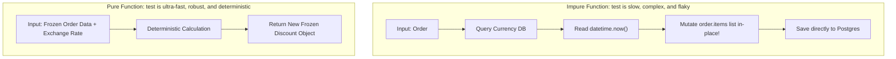

# Function & Algorithmic Unit Testing 🧮

> **Authoritative Sources & Literature:**
> - Gerard Meszaros: *xUnit Test Patterns: Refactoring Test Code* (Addison-Wesley)
> - Martin Fowler: *Refactoring: Improving the Design of Existing Code* (Pure Functions & Replacing Temp with Query)
> - Brian Okken: *Python Testing with pytest* (Chapter 2: Writing Test Functions, Pragmatic Bookshelf)
> - Gary Bernhardt: *Functional Core, Imperative Shell*

---

## 1. Conceptual Definition & Core Mental Model

At the lowest, most deterministic level of software testing lies the **pure function**.

A function is **pure** if and only if it satisfies two mathematical properties:
1. **Referential Transparency**: Given the exact same input arguments, it will **always** return the exact same output value, regardless of when, where, or how many times it is invoked.
2. **Zero Side Effects**: It causes no observable changes outside its scope—it does not mutate its input arguments, does not modify global state, does not query a database, and does not execute disk or network I/O.

```
       [ Impure Function ] ──> Reads DB / Mutates Dict / Reads Clock ──> Non-Deterministic
       
       [ Pure Function ]
              │
          Input Data (x, y) ──> [ Pure Transformation ] ──> Output Result (z)
              ▲                                                    │
              │                                                    ▼
       (Pristine State)                                   (Pure Value Return)
```

Pure functions are the easiest, fastest, and most cost-effective software units to test. Setup requires zero mocking; execution takes microseconds; and assertions are simple value comparisons.

---

## 2. Why This Is Critical in Modern Python Backend Engineering

1. **The "Functional Core, Imperative Shell" Architecture**: Modern backends achieve massive testability by separating business algorithms (tax calculations, loan amortizations, pricing tiers) into pure functions, while leaving network I/O (FastAPI routes, SQLAlchemy queries) to a thin outer shell.
2. **Defeating the Hidden Mutation Bug**: Python passes objects (lists, dictionaries, dataclass instances) by assignment (object reference). If a calculation function mutates an input list (`items.sort()`), it secretly corrupts the caller's state. Testing must verify that inputs remain completely immutable.
3. **Sub-Millisecond Feedback**: Testing pure functions bypasses ORM mapping, network handshakes, and database transactions, enabling thousands of tests to pass in milliseconds.

---

## 3. Pure vs. Impure Execution Flow



---

## 4. Standard Syntax, Signatures & Key Options

### Table-Driven Testing with `@pytest.mark.parametrize`
Pure functions are best tested using table-driven test matrices:

```python
import pytest
from decimal import Decimal

@pytest.mark.unit
@pytest.mark.parametrize(
    "subtotal,coupon_code,expected_discount",
    [
        (Decimal("100.00"), "SAVE10", Decimal("10.00")),
        (Decimal("100.00"), "SAVE20", Decimal("20.00")),
        (Decimal("100.00"), "INVALID", Decimal("0.00")),
        (Decimal("0.00"), "SAVE10", Decimal("0.00")),
    ],
    ids=["ten_percent", "twenty_percent", "invalid_coupon", "zero_subtotal"]
)
def test_calculate_coupon_discount(
    subtotal: Decimal, coupon_code: str, expected_discount: Decimal
):
    # Pure function invocation
    discount = calculate_coupon_discount(subtotal, coupon_code)
    assert discount == expected_discount
```

---

## 5. Verifying Argument Immutability

To guarantee that a function does not mutate its arguments in-place, compare a deep copy of the inputs before and after execution:

```python
import copy

def test_function_does_not_mutate_inputs():
    input_payload = {"user_id": 123, "tags": ["vip", "early_adopter"]}
    payload_snapshot = copy.deepcopy(input_payload)

    # Act
    result = format_user_metadata(input_payload)

    # Assert immutability: input must match original snapshot exactly!
    assert input_payload == payload_snapshot
    assert input_payload["tags"] is not result["tags"] # Distinct memory references
```

---

## 6. Lifecycle, Execution Flow & Teardown Mechanics

- **Setup Cost**: $0\text{ms}$ (instant in-memory instantiation).
- **Execution Cost**: $< 0.05\text{ms}$.
- **Teardown Cost**: $0\text{ms}$ (Python's garbage collector automatically reclaims memory).

---

## 7. Scopes, Hierarchy, or Test Boundaries

```
[ Layer 1: Pure Mathematical Functions & Value Objects ] <--- Unit Scope Starts Here
         │
[ Layer 2: Domain Entities & Aggregate Invariants ]
         │
[ Layer 3: Service Layer Orchestration (Uses Fakes) ]
         │
[ Layer 4: Infrastructure & Framework I/O (Database, HTTP) ] <--- Unit Scope Ends
```

---

## 8. Pytest Fixture & `conftest.py` Integration Patterns

When testing pure functions, avoid heavy fixtures. Use lightweight immutable value object fixtures or helper factories:

```python
# tests/unit/conftest.py
import pytest
from decimal import Decimal
from dataclasses import dataclass

@dataclass(frozen=True)
class LoanParameters:
    principal: Decimal
    annual_rate: Decimal
    term_months: int

@pytest.fixture
def standard_mortgage() -> LoanParameters:
    return LoanParameters(
        principal=Decimal("300000.00"),
        annual_rate=Decimal("0.05"), # 5%
        term_months=360,             # 30 years
    )
```

---

## 9. Practical Python Implementation: Step-by-Step Walkthrough

We will implement an **Amortization Loan Payment Formula** and verify it with mathematical rigor.

### Step 1: Implement the Pure Functional Engine

$$M = P \frac{r(1+r)^n}{(1+r)^n - 1}$$
Where:
- $M$ = Monthly payment
- $P$ = Principal loan amount
- $r$ = Monthly interest rate ($\text{annual rate} / 12$)
- $n$ = Total number of monthly payments

```python
# src/finance/amortization.py
from decimal import Decimal, ROUND_HALF_UP

def calculate_monthly_payment(
    principal: Decimal,
    annual_interest_rate: Decimal,
    term_months: int
) -> Decimal:
    """
    Pure function computing exact monthly payment.
    Guarantees:
    - Zero mutation of inputs.
    - Deterministic rounding via Decimal ROUND_HALF_UP.
    """
    if principal <= Decimal("0.00"):
        raise ValueError("Principal must be strictly positive")
    if annual_interest_rate < Decimal("0.00"):
        raise ValueError("Annual interest rate cannot be negative")
    if term_months <= 0:
        raise ValueError("Term in months must be at least 1")

    # Zero interest special case
    if annual_interest_rate == Decimal("0.00"):
        return (principal / Decimal(term_months)).quantize(Decimal("0.01"), rounding=ROUND_HALF_UP)

    # Monthly interest rate
    r = annual_interest_rate / Decimal("12")
    one_plus_r = Decimal("1.0") + r

    # (1 + r)^n
    compound_factor = one_plus_r ** term_months

    # M = P * [r * compound / (compound - 1)]
    numerator = r * compound_factor
    denominator = compound_factor - Decimal("1.0")
    
    monthly_payment = principal * (numerator / denominator)
    return monthly_payment.quantize(Decimal("0.01"), rounding=ROUND_HALF_UP)
```

### Step 2: Test Suite Verifying Mathematical Correctness

```python
# tests/unit/test_amortization.py
import pytest
from decimal import Decimal
from src.finance.amortization import calculate_monthly_payment

@pytest.mark.unit
@pytest.mark.parametrize(
    "principal,rate,months,expected_payment",
    [
        # Standard $200,000, 6.0% annual rate, 30 years (360 months) -> $1,199.10
        (Decimal("200000.00"), Decimal("0.06"), 360, Decimal("1199.10")),
        # $100,000, 5.0% annual rate, 15 years (180 months) -> $790.79
        (Decimal("100000.00"), Decimal("0.05"), 180, Decimal("790.79")),
        # Zero interest: $12,000, 0% rate, 12 months -> $1,000.00
        (Decimal("12000.00"), Decimal("0.00"), 12, Decimal("1000.00")),
        # 1-month micro-loan: $500, 12% rate, 1 month -> $505.00
        (Decimal("500.00"), Decimal("0.12"), 1, Decimal("505.00")),
    ],
    ids=["thirty_year_fixed", "fifteen_year_fixed", "zero_interest_loan", "single_month_loan"]
)
def test_calculate_monthly_payment_exact_values(
    principal: Decimal, rate: Decimal, months: int, expected_payment: Decimal
):
    payment = calculate_monthly_payment(principal, rate, months)
    assert payment == expected_payment


@pytest.mark.unit
@pytest.mark.parametrize(
    "bad_principal,bad_rate,bad_months,error_match",
    [
        (Decimal("0.00"), Decimal("0.05"), 360, "Principal must be strictly positive"),
        (Decimal("-100.00"), Decimal("0.05"), 360, "Principal must be strictly positive"),
        (Decimal("100000.00"), Decimal("-0.01"), 360, "Annual interest rate cannot be negative"),
        (Decimal("100000.00"), Decimal("0.05"), 0, "Term in months must be at least 1"),
        (Decimal("100000.00"), Decimal("0.05"), -12, "Term in months must be at least 1"),
    ]
)
def test_calculate_monthly_payment_invalid_inputs(
    bad_principal, bad_rate, bad_months, error_match
):
    with pytest.raises(ValueError, match=error_match):
        calculate_monthly_payment(bad_principal, bad_rate, bad_months)
```

---

## 10. Framework-Specific Integration: Functional Core, FastAPI Shell

To maximize testability in FastAPI, keep route handlers thin and delegate all business calculations to pure functions:

```python
# src/api/routes.py
from fastapi import APIRouter, HTTPException
from pydantic import BaseModel, Field
from decimal import Decimal
from src.finance.amortization import calculate_monthly_payment

router = APIRouter()

class LoanRequest(BaseModel):
    principal: Decimal = Field(..., gt=0)
    rate: Decimal = Field(..., ge=0)
    term_months: int = Field(..., gt=0)

@router.post("/calculate-payment")
async def calculate_payment(payload: LoanRequest):
    # Route simply adapts HTTP -> calls PURE FUNCTION -> adapts Output
    try:
        payment = calculate_monthly_payment(payload.principal, payload.rate, payload.term_months)
        return {"monthly_payment": str(payment)}
    except ValueError as e:
        raise HTTPException(status_code=400, detail=str(e))
```

This ensures that **100% of mathematical edge cases are tested in microsecond unit tests**, while the HTTP route test only needs to verify request parsing.

---

## 11. Real-World Enterprise Backend Scenario: Tiered Volume Discounting

In an enterprise B2B SaaS procurement platform:
- Customers receive progressive discounts based on order volume:
  - 1–10 licenses: \$50/seat
  - 11–50 licenses: \$45/seat
  - 51+ licenses: \$40/seat
- Writing this as a pure function allows validating 25 different seat count permutations (including boundaries 10, 11, 50, 51) in 0.002 seconds.

---

## 12. Anti-Patterns & Common Pitfalls

### Anti-Pattern 1: The Hidden Impurity (Reading the System Clock)
```python
# ❌ IMPURE: Cannot test historical dates or specific times!
from datetime import datetime

def is_discount_active(promo_code: str) -> bool:
    now = datetime.now() # HIDDEN IMPURITY!
    return now.month == 12 and promo_code == "XMAS"

# ✅ PURE: Inject the current time as an explicit parameter
from datetime import datetime

def is_discount_active(promo_code: str, current_time: datetime) -> bool:
    return current_time.month == 12 and promo_code == "XMAS"
```

### Anti-Pattern 2: Mutating In-Place
```python
# ❌ BUG: Mutating input list directly
def apply_fee(orders: list[dict], fee: float):
    for o in orders:
        o["total"] += fee # Corrupts caller's data!
    return orders
```

### Anti-Pattern 3: Floating-Point Rounding in Financial Math
Using standard Python `float` (`19.99 * 0.20 = 3.9980000000000007`) instead of `Decimal`.

---

## 13. Best Practices & Production Guidelines

1. **Push I/O to the Boundaries**: Keep computational algorithms in standalone, pure Python modules with zero imports from database or web frameworks.
2. **Use `@dataclass(frozen=True)` for Data Objects**: Enforce immutability at the type level.
3. **Inject Time and Randomness as Parameters**: Never call `datetime.now()` or `random.random()` inside business functions; pass them in from callers.
4. **Use Table-Driven Parametrization**: Group valid, edge, and invalid inputs into readable `@pytest.mark.parametrize` matrices.

---

## 14. Trade-Off Analysis: Function Architectures

| Dimension | Pure Functions | Stateful Class Methods | In-Place Mutating Procedures |
| :--- | :--- | :--- | :--- |
| **Test Setup Complexity** | **Zero (Pass arguments)** | Moderate (Instantiate class) | High (Requires snapshots) |
| **Execution Velocity** | **Sub-millisecond** | Fast | Fast |
| **Concurrency Safety** | **100% Thread-Safe** | Requires Locks | Race Condition Prone |
| **Refactoring Ease** | Maximum | High | Low |

---

## 15. Diagnostic & Debugging Playbook

```bash
# Run pure function tests with maximum verbosity
pytest tests/unit/test_amortization.py -vv

# Show local variables on failure to inspect mathematical intermediates
pytest tests/unit/test_amortization.py -l

# Profile speed of pure function suite
pytest tests/unit/test_amortization.py --durations=0
```

---

## 16. Senior Staff Interview Questions & Deep Dives

### Question 1: How does Gary Bernhardt's "Functional Core, Imperative Shell" architecture improve backend maintainability and test execution speed?
**Answer**:
The architecture divides the system into two distinct rings:
1. **The Functional Core**: Contains all business domain logic, financial rules, state machine transitions, and algorithms implemented as **pure functions** that accept immutable data structures and return new immutable data structures. It has zero dependencies on databases, file systems, or network sockets. As a result, 90% of business logic can be tested in microseconds without test doubles or mocking frameworks.
2. **The Imperative Shell**: A thin outer layer (FastAPI routers, Celery tasks, CLI entrypoints) that handles I/O: querying PostgreSQL, calling Stripe, and passing data into the functional core. It then persists the core's return value. The imperative shell is verified with a small number of integration tests. This architecture eliminates brittle mocks and guarantees blistering test velocity.

### Question 2: Why should financial and monetary calculations never use Python's built-in `float` type, even in pure functions?
**Answer**:
Python `float` uses IEEE 754 double-precision binary representation. Numbers that have clean decimal representations (like `0.1` or `0.01`) cannot be represented exactly in binary floating-point, resulting in rounding artifacts (e.g. `0.1 + 0.2 == 0.30000000000000004`). In financial accounting, accumulated fractional cent errors cause ledger imbalances and tax discrepancies. The standard library `decimal.Decimal` represents numbers in base-10 with user-defined precision and explicit rounding modes (such as `ROUND_HALF_UP` or `ROUND_HALF_EVEN`), ensuring exact monetary compliance.

---

## 17. Hands-on Engineering Exercises & Challenges

### Exercise 1: Refactoring an Impure Function
Take this impure function:
```python
import random
from datetime import datetime

def issue_ticket(customer_name: str) -> dict:
    return {
        "customer": customer_name,
        "ticket_id": f"TICK-{random.randint(1000, 9999)}",
        "issued_at": datetime.utcnow().isoformat(),
    }
```
Refactor it into a 100% pure function with zero randomness and zero clock reading, and write a deterministic unit test.

### Exercise 2: Implementing a Tax Bracket Engine
Write a pure function `compute_income_tax(income: Decimal, brackets: list[tuple[Decimal, Decimal]]) -> Decimal` implementing progressive marginal tax brackets. Write a parametrized test suite verifying standard income, exact bracket boundaries, and income below the minimum threshold.

---

## 18. Summary, Cross-References & Further Reading

Pure functions form the most resilient, maintainable, and lightning-fast segment of any test suite. By isolating business algorithms into pure functional cores and verifying them through table-driven parametrization, backend teams eliminate flaky tests and achieve near-instantaneous feedback.

### Cross-References:
- Previous: [Unit Testing Overview](index.md)
- Next: [Service Layer Unit Testing](service-layer-testing.md)
- [Business Logic & Invariant Testing](business-logic-testing.md)
- [Boundary Value Analysis](boundary-value-testing.md)
