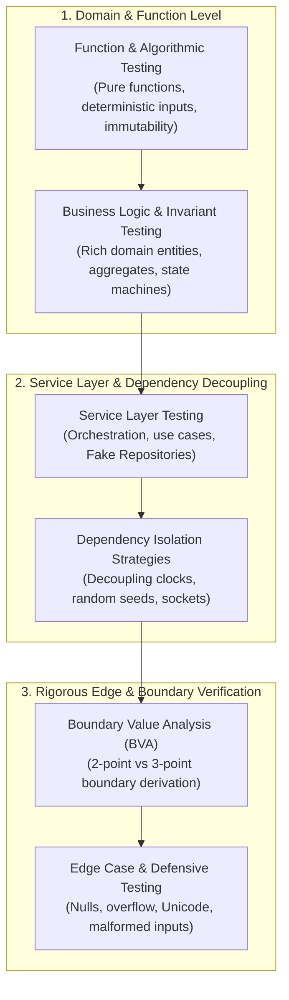

# Unit Testing in Python Backend Systems 🔬

> **Authoritative Sources & Literature:**
> - Gerard Meszaros: *xUnit Test Patterns: Refactoring Test Code* (Addison-Wesley)
> - Martin Fowler: *Unit Test & Refactoring* (martinfowler.com)
> - Harry Percival & Bob Gregory: *Architecture Patterns with Python* (Domain Modeling & Service Layer, O'Reilly)
> - Glenford J. Myers: *The Art of Software Testing* (Boundary Value Analysis & Equivalence Partitioning)

---

## 📖 Module Overview

**Unit Testing** forms the foundational bedrock (70%) of any robust testing topology. A true unit test is distinguished by two non-negotiable physical constraints:
1. **Sub-Millisecond Execution Velocity**: It executes entirely in-memory ($< 1\text{ms}$).
2. **Deterministic Isolation**: It has zero out-of-process dependencies—no network sockets, no persistent databases, no unmanaged filesystem access, and no system clock drift.

This module provides backend engineers with a rigorous engineering manual for isolating pure algorithmic functions, driving service layers with in-memory Fakes, validating rich domain aggregates, performing boundary value analysis, and severing volatile environmental dependencies.

---

## 🗺️ Module Guides

### 1. [Function & Algorithmic Testing](function-testing.md)
Master testing of pure functions with zero side effects. Understand referential transparency, deterministic I/O mappings, table-driven tests, and immutability guarantees.

### 2. [Service Layer Unit Testing](service-layer-testing.md)
Test application use cases and workflows without touching databases. Decouple domain orchestration using **Fake Repositories** backed by in-memory dictionaries.

### 3. [Business Logic & Invariant Testing](business-logic-testing.md)
Protect core enterprise invariants. Test rich domain models, aggregates, entity lifecycles, and state machines while avoiding the Anemic Domain Model anti-pattern.

### 4. [Edge Case & Defensive Testing](edge-case-testing.md)
Harden backend code against production anomalies: `None`/null values, integer overflows, floating-point precision loss, malformed payloads, and Unicode normalization quirks.

### 5. [Boundary Value Analysis (BVA)](boundary-value-testing.md)
Apply mathematical boundary analysis. Learn how to systematically derive 2-point and 3-point boundary test cases around equivalence partitions.

### 6. [Dependency Isolation Strategies](dependency-isolation.md)
Sever volatile environmental dependencies. Master techniques for freezing time (`time-machine`), seeding pseudo-random generators, sandboxing filesystem writes (`tmp_path`), and enforcing zero-socket policies.

---

## 📊 Summary of Unit Testing Principles

| Dimension | Unit Test Standard | Anti-Pattern to Avoid |
| :--- | :--- | :--- |
| **Execution Time** | Sub-millisecond ($< 1\text{ms}$) | Tests taking $50\text{ms}+$ due to SQLite or disk I/O |
| **Collaborators** | Real domain objects or In-Memory Fakes | Heavy mock chains asserting on private method calls |
| **Verification** | **State Verification** (Outputs & Invariants) | Behavioral Verification (Checking interaction counts) |
| **Network Access** | Blocked via `pytest-socket` | Calling external sandbox APIs |
| **Time Dependence** | Frozen UTC timestamp | Relying on live `datetime.now()` |

---

## ⏭️ Next Steps

Begin with **[Function & Algorithmic Testing](function-testing.md)** to establish pure functional unit testing patterns.
