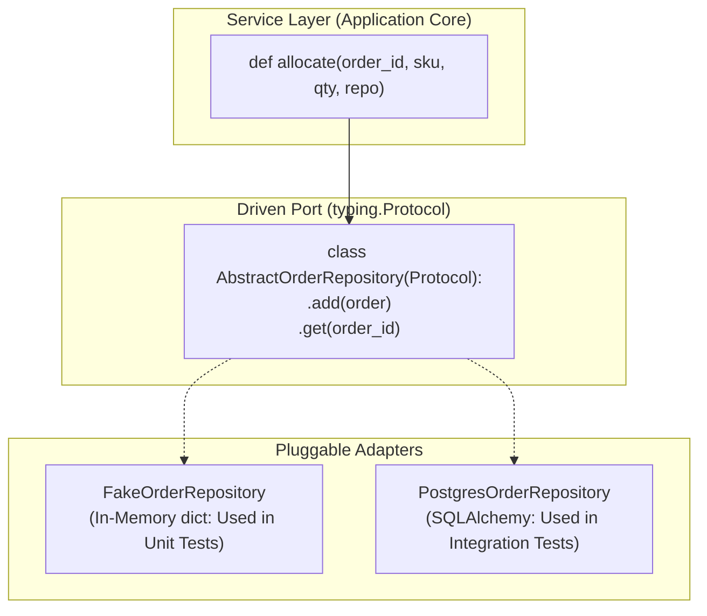
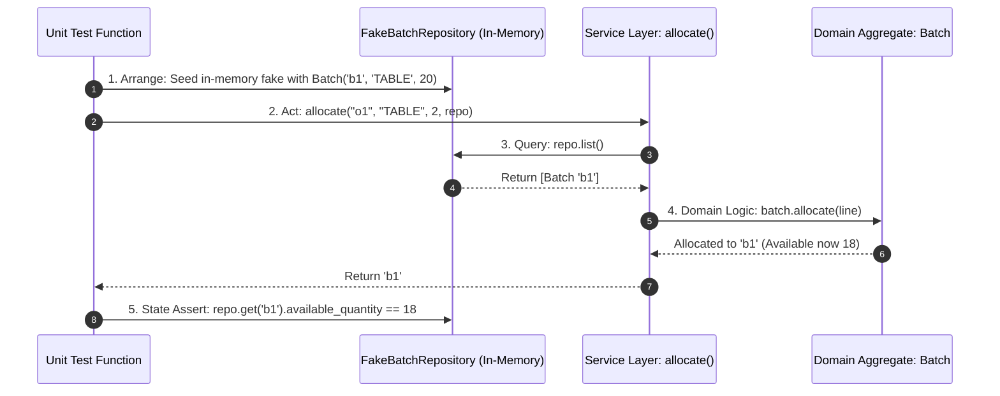

# Service Layer Unit Testing & Fake Repositories 🏛️

> **Authoritative Sources & Literature:**
> - Harry Percival & Bob Gregory: *Architecture Patterns with Python* (Chapter 4: Service Layer, Chapter 5: TDD in High Gear and Low Gear, O'Reilly)
> - Martin Fowler: *Patterns of Enterprise Application Architecture* (Service Layer Pattern)
> - Gerard Meszaros: *xUnit Test Patterns: Refactoring Test Code* (Fake Object Pattern, Addison-Wesley)

---

## 1. Conceptual Definition & Core Mental Model

The **Service Layer** (also known as Application Services or Use Case Handlers) defines the operational boundary of an application. It coordinates business workflows: fetching domain aggregates from repositories, executing domain logic, and persisting state changes.

### The Testing Philosophy of Cosmic Python
In *Architecture Patterns with Python*, Harry Percival and Bob Gregory establish a transformative principle:
> **Test your application service layer using primitive arguments and in-memory Fake Repositories.**

Instead of writing tests that are tightly coupled to HTTP routers (FastAPI/Flask) or tightly coupled to relational databases (SQLAlchemy/PostgreSQL), service layer tests interact with clean Python functions using simple primitive types (`str`, `int`, `Decimal`).

```
       [ Client / HTTP Router ] (Not tested here)
                 │
                 ▼
       [ Service Layer: Use Case ] <─── TEST DRIVES HERE (Primitives: order_id, sku)
                 │
        ┌────────┴────────┐
        ▼                 ▼
  [ Domain Model ]  [ Repository Port (Protocol) ]
 (Pure Invariants)        │
                 ┌────────┴────────┐
                 ▼                 ▼
          [ FakeRepository ]  [ PostgresRepository ]
          (Used by UNIT test) (Used by INTEGRATION test)
```

---

## 2. Why This Is Critical in Modern Python Backend Engineering

1. **"High Gear" Testing Enables Fearless Refactoring**: When you write tests directly against the service layer using fake repositories, you can completely refactor internal domain entities (renaming methods, changing internal data structures from lists to sets) **without breaking a single service layer test**!
2. **Eliminates the "Mockist" Nightmare**: Service tests using `unittest.mock.patch` require 15 lines of mock wiring (`mock_repo.get.return_value = ...`) that breaks whenever an internal method name changes. A **Fake Repository** behaves like a real database in memory, supporting clean state assertions.
3. **Blazing Execution Speed**: Complete end-to-end business workflows execute entirely in memory in **under 2 milliseconds**.

---

## 3. The Architecture: Ports, Adapters & Fakes



---

## 4. Standard Syntax, Signatures & Key Options

### Defining the Repository Port (`typing.Protocol`)
```python
from typing import Protocol, Optional
from src.domain.models import Batch

class AbstractBatchRepository(Protocol):
    def add(self, batch: Batch) -> None: ...
    def get(self, reference: str) -> Optional[Batch]: ...
    def list(self) -> list[Batch]: ...
```

### Implementing the Fake Repository
A Fake implements the protocol using standard Python data structures:

```python
class FakeBatchRepository:
    def __init__(self, batches: list[Batch] | None = None):
        self._batches = {b.reference: b for b in (batches or [])}

    def add(self, batch: Batch) -> None:
        self._batches[batch.reference] = batch

    def get(self, reference: str) -> Batch | None:
        return self._batches.get(reference)

    def list(self) -> list[Batch]:
        return list(self._batches.values())
```

---

## 5. Driving Services with Primitive Types

A well-designed service layer function accepts **primitive arguments** (`order_id: str`, `sku: str`, `qty: int`), rather than requiring the caller to construct complex domain entity objects:

```python
# ✅ GOOD: Accepts primitive arguments; handles domain creation internally
def allocate_order_line(
    order_id: str,
    sku: str,
    qty: int,
    repo: AbstractBatchRepository
) -> str:
    line = OrderLine(order_id, sku, qty)
    batches = repo.list()
    batchref = model.allocate(line, batches)
    return batchref
```

---

## 6. Lifecycle, Execution Flow & Teardown Mechanics



---

## 7. Scopes, Hierarchy, or Test Boundaries

```
[ HTTP Router / FastAPI Controller ] (Boundary of Integration/E2E)
                 │
[ Service Layer / Use Case Function ] <─── UNIT TEST BOUNDARY
                 │
[ Domain Model (Pure Logic) ]
                 │
[ FakeRepository (In-Memory Dictionary) ]
```

---

## 8. Pytest Fixture & `conftest.py` Integration Patterns

```python
# tests/unit/conftest.py
import pytest
from src.adapters.fakes import FakeBatchRepository
from src.domain.models import Batch
from datetime import date

@pytest.fixture
def fake_repo() -> FakeBatchRepository:
    """Provides a fresh, empty in-memory repository for every test."""
    return FakeBatchRepository()

@pytest.fixture
def seeded_repo() -> FakeBatchRepository:
    """Pre-seeded fake repository with standard test stock."""
    return FakeBatchRepository([
        Batch("batch-today", "MINIMALIST-DESK", qty=10, eta=date.today()),
        Batch("batch-later", "MINIMALIST-DESK", qty=10, eta=date(2026, 12, 31)),
    ])
```

---

## 9. Practical Python Implementation: Step-by-Step Walkthrough

We will build an **Inventory Allocation Service** (inspired by *Cosmic Python*) and test it entirely in the Service Layer using Fake Repositories.

### Step 1: Define Domain Models & Exceptions

```python
# src/domain/models.py
from dataclasses import dataclass
from datetime import date

class OutOfStockError(Exception):
    pass

class InvalidSkuError(Exception):
    pass

@dataclass(frozen=True)
class OrderLine:
    orderid: str
    sku: str
    qty: int

class Batch:
    def __init__(self, ref: str, sku: str, qty: int, eta: date | None = None):
        self.reference = ref
        self.sku = sku
        self.eta = eta
        self._purchased_quantity = qty
        self._allocations: set[OrderLine] = set()

    def allocate(self, line: OrderLine) -> None:
        if self.can_allocate(line):
            self._allocations.add(line)

    def can_allocate(self, line: OrderLine) -> bool:
        return self.sku == line.sku and self.available_quantity >= line.qty

    @property
    def allocated_quantity(self) -> int:
        return sum(line.qty for line in self._allocations)

    @property
    def available_quantity(self) -> int:
        return self._purchased_quantity - self.allocated_quantity
```

### Step 2: Implement the Service Layer

```python
# src/services/allocation_service.py
from src.domain.models import OrderLine, OutOfStockError, InvalidSkuError, Batch
from typing import Protocol

class BatchRepositoryPort(Protocol):
    def add(self, batch: Batch) -> None: ...
    def get(self, reference: str) -> Batch | None: ...
    def list(self) -> list[Batch]: ...

def allocate(
    orderid: str,
    sku: str,
    qty: int,
    repo: BatchRepositoryPort
) -> str:
    """Service use case driven by primitive types."""
    line = OrderLine(orderid, sku, qty)
    batches = repo.list()

    # Domain validation
    if not any(b.sku == line.sku for b in batches):
        raise InvalidSkuError(f"Invalid sku: {line.sku}")

    # Business rule: Allocate to earliest batch first
    sorted_batches = sorted(
        batches,
        key=lambda b: (b.eta is not None, b.eta)
    )

    for batch in sorted_batches:
        if batch.can_allocate(line):
            batch.allocate(line)
            repo.add(batch) # Update state
            return batch.reference

    raise OutOfStockError(f"Out of stock for sku: {line.sku}")
```

### Step 3: Write Fast, High-Gear Unit Tests

```python
# tests/unit/test_allocation_service.py
import pytest
from datetime import date
from src.domain.models import Batch, OutOfStockError, InvalidSkuError
from src.services.allocation_service import allocate
from src.adapters.fakes import FakeBatchRepository

def test_allocates_to_earliest_batch():
    # Arrange: Seed fake repository in-memory
    repo = FakeBatchRepository([
        Batch("batch-slow", "RETRO-CLOCK", qty=20, eta=date(2026, 12, 1)),
        Batch("batch-fast", "RETRO-CLOCK", qty=20, eta=date(2026, 6, 1)),
    ])

    # Act: Call service with primitives
    batchref = allocate(orderid="o1", sku="RETRO-CLOCK", qty=5, repo=repo)

    # Assert: High-gear state verification!
    assert batchref == "batch-fast"
    assert repo.get("batch-fast").available_quantity == 15
    assert repo.get("batch-slow").available_quantity == 20

def test_errors_for_invalid_sku():
    repo = FakeBatchRepository([
        Batch("batch-1", "REAL-SKU", qty=10, eta=None)
    ])

    with pytest.raises(InvalidSkuError, match="Invalid sku: NONEXISTENT"):
        allocate(orderid="o1", sku="NONEXISTENT", qty=2, repo=repo)

def test_raises_out_of_stock_when_stock_insufficient():
    repo = FakeBatchRepository([
        Batch("batch-1", "SMALL-DESK", qty=5, eta=None)
    ])

    with pytest.raises(OutOfStockError, match="Out of stock for sku: SMALL-DESK"):
        allocate(orderid="o1", sku="SMALL-DESK", qty=10, repo=repo)
```

---

## 10. Framework-Specific Integration: FastAPI Dependency Injection

In FastAPI, the route simply adapts HTTP inputs, invokes the service layer, and returns JSON:

```python
# src/api/routes.py
from fastapi import APIRouter, Depends, HTTPException, status
from pydantic import BaseModel
from src.services.allocation_service import allocate
from src.api.dependencies import get_batch_repository
from src.domain.models import OutOfStockError, InvalidSkuError

router = APIRouter()

class AllocationRequest(BaseModel):
    orderid: str
    sku: str
    qty: int

@router.post("/allocate", status_code=status.HTTP_201_CREATED)
async def allocate_endpoint(
    payload: AllocationRequest,
    repo = Depends(get_batch_repository)
):
    try:
        batchref = allocate(payload.orderid, payload.sku, payload.qty, repo=repo)
        return {"batchref": batchref}
    except (OutOfStockError, InvalidSkuError) as e:
        raise HTTPException(status_code=400, detail=str(e))
```

---

## 11. Real-World Enterprise Backend Scenario: B2B Multi-Approver Expense Claims

In an enterprise expense management system:
- A claim under \$1,000 requires 1 manager approval.
- A claim over \$1,000 requires 2 executive approvals.
- Service tests use an in-memory `FakeExpenseRepository` and `FakeEmployeeDirectory` to test:
  1. Submitting claims.
  2. Single approval transitions.
  3. Escalated two-tier approval transitions.
  4. Automatic payment scheduling.
- The entire workflow suite of 45 test scenarios runs in **0.08 seconds**.

---

## 12. Anti-Patterns & Common Pitfalls

### Anti-Pattern 1: The Mock-Heavy Service Test
Mocking out the repository instead of using a Fake:
```python
# ❌ BRITTLE: Coupled to exact repository method names
def test_allocate_mock(mocker):
    mock_repo = mocker.patch("src.services.allocation_service.repo")
    mock_repo.list.return_value = [...]
    # If the service refactors from repo.list() to repo.get_available_batches(), this breaks!
```

### Anti-Pattern 2: Passing Domain Entities Across the Service Boundary
Requiring the caller to construct complex domain objects:
```python
# ❌ TIGHTLY COUPLED: Leaks domain models to web layer
allocate(OrderLine("o1", "DESK", 2), repo)

# ✅ DECOUPLED: Accepts clean primitives
allocate("o1", "DESK", 2, repo)
```

### Anti-Pattern 3: Putting SQL Queries Inside the Service Layer
Executing raw SQL or ORM queries (`session.query(Batch)...`) inside the service function instead of using the repository port.

---

## 13. Best Practices & Production Guidelines

1. **Keep Service Layer Inputs Primitive**: Pass `str`, `int`, `Decimal`, or lightweight DTO dataclasses.
2. **Implement Fakes for All Secondary Driven Ports**: Build in-memory fakes for repositories, email clients, and message buses.
3. **Assert on Fake State, Not Interaction Counts**: Verify that `fake_repo.get("b1").available == 18`, rather than asserting `fake_repo.add.assert_called_once()`.
4. **Shift Between High and Low Gear**: Start with Low Gear (unit testing new domain entities); once stable, write all new tests against the Service Layer in High Gear.

---

## 14. Trade-Off Analysis: Service Layer Testing Approaches

| Approach | Execution Speed | Refactoring Resilience | Implementation Effort | Catches SQL Bugs? |
| :--- | :--- | :--- | :--- | :--- |
| **Service Tests with Fakes (High Gear)** | **Ultra-Fast (< 2ms)** | **Maximum** | Low (Write Fake once) | No (Needs integration test) |
| **Service Tests with Mocks** | Fast (< 5ms) | Low (Breaks on renames) | Moderate | No |
| **Service Tests with Real Postgres** | Slow (50ms - 200ms) | Moderate | High (DB setup) | Yes |

---

## 15. Diagnostic & Debugging Playbook

```python
# Print the entire in-memory state of your fake repository at any point:
print("Fake Repo Batches:", fake_repo.list())

# Verify state after service call:
batch = fake_repo.get("batch-fast")
print("Remaining quantity:", batch.available_quantity)
```

---

## 16. Senior Staff Interview Questions & Deep Dives

### Question 1: What does "TDD in High Gear vs. Low Gear" mean in the context of Harry Percival's architecture, and how does it prevent test brittleness?
**Answer**:
- **Low Gear**: Writing fine-grained unit tests directly against individual methods of domain models (e.g. testing `Batch.can_allocate()` and `Batch.deallocate()`). When designing a complex domain model from scratch, Low Gear provides fast, granular feedback.
- **High Gear**: Writing tests against the **Service Layer** (e.g. calling `allocate(order_id, sku, qty, repo=fake_repo)`).
- **The Brittleness Problem**: If a team keeps hundreds of tests in Low Gear, the test suite becomes tightly coupled to internal domain representations. When the domain model needs to be refactored (e.g., merging two classes or replacing an internal dictionary with a custom collection), dozens of Low Gear unit tests fail even though the business capability is intact. Shifting into **High Gear** decouples the test suite from domain internals, enabling fearless structural refactoring.

### Question 2: Why should a Service Layer function accept primitive types instead of domain entity instances?
**Answer**:
Accepting primitive types establishes a clean **Hexagonal boundary**. The Service Layer acts as the orchestrator: it receives raw data from ingress adapters (HTTP controllers, CLI arguments, Kafka consumers), instantiates domain entities, enforces transactions, and coordinates persistence. If the service required callers to pass in pre-constructed domain entities, the HTTP controller would need to understand domain construction invariants, leading to leaking domain logic into the presentation tier.

---

## 17. Hands-on Engineering Exercises & Challenges

### Exercise 1: Building a Fake User Repository
1. Define an `AbstractUserRepository(Protocol)` with `.add(user)` and `.get_by_email(email)`.
2. Implement `FakeUserRepository` using an in-memory dictionary.
3. Write a service function `register_user(email: str, password: str, repo: AbstractUserRepository) -> str`.
4. Write a unit test verifying duplicate email registration raises a `DuplicateEmailError`.

### Exercise 2: Refactoring a Mockist Test to a State-Verified Fake
Take an existing test that uses `mocker.patch("src.repo.get")` and `mocker.patch("src.repo.save")`. Refactor the service and test to use `FakeRepository`, replacing all `.assert_called_once()` checks with real state assertions.

---

## 18. Summary, Cross-References & Further Reading

Service Layer unit testing with Fake Repositories represents the sweet spot of backend quality assurance. By driving services with primitive types and verifying state on in-memory adapters, backend teams achieve fearless domain refactoring with microsecond test feedback.

### Cross-References:
- Previous: [Function & Algorithmic Unit Testing](function-testing.md)
- Next: [Business Logic & Invariant Testing](business-logic-testing.md)
- [Repository Pattern & Fake Repositories](../architecture-and-testing/repository-pattern.md)
- [Unit of Work Testing](../architecture-and-testing/unit-of-work.md)
