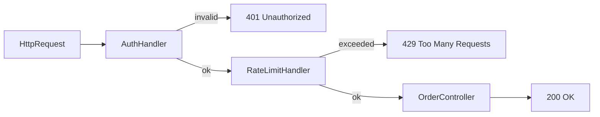

# Chain of Responsibility (Behavioral)

## 1. Clear Definition
**Chain of Responsibility** is a behavioral design pattern that passes a request sequentially along a **chain of potential handlers**. Each handler inspects the request and decides either to **process/short-circuit it** or **forward it** to the next handler in the chain.

> **30-Second Interview Summary:**  
> *"Chain of Responsibility decouples the sender of a request from its receivers by linking handlers in sequence. Each handler processes what it owns (or rejects early) and forwards the rest—just like HTTP middleware or GUI event bubbling."*

**Key Participants:**
* **Handler (`RequestHandler`):** Declares the handling contract and stores `_next_handler`.
* **Concrete Handlers (`AuthHandler`, `RateLimitHandler`):** Implement specific checks or business logic.
* **Client:** Wires the chain and submits requests to the head handler only.

---

## 2. Real-Time & Real-World Examples
* **Real-Life Analogy (*Mastering Python Design Patterns*):** An **ATM / vending machine** has a single banknote slot (head of the chain) that routes bills through internal validators until the matching receptacle accepts them.
* **Real-Time Software Example:** **FastAPI / Starlette / Django Middleware**—an HTTP request passes through `CORS → Auth → RateLimit → RouteHandler`, where any middleware can short-circuit with `401` or `429`.

---

## 3. Mental Model



---

## 4. Python Implementation

```python
from abc import ABC, abstractmethod
from dataclasses import dataclass


@dataclass
class HttpRequest:
    """Represents an incoming API request moving through the middleware chain."""

    user: str | None
    requests_last_min: int
    payload: str


class RequestHandler(ABC):
    """Abstract base handler that holds a reference to the next handler."""

    def __init__(self) -> None:
        self._next_handler: RequestHandler | None = None

    def set_next(self, handler: "RequestHandler") -> "RequestHandler":
        """Link the next handler and return it to support fluent chaining."""
        self._next_handler = handler
        return handler

    def handle(self, request: HttpRequest) -> str:
        """
        Execute this handler first.
        Short-circuit if a response is returned; otherwise forward down the chain.
        """
        result = self._process(request)
        if result is not None:
            return result  # Short-circuit: request handled or rejected early

        if self._next_handler is not None:
            return self._next_handler.handle(request)

        return "200 OK (end of chain)"

    @abstractmethod
    def _process(self, request: HttpRequest) -> str | None:
        """Return a response string to stop the chain, or None to forward."""


class AuthHandler(RequestHandler):
    """Rejects unauthenticated requests before any downstream logic runs."""

    def _process(self, request: HttpRequest) -> str | None:
        if not request.user:
            return "401 Unauthorized: missing credentials"
        return None


class RateLimitHandler(RequestHandler):
    """Blocks requests that exceed the per-minute quota."""

    def __init__(self, max_rpm: int = 10) -> None:
        super().__init__()
        self.max_rpm = max_rpm

    def _process(self, request: HttpRequest) -> str | None:
        if request.requests_last_min > self.max_rpm:
            return "429 Too Many Requests: quota exceeded"
        return None


class OrderControllerHandler(RequestHandler):
    """Terminal handler executing the core business action."""

    def _process(self, request: HttpRequest) -> str | None:
        return f"200 OK: processed '{request.payload}' for {request.user}"


if __name__ == "__main__":
    # Wire chain: Auth -> RateLimit -> OrderController
    chain = AuthHandler()
    chain.set_next(RateLimitHandler(max_rpm=10)).set_next(OrderControllerHandler())

    print(chain.handle(HttpRequest(user=None, requests_last_min=1, payload="create_order")))
    print(chain.handle(HttpRequest(user="alice", requests_last_min=25, payload="create_order")))
    print(chain.handle(HttpRequest(user="alice", requests_last_min=3, payload="create_order")))
```

> **Pythonic Tip (*Mastering Python Design Patterns*):** For event-bubbling UIs, a base `Widget` can use `getattr(self, f"handle_{event.name}")` to dispatch dynamically instead of writing subclass boilerplate.

**Sample Output:**
```text
401 Unauthorized: missing credentials
429 Too Many Requests: quota exceeded
200 OK: processed 'create_order' for alice
```

---

## 5. Use Cases & When to Skip
* **When to Use:**
  * Ordered API validation/middleware pipelines (auth, rate limit, schema validation).
  * Escalation or event-bubbling systems where the final receiver isn't known at compile time.
* **When to Skip:**
  * Simple 2-branch routing where a plain `if/else` or `dict` dispatch is clearer.

---

## 6. Don't Confuse With

| Pattern | Key Difference |
| :--- | :--- |
| **[Decorator](../structural/decorator.md)** | Every decorator enhances and forwards the call; CoR handlers can **short-circuit** early. |
| **[Observer](observer.md)** | Observer broadcasts to **all** subscribers at once; CoR passes sequentially along a chain. |

---

## 7. Rapid Interview Q&As
* **Q: What happens if no handler handles the request?**  
  **A:** It falls off the end unhandled—always define a safe default/tail fallback (`404` or `200 OK`).
* **Q: How do you reorder pipeline stages without changing handler code?**  
  **A:** Just change the `set_next(...)` wiring at startup—each handler stays completely independent.
