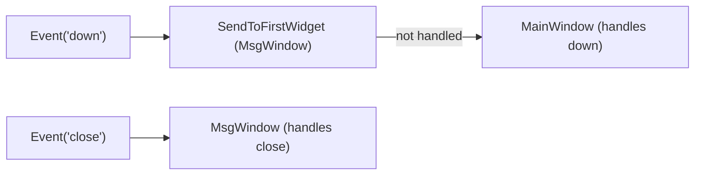

# Chain of Responsibility (Behavioral)

## 1. 30-Second Interview Answer
> **Chain of Responsibility** decouples a sender from multiple potential receivers by passing a request/event along a **chain of handlers**. Each handler either handles the request (e.g., `handle_down` / `handle_paint`) or forwards it to its `parent`/successor until handled or the chain ends.

---

## 2. Real-Life & Software Examples *(Mastering Python Design Patterns)*
- **Real-Life Analogy:** **ATMs / vending machines** (one banknote/coin slot routes cash to the matching internal receptacle) and **shared broadcast Ethernet networks**.
- **Python Software Example:** **GUI event propagation** (Apple Cocoa / Qt widget trees) and **HTTP middleware chains** (FastAPI / Starlette / Django middleware).

---

## 3. Mental Model



---

## 4. Python Implementation *(Book Example: Dynamic Dispatch `Widget` Chain)*

```python
class Event:
    def __init__(self, name: str) -> None:
        self.name = name


class Widget:
    def __init__(self, parent: "Widget | None" = None) -> None:
        self.parent = parent

    def handle(self, event: Event) -> None:
        handler_name = f"handle_{event.name}"
        if hasattr(self, handler_name):
            getattr(self, handler_name)(event)
        elif self.parent:
            self.parent.handle(event)
        elif hasattr(self, "handle_default"):
            self.handle_default(event)


class MainWindow(Widget):
    def handle_close(self, event: Event) -> None:
        print(f"MainWindow handled: {event.name}")

    def handle_default(self, event: Event) -> None:
        print(f"MainWindow default: {event.name}")


class SendDialog(Widget):
    def handle_paint(self, event: Event) -> None:
        print(f"SendDialog handled: {event.name}")


class MsgText(Widget):
    def handle_down(self, event: Event) -> None:
        print(f"MsgText handled: {event.name}")


mw = MainWindow()
sd = SendDialog(mw)
msg = MsgText(sd)
msg.handle(Event("down"))   # Handled by MsgText
msg.handle(Event("paint"))  # Bubbles up to SendDialog
msg.handle(Event("close"))  # Bubbles up to MainWindow
```

---

## 5. Use Cases & When to Skip
- **Use when:** You don't know in advance which handler (or how many) should process an event/request—such as UI event bubbling, purchase approvals, or HTTP middleware.
- **Watch out for:** Requests reaching the end unhandled—always provide a `handle_default` fallback.

---

## 6. Rapid Follow-Up Q&As
- **Q: How does Python simplify Chain of Responsibility here?**  
  **A:** Using `hasattr(self, f"handle_{event.name}")` + `getattr(...)` eliminates giant `if/elif` chains on event types.
- **Q: Chain of Responsibility vs. Observer?**  
  **A:** **CoR** passes a request sequentially until *one* handler (or middleware pipeline) processes/stops it; [Observer](observer.md) broadcasts to *all* subscribers simultaneously.
