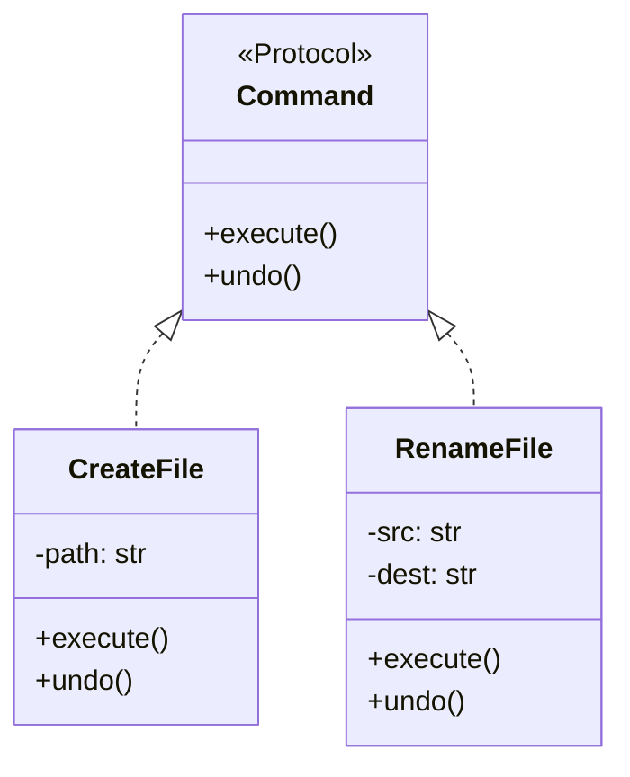

# Command (Behavioral)

## 1. 30-Second Interview Answer
> **Command** encapsulates an operation as a standalone object with `execute()` and `undo()`. Because the invoker is decoupled from *how* the operation works, you can queue commands, execute them later, log them, or push them onto an **undo stack** for multi-level rollback.

---

## 2. Real-Life & Software Examples *(Mastering Python Design Patterns)*
- **Real-Life Analogy:** **Restaurant order check**—the waiter writes the order on a check and places it in the kitchen queue; the cook executes each independent check on demand.
- **Python Software Example:** **`PyQt` `QAction`** (encapsulates menu/shortcut actions) and **`git-cola`** (Python Git GUI using commands for commits/checkouts).

---

## 3. Mental Model



---

## 4. Python Implementation *(Book Example: File Operations with `undo()`)*

```python
import os
from pathlib import Path
from typing import Protocol


class Command(Protocol):
    def execute(self) -> None: ...
    def undo(self) -> None: ...


class CreateFile:
    def __init__(self, path: str, text: str = "hello world\n") -> None:
        self.path = Path(path)
        self.text = text

    def execute(self) -> None:
        self.path.write_text(self.text, encoding="utf-8")

    def undo(self) -> None:
        if self.path.exists():
            self.path.unlink()


class RenameFile:
    def __init__(self, src: str, dest: str) -> None:
        self.src = Path(src)
        self.dest = Path(dest)

    def execute(self) -> None:
        os.rename(self.src, self.dest)

    def undo(self) -> None:
        os.rename(self.dest, self.src)


# Execute a batch of commands, then undo in reverse order
commands: list[Command] = [
    CreateFile("notes_tmp.txt"),
    RenameFile("notes_tmp.txt", "notes_renamed.txt"),
]
for cmd in commands:
    cmd.execute()

for cmd in reversed(commands):
    cmd.undo()
```

---

## 5. Use Cases & When to Skip (Pythonic Alternatives)
- **Use when:** You need **multi-level Undo/Redo**, macro recording, task queues, or decoupling UI triggers from business actions.
- **Pythonic Alternative:** When you *don't* need `undo()`, a plain function, closure, or `functools.partial` works without a class.

---

## 6. Rapid Follow-Up Q&As
- **Q: How do you implement multi-level Undo?**  
  **A:** Maintain a history list/stack of executed `Command` objects; on undo, `pop()` the most recent command and call `cmd.undo()`.
