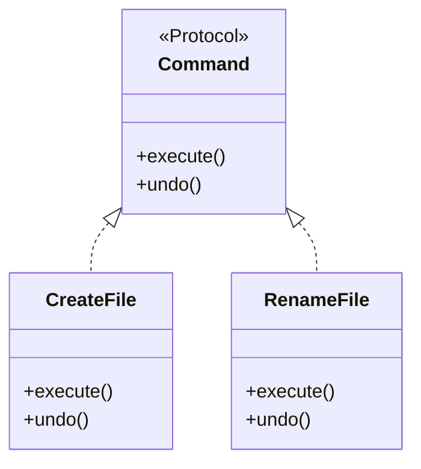

# Command (Behavioral)

## 1. Clear Definition
**Command** is a behavioral design pattern that encapsulates a request or operation (create, rename, insert, delete) as a **standalone object** exposing `execute()` and `undo()`. Decoupling the invoker from how the action runs lets you queue jobs, log operations, and build multi-level Undo/Redo stacks.

> **30-Second Interview Summary:**  
> *"Command turns an action into an object with `execute()` and `undo()`. Because requests are first-class objects, you can store them in an undo history stack, queue them for background workers, or execute them in batches."*

**Key Participants:**
* **Command (`Command`):** Protocol declaring `execute()` and `undo()`.
* **Concrete Commands (`CreateFile`, `RenameFile`):** Store target state and implement forward + reverse logic.
* **Invoker (`CommandHistory`):** Runs commands and tracks history for undo.

---

## 2. Real-Time & Real-World Examples
* **Real-Life Analogy (*Mastering Python Design Patterns*):** **Restaurant order check**—the waiter writes each order on a check and places it in the kitchen queue; the cook executes each check independently on demand.
* **Real-Time Software Example:** **`PyQt` `QAction`**, **`git-cola`** (Python Git GUI), and **Celery / RQ** background job queues.

---

## 3. Mental Model



---

## 4. Python Implementation

```python
import os
from pathlib import Path
from typing import Protocol


class Command(Protocol):
    """Contract for reversible operations."""

    def execute(self) -> None:
        """Perform the operation."""

    def undo(self) -> None:
        """Revert the operation to restore prior state."""


class CreateFile:
    """Creates a file on disk and deletes it on undo."""

    def __init__(self, path: str, text: str = "hello world\n") -> None:
        self.path = Path(path)
        self.text = text

    def execute(self) -> None:
        self.path.write_text(self.text, encoding="utf-8")
        print(f"Created {self.path}")

    def undo(self) -> None:
        if self.path.exists():
            self.path.unlink()
            print(f"Deleted {self.path} (undo)")


class RenameFile:
    """Renames a file and restores the original name on undo."""

    def __init__(self, src: str, dest: str) -> None:
        self.src = Path(src)
        self.dest = Path(dest)

    def execute(self) -> None:
        os.rename(self.src, self.dest)
        print(f"Renamed {self.src} -> {self.dest}")

    def undo(self) -> None:
        if self.dest.exists():
            os.rename(self.dest, self.src)
            print(f"Restored {self.dest} -> {self.src} (undo)")


if __name__ == "__main__":
    history: list[Command] = [
        CreateFile("demo_note.txt"),
        RenameFile("demo_note.txt", "demo_renamed.txt"),
    ]

    for cmd in history:
        cmd.execute()

    # Roll back in reverse execution order
    for cmd in reversed(history):
        cmd.undo()
```

**Sample Output:**
```text
Created demo_note.txt
Renamed demo_note.txt -> demo_renamed.txt
Restored demo_renamed.txt -> demo_note.txt (undo)
Deleted demo_note.txt (undo)
```

---

## 5. Use Cases & When to Skip
* **When to Use:**
  * Multi-level **Undo/Redo**, macro recording, transactional rollbacks, or deferred task queues.
* **When to Skip:**
  * If you *don't* need `undo()` or queuing metadata, a plain function, closure, or `functools.partial` is simpler.

---

## 6. Don't Confuse With

| Pattern | Key Difference |
| :--- | :--- |
| **[Strategy](strategy.md)** | Parameterizes *how* an algorithm runs; Command encapsulates *what* action to execute (plus undo state). |
| **[Chain of Responsibility](chain-of-responsibility.md)** | Passes a request along handlers until one handles it; Command binds a specific action to an object. |

---

## 7. Rapid Interview Q&As
* **Q: How do you support multi-level Undo & Redo?**  
  **A:** Keep an `undo_stack` and `redo_stack`: executing a new command pushes to `undo_stack` and clears `redo_stack`; undoing pops `undo_stack`, calls `cmd.undo()`, and pushes to `redo_stack`.
