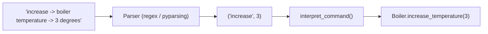

# Interpreter (Chapter 12)

## 1. Clear Definition
**Interpreter** is a behavioral design pattern that provides a simple **Domain-Specific Language (DSL)** so advanced users or domain experts can express rules and commands without writing full general-purpose code. Note that Interpreter assumes the input is already parsed (e.g., via `pyparsing` or an AST) and focuses on **evaluating** those parsed tokens.

> **30-Second Interview Summary:**  
> *"Interpreter evaluates a lightweight Domain-Specific Language (DSL) against domain objects—useful for smart rules, query filters, or automation scripts without exposing `eval()` security risks."*

**Key Participants:**
* **Context / Receiver (`Boiler`):** Domain object whose state is manipulated by DSL commands.
* **Parser (`re` / `pyparsing`):** Converts raw text into structured tokens.
* **Interpreter (`interpret_command`):** Evaluates parsed tokens and invokes domain actions.

---

## 2. Real-Time & Real-World Examples
* **Real-Life Analogy (*Mastering Python Design Patterns*):** **Musical notation**—sheet music is a domain language of pitch and duration, and the musician acts as the interpreter turning symbols into sound.
* **Real-Time Software Example:** **`PyT`** (Python HTML internal DSL), **Chromium Mesa Python bindings**, and **rule engines / search query filters** (e.g., `status:open AND priority:high`).

---

## 3. Mental Model



---

## 4. Python Implementation

```python
import re


class Boiler:
    """Domain receiver representing a smart-home boiler."""

    def __init__(self, temperature: int = 83) -> None:
        self.temperature = temperature

    def increase_temperature(self, amount: int) -> None:
        """Raise boiler temperature by `amount` degrees Celsius."""
        self.temperature += amount

    def decrease_temperature(self, amount: int) -> None:
        """Lower boiler temperature by `amount` degrees Celsius."""
        self.temperature -= amount


_CMD_PATTERN = re.compile(
    r"^(increase|decrease)\s*->\s*boiler temperature\s*->\s*(\d+)\s*degrees?$"
)


def interpret_command(text: str, boiler: Boiler) -> None:
    """
    Parse and interpret a smart-home DSL command safely against `boiler`
    without using `eval()` or exposing arbitrary Python execution.
    """
    match = _CMD_PATTERN.match(text.strip())
    if not match:
        raise ValueError(f"Unknown DSL command: {text!r}")

    action, raw_amount = match.groups()
    amount = int(raw_amount)
    if action == "increase":
        boiler.increase_temperature(amount)
    else:
        boiler.decrease_temperature(amount)


if __name__ == "__main__":
    boiler = Boiler(temperature=83)
    interpret_command("increase -> boiler temperature -> 3 degrees", boiler)
    print(f"Boiler temperature: {boiler.temperature}°C")
```

**Sample Output:**
```text
Boiler temperature: 86°C
```

---

## 5. Use Cases & When to Skip
* **When to Use:**
  * Domain experts need safe, readable rule/automation scripts (smart-home rules, query filters, billing formulas).
* **When to Skip:**
  * For complex nested grammars, use a dedicated parser (`pyparsing`, `lark`) instead of regex; for simple configs, use YAML/JSON.

---

## 6. Don't Confuse With

| Pattern | Key Difference |
| :--- | :--- |
| **[Command](command.md)** | Encapsulates **programmatic** actions with `undo()`; Interpreter evaluates **language/DSL grammar**. |
| **[Strategy](strategy.md)** | Swaps complete algorithms; Interpreter evaluates expressions/rules written in a DSL. |

---

## 7. Rapid Interview Q&As
* **Q: Internal vs. External DSL?**  
  **A:** **Internal DSL** reuses the host language's syntax (e.g., SQLAlchemy queries in Python); **External DSL** has its own standalone syntax (e.g., SQL, regex, smart-home commands).
