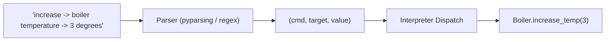

# Interpreter (Chapter 12)

## 1. 30-Second Interview Answer
> **Interpreter** lets advanced users control an application through a simple **Domain-Specific Language (DSL)** instead of writing full general-purpose code. Note that the pattern assumes the input is already parsed (e.g., via `pyparsing` or an AST) and focuses on **evaluating/interpreting** those parsed commands against domain objects.

---

## 2. Real-Life & Software Examples *(Mastering Python Design Patterns)*
- **Real-Life Analogy:** **Musical notation**—sheet music is a domain language of pitch and duration, and the musician acts as the interpreter turning symbols into sound.
- **Python Software Example:** **`PyT`** (Python HTML generation internal DSL) and **Chromium's Mesa Python bindings** (translating C model commands into Python objects).

---

## 3. Mental Model



---

## 4. Python Implementation *(Book Example: Smart-House `Boiler` DSL)*

```python
import re


class Boiler:
    def __init__(self) -> None:
        self.temperature = 83  # Celsius

    def increase_temperature(self, amount: int) -> None:
        self.temperature += amount

    def decrease_temperature(self, amount: int) -> None:
        self.temperature -= amount


def interpret_command(text: str, boiler: Boiler) -> None:
    match = re.fullmatch(
        r"(increase|decrease)\s*->\s*boiler temperature\s*->\s*(\d+)\s*degrees?",
        text.strip(),
    )
    if not match:
        raise ValueError(f"Unknown DSL command: {text}")

    action, raw_amount = match.groups()
    amount = int(raw_amount)
    if action == "increase":
        boiler.increase_temperature(amount)
    else:
        boiler.decrease_temperature(amount)


boiler = Boiler()
interpret_command("increase -> boiler temperature -> 3 degrees", boiler)
assert boiler.temperature == 86
```

---

## 5. Use Cases & When to Skip
- **Use when:** Domain experts or power users need an expressive rule/automation language (smart-home rules, query filters, billing formulas) without full Python/code execution risks (`eval()`).
- **When to Skip:** For complex grammars, use a real parser library (`pyparsing`, `lark`) instead of hand-rolled regexes; never use `eval()` on untrusted user strings.

---

## 6. Rapid Follow-Up Q&As
- **Q: Internal vs. External DSL?**  
  **A:** **Internal DSL** reuses the host language's syntax/runtime (e.g., SQLAlchemy expressions in Python); **External DSL** defines its own standalone grammar/syntax (e.g., SQL, regex, smart-house commands).
