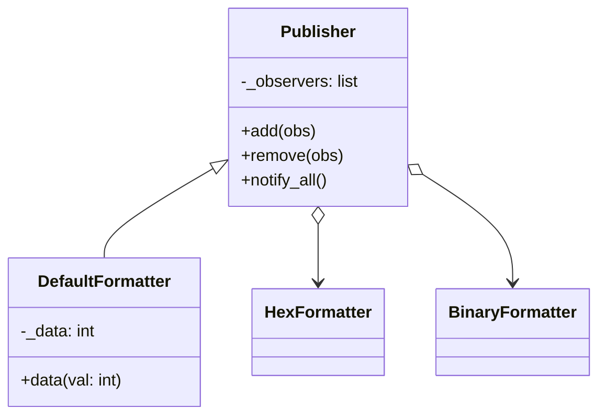

# Observer (Behavioral)

## 1. Clear Definition
**Observer** is a behavioral design pattern that defines a **one-to-many publish-subscribe** dependency between objects: when a `Publisher` (Subject) changes state, all attached `Observer`s are notified automatically without the publisher knowing their concrete classes.

> **30-Second Interview Summary:**  
> *"Observer lets a publisher notify any number of subscribers dynamically at runtime when its state changes—decoupling core state updates from side effects like UI refreshes, logging, or notifications."*

**Key Participants:**
* **Publisher (`Publisher`, `DefaultFormatter`):** Maintains `_observers` and calls `notify_all()` on state changes.
* **Observer (`HexFormatter`, `BinaryFormatter`):** Implements `notify(publisher)` to react to updates.

---

## 2. Real-Time & Real-World Examples
* **Real-Life Analogy (*Mastering Python Design Patterns*):** **An auction**—the auctioneer is the publisher and bidders with numbered paddles are subscribers; also **RSS/Atom feeds**.
* **Real-Time Software Example:** **`django-observer`** / **Django Signals (`post_save`)**, **RabbitMQ** pub/sub consumers, and MVC Views observing a Model.

---

## 3. Mental Model



---

## 4. Python Implementation

```python
from typing import Protocol


class Observer(Protocol):
    """Contract that every subscriber must implement to receive updates."""

    def notify(self, publisher: "DefaultFormatter") -> None:
        """React to a state change in `publisher`."""


class Publisher:
    """Base observable managing dynamic subscriber registration."""

    def __init__(self) -> None:
        self._observers: list[Observer] = []

    def add(self, observer: Observer) -> None:
        """Attach an observer if not already subscribed."""
        if observer not in self._observers:
            self._observers.append(observer)

    def remove(self, observer: Observer) -> None:
        """Detach an observer to avoid lapsed-listener memory leaks."""
        self._observers.remove(observer)

    def notify_all(self) -> None:
        """Broadcast update to a snapshot of current observers."""
        for observer in list(self._observers):
            observer.notify(self)  # type: ignore[arg-type]


class DefaultFormatter(Publisher):
    """Concrete publisher whose `.data` property triggers notifications on change."""

    def __init__(self, name: str) -> None:
        super().__init__()
        self.name = name
        self._data = 0

    @property
    def data(self) -> int:
        return self._data

    @data.setter
    def data(self, new_value: int) -> None:
        self._data = int(new_value)
        self.notify_all()  # Automatically notify all attached formatters


class HexFormatter:
    """Observer that prints the publisher's value in hexadecimal."""

    def notify(self, publisher: DefaultFormatter) -> None:
        print(f"{publisher.name} -> hex: {hex(publisher.data)}")


class BinaryFormatter:
    """Observer that prints the publisher's value in binary."""

    def notify(self, publisher: DefaultFormatter) -> None:
        print(f"{publisher.name} -> bin: {bin(publisher.data)}")


if __name__ == "__main__":
    formatter = DefaultFormatter("metric")
    hex_obs = HexFormatter()
    formatter.add(hex_obs)
    formatter.add(BinaryFormatter())

    formatter.data = 10
    formatter.remove(hex_obs)
    formatter.data = 15
```

**Sample Output:**
```text
metric -> hex: 0xa
metric -> bin: 0b1010
metric -> bin: 0b1111
```

---

## 5. Use Cases & When to Skip
* **When to Use:**
  * Multiple views or downstream modules (audit logs, metrics, caches) must react to state changes dynamically.
* **When to Skip:**
  * If subscribers need **asynchronous, cross-process** delivery, use a message broker (RabbitMQ/Kafka) instead of in-memory Observer.

---

## 6. Don't Confuse With

| Pattern | Key Difference |
| :--- | :--- |
| **[Chain of Responsibility](chain-of-responsibility.md)** | Passes sequentially until one handler stops it; Observer notifies **all** subscribers. |
| **[MVC](../structural/mvc.md)** | Architectural pattern where the **Model** often acts as the Publisher and **Views** act as Observers. |

---

## 7. Rapid Interview Q&As
* **Q: What is the "Lapsed Listener" memory leak, and how do you prevent it in Python?**  
  **A:** If a short-lived subscriber forgets to call `remove()`, the publisher's list keeps a strong reference forever. Prevent it with `weakref.WeakSet` or explicit context-manager cleanup.
