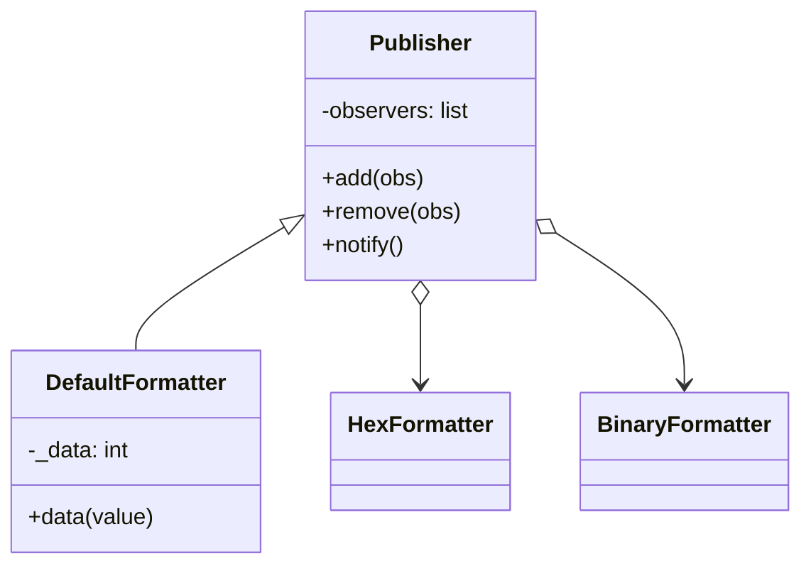

# Observer (Behavioral)

## 1. 30-Second Interview Answer
> **Observer** defines a one-to-many **publish-subscribe** relationship: when a `Publisher` (Subject) changes state, it notifies all attached `Observer`s automatically without knowing their concrete types. Observers can be attached and detached dynamically at runtime.

---

## 2. Real-Life & Software Examples *(Mastering Python Design Patterns)*
- **Real-Life Analogy:** **An auction**—the auctioneer is the publisher and bidders with numbered paddles are subscribers; also **RSS/Atom feeds** notifying readers of new posts.
- **Python Software Example:** **`django-observer`** (runs callbacks when Django model fields change) and **RabbitMQ** Python bindings for async pub/sub.

---

## 3. Mental Model



---

## 4. Python Implementation *(Book Example: `DefaultFormatter` + `HexFormatter` / `BinaryFormatter`)*

```python
from typing import Protocol


class Observer(Protocol):
    def notify(self, publisher: "DefaultFormatter") -> None: ...


class Publisher:
    def __init__(self) -> None:
        self._observers: list[Observer] = []

    def add(self, observer: Observer) -> None:
        if observer not in self._observers:
            self._observers.append(observer)

    def remove(self, observer: Observer) -> None:
        self._observers.remove(observer)

    def notify_all(self) -> None:
        for obs in list(self._observers):
            obs.notify(self)  # type: ignore[arg-type]


class DefaultFormatter(Publisher):
    def __init__(self, name: str) -> None:
        super().__init__()
        self.name = name
        self._data = 0

    @property
    def data(self) -> int:
        return self._data

    @data.setter
    def data(self, new_value: int) -> None:
        self._data = int(new_value)
        self.notify_all()


class HexFormatter:
    def notify(self, publisher: DefaultFormatter) -> None:
        print(f"{publisher.name}: hex={hex(publisher.data)}")


class BinaryFormatter:
    def notify(self, publisher: DefaultFormatter) -> None:
        print(f"{publisher.name}: bin={bin(publisher.data)}")


df = DefaultFormatter("test")
hf = HexFormatter()
df.add(hf)
df.add(BinaryFormatter())
df.data = 10  # Notifies both HexFormatter and BinaryFormatter
```

---

## 5. Use Cases & When to Skip
- **Use when:** Multiple views or downstream services (chart + table in MVC, audit logs, emails) must stay in sync with a state change.
- **Watch out for:** **Lapsed Listener** memory leaks—always `remove()` short-lived observers or store them in `weakref.WeakSet`.

---

## 6. Rapid Follow-Up Q&As
- **Q: How does Observer connect to MVC?**  
  **A:** In [MVC](../structural/mvc.md), the **Model** acts as the Publisher and multiple **Views** act as Observers so all views refresh when the model changes.
