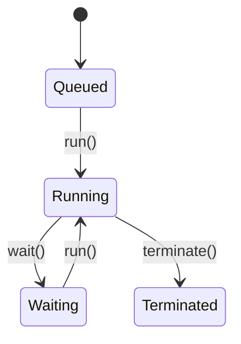

# State (Behavioral)

## 1. Clear Definition
**State** is a behavioral design pattern that models a **Finite-State Machine (FSM)** by encapsulating each state's behavior and allowed transitions into its own class. Instead of repeating `if self.status == ...` across every method, the context delegates calls to its active state object.

> **30-Second Interview Summary:**  
> *"State replaces sprawling `if/elif` status checks with state objects that know which transitions are valid. When an event occurs, the active state handles it and transitions the context to the next state."*

**Key Participants:**
* **Context (`Process`):** Holds the active `state` and delegates lifecycle actions (`run()`, `wait()`, `terminate()`).
* **State (`ProcessState`):** Abstract base class defining default invalid-transition errors.
* **Concrete States (`Queued`, `Running`, `Waiting`, `Terminated`):** Override only the transitions valid from that state.

---

## 2. Real-Time & Real-World Examples
* **Real-Life Analogy (*Mastering Python Design Patterns*):** **Snack vending machine** (reacts differently based on inserted money and stock state), **traffic lights**, and **parking meters**.
* **Real-Time Software Example:** **`django-fsm`** (enforcing valid `Order` / `Invoice` state transitions), **`transitions`**, and **OS process schedulers**.

---

## 3. Mental Model



---

## 4. Python Implementation

```python
from abc import ABC


class ProcessState(ABC):
    """Base state rejecting invalid transitions by default."""

    name: str

    def run(self, proc: "Process") -> None:
        raise ValueError(f"Invalid transition: cannot run from '{self.name}'")

    def wait(self, proc: "Process") -> None:
        raise ValueError(f"Invalid transition: cannot wait from '{self.name}'")

    def terminate(self, proc: "Process") -> None:
        raise ValueError(f"Invalid transition: cannot terminate from '{self.name}'")


class Queued(ProcessState):
    """Initial state: process is waiting in the scheduler queue."""

    name = "queued"

    def run(self, proc: "Process") -> None:
        proc.transition_to(Running())


class Running(ProcessState):
    """Active state: process can pause (`wait`) or finish (`terminate`)."""

    name = "running"

    def wait(self, proc: "Process") -> None:
        proc.transition_to(Waiting())

    def terminate(self, proc: "Process") -> None:
        proc.transition_to(Terminated())


class Waiting(ProcessState):
    """Blocked state: process can resume (`run`) once I/O completes."""

    name = "waiting"

    def run(self, proc: "Process") -> None:
        proc.transition_to(Running())


class Terminated(ProcessState):
    """Terminal state: no further transitions are allowed."""

    name = "terminated"


class Process:
    """Context delegating lifecycle events to its current ProcessState."""

    def __init__(self, name: str) -> None:
        self.name = name
        self.state: ProcessState = Queued()

    def transition_to(self, new_state: ProcessState) -> None:
        """Update active state and log the transition."""
        print(f"[{self.name}] {self.state.name} -> {new_state.name}")
        self.state = new_state

    def run(self) -> None:
        self.state.run(self)

    def wait(self) -> None:
        self.state.wait(self)

    def terminate(self) -> None:
        self.state.terminate(self)


if __name__ == "__main__":
    proc = Process("worker-1")
    proc.run()
    proc.wait()
    proc.run()
    proc.terminate()
```

**Sample Output:**
```text
[worker-1] queued -> running
[worker-1] running -> waiting
[worker-1] waiting -> running
[worker-1] running -> terminated
```

---

## 5. Use Cases & When to Skip
* **When to Use:**
  * Entities with 3+ lifecycle states and strict transition rules (orders, payments, OS processes, network connections).
* **When to Skip:**
  * For 2 states (`active`/`inactive`), use a simple boolean or `Enum`.

---

## 6. Don't Confuse With

| Pattern | Key Difference |
| :--- | :--- |
| **[Strategy](strategy.md)** | Algorithms are **independent** and chosen by the caller; State objects **know sibling states** and trigger transitions. |
| **[Command](command.md)** | Encapsulates an action/request; State encapsulates the current lifecycle mode of an object. |

---

## 7. Rapid Interview Q&As
* **Q: What is the main advantage of State over `if/elif status == ...`?**  
  **A:** Adding a new state only requires adding one new class (Open/Closed Principle) instead of hunting down and editing `if/elif` blocks across every method.
