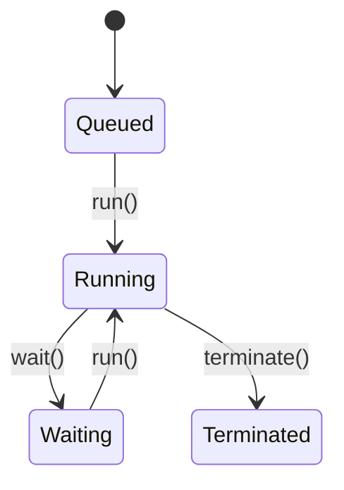

# State (Behavioral)

## 1. 30-Second Interview Answer
> **State** models a **Finite-State Machine (FSM)** in object-oriented code: each state is encapsulated with its allowed transitions and entry/exit hooks. Instead of sprawling `if/elif status == ...` checks across every method, the context delegates behavior to its active state object.

---

## 2. Real-Life & Software Examples *(Mastering Python Design Patterns)*
- **Real-Life Analogy:** **Snack vending machine** (rejects selection when out of stock or underpaid, dispenses item + change when paid) and **traffic lights / parking meters**.
- **Python Software Example:** **`django-fsm`** (declarative FSM transitions on Django models) and **`state_machine`** / **`transitions`** Python packages.

---

## 3. Mental Model



---

## 4. Python Implementation *(Book Example: OS `Process` State Machine)*

```python
from abc import ABC, abstractmethod


class ProcessState(ABC):
    name: str

    def run(self, proc: "Process") -> None:
        raise ValueError(f"Cannot run from state {self.name}")

    def wait(self, proc: "Process") -> None:
        raise ValueError(f"Cannot wait from state {self.name}")

    def terminate(self, proc: "Process") -> None:
        raise ValueError(f"Cannot terminate from state {self.name}")


class Queued(ProcessState):
    name = "queued"

    def run(self, proc: "Process") -> None:
        proc.transition_to(Running())


class Running(ProcessState):
    name = "running"

    def wait(self, proc: "Process") -> None:
        proc.transition_to(Waiting())

    def terminate(self, proc: "Process") -> None:
        proc.transition_to(Terminated())


class Waiting(ProcessState):
    name = "waiting"

    def run(self, proc: "Process") -> None:
        proc.transition_to(Running())


class Terminated(ProcessState):
    name = "terminated"


class Process:
    def __init__(self, name: str) -> None:
        self.name = name
        self.state: ProcessState = Queued()

    def transition_to(self, new_state: ProcessState) -> None:
        print(f"[{self.name}] {self.state.name} -> {new_state.name}")
        self.state = new_state

    def run(self) -> None:
        self.state.run(self)

    def wait(self) -> None:
        self.state.wait(self)

    def terminate(self) -> None:
        self.state.terminate(self)


p = Process("worker-1")
p.run()
p.wait()
p.run()
p.terminate()
assert p.state.name == "terminated"
```

---

## 5. Use Cases & When to Skip
- **Use when:** Modeling entities with strict lifecycle states and invalid-transition guards (OS processes, order/payment workflows, network protocols).
- **When to Skip:** For 2 simple states (e.g., `active`/`inactive`), a boolean or `Enum` is enough; don't over-engineer a class hierarchy.

---

## 6. Rapid Follow-Up Q&As
- **Q: State vs. Strategy?**  
  **A:** [Strategy](strategy.md) swaps independent algorithms chosen by the client; **State** models an FSM where states know their allowed transitions to sibling states.
