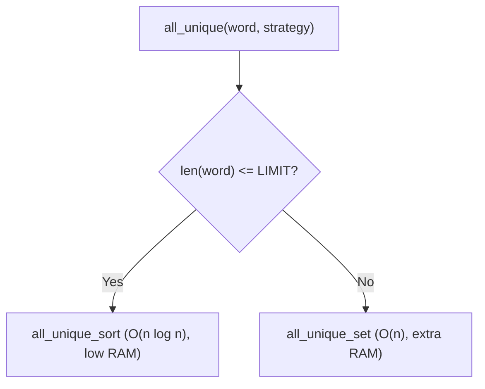

# Strategy (Behavioral)

## 1. 30-Second Interview Answer
> **Strategy** encapsulates multiple algorithms for the same task behind a common contract so the caller can **pick and swap the best algorithm at runtime** (e.g., based on input size or time/space trade-offs). Because Python has **first-class functions**, Strategy rarely needs extra boilerplate classes—you can pass functions directly.

---

## 2. Real-Life & Software Examples *(Mastering Python Design Patterns)*
- **Real-Life Analogy:** **Getting to the airport**—take the bus/train (cheap if early), drive your car (convenient), or take a taxi (fast when in a hurry), trading off cost, time, and convenience.
- **Python Software Example:** **`sorted(items, key=...)`** and `list.sort(key=...)`—Python lets callers pass any key-extraction strategy function.

---

## 3. Mental Model



---

## 4. Python Implementation *(Book Example: `allUnique` with First-Class Functions)*

```python
from typing import Callable

LIMIT = 5


def pairs(seq: str) -> zip:
    return zip(seq, seq[1:])


def all_unique_sort(s: str) -> bool:
    """Slow on huge inputs (O(n log n)), minimal extra memory."""
    if len(s) > LIMIT:
        print(f"Warning: '{s}' exceeds {LIMIT} chars; sort strategy is slower")
    sorted_chars = sorted(s)
    return all(c1 != c2 for c1, c2 in pairs("".join(sorted_chars)))


def all_unique_set(s: str) -> bool:
    """Fast (O(n)), uses extra set memory."""
    return len(set(s)) == len(s)


def all_unique(s: str, strategy: Callable[[str], bool]) -> bool:
    return strategy(s)


assert all_unique("python", all_unique_set) is True
assert all_unique("hello", all_unique_sort) is False
```

---

## 5. Use Cases & When to Skip (Pythonic Alternatives)
- **Use when:** No single algorithm is optimal for all inputs (sorting, compression, encryption, pricing, routing) and you want to switch strategies cleanly at runtime.
- **Pythonic Idiom:** Always prefer **first-class functions** (`Callable`) over single-method Strategy classes unless strategies need to hold internal state.

---

## 6. Rapid Follow-Up Q&As
- **Q: Why does Python make Strategy so lightweight?**  
  **A:** Functions are first-class objects in Python, so passing `all_unique_set` or `lambda x: ...` directly replaces GoF's `Strategy` interface + concrete wrapper classes.
- **Q: Strategy vs. Template Method?**  
  **A:** **Strategy** swaps the *entire* algorithm via composition/callables; [Template](template.md) keeps a fixed algorithm skeleton and overrides *individual steps*.
