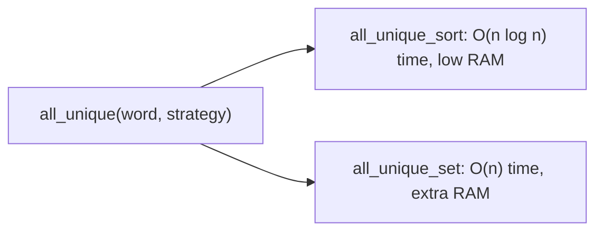

# Strategy (Behavioral)

## 1. Clear Definition
**Strategy** is a behavioral design pattern that defines a family of **interchangeable algorithms** for the same task and lets the caller **swap them transparently at runtime** based on input size, cost, or performance trade-offs.

> **30-Second Interview Summary:**  
> *"Strategy lets you swap algorithms at runtime without `if/elif` branches. Because Python functions are first-class objects, you don't need GoF wrapper classes for stateless strategies—just pass a function (`Callable`) directly, like `sorted(items, key=...)`."*

**Key Participants:**
* **Context (`all_unique`):** Accepts a strategy callable and delegates execution to it.
* **Concrete Strategies (`all_unique_sort`, `all_unique_set`):** Independent algorithms with different time/space trade-offs.

---

## 2. Real-Time & Real-World Examples
* **Real-Life Analogy (*Mastering Python Design Patterns*):** **Getting to the airport**—take the bus/train (cheap if early), drive your car (convenient), or take a taxi (fast when in a hurry).
* **Real-Time Software Example:** **`sorted(data, key=...)`** in Python's stdlib, and **payment/compression/pricing strategies** swapped by config or request type.

---

## 3. Mental Model



---

## 4. Python Implementation

```python
from typing import Callable

LIMIT = 5


def _pairs(seq: str) -> zip[tuple[str, str]]:
    """Yield adjacent character pairs from a string."""
    return zip(seq, seq[1:])


def all_unique_sort(s: str) -> bool:
    """
    Strategy 1: Sort characters first, then check adjacent pairs.
    O(n log n) time, minimal extra memory—best for tiny strings.
    """
    if len(s) > LIMIT:
        print(f"[WARN] '{s}' exceeds {LIMIT} chars; sort strategy is slower")
    sorted_chars = "".join(sorted(s))
    return all(c1 != c2 for c1, c2 in _pairs(sorted_chars))


def all_unique_set(s: str) -> bool:
    """
    Strategy 2: Compare set length against string length.
    O(n) time, O(n) extra memory—best for larger inputs.
    """
    return len(set(s)) == len(s)


def all_unique(s: str, strategy: Callable[[str], bool]) -> bool:
    """Context function executing the caller-selected uniqueness strategy."""
    return strategy(s)


if __name__ == "__main__":
    print("python (set):", all_unique("python", all_unique_set))
    print("hello (sort):", all_unique("hello", all_unique_sort))
    print("algorithm (sort):", all_unique("algorithm", all_unique_sort))
```

**Sample Output:**
```text
python (set): True
hello (sort): False
[WARN] 'algorithm' exceeds 5 chars; sort strategy is slower
algorithm (sort): True
```

---

## 5. Use Cases & When to Skip
* **When to Use:**
  * Multiple algorithms solve the same problem with different time/space/cost trade-offs (sorting, pricing, encryption, compression).
* **When to Skip:**
  * Always prefer **first-class functions** (`Callable`) over single-method Strategy classes unless strategies hold configuration/state.

---

## 6. Don't Confuse With

| Pattern | Key Difference |
| :--- | :--- |
| **[State](state.md)** | Models an FSM where states transition each other; Strategy algorithms are **independent**. |
| **[Template](template.md)** | Keeps one shared skeleton and varies *steps*; Strategy swaps the **entire** algorithm. |

---

## 7. Rapid Interview Q&As
* **Q: Why does Python make Strategy much simpler than Java/C++?**  
  **A:** Functions are first-class objects in Python, so passing a function directly replaces the GoF Strategy interface and single-method wrapper classes.
