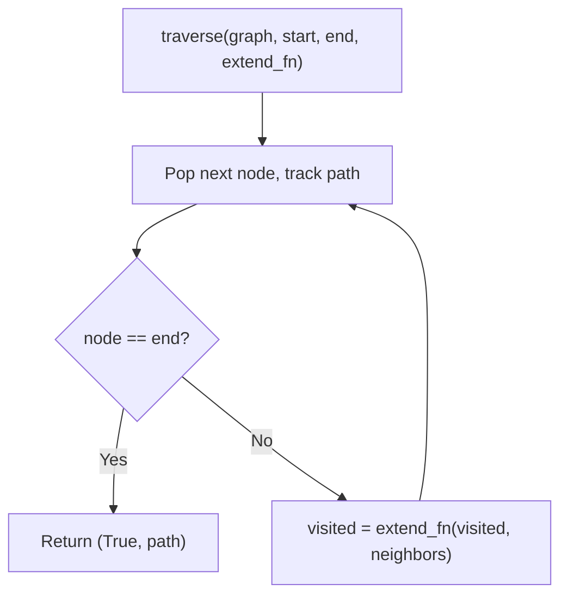

# Template Method (Behavioral)

## 1. 30-Second Interview Answer
> **Template** eliminates code duplication across algorithms that share the same overall structure but differ in specific steps. Instead of copying 90% of the code, you extract the shared skeleton into a **template function/method** and pass **hook functions** (or override subclass hooks) for the differing steps—just like unifying **BFS** and **DFS** graph traversal.

---

## 2. Real-Life & Software Examples *(Mastering Python Design Patterns)*
- **Real-Life Analogy:** **A worker's daily routine** (wake up → commute → work → commute → sleep)—the skeleton is identical, while the *work* step varies by profession.
- **Python Software Example:** **`cmd.Cmd`** (CLI interpreter skeleton), **`socketserver`** request handlers, and **`unittest.TestCase`** (`setUp`/`tearDown` hooks).

---

## 3. Mental Model



---

## 4. Python Implementation *(Book Example: Unified BFS & DFS Graph Traversal)*

In the book, Sakis Kasampalis shows that BFS and DFS are identical except for how `visited` is extended (`visited + neighbors` vs. `neighbors + visited`):

```python
from typing import Callable

Graph = dict[str, list[str]]
ExtendAction = Callable[[list[str], list[str]], list[str]]


def extend_bfs_path(visited: list[str], neighbors: list[str]) -> list[str]:
    return visited + neighbors  # Queue (FIFO) -> Breadth-First


def extend_dfs_path(visited: list[str], neighbors: list[str]) -> list[str]:
    return neighbors + visited  # Stack (LIFO) -> Depth-First


def traverse(
    graph: Graph, start: str, end: str, action: ExtendAction
) -> tuple[bool, list[str]]:
    path: list[str] = []
    visited = [start]
    while visited:
        current = visited.pop(0)
        if current not in path:
            path.append(current)
            if current == end:
                return True, path
            if current not in graph:
                continue
            visited = action(visited, graph[current])
    return False, path


cities: Graph = {
    "Frankfurt": ["Mannheim", "Wurzburg", "Kassel"],
    "Mannheim": ["Karlsruhe"],
    "Karlsruhe": ["Augsburg"],
    "Augsburg": ["Munchen"],
    "Wurzburg": ["Erfurt", "Nurnberg"],
}

found_bfs, bfs_path = traverse(cities, "Frankfurt", "Nurnberg", extend_bfs_path)
found_dfs, dfs_path = traverse(cities, "Frankfurt", "Nurnberg", extend_dfs_path)
assert found_bfs and found_dfs
```

---

## 5. Use Cases & When to Skip
- **Use when:** Multiple algorithms share structural similarity (graph search, ETL pipelines, banner/report formatters) and you want to eliminate duplicated control flow.
- **Pythonic Tip:** Passing a hook function (`action: ExtendAction`) avoids creating unnecessary abstract base classes when only 1–2 steps differ.

---

## 6. Rapid Follow-Up Q&As
- **Q: Template vs. Strategy?**  
  **A:** **Template** keeps one shared algorithm skeleton and varies *only specific steps* via hooks/subclasses. [Strategy](strategy.md) swaps the *entire* algorithm.
- **Q: Why does Alex Martelli say *"Design patterns are discovered, not invented"*?**  
  **A:** Patterns emerge naturally from refactoring duplication and coupling—don't force a pattern before the problem exists.
